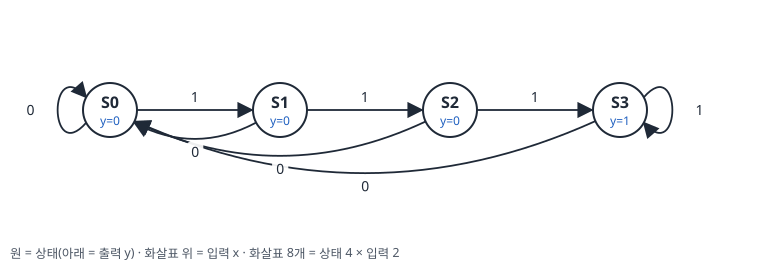
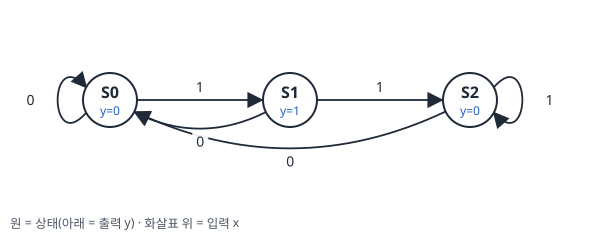
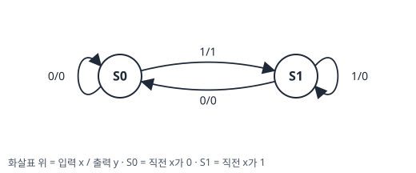
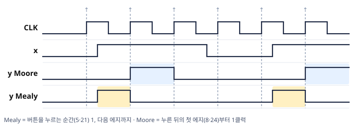
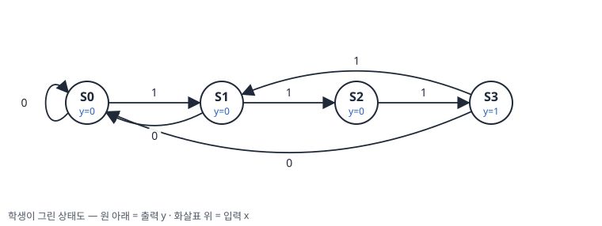
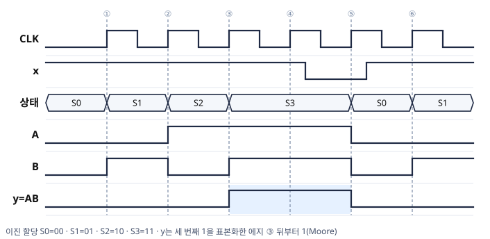
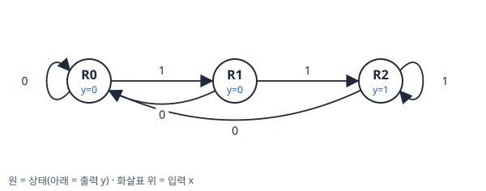
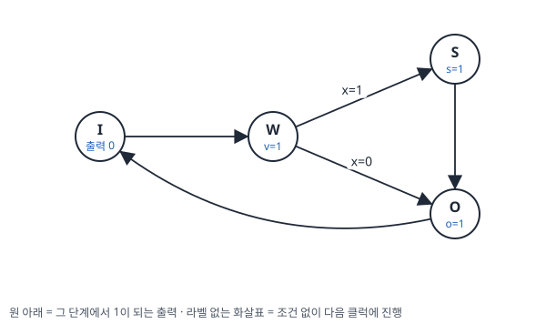
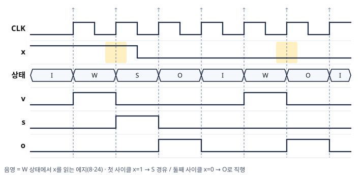

# 디지털공학 5장 보조학습자료 (2/2)
### FSM · Mealy와 Moore 판정 · 시퀀스 추적과 타이밍 차트 · 순차회로 설계 절차 · 상태 축소와 할당 · 설계 예제 · 연습문제 해설

> 이 자료는 교재의 핵심 개념과 풀이 과정을 본문 서술로 정리한 복습용 보조자료입니다.  
> Mano, *Digital Design* 5장과 함께 활용하세요.

---

## 목차

- [5. 유한상태머신 (FSM)](#5-유한상태머신-fsm)
- [6. 순차회로 설계 절차](#6-순차회로-설계-절차)
- [7. 설계 예제](#7-설계-예제)
- [8. 연습문제 해설](#8-연습문제-해설)

---

## 5. 유한상태머신 (FSM)

### 학습목표

- Moore Machine과 Mealy Machine의 구조적 차이를 설명할 수 있다.
- 출력식으로 Mealy와 Moore를 판정하고, 출력이 바뀌는 시점을 설명할 수 있다.
- 글리치(Glitch)가 발생하는 원인과 해결 방법을 이해한다.
- 입력 시퀀스에 대한 상태와 출력의 변화를 표와 타이밍 차트로 추적할 수 있다.


> 🎞️ **Mealy와 Moore** — 두 모델의 차이를 약 58초 동안 재생하고 처음부터 반복합니다.

---

### 5.1 FSM이란?

**유한상태머신(Finite State Machine, FSM)** 은 순차논리 회로의 동작을  
**유한한 수의 상태(State)** 로 모델링하는 추상적 표현 방식입니다.

- 회로의 동작 = 현재 상태에서 입력을 받아 다음 상태로 전이(Transition)
- 이 전이 규칙과 출력 규칙의 집합이 FSM을 정의합니다.

FSM의 구성 요소:

| 요소 | 내용 |
|---|---|
| **상태 집합 $S$** | 가능한 모든 내부 상태 |
| **입력 집합 $I$** | 외부 입력 신호 |
| **출력 집합 $O$** | 외부 출력 신호 |
| **전이 함수** | 현재 상태 + 입력 → 다음 상태 |
| **출력 함수** | 상태(또는 상태+입력) → 출력 |

---

### 5.2 Moore Machine

**Moore Machine**은 **출력이 현재 상태에만 의존**하는 FSM입니다.

$$\text{출력} = G(\text{현재 상태})$$

- 출력이 플립플롭 출력에만 의존하므로 **클럭과 동기화**됩니다.
- 입력 신호가 변해도 출력은 다음 클럭 에지까지 바뀌지 않습니다.
- **안정적이고 설계가 단순**하다는 장점이 있습니다.

**상태천이도 표기:**

```
        x=0
  ┌──────────────┐
  │              ▼
[S0 / y=0] ──x=1──▶ [S1 / y=1]
  ▲                       │
  └────────x=0─────────────┘
```

> 💡 Moore Machine에서 출력 $y$는 **원 안(상태 안)** 에 표기합니다.  
> 입력에 따른 전이 화살표에는 입력만 표기합니다.

---

### 5.3 Mealy Machine

**Mealy Machine**은 **출력이 현재 상태와 현재 입력의 조합**으로 결정되는 FSM입니다.

$$\text{출력} = G(\text{현재 상태},\; \text{현재 입력})$$

- 입력이 변하면 **클럭과 무관하게** 출력도 즉시 변할 수 있습니다.
- 일반적으로 Moore Machine보다 **상태 수가 적어** 회로가 간단해질 수 있습니다.
- 단, 비동기 입력이 사용될 경우 **글리치(Glitch)** 문제가 발생할 수 있습니다.

**상태천이도 표기:**

```
        x=0 / y=0
  ┌──────────────────┐
  │                  ▼
[S0] ──── x=1 / y=1 ────▶ [S1]
  ▲                            │
  └────────x=0 / y=0───────────┘
```

> 💡 Mealy Machine에서 출력 $y$는 **화살표 위(입력/출력)** 에 함께 표기합니다.

---

### 5.4 Moore vs Mealy 비교

| 항목 | Moore Machine | Mealy Machine |
|---|---|---|
| 출력 결정 요소 | 현재 상태만 | 현재 상태 + 현재 입력 |
| 출력 시점 | 클럭 동기 (안정적) | 입력 변화 시 즉시 (비동기 가능) |
| 상태 수 | 상대적으로 많음 | 상대적으로 적음 |
| 글리치 위험 | 낮음 | 높음 (비동기 입력 시) |
| 상태도 출력 위치 | 상태 원 안 | 전이 화살표 위 |

> 📖 **그림은 교재 참고** — Mano 6판 Fig 5.21 (Block diagrams of Mealy and Moore state machines): Mealy 블록도에는 입력이 출력 논리에 직접 연결되는 선이 하나 더 있습니다. 두 모델의 구조적 차이는 이 연결 하나입니다.

- 1/2 자료 4.4절 회로의 출력식은 $y = (A+B)x'$입니다. 출력식에 입력 $x$가 있으므로 **Mealy**입니다.
- 판정 기준은 **정리한 출력식에 입력 변수가 남는가**입니다(5.6절의 예제 5-4).

---

### 5.5 글리치(Glitch)와 해결 방법

**글리치**란 하드웨어에 의해 발생하는 **시스템의 일시적 오류 신호**입니다.

**Mealy Machine에서 글리치가 발생하는 원인:**

- 비동기 입력 신호가 변할 때, 클럭 사이클 중간에 출력이 순간적으로 바뀜
- 이 의도하지 않은 짧은 출력 변화가 글리치

**해결 방법:**

$$\text{클럭의 활성화 에지 직전의 비동기 입력 값을 샘플링하여 사용}$$

즉, 비동기 입력을 그대로 사용하지 않고, 클럭 에지 직전에 **레지스터로 샘플링(동기화)** 해서 사용합니다.

> ⚠️ **자주 하는 실수** — Mealy 회로의 출력을 「클럭 에지에서만 바뀐다」고 가정하고 파형을 그리는 실수입니다.
>
> 에지에서만 바뀌는 것은 **상태**(플립플롭)입니다. Mealy 출력은 입력이 변하는 순간 함께 변합니다. 출력을 안정적으로 사용하려면 클럭 에지 시점의 값을 읽습니다.

**확인 — 같은 입력에서 Moore 출력과 Mealy 출력**


- $z$는 상태 $Q$만 사용하므로 상승 에지에서만 바뀝니다.
- $y$는 입력 $x$를 직접 사용하므로 $x$가 바뀌는 순간 함께 바뀝니다. 빨간 음영의 짧은 펄스는 어느 에지와도 겹치지 않아, 에지 시점의 값을 사용하는 다음 회로에는 전달되지 않습니다.
- 따라서 Mealy 출력은 에지 시점의 값으로 읽습니다.

> 📖 **그림은 교재 참고** — Mano 6판 Fig 5.22 (Simulation output of Mealy_Zero_Detector): 「valid Mealy output」은 클럭 에지 시점의 값이고, 「Mealy glitch」는 에지 사이의 입력 변화가 만든 짧은 펄스입니다.

---

### 5.6 Mealy와 Moore 판정 — 예제

#### 예제 5-1 — 출력식으로 판정

어떤 회로의 출력식이 $y = A'B + x(A \oplus B)$이다. ⓐ Mealy/Moore를 판정하라. ⓑ 출력식을 $y = A'B$로 바꾸면 판정과 출력 변화 시점이 어떻게 달라지는가?

<details>
<summary>풀이 보기</summary>


**ⓐ** 출력식에 입력 $x$가 있으므로 **Mealy**입니다. $x$가 에지 사이에서 변하면 $y$도 즉시 변합니다(글리치 가능).

**ⓑ** $y = A'B$는 상태만의 함수이므로 **Moore**입니다. 상태가 클럭 에지에서만 바뀌므로 $y$도 에지 직후에만 바뀝니다.

**검산**: 판별 기준은 출력식에 입력 변수가 있는가입니다. 식의 길이 · 항 수 · XOR 유무는 판정과 무관합니다(식을 정리한 뒤에 판단합니다 — 예제 5-4).

</details>

#### 예제 5-2 — 상태도로 판정

아래 두 상태도 (a) · (b)가 각각 Moore 모델인지 Mealy 모델인지 판정하고, 근거와 출력이 바뀌는 시점을 쓰라.


<details>
<summary>풀이 보기</summary>


| | 출력 표기 위치 | 판정 | 출력이 바뀌는 시점 |
|---|---|---|---|
| (a) | 원 안(상태마다 $y$ 하나) | **Moore** | 상태가 바뀌는 에지 직후 |
| (b) | 화살표 위(입력/출력) | **Mealy** | 입력이 바뀌는 즉시(에지 사이 포함) |

- (b)의 상태 $S0$에서는 $x = 0$이면 $y = 0$, $x = 1$이면 $y = 1$입니다. 같은 상태에서 입력에 따라 출력이 다르므로 출력은 상태만의 함수가 아닙니다.
- 동작: (a)는 직전 에지의 $x$를 한 클럭 동안 내보냅니다(한 클럭 지연된 $x$). (b)는 상태 $S0$(직전 에지의 $x = 0$)에서 $x$가 1인 동안만 $y = 1$이므로, **$x$가 0에서 1로 바뀐 것을 알리는 회로**입니다.

**검산**: (a)의 상태 $S1$을 향하는 화살표는 모두 $x = 1$이고, 원 안 출력은 $y = 1$입니다. 출력이 상태와 함께 정해집니다.

</details>

#### 예제 5-3 — 상태표 · 상태도 · 판정 (심화)

D 플립플롭 $A$·$B$, 입력 $x$, 출력 $y$인 회로에서 다음을 읽었다: $D_A = B$, $D_B = A'x$, $y = AB'$. ⓐ 상태표(8행) ⓑ 상태도 ⓒ Mealy/Moore 판정을 수행하라.

<details>
<summary>풀이 보기</summary>


**ⓐ** 입력 열 $D_A = B$, $D_B = A'x$를 계산하면, D 특성표에 따라 그 값이 다음 상태가 됩니다.

| 현재 $AB$ | $x$ | $D_A D_B$ = 다음 $AB$ | $y$ |
|:---:|:---:|:---:|:---:|
| 00 | 0 | 00 | 0 |
| 00 | 1 | 01 | 0 |
| 01 | 0 | 10 | 0 |
| 01 | 1 | 11 | 0 |
| 10 | 0 | 00 | 1 |
| 10 | 1 | 00 | 1 |
| 11 | 0 | 10 | 0 |
| 11 | 1 | 10 | 0 |

**ⓑ** $x = 1$이 지속되면 $00 \to 01 \to 11 \to 10 \to 00$을 순환합니다. $10$은 입력과 무관하게 $00$으로, $11$은 $10$으로 이동합니다.

**ⓒ** $y = AB'$는 출력식에 입력 $x$가 없으므로 **Moore**입니다. $y$는 상태 $10$에서만 1이며, 표에서 $x$의 두 행이 같은 이유입니다.

**검산**: 행 $01$, $x = 0$: $D_A = B = 1$, $D_B = A'x = 1 \cdot 0 = 0$ → 다음 $10$

</details>

#### 예제 5-4 — 정리하기 전의 출력식 (심화)

어떤 회로의 출력식을 $y = Ax + Ax'$로 읽었다. 한 학생이 「식에 $x$가 있으므로 Mealy」라고 판정했다. 판정을 검토하라.

<details>
<summary>풀이 보기</summary>


출력식을 정리합니다(분배 법칙 · 보수 법칙).

$$y = Ax + Ax' = A(x + x') = A$$

- 정리한 식에는 $x$가 없으므로 출력은 상태 $A$만의 함수이고 **Moore**입니다. 학생 판정은 틀렸습니다.
- 판정 기준은 「정리한(최소화한) 출력식에 입력 변수가 남는가」입니다.
- 출력 변화 시점도 Moore와 같습니다. $x$가 에지 사이에서 바뀌어도 $Ax + Ax'$의 논리값은 $A$와 같습니다.

**검산**: $A = 1$일 때 $x = 0$이면 $y = 0 + 1 = 1$, $x = 1$이면 $y = 1 + 0 = 1$로 $x$와 무관하게 $y = A$입니다.

</details>

---

### 5.7 시퀀스 추적과 타이밍 차트

입력이 에지마다 차례로 주어지면, 상태표에서 해당 행을 순서대로 찾아 상태와 출력의 시간 전개를 추적합니다. 아래 예제는 1/2 자료 4.4절의 회로($D_A = Ax + Bx$, $D_B = A'x$, $y = (A+B)x'$)를 사용합니다.

#### 예제 5-5 — 상태와 출력 추적

4.4절 회로(초기 상태 $00$)에 입력 $x = 1, 1, 0, 1, 0$이 클럭 에지마다 순서대로 들어올 때, 상태와 출력을 추적하라.

<details>
<summary>풀이 보기</summary>


| 에지 | 현재 $AB$ | $x$ | $y$ | 다음 $AB$ |
|:---:|:---:|:---:|:---:|:---:|
| ① | 00 | 1 | 0 | 01 |
| ② | 01 | 1 | 0 | 11 |
| ③ | 11 | 0 | 1 | 00 |
| ④ | 00 | 1 | 0 | 01 |
| ⑤ | 01 | 0 | 1 | 00 |

출력 시퀀스는 $0, 0, 1, 0, 1$입니다. 1의 연속이 끊기는 순간마다 **$y$가 1**이며, 4.4절에서 상태도로 읽은 의미가 시퀀스로 확인됩니다.

</details>

#### 예제 5-6 — T 플립플롭 카운터 추적

1/2 자료 예제 4-5의 회로($T_A = Bx$, $T_B = x$, 초기 상태 $00$)에 $x = 1, 1, 1, 1$을 가할 때 상태를 추적하라.

<details>
<summary>풀이 보기</summary>


| 에지 | 현재 $AB$ | $T_A = Bx$ | $T_B = x$ | 다음 $AB$ |
|:---:|:---:|:---:|:---:|:---:|
| ① | 00 | 0 | 1 | 01 |
| ② | 01 | 1 | 1 | 10 |
| ③ | 10 | 0 | 1 | 11 |
| ④ | 11 | 1 | 1 | 00 |

상태 시퀀스는 $00 \to 01 \to 10 \to 11 \to 00$, 2진수로 $0, 1, 2, 3, 0$입니다. 「$x$가 1인 동안만 세는 2비트 카운터」라는 해석이 시퀀스로 확인됩니다.

**검산** — ②: $T_A = 1$ → $A$ 토글($0 \to 1$), $T_B = 1$ → $B$ 토글($1 \to 0$) → $10$

</details>

**타이밍 차트 작도 규칙** — 시퀀스 표를 시간 축 위의 파형으로 옮기면 상태 변화(에지 동기)와 Mealy 출력(비동기)의 차이가 그림으로 드러납니다.

1. 상태 신호($A$, $B$)는 상승 에지에서만 바뀝니다. 변화점을 에지 위치에 맞춥니다.
2. 입력 $x$는 에지 직후에 바뀐다고 가정합니다(다음 에지 전에 안정 — 셋업 조건).
3. Mealy 출력 $y$는 상태 · 입력이 바뀌는 즉시 다시 계산합니다. 에지 사이에서도 변합니다.

#### 예제 5-7 — 타이밍 차트 작도 (심화)

예제 5-5의 시퀀스(초기 $00$, $x = 1, 1, 0, 1, 0$)를 CLK · $x$ · $A$ · $B$ · $y$ 파형으로 그려라.

<details>
<summary>풀이 보기</summary>


먼저 에지 사이 구간별 값을 표로 정리합니다(각 열 = 그 에지 직후부터 다음 에지 직전까지).

| 구간 | ① 전 | ① 후 | ② 후 | ③ 후 | ④ 후 | ⑤ 후 |
|:---:|:---:|:---:|:---:|:---:|:---:|:---:|
| $AB$ | 00 | 01 | 11 | 00 | 01 | 00 |
| $x$ (다음 에지용) | 1 | 1 | 0 | 1 | 0 | 0 |
| $y = (A+B)x'$ | 0 | 0 | 1 | 0 | 1 | 0 |


$y$ 펄스는 에지 ② · ③ 사이와 ④ · ⑤ 사이, 즉 에지 직전 구간에 나타납니다. 예제 5-5 표의 「에지 ③에서 $y = 1$」은 그 에지 시점에 읽는 값이며, 파형에서는 $x$가 0으로 바뀐 순간부터 1입니다.

**검산**: $A$ · $B$의 변화점은 모두 상승 에지와 일치합니다(동기). $y$의 변화점 4개 가운데 2개는 에지가 아니라 $x$의 하강과 일치합니다(Mealy).

</details>

#### 예제 5-8 — 상태 파형에서 입력 복원 (심화)

4.4절 회로(초기 상태 $00$)의 상태 $A$ · $B$가 아래 파형과 같이 변했다. 에지 ①\~⑥ 직전의 입력 $x$를 복원하고, $y = 1$이 되는 구간을 쓰라.


<details>
<summary>풀이 보기</summary>


1/2 자료 예제 4-2의 상태표를 근거로 에지마다 다음 상태에서 $x$를 판정합니다.

- $x = 0$이면 다음 상태는 항상 $00$입니다. $x = 1$이면 다음 상태가 $00$이 되지 않습니다($x = 1$이면 $D_A = A + B$와 $D_B = A'$가 동시에 0이 될 수 없음).
- 따라서 다음 상태가 $00$이면 $x = 0$, 그렇지 않으면 $x = 1$입니다.

| 에지 | ① | ② | ③ | ④ | ⑤ | ⑥ |
|:---:|:---:|:---:|:---:|:---:|:---:|:---:|
| 다음 $AB$ | 01 | 00 | 01 | 11 | 10 | 00 |
| 복원한 $x$ | 1 | 0 | 1 | 1 | 1 | 0 |


- $y = 1$은 $x$가 0이고 상태가 $00$이 아닌 구간으로, 에지 ① · ② 사이와 ⑤ · ⑥ 사이입니다. 두 구간 모두 1의 연속이 0으로 끊기는 순간입니다.

**검산**: 에지 ④ — 현재 $01$, $x = 1$ → $D_A = 1 \cdot (0 + 1) = 1$, $D_B = 1 \cdot 1 = 1$ → 다음 $11$로 파형의 ④ 뒤 $A = B = 1$과 같습니다.

</details>

---

### 5.8 복습문제

#### 문제 (1)

다음 중 Moore Machine의 특성에 해당하는 것을 모두 고르라.

1. 출력이 현재 상태와 입력의 조합으로 결정된다.
2. 출력이 클럭과 동기화된다.
3. 상태 수가 Mealy Machine보다 항상 적다.
4. 상태천이도에서 출력이 상태 원 안에 표기된다.

<details>
<summary>정답 보기</summary>


**정답: 2, 4**

- 1번: Mealy Machine의 특성 → 오답
- 2번: Moore는 상태에만 의존하므로 클럭 동기화 → 정답
- 3번: 일반적으로 Moore가 상태 수가 더 많음 → 오답
- 4번: Moore는 출력을 상태 안에 표기 → 정답

</details>

---

#### 문제 (2)

세 회로의 출력식이 각각 다음과 같다. Mealy/Moore를 분류하고, 클럭 에지 사이에서 출력이 변할 수 있는 것을 고르라.

(a) $y = AB$ (b) $y = (A+B)x'$ (c) $y = A \oplus B$

<details>
<summary>정답 및 풀이 보기</summary>


| 회로 | 출력식에 입력 포함? | 분류 |
|:---:|:---:|:---:|
| (a) | 없음 (상태만) | Moore |
| (b) | $x'$ 포함 | Mealy |
| (c) | 없음 (상태만) | Moore |

에지 사이에서 출력이 변할 수 있는 것은 (b)입니다. (a) · (c)는 상태가 에지에서만 바뀌므로 출력도 에지 직후에만 바뀝니다.

</details>

---

#### 문제 (3)

1/2 자료 4.4절 회로(초기 상태 $00$)에 $x = 0, 1, 1, 1, 0$을 가할 때 상태 · 출력 시퀀스를 추적하라. $y = 1$이 나타나는 시점을 회로의 의미로 설명하라.

<details>
<summary>정답 및 풀이 보기</summary>


| 에지 | 현재 $AB$ | $x$ | $y$ | 다음 $AB$ |
|:---:|:---:|:---:|:---:|:---:|
| ① | 00 | 0 | 0 | 00 |
| ② | 00 | 1 | 0 | 01 |
| ③ | 01 | 1 | 0 | 11 |
| ④ | 11 | 1 | 0 | 10 |
| ⑤ | 10 | 0 | 1 | 00 |

출력 시퀀스는 $0, 0, 0, 0, 1$입니다. $y = 1$은 ⑤로, 1이 세 번 이어진 뒤 0으로 바뀌는 시점입니다. 처음의 $x = 0$(①)에서는 상태가 $00$이므로 $y = 0$입니다. 끊길 1의 연속이 없었기 때문입니다.

</details>

---

---

## 6. 순차회로 설계 절차

### 학습목표

- 순차회로 설계의 7단계 절차를 순서대로 나열하고, 창의성이 필요한 단계와 기계적인 단계를 구분할 수 있다.
- 기능 정의에서 기억해야 할 것을 찾아 상태를 정의하고, Moore · Mealy 방식으로 상태도를 작성할 수 있다.
- 등가 상태의 병합 조건을 적용해 상태를 축소할 수 있다.
- 상태 수에서 필요한 플립플롭 수를 구하고, 이진 · Gray · 원핫 할당의 차이를 설명할 수 있다.
- 여기표를 사용해 원하는 상태 전이에 필요한 플립플롭 입력을 구할 수 있다.


> 🎞️ **설계 절차** — 해석과 설계의 방향, 설계 7단계를 약 34초 동안 재생하고 처음부터 반복합니다.

---

### 6.1 설계 절차 7단계

1/2 자료 4절의 해석은 완성된 회로를 받아 「무슨 일을 하는가」를 읽었습니다. 설계는 반대 방향입니다. 「○○하는 회로를 만들어 달라」는 **기능 정의**에서 출발해 회로를 만듭니다.

기능 정의는 회로가 할 일을 입력과 출력으로 적은 설명입니다. 순차회로에서는 입력이 들어오는 순서에 따라 언제 어떤 출력을 내는지까지 적습니다.

> 기능 정의 → 상태도 → 상태표 → 플립플롭 입력 방정식 → 회로

해석과 설계는 같은 절차를 역순으로 수행합니다.

| 단계 | 내용 | 이 자료의 위치 |
|:---:|---|:---:|
| **Step 1** | 기능 정의 분석 → **상태도** 도출 | 6.2 |
| **Step 2** | 등가 상태가 있으면 **상태 축소** | 6.3 |
| **Step 3** | 각 상태에 2진 코드 부여 — **상태 할당** | 6.4 |
| **Step 4** | 2진 코드 **상태표** 작성 | 7.1 |
| **Step 5** | **플립플롭 종류 선택** — D · JK · T | 7.1 · 7.4 · 7.5 |
| **Step 6** | 여기표 · K-map으로 **플립플롭 입력 방정식 도출** | 6.5 · 7.1 · 7.4 |
| **Step 7** | **논리회로 작성** · 검증 | 7.1 |

> 💡 창의성이 필요한 단계는 **Step 1뿐**입니다. Step 2\~7은 이미 배운 도구(3장의 K-map, 1/2 자료 3절의 특성표, 4절의 상태표)를 순서대로 적용하는 **기계적 절차**입니다. 따라서 설계 연습의 핵심 단계는 상태도이며, 「다음 출력을 위해 무엇을 기억해야 하는가」를 찾는 일입니다.

---

### 6.2 Step 1 — 기능 정의에서 상태도로

상태를 찾는 질문은 하나입니다 — 「다음 출력을 결정하려면 과거의 무엇을 기억해야 하는가?」

**러닝 예제 — 연속 1 검출기**

> **기능 정의**: 입력 $x$에 1이 3개 이상 연속으로 들어오면 출력 $y = 1$을 낸다.

기억해야 할 것은 「지금까지 이어진 연속 1의 개수」입니다.

| 상태 | 기억하는 것 | 출력 $y$ |
|:---:|---|:---:|
| $S_0$ | 연속 1이 0개 (초기 또는 0 직후) | 0 |
| $S_1$ | 연속 1이 1개 | 0 |
| $S_2$ | 연속 1이 2개 | 0 |
| $S_3$ | 연속 1이 3개 이상 | **1** |

4개째부터는 상태를 늘리지 않습니다. 기능 정의가 「3개 이상」이므로 더 구분할 이유가 없기 때문입니다. **상태 수는 기능 정의가 요구하는 구분의 수**입니다.

출력이 「몇 개까지 왔는가」라는 상태 자체로 결정되므로 **Moore 방식**이 자연스럽습니다. 5절과 같이 출력은 상태 원 안에, 화살표 위에는 입력만 적습니다.



**확인**

- 화살표는 상태마다 입력값별로 하나씩, 모두 8개입니다(상태 4 × 입력 2).
- $S_3$의 $x = 1$ 화살표는 자기 고리입니다. 기능 정의가 「3개 이상」이므로 4번째 1이 와도 $y = 1$을 유지합니다.

> ⚠️ **자주 하는 실수** — $x = 0$ 화살표를 빠뜨리는 것. 상태도는 모든 상태에서 모든 입력에 대해 화살표가 있어야 완성입니다(상태 4개 × 입력 2값 = 화살표 8개). 「0이 오면 처음부터 다시」도 화살표로 명시해야 회로로 구현할 수 있습니다.

#### 예제 6-1 — 버튼을 누르는 순간의 펄스

기능 정의 「버튼($x$)이 눌리는 순간 한 번만 $y = 1$ 펄스를 낸다. 계속 누르고 있어도 다시 1이 되지 않는다」의 상태도를 Moore 방식으로 작성하라.

<details>
<summary>풀이 보기</summary>


**Step 1** — 기억할 것은 직전 입력의 상황(눌리지 않음 · 방금 눌림 · 누른 채 유지)이며, 상태는 3개입니다.

| 상태 | 기억하는 것 | $y$ |
|:---:|---|:---:|
| $S_0$ | 버튼이 눌리지 않은 상태 | 0 |
| $S_1$ | 방금 눌림 (0 → 1 직후 첫 클럭) | **1** |
| $S_2$ | 누른 채 유지 중 | 0 |

전이는 $S_0 \xrightarrow{x=1} S_1 \xrightarrow{x=1} S_2 \xrightarrow{x=1} S_2$이며, $x = 0$이면 어느 상태에서든 $S_0$으로 갑니다.



- 「방금 눌림」($S_1$)과 「누른 채 유지」($S_2$)를 나누어야 $y = 1$이 한 클럭으로 끝납니다. 둘을 합치면 누르고 있는 동안 $y = 1$이 계속됩니다.
- 러닝 예제가 「몇 개까지 왔는가」(개수)를 세었다면, 이 예제는 「방금 무슨 일이 있었는가」(이력)를 기억합니다. 상태를 찾는 두 가지 전형입니다.
- 1/2 자료 4.4절의 회로가 1의 연속이 끊기는 순간을 알렸다면, 이 예제는 1이 시작되는 순간을 알립니다.

</details>

#### 예제 6-2 — 같은 기능을 Mealy 방식으로 (심화)

예제 6-1의 기능 정의를 Mealy 방식으로 설계하라. 상태도 → 상태표 → D 플립플롭 방정식까지 완주하고 Moore 설계와 비교하라.

<details>
<summary>풀이 보기</summary>


**Step 1** — Mealy에서는 출력이 「현재 상태 + 현재 입력」으로 결정되므로 「방금 눌림」 상태가 필요하지 않습니다. 기억할 것은 직전 입력이 0이었는가 1이었는가 하나뿐입니다.

| 상태 | 기억하는 것 | 전이 · 출력 |
|:---:|---|---|
| $S_0$ | 직전 $x = 0$ (버튼 떼어짐) | $x = 1$ → $S_1$, $y = 1$<br>$x = 0$ → $S_0$, $y = 0$ |
| $S_1$ | 직전 $x = 1$ (누른 채) | $x = 1$ → $S_1$, $y = 0$<br>$x = 0$ → $S_0$, $y = 0$ |



**Step 3\~6** — 플립플롭은 1개($Q$: $S_0 = 0$, $S_1 = 1$)입니다. 다음 상태는 항상 현재 입력과 같으므로 $D = x$이고, 출력은 「떼어진 상태에서 눌림」입니다.

$$D = x, \qquad y = xQ'$$

**검산**: 입력 $0, 1, 1, 0$에서 $Q$는 $0 \to 0 \to 1 \to 1 \to 0$이고, 각 시점의 $y = xQ'$는 $0, 1, 0, 0$입니다. 두 번째 클럭 구간에서만 펄스가 생깁니다.



- Mealy의 $y$는 버튼을 누르는 순간 1이 되고 다음 에지에서 0이 됩니다.
- Moore의 $y$는 누른 뒤의 첫 에지에서 1이 되어 한 클럭 동안 유지됩니다.

| 비교 | Moore (예제 6-1) | Mealy (예제 6-2) |
|---|:---:|:---:|
| 상태 수 / 플립플롭 수 | 3 / 2 | **2 / 1** |
| 출력 시점 | 눌림을 표본화한 에지 다음 한 클럭 동안 | 눌리는 즉시 (에지 사이) |
| 출력 안정성 | 에지 동기 — 글리치 없음 | 입력 변동이 출력에 즉시 반영 |

5절의 대조가 설계에서 그대로 나타납니다. **상태 수는 Mealy가 적고, 출력의 시점과 안정성은 Moore가 유리**합니다. 어느 방식을 택할지는 출력을 받는 다음 회로가 에지 사이의 변화를 허용하는가로 정합니다.

</details>

#### 예제 6-3 — 상태도의 오류 찾기 (심화)

한 학생이 러닝 예제(1이 3개 이상 연속되면 $y = 1$)의 상태도를 아래와 같이 그렸다. 틀린 곳 두 곳을 찾고, 입력 $x = 1, 1, 1, 1, 1$을 가했을 때 출력이 기능 정의와 어떻게 달라지는지 설명하라.



<details>
<summary>풀이 보기</summary>


| 위치 | 학생의 상태도 | 올바른 상태도 | 어긴 기준 |
|---|:---:|:---:|---|
| $S_3$, $x = 1$ | $S_3 \to S_1$ | $S_3$의 자기 고리 | 기능 정의의 「3개 이상」 — 4번째 1에서도 $y = 1$ |
| $S_2$, $x = 0$ | 화살표 없음 | $S_2 \to S_0$ | 모든 상태 × 모든 입력 — 8개 필요, 학생 답 7개 |

- 입력 $1, 1, 1, 1, 1$에서 학생 회로의 상태는 $S_1, S_2, S_3, S_1, S_2$이므로 $y = 0, 0, 1, 0, 0$입니다. 기능 정의대로라면 상태가 $S_1, S_2, S_3, S_3, S_3$이고 $y = 0, 0, 1, 1, 1$입니다.
- 첫 번째 오류는 기능 정의를 「1이 3개 들어올 때마다 한 번 검출」(겹치지 않는 검출)로 바꾸어 읽은 결과입니다. 기능 정의의 낱말 하나가 화살표 하나를 결정합니다.

</details>

---

### 6.3 상태 축소 (State Reduction)

Step 1에서 그린 상태도에는 **같은 일을 하는 상태**가 숨어 있을 수 있습니다. 상태가 줄면 플립플롭 수와 조합논리가 함께 줄어듭니다(상태 4 → 2개이면 플립플롭 2 → 1개).

**병합 조건** — 두 상태 $S_i$와 $S_j$가 다음을 모두 만족하면 등가이며, 하나로 병합합니다.

1. 모든 입력에 대해 **출력이 동일**하다.
2. 모든 입력에 대해 **다음 상태가 동일**하거나, 서로 병합 가능한 쌍을 가리킨다.

- **왜 이 두 조건인가** — 두 상태에서 각각 출발해 어떤 입력열을 가해도 출력열이 같으면, 회로 밖에서는 두 상태를 구분할 수 없습니다. 조건 1은 첫 출력이 같음을, 조건 2는 그 뒤의 출력도 계속 같음을 보장합니다.
- **확인** — 병합 전후의 표에 같은 입력열을 가해 출력열을 비교합니다(예제 6-4 검산).

> 💡 **표에서 찾는 방법**: 상태표에서 행을 비교해 출력 열이 완전히 같고 다음 상태 열도 서로 대응되면 병합합니다. 병합한 뒤에는 표를 다시 비교합니다.

#### 예제 6-4 — 병합 가능한 쌍 찾기

다음 상태표에서 병합 가능한 상태 쌍을 찾아라.

| 현재 | 다음 ($x = 0$) | 다음 ($x = 1$) | 출력 ($x = 0$) | 출력 ($x = 1$) |
|:---:|:---:|:---:|:---:|:---:|
| $A$ | $A$ | $B$ | 0 | 0 |
| $B$ | $A$ | $D$ | 1 | 0 |
| $C$ | $A$ | $C$ | 1 | 0 |
| $D$ | $A$ | $C$ | 1 | 0 |

<details>
<summary>풀이 보기</summary>


행을 비교합니다. $C$와 $D$는 출력 (1, 0)이 같고 다음 상태 ($A$, $C$)도 같으므로 **병합**합니다($D$를 $C$로 치환).

| 현재 | 다음 ($x = 0$) | 다음 ($x = 1$) | 출력 ($x = 0$) | 출력 ($x = 1$) |
|:---:|:---:|:---:|:---:|:---:|
| $A$ | $A$ | $B$ | 0 | 0 |
| $B$ | $A$ | $D \to \boldsymbol{C}$ | 1 | 0 |
| $C$ | $A$ | $C$ | 1 | 0 |

**검산**: 병합 전후 표에 같은 입력 시퀀스를 가하면 출력 시퀀스가 같습니다. 회로 밖에서 구분할 수 없으므로 등가입니다.

</details>

#### 예제 6-5 — 병합할 수 없는 쌍

다음 상태표에서 병합 가능한 쌍을 모두 찾아 최종 상태 수를 구하라.

| 현재 | 다음 ($x = 0$) | 다음 ($x = 1$) | 출력 ($x = 0$) | 출력 ($x = 1$) |
|:---:|:---:|:---:|:---:|:---:|
| $A$ | $B$ | $C$ | 0 | 0 |
| $B$ | $D$ | $C$ | 0 | 1 |
| $C$ | $D$ | $C$ | 0 | 1 |
| $D$ | $A$ | $C$ | 0 | 0 |

<details>
<summary>풀이 보기</summary>


**후보 선별** — 출력이 같은 쌍만 후보입니다. $(B, C)$의 출력은 (0, 1), $(A, D)$의 출력은 (0, 0)으로 각각 같습니다.

- $(B, C)$: 다음 상태가 $(D, C)$와 $(D, C)$로 같으므로 **병합**합니다($C$를 $B$로 치환).
- $(A, D)$: 다음 상태가 $(B, C)$와 $(A, C)$이며, $x = 0$에서 $B \ne A$이므로 보류합니다. 치환한 뒤 다시 비교하면 $A$의 다음은 $(B, B)$, $D$의 다음은 $(A, B)$로 여전히 $B \ne A$이므로 **병합할 수 없습니다**.

$$\boxed{\text{최종 3상태 } (A, B, D)}$$

</details>

> ⚠️ **자주 하는 실수** — 출력이 같다는 것만 보고 병합하는 것. 다음 상태까지 같아야 등가입니다. 한 쌍을 병합하면 다른 쌍의 다음 상태가 바뀌므로, 치환한 뒤 반드시 다시 비교합니다(병합이 연쇄될 수 있습니다).


> 🎞️ **상태 축소** — 예제 6-5의 풀이를 상태표와 상태도로 약 56초 동안 재생하고 처음부터 반복합니다.

#### 예제 6-6 — 검사 중인 쌍을 가리키는 다음 상태 (심화)

다음 상태표에서 병합 가능한 쌍을 찾아 최종 상태 수를 구하라.

| 현재 | 다음 ($x = 0$) | 다음 ($x = 1$) | 출력 ($x = 0$) | 출력 ($x = 1$) |
|:---:|:---:|:---:|:---:|:---:|
| $A$ | $C$ | $B$ | 0 | 1 |
| $B$ | $C$ | $A$ | 0 | 1 |
| $C$ | $A$ | $C$ | 1 | 0 |

<details>
<summary>풀이 보기</summary>


**후보** — 출력이 같은 쌍은 $(A, B)$뿐입니다. $C$는 출력이 달라 후보가 아닙니다.

**판정** — $x = 0$의 다음 상태는 둘 다 $C$입니다. $x = 1$의 다음 상태는 $B$와 $A$로, 검사 중인 쌍 자신을 가리킵니다. 조건 2의 「서로 병합 가능한 쌍」에는 검사 중인 쌍도 포함되므로, $A = B$로 가정해 모순이 생기지 않으면 병합합니다.

- $B$를 $A$로 치환하면 두 행이 모두 다음 $(C, A)$ · 출력 $(0, 1)$이 되므로 **병합**합니다.
- **검산**: $A$와 $B$에서 각각 출발해 $x = 1, 1, 0$을 가하면 출력열은 둘 다 $1, 1, 0$입니다. 회로 밖에서 구분할 수 없습니다.

$$\boxed{\text{최종 2상태 } (A, C)} \quad (\text{플립플롭 } 2\text{개} \to 1\text{개})$$

조건 2는 「다음 상태가 글자 그대로 같아야 한다」는 뜻이 아닙니다. 다음 상태가 **등가**이면 충분합니다.

</details>

#### 예제 6-7 — 기능 정의에 없는 구분 (심화)

한 학생이 러닝 예제를 「연속 1의 개수를 4개까지 센다」로 읽고 아래 Moore 상태표(상태 5개)를 만들었다. 상태를 축소하고, 축소 전후에 필요한 플립플롭 수를 비교하라.

| 현재 | 다음 ($x = 0$) | 다음 ($x = 1$) | 출력 $y$ |
|:---:|:---:|:---:|:---:|
| $S_0$ | $S_0$ | $S_1$ | 0 |
| $S_1$ | $S_0$ | $S_2$ | 0 |
| $S_2$ | $S_0$ | $S_3$ | 0 |
| $S_3$ | $S_0$ | $S_4$ | 1 |
| $S_4$ | $S_0$ | $S_4$ | 1 |

<details>
<summary>풀이 보기</summary>


**후보** — Moore 상태표는 출력 열이 하나이며, 같은 두 조건을 적용합니다. 출력이 같은 무리는 $\{S_0, S_1, S_2\}$($y = 0$)와 $\{S_3, S_4\}$($y = 1$)입니다.

- $(S_3, S_4)$: 다음 상태가 $(S_0, S_4)$와 $(S_0, S_4)$로 같으므로 **병합**합니다($S_4$를 $S_3$으로 치환하면 $S_3$의 $x = 1$은 자기 고리).
- $\{S_0, S_1, S_2\}$: $x = 1$의 다음 상태가 $S_1$, $S_2$, $S_3$입니다. $S_3$은 출력이 다른 무리이므로 $S_2$는 $S_0$ · $S_1$과 등가가 아닙니다. 다시 비교하면 $S_0$의 다음($S_1$)과 $S_1$의 다음($S_2$)이 서로 다른 무리이므로 $S_0$과 $S_1$도 등가가 아닙니다.

| | 상태 수 | 플립플롭 수 $\lceil \log_2 n \rceil$ |
|---|:---:|:---:|
| 축소 전 | 5 | 3 |
| 축소 후 | 4 ($S_0$\~$S_3$) | 2 |

축소 결과는 6.2절의 상태도와 같습니다. 기능 정의가 요구하지 않는 구분(4번째 1)을 상태로 만들면 축소 단계가 그 상태를 제거하며, 플립플롭이 1개 줄어듭니다(플립플롭 수 계산 = 6.4절).

</details>

---

### 6.4 상태 할당 (State Assignment)

상태 할당은 각 상태에 **2진 코드를 부여**하는 과정입니다. $n$개 상태를 구분하려면 플립플롭이 $\lceil \log_2 n \rceil$개 필요합니다.

| 상태 수 | 2 | 3\~4 | 5\~8 | 9\~16 |
|:---:|:---:|:---:|:---:|:---:|
| **플립플롭 수** | 1 | 2 | 3 | 4 |

- **왜** — 플립플롭 $k$개는 서로 다른 코드 $2^k$개를 만듭니다. 상태마다 다른 코드가 필요하므로 $2^k \ge n$을 만족하는 가장 작은 $k$가 필요한 플립플롭 수입니다.
- **확인** — 상태가 5개이면 $2^2 = 4 < 5 \le 8 = 2^3$이므로 플립플롭 3개입니다. 남는 코드 3개는 미사용 상태가 되어 K-map의 don't care로 활용할 수 있습니다(예제 7-1).

**세 가지 할당 전략**

| 전략 | 4상태 예 | 특징 |
|---|---|---|
| **이진** | 00, 01, 10, 11 | 표준 · 직관적 — 기본 선택 |
| **Gray** | 00, 01, **11, 10** | 인접 전이가 1비트 변화(1장의 Gray 코드) — K-map 간소화에 유리 |
| **원핫** (one-hot) | 0001, 0010, 0100, 1000 | 상태당 플립플롭 1개(모두 $n$개) — 다음 상태 논리가 매우 단순 |

러닝 예제의 $x = 1$ 전이에서 바뀌는 비트 수를 비교합니다.

| 전이 | 이진 | 바뀌는 비트 | Gray | 바뀌는 비트 |
|:---:|:---:|:---:|:---:|:---:|
| $S_0 \to S_1$ | 00 → 01 | 1 | 00 → 01 | 1 |
| $S_1 \to S_2$ | 01 → 10 | **2** | 01 → 11 | 1 |
| $S_2 \to S_3$ | 10 → 11 | 1 | 11 → 10 | 1 |

Gray 할당에서는 이 전이가 모두 1비트 변화입니다. 바뀌는 비트가 적으면 다음 상태 식의 1이 K-map에서 이웃하기 쉬워 더 큰 묶음을 만들 수 있습니다(7.7절 복습문제 (3)에서 확인).

> 💡 할당은 정답이 아니라 **선택**이며, 이 선택이 Step 6에서 얻을 **방정식의 복잡도를 좌우**합니다. 원핫은 플립플롭을 많이 사용하는 대신 논리가 단순하고 빠르므로 제어유닛을 구현할 때 많이 사용합니다(예제 7-4).

---

### 6.5 플립플롭 여기표 (Excitation Table)

특성표는 「입력을 주면 다음 상태는?」(해석 방향)에 답하고, **여기표**는 「이 전이를 만들려면 입력은?」(설계 방향)에 답합니다. 여기표는 특성표를 거꾸로 읽은 표입니다.

| 전이 $Q \to Q^+$ | $D$ | $J$ | $K$ | $T$ |
|:---:|:---:|:---:|:---:|:---:|
| $0 \to 0$ | 0 | 0 | × | 0 |
| $0 \to 1$ | 1 | 1 | × | 1 |
| $1 \to 0$ | 0 | × | 1 | 1 |
| $1 \to 1$ | 1 | × | 0 | 0 |

- $D = Q^+$입니다. 다음 상태 값이 곧 입력값입니다.
- $T = Q \oplus Q^+$입니다. 상태가 바뀌면 1, 유지되면 0입니다.
- JK의 ×(don't care)는 8칸 가운데 4칸입니다. K-map에서 ×를 묶음에 활용하면 식이 크게 단순해집니다.

---

### 6.6 복습문제

#### 문제 (1)

다음 기능 정의에 따라 Moore 방식의 상태도를 작성하라 — 「입력 $x$에 0이 2개 이상 연속되면 $y = 1$」

<details>
<summary>정답 및 풀이 보기</summary>


기억할 것은 연속 0의 개수이며, 상태 3개이면 충분합니다.

| 상태 | 의미 | $y$ |
|:---:|---|:---:|
| $P_0$ | 연속 0이 0개 | 0 |
| $P_1$ | 연속 0이 1개 | 0 |
| $P_2$ | 연속 0이 2개 이상 | **1** |

전이는 $x = 0$일 때 $P_0 \to P_1 \to P_2 \to P_2$(유지)이고, $x = 1$이면 어느 상태든 $P_0$으로 돌아갑니다.

**검산**: 입력 $0, 0, 1, 0$에서 상태는 $P_1, P_2, P_0, P_1$이며, 두 번째 0에서 $P_2$($y = 1$)가 됩니다.

러닝 예제와 구조가 같고 세는 대상만 다릅니다. 상태 설계는 결국 개수와 이력의 구분 문제입니다.

</details>

---

#### 문제 (2)

예제 6-4의 병합 후 표에서 **추가로** 병합 가능한 쌍을 찾아 최종 상태 수를 구하라.

<details>
<summary>정답 및 풀이 보기</summary>


치환한 뒤 $B$와 $C$는 출력 (1, 0)이 같고, 다음 상태가 $x = 0$에서 모두 $A$, $x = 1$에서 모두 $C$이므로 **병합**합니다.

| 현재 | 다음 ($x = 0$) | 다음 ($x = 1$) | 출력 ($x = 0$) | 출력 ($x = 1$) |
|:---:|:---:|:---:|:---:|:---:|
| $A$ | $A$ | $B$ | 0 | 0 |
| $B$ | $A$ | $B$ | 1 | 0 |

$$4\text{개 상태} \to 2\text{개 상태} \quad (\text{플립플롭 } 2\text{개} \to 1\text{개})$$

처음 비교에서는 $B \ne C$였습니다($B$의 다음이 $D$). $C = D$ 병합이 이루어진 뒤에야 $B = C$가 성립합니다. 병합은 연쇄를 만들므로, 표가 더 줄지 않을 때까지 반복해 비교합니다.

</details>

---

#### 문제 (3)

상태 12개의 FSM을 ⓐ 이진 할당 ⓑ 원핫 할당으로 구현할 때 각각 필요한 플립플롭 수를 구하라. 원핫이 플립플롭을 더 사용함에도 선택되는 이유를 한 줄로 쓰라.

<details>
<summary>정답 및 풀이 보기</summary>


- ⓐ 이진: $\lceil \log_2 12 \rceil = 4$개 (**검산**: $2^3 = 8 < 12 \le 16 = 2^4$)
- ⓑ 원핫: 상태당 1개이므로 12개

**이유**: 원핫은 각 상태가 플립플롭 하나의 1로 표시되므로 다음 상태와 출력의 조합논리가 단순해지고, 속도와 설계 명료성에서 유리합니다. FPGA처럼 플립플롭이 풍부한 하드웨어에서는 플립플롭을 아끼고 논리를 더 사용하는 이진 할당과 반대의 절충이 성립합니다.

</details>

---

#### 문제 (4)

여기표만으로 답하라. 전이 ⓐ $0 \to 1$ ⓑ $1 \to 1$ ⓒ $1 \to 0$ 각각에 필요한 $(J, K)$와 $T$를 쓰라.

<details>
<summary>정답 및 풀이 보기</summary>


| 전이 | $(J, K)$ | $T$ |
|:---:|:---:|:---:|
| ⓐ $0 \to 1$ | $(1, ×)$ | 1 |
| ⓑ $1 \to 1$ | $(×, 0)$ | 0 |
| ⓒ $1 \to 0$ | $(×, 1)$ | 1 |

ⓐ에서 $K$가 ×인 이유는 $Q = 0$일 때 Set($J = 1$)이면 $K$가 무엇이든 결과가 같기 때문입니다($J = K = 1$인 토글도 $0 \to 1$). 「결과가 같으면 ×」라는 자유도가 7.4절 간소화의 원천입니다.

</details>

---

---

## 7. 설계 예제

### 학습목표

- D 플립플롭으로 연속 1 검출기를 설계 7단계 전체로 완주할 수 있다.
- 미사용 상태를 don't care로 활용해 방정식을 간소화할 수 있다.
- 순환 시퀀서에 조건 분기가 있는 제어기를 설계할 수 있다.
- JK · T 플립플롭으로 설계를 수행하고, 여기표의 don't care를 활용할 수 있다.
- 설계한 방정식을 해석 절차로 되돌려 설계를 검증할 수 있다.

---

### 7.1 설계 예제 — D 플립플롭: 연속 1 검출기

> **기능 정의**: 입력 $x$에 1이 3개 이상 연속으로 들어오면 출력 $y = 1$ (Moore · D 플립플롭 사용)

**Step 1 — 상태도**: 6.2절의 상태도(상태 $S_0$\~$S_3$)를 사용합니다.

**Step 2 — 상태 축소**: 4개 상태의 역할이 모두 달라 병합할 상태가 없습니다.

**Step 3 — 상태 할당**: 이진 할당 $S_0 = 00$, $S_1 = 01$, $S_2 = 10$, $S_3 = 11$ (플립플롭 $A$, $B$)

---

**Step 4 — 상태표**

$D_A$ · $D_B$ 열은 Step 5에서 선택하는 D 플립플롭의 입력입니다. $Q(t+1) = D$이므로 다음 상태 열과 값이 같습니다.

| 현재 $A$ | 현재 $B$ | $x$ | 다음 $A^+$ | 다음 $B^+$ | $D_A$ | $D_B$ | $y$ |
|:---:|:---:|:---:|:---:|:---:|:---:|:---:|:---:|
| 0 | 0 | 0 | 0 | 0 | 0 | 0 | 0 |
| 0 | 0 | 1 | 0 | 1 | 0 | 1 | 0 |
| 0 | 1 | 0 | 0 | 0 | 0 | 0 | 0 |
| 0 | 1 | 1 | 1 | 0 | 1 | 0 | 0 |
| 1 | 0 | 0 | 0 | 0 | 0 | 0 | 0 |
| 1 | 0 | 1 | 1 | 1 | 1 | 1 | 0 |
| 1 | 1 | 0 | 0 | 0 | 0 | 0 | **1** |
| 1 | 1 | 1 | 1 | 1 | 1 | 1 | **1** |

Moore이므로 $y$는 현재 상태만으로 결정됩니다. 현재가 $11$인 두 행 모두 $y = 1$이며 $x$와 무관합니다.

---

**Step 5\~6 — D 플립플롭 선택과 K-map**

D 플립플롭은 $Q(t+1) = D$이므로 다음 상태 열이 곧 $D$의 진리표입니다. 변수 $(A, B, x)$의 K-map으로 최소화합니다(행 = $A$, 열 = $Bx$ · 열 순서 00 · 01 · 11 · 10).

| $D_A$ | 00 | 01 | 11 | 10 |
|:---:|:---:|:---:|:---:|:---:|
| $A = 0$ | 0 | 0 | 1 | 0 |
| $A = 1$ | 0 | 1 | 1 | 0 |

- $D_A$: 1인 칸은 $m_3(011)$, $m_5(101)$, $m_7(111)$이며, 묶음 $\{m_3, m_7\} = Bx$, $\{m_5, m_7\} = Ax$입니다.

$$D_A = Ax + Bx = x(A + B)$$

| $D_B$ | 00 | 01 | 11 | 10 |
|:---:|:---:|:---:|:---:|:---:|
| $A = 0$ | 0 | 1 | 0 | 0 |
| $A = 1$ | 0 | 1 | 1 | 0 |

- $D_B$: 1인 칸은 $m_1(001)$, $m_5(101)$, $m_7(111)$이며, 묶음 $\{m_1, m_5\} = B'x$, $\{m_5, m_7\} = Ax$입니다.

$$D_B = Ax + B'x = x(A + B')$$

출력은 Moore이므로 상태만의 함수입니다.

$$y = AB$$

> 📖 **그림은 교재 참고** — Mano 6판 Fig 5.28 (K-Maps for sequence detector): $D_A$ · $D_B$ · $y$의 K-map 묶음

> ⚠️ **자주 하는 실수** — 다음 상태 열에서 1인 행을 일부만 K-map에 옮기는 것. $D_B$의 1은 세 곳($m_1$, $m_5$, $m_7$)입니다. 상태표를 위에서 아래로 살피며 모든 행을 확인한 뒤 K-map을 채웁니다. 하나를 빠뜨리면 회로가 특정 전이에서만 오동작해 원인을 찾기 어렵습니다(예제 7-3).

---

**Step 7 — 회로와 검증**

D 플립플롭 2개와 조합논리 $D_A = x(A + B)$, $D_B = x(A + B')$, 출력 $y = AB$로 회로를 구성합니다.

> 📖 **그림은 교재 참고** — Mano 6판 Fig 5.29 (Logic diagram of a Moore-type sequence detector)

**검산**: 상태표의 한 행($AB = 10$, $x = 1$)에서 $D_A = x(A + B) = 1 \cdot (1 + 0) = 1$, $D_B = x(A + B') = 1 \cdot (1 + 1) = 1$이므로 다음 상태는 $11$입니다. 표의 해당 행과 같습니다.



- 상태는 에지 ①②③에서 $S_1 \to S_2 \to S_3$으로 전진하고, ④에서는 $x = 1$이므로 $S_3$을 유지합니다.
- $y = AB$는 세 번째 1을 표본화한 에지 ③ 뒤부터 1입니다. 세 번째 1이 입력되는 동안에는 아직 0입니다. Moore 출력은 상태만으로 결정되기 때문입니다.
- 에지 ⑤에서 $x = 0$을 표본화하면 상태가 $S_0$이 되어 $y$도 0이 됩니다.

#### 예제 7-1 — 1이 2개 이상 연속되면 출력 (미사용 상태의 활용)

기능 정의 「입력 $x$에 1이 2개 이상 연속되면 $y = 1$ (Moore)」에 대해 상태도 → 할당 → 상태표 → D 플립플롭 방정식까지 완주하라. 미사용 상태 조합이 생기면 don't care로 활용한다.

<details>
<summary>풀이 보기</summary>


**Step 1** — 상태는 3개입니다.

- $R_0$: 연속 1이 0개, $y = 0$
- $R_1$: 연속 1이 1개, $y = 0$
- $R_2$: 연속 1이 2개 이상, $y = 1$

전이는 $x = 1$이면 전진($R_2$는 유지), $x = 0$이면 $R_0$입니다.



**Step 3** — 플립플롭 2개($A$, $B$ · 6.4절)를 사용하고 $R_0 = 00$, $R_1 = 01$, $R_2 = 10$으로 할당합니다. $11$은 미사용이므로 don't care입니다.

**Step 4** — 상태표(미사용 $11$의 두 행은 X)

| 현재 $A$ | 현재 $B$ | $x$ | 다음 $A^+$ | 다음 $B^+$ | $y$ |
|:---:|:---:|:---:|:---:|:---:|:---:|
| 0 | 0 | 0 | 0 | 0 | 0 |
| 0 | 0 | 1 | 0 | 1 | 0 |
| 0 | 1 | 0 | 0 | 0 | 0 |
| 0 | 1 | 1 | 1 | 0 | 0 |
| 1 | 0 | 0 | 0 | 0 | 1 |
| 1 | 0 | 1 | 1 | 0 | 1 |
| 1 | 1 | 0 | X | X | X |
| 1 | 1 | 1 | X | X | X |

**Step 6** — D 플립플롭은 다음 상태 열을 그대로 옮깁니다(행 = $A$, 열 = $Bx$ · 열 순서 00 · 01 · 11 · 10).

| $D_A$ | 00 | 01 | 11 | 10 |
|:---:|:---:|:---:|:---:|:---:|
| $A = 0$ | 0 | 0 | 1 | 0 |
| $A = 1$ | 0 | 1 | X | X |

| $D_B$ | 00 | 01 | 11 | 10 |
|:---:|:---:|:---:|:---:|:---:|
| $A = 0$ | 0 | 1 | 0 | 0 |
| $A = 1$ | 0 | 0 | X | X |

- $D_A$: $\{m_5, m_7\} \to Ax$, $\{m_3, m_7\} \to Bx$ — X인 $m_7$을 두 묶음에 함께 사용합니다.
- $D_B$: 1은 $m_1$ 하나이고 이웃($m_0$, $m_3$, $m_5$)에 1이나 X가 없어 단독으로 묶습니다 → $A'B'x$

$$D_A = x(A + B), \qquad D_B = A'B'x, \qquad y = A$$

**검산**: $R_1(01)$, $x = 1$에서 $D_A = 1 \cdot (0 + 1) = 1$, $D_B = 0$이므로 다음 상태는 $10 = R_2$이고, $y$는 다음 클럭부터 1입니다. 출력이 $y = A$로 단순해진 것도 $11$을 X로 사용했기 때문입니다(3장의 don't care 활용과 같은 기법).

미사용 상태 $11$에서 출발해도 $D_A = x$, $D_B = 0$이므로 다음 에지에 $10$($x = 1$) 또는 $00$($x = 0$)으로 들어갑니다. 이 회로는 미사용 상태에 머무르지 않습니다.

</details>

**Logisim으로 확인하기** — 예제 7-1의 회로를 구성해 상태표와 대조합니다.

1. **배치** — D 플립플롭 2개($A$, $B$), 2입력 AND 1개 · 3입력 AND 1개, OR 1개, 입력 핀 2개($x$, $CLK$), 출력 핀 1개($y$)를 놓고 $D_A = x(A + B)$, $D_B = A'B'x$, $y = A$대로 연결합니다. $A'$ · $B'$는 플립플롭의 $Q'$ 출력을 사용하고, $CLK$는 입력 핀으로 두어 한 단계씩 직접 바꿉니다.
2. **초기 상태 확인** — $AB = 00$($R_0$)이고 $y = 0$인지 확인합니다.
3. **1 두 번** — $x = 1$로 두고 $CLK$를 0 → 1 → 0으로 두 번 바꿉니다. $AB$가 $01 \to 10$으로 바뀌고, 두 번째 에지 뒤에 $y = 1$이 되는지 확인합니다.
4. **유지와 복귀** — $x = 1$인 채 한 번 더 바꾸면 $AB = 10$을 유지합니다. $x = 0$으로 바꾼 뒤 에지를 주면 $AB = 00$, $y = 0$이 됩니다.
5. **대조** — 에지마다 기록한 $AB$ · $y$가 Step 4 상태표의 해당 행과 일치하는지 확인합니다.

---

### 7.2 설계 예제 — 제어 시나리오: 순환 시퀀서와 조건 분기

검출기는 「입력을 읽고 판단하는」 FSM이었습니다. 제어기는 대개 **정해진 순서로 동작을 진행하다가 조건에 따라 일부 단계를 건너뛰는** 형태입니다. 상태는 동작 단계, 출력은 그 단계에서 켜는 신호이므로 Moore 방식이 자연스럽습니다.

#### 예제 7-2 — 음료 기계 제어기

간이 음료 기계의 제어기를 설계하라. 대기($I$) → 물 공급($W$) → 배출($O$) → 대기를 클럭마다 진행하되, 물 공급 단계에서 설탕 선택 $x = 1$이면 설탕 투입($S$) 단계를 거친 뒤 배출한다. 각 단계는 1클럭 지속하며 출력은 밸브 $v$ · 설탕 $s$ · 배출 $o$ 세 신호이다.

<details>
<summary>풀이 보기</summary>


**Step 1** — 상태는 4개이고 분기는 $W$에서만 일어납니다.



$x$는 $W$에서만 읽습니다. $I$ · $S$ · $O$는 입력과 무관하게 다음 단계로 진행하므로 상태표에서 $x$ 양쪽 행이 같습니다.

**Step 3\~4** — 할당 $I = 00$, $W = 01$, $S = 11$, $O = 10$ (Gray 순서)

| 상태 | 현재 $A$ | 현재 $B$ | $x$ | 다음 $A^+$ | 다음 $B^+$ | $v$ | $s$ | $o$ |
|:---:|:---:|:---:|:---:|:---:|:---:|:---:|:---:|:---:|
| $I$ | 0 | 0 | 0 | 0 | 1 | 0 | 0 | 0 |
| $I$ | 0 | 0 | 1 | 0 | 1 | 0 | 0 | 0 |
| $W$ | 0 | 1 | 0 | 1 | 0 | 1 | 0 | 0 |
| $W$ | 0 | 1 | 1 | 1 | 1 | 1 | 0 | 0 |
| $S$ | 1 | 1 | 0 | 1 | 0 | 0 | 1 | 0 |
| $S$ | 1 | 1 | 1 | 1 | 0 | 0 | 1 | 0 |
| $O$ | 1 | 0 | 0 | 0 | 0 | 0 | 0 | 1 |
| $O$ | 1 | 0 | 1 | 0 | 0 | 0 | 0 | 1 |

**Step 6** — K-map(행 = $A$, 열 = $Bx$ · 열 순서 00 · 01 · 11 · 10)

| $D_A$ | 00 | 01 | 11 | 10 |
|:---:|:---:|:---:|:---:|:---:|
| $A = 0$ | 0 | 0 | 1 | 1 |
| $A = 1$ | 0 | 0 | 1 | 1 |

| $D_B$ | 00 | 01 | 11 | 10 |
|:---:|:---:|:---:|:---:|:---:|
| $A = 0$ | 1 | 1 | 1 | 0 |
| $A = 1$ | 0 | 0 | 0 | 0 |

- $D_A$: 1이 $B = 1$인 두 열을 모두 채우므로 $B$
- $D_B$: $\{m_0, m_1\} \to A'B'$, $\{m_1, m_3\} \to A'x$

$$D_A = B, \qquad D_B = A'(B' + x), \qquad v = A'B,\ s = AB,\ o = AB'$$

**검산**: $W(01)$에서 $x = 1$이면 $D_A = 1$, $D_B = 1 \cdot (0 + 1) = 1$이므로 $11 = S$로 가고, $x = 0$이면 $D_A = 1$, $D_B = 1 \cdot (0 + 0) = 0$이므로 $10 = O$로 갑니다. 조건 분기가 $D_B$의 $A'x$ 항 하나로 구현되었습니다.



- 출력 $v$ · $s$ · $o$는 상태마다 하나씩, 그 상태의 한 클럭 동안만 1입니다.
- $x$가 결과를 바꾸는 시점은 $W$ 상태에서 맞는 에지(8 · 24)뿐입니다. 다른 시점의 $x$ 변화는 상태에 영향을 주지 않습니다.

</details>

> 💡 이 구조가 **제어유닛의 원형**입니다. 상태는 단계, 출력은 데이터패스에 보내는 제어 신호(4장 가산-감산기의 $M$, MUX 선택선), 입력은 데이터패스가 보내는 조건 신호입니다. 실제 기기에서 「1클럭 지속」은 카운터(6장)로 늘리고, 제어유닛 설계(8장)에서는 이 형태를 ASM 차트로 그립니다.

---

### 7.3 설계 결과의 점검과 원핫 할당

#### 예제 7-3 — K-map에서 빠뜨린 1 (심화)

한 학생이 7.1절 상태표의 $D_B$를 K-map으로 구하면서 $\{m_5, m_7\}$만 묶어 $D_B = Ax$를 얻었다. 이 회로에 초기 상태 $00$에서 $x = 1, 1, 1$을 가하면 어떻게 동작하는지 설명하고, 빠진 1을 찾아라.

<details>
<summary>풀이 보기</summary>


| 민텀 | 현재 $A$ | 현재 $B$ | $x$ | 회로 | $D_A$ | $D_B$ | 다음 $A^+$ | 다음 $B^+$ |
|:---:|:---:|:---:|:---:|:---:|:---:|:---:|:---:|:---:|
| $m_1$ | 0 | 0 | 1 | 올바른 회로 | 0 | **1** | 0 | 1 |
| $m_1$ | 0 | 0 | 1 | 학생 회로 | 0 | 0 | 0 | 0 |
| $m_3$ | 0 | 1 | 1 | 올바른 회로 | 1 | 0 | 1 | 0 |
| $m_3$ | 0 | 1 | 1 | 학생 회로 | 1 | 0 | 1 | 0 |
| $m_5$ | 1 | 0 | 1 | 올바른 회로 | 1 | 1 | 1 | 1 |
| $m_5$ | 1 | 0 | 1 | 학생 회로 | 1 | 1 | 1 | 1 |

- 학생 회로는 $00$에서 $x = 1$이 와도 $00$에 머뭅니다. $00$을 벗어날 경로가 없으므로 $x = 1, 1, 1$을 가해도 $y = AB = 0$이 유지됩니다. 검출기가 한 번도 동작하지 않습니다.
- 빠진 1은 $m_1(001)$입니다. $D_B$의 1은 $m_1$, $m_5$, $m_7$ 세 곳이며(7.1절), $\{m_1, m_5\} = B'x$ 묶음이 빠졌습니다.
- 1 하나를 빠뜨린 결과는 「특정 전이 하나의 오동작」이지만, 그 전이가 시작 경로이면 회로 전체가 동작하지 않습니다.

</details>

#### 예제 7-4 — 원핫 할당 (심화)

러닝 예제를 원핫 할당($S_0 = 0001$, $S_1 = 0010$, $S_2 = 0100$, $S_3 = 1000$ · 플립플롭 $Q_0$\~$Q_3$이 상태 $S_0$\~$S_3$에 하나씩 대응)으로 구현할 때 D 플립플롭 입력 방정식과 출력 방정식을 구하라.

<details>
<summary>풀이 보기</summary>


**Step 6** — 원핫에서는 상태도의 화살표를 그대로 읽습니다. 「다음 에지에 $S_k$가 되는 경우」는 「$S_k$로 들어오는 화살표」의 OR입니다.

| 플립플롭 | 들어오는 화살표 (6.2절 상태도) | 입력 방정식 |
|:---:|---|:---:|
| $Q_0$ ($S_0$) | 모든 상태에서 $x = 0$ | $D_0 = x'$ |
| $Q_1$ ($S_1$) | $S_0$에서 $x = 1$ | $D_1 = Q_0 x$ |
| $Q_2$ ($S_2$) | $S_1$에서 $x = 1$ | $D_2 = Q_1 x$ |
| $Q_3$ ($S_3$) | $S_2$ · $S_3$에서 $x = 1$ | $D_3 = (Q_2 + Q_3)x$ |

출력은 $S_3$일 때만 1이므로 $y = Q_3$입니다(Moore).

- $D_0$은 원래 $x'(Q_0 + Q_1 + Q_2 + Q_3)$이지만, 원핫에서는 항상 플립플롭 하나만 1이므로 괄호가 1이 되어 $x'$만 남습니다.
- **검산**: $S_2$($Q_2 = 1$)에서 $x = 1$이면 $D_3 = (1 + 0) \cdot 1 = 1$, $D_0 = D_1 = D_2 = 0$이므로 다음 상태는 $S_3$입니다.

| 할당 | 플립플롭 수 | 입력 방정식을 얻는 방법 |
|---|:---:|---|
| 이진 (7.1절) | 2 | K-map 최소화 — $D_A = x(A + B)$, $D_B = x(A + B')$ |
| 원핫 (이 예제) | 4 | 상태도에서 직접 읽음 — 곱항 1\~2개 |

플립플롭을 2개 더 사용하는 대신 K-map 없이 상태도에서 식을 읽습니다. 6.4절에서 「원핫 = 논리가 단순」이라고 한 것의 사례입니다.

</details>

---

### 7.4 설계 예제 — JK 플립플롭: 동일 기능

JK · T 플립플롭도 Step 1\~4(상태도 · 축소 · 할당 · 상태표)는 D 플립플롭과 같습니다. Step 5\~6에서 여기표(6.5절)를 사용한다는 점만 다릅니다.

7.1절의 상태표(이진 할당)를 JK 플립플롭으로 구현합니다. 각 행의 전이($Q \to Q^+$)를 여기표로 번역합니다.

| 현재 $A$ | 현재 $B$ | $x$ | 다음 $A^+$ | 다음 $B^+$ | $J_A$ | $K_A$ | $J_B$ | $K_B$ |
|:---:|:---:|:---:|:---:|:---:|:---:|:---:|:---:|:---:|
| 0 | 0 | 0 | 0 | 0 | 0 | × | 0 | × |
| 0 | 0 | 1 | 0 | 1 | 0 | × | 1 | × |
| 0 | 1 | 0 | 0 | 0 | 0 | × | × | 1 |
| 0 | 1 | 1 | 1 | 0 | 1 | × | × | 1 |
| 1 | 0 | 0 | 0 | 0 | × | 1 | 0 | × |
| 1 | 0 | 1 | 1 | 1 | × | 0 | 1 | × |
| 1 | 1 | 0 | 0 | 0 | × | 1 | × | 1 |
| 1 | 1 | 1 | 1 | 1 | × | 0 | × | 0 |

각 플립플롭의 $J$는 현재 값이 0인 행에서만, $K$는 1인 행에서만 정해집니다. 나머지 절반은 ×이므로 32칸 가운데 16칸이 ×입니다.

**K-map** (행 = $A$, 열 = $Bx$ · 열 순서 00 · 01 · 11 · 10) — ×를 묶음에 적극 활용합니다.

| $J_A$ | 00 | 01 | 11 | 10 |
|:---:|:---:|:---:|:---:|:---:|
| $A = 0$ | 0 | 0 | 1 | 0 |
| $A = 1$ | × | × | × | × |

| $K_A$ | 00 | 01 | 11 | 10 |
|:---:|:---:|:---:|:---:|:---:|
| $A = 0$ | × | × | × | × |
| $A = 1$ | 1 | 0 | 0 | 1 |

- $J_A$: $\{m_3, m_7\} \to Bx$
- $K_A$: $\{m_4, m_6\}$에 ×인 $m_0$, $m_2$를 더해 $x'$

| $J_B$ | 00 | 01 | 11 | 10 |
|:---:|:---:|:---:|:---:|:---:|
| $A = 0$ | 0 | 1 | × | × |
| $A = 1$ | 0 | 1 | × | × |

| $K_B$ | 00 | 01 | 11 | 10 |
|:---:|:---:|:---:|:---:|:---:|
| $A = 0$ | × | × | 1 | 1 |
| $A = 1$ | × | × | 0 | 1 |

- $J_B$: $x = 1$인 두 열 → $x$
- $K_B$: $A = 0$ 행 전체 → $A'$, $x = 0$인 두 열 → $x'$

$$J_A = Bx, \quad K_A = x', \quad J_B = x, \quad K_B = A' + x'$$

**검산**: $AB = 10$, $x = 1$에서 $J_A = 0$, $K_A = 0$이므로 $A = 1$ 유지, $J_B = 1$, $K_B = 0 + 0 = 0$이므로 $B = 1$(Set)입니다. 다음 상태 $11$로 상태표와 같습니다.

> 💡 7.1절 D 설계의 $D_B = x(A + B')$와 JK의 $J_B = x$, $K_B = A' + x'$를 비교하면 JK의 각 식이 더 단순합니다. × 16칸의 자유도가 만든 결과입니다. 반면 D 설계는 다음 상태를 그대로 읽으므로 절차가 가장 빠릅니다. 「빠른 D와 비용이 적은 JK」 사이의 절충은 설계자가 선택합니다.

#### 예제 7-5 — 미사용 상태가 있는 JK 설계 (심화)

예제 7-1의 상태표를 JK 플립플롭으로 구현할 때 $J_A$ · $K_A$를 여기표로 도출하라.

<details>
<summary>풀이 보기</summary>


$A$의 전이를 여기표로 번역합니다. 미사용 $11$의 행은 $J$ · $K$ 모두 ×입니다.

| 현재 $A$ | 현재 $B$ | $x$ | $A \to A^+$ | $J_A$ | $K_A$ |
|:---:|:---:|:---:|:---:|:---:|:---:|
| 0 | 0 | 0 / 1 | $0 \to 0$ / $0 \to 0$ | 0 / 0 | × / × |
| 0 | 1 | 0 / 1 | $0 \to 0$ / $0 \to 1$ | 0 / **1** | × / × |
| 1 | 0 | 0 / 1 | $1 \to 0$ / $1 \to 1$ | × / × | **1** / 0 |
| 1 | 1 | 0 / 1 | 미사용 | × / × | × / × |

K-map에서 ×를 활용합니다. $J_A$의 1은 $m_3$ 하나이므로 ×인 $m_7$과 묶어 $Bx$이고, $K_A$의 1은 $m_4$이므로 ×인 $m_0$, $m_2$, $m_6$과 묶어 $x'$입니다.

$$J_A = Bx, \qquad K_A = x'$$

**검산**: $(10, x = 1)$에서 $K_A = 0$이므로 $A$를 유지합니다($R_2$에서 $x = 1$이면 머무름).

7.4절의 연속 1 검출기(4상태)와 **같은 식**이 도출되었습니다. 상태 수가 달라도 「1이 이어지는 동안 전진, 0이면 복귀」라는 구조가 같으면 제어 논리도 닮습니다.

</details>

---

### 7.5 설계 예제 — T 플립플롭: 3비트 업카운터

T의 여기표는 가장 단순합니다. **바뀌면 1, 유지되면 0**($T = Q \oplus Q^+$)입니다. 상태가 규칙적으로 순환하는 회로(카운터)에서 T 설계가 가장 짧은 식을 얻습니다.

> **기능 정의**: 입력 없이 클럭마다 $000 \to 001 \to \cdots \to 111 \to 000$으로 순환하는 3비트 2진 카운터 (T 플립플롭 $A_2 A_1 A_0$ 사용)

**Step 4 · 6** — 상태표의 각 비트 전이를 여기표로 번역합니다.

| 현재 $A_2A_1A_0$ | 다음 | $T_{A_2}$ | $T_{A_1}$ | $T_{A_0}$ |
|:---:|:---:|:---:|:---:|:---:|
| 000 | 001 | 0 | 0 | 1 |
| 001 | 010 | 0 | 1 | 1 |
| 010 | 011 | 0 | 0 | 1 |
| 011 | 100 | 1 | 1 | 1 |
| 100 | 101 | 0 | 0 | 1 |
| 101 | 110 | 0 | 1 | 1 |
| 110 | 111 | 0 | 0 | 1 |
| 111 | 000 | 1 | 1 | 1 |

K-map(변수 $A_2$, $A_1$, $A_0$)으로 정리합니다.

- $T_{A_0}$: 모든 칸이 1
- $T_{A_1}$: 1인 칸 $m_1$, $m_3$, $m_5$, $m_7$ = $A_0 = 1$인 칸 전체
- $T_{A_2}$: 1인 칸 $m_3$, $m_7$

$$T_{A_0} = 1, \qquad T_{A_1} = A_0, \qquad T_{A_2} = A_1 A_0$$

**검산**: $011 \to 100$에서 $T_{A_2} = 1 \cdot 1 = 1$(토글 $0 \to 1$), $T_{A_1} = 1$($1 \to 0$), $T_{A_0} = 1$($1 \to 0$)입니다.

> 📖 **그림은 교재 참고** — Mano 6판 Fig 5.34 (Logic diagram of three-bit binary counter): $T_{A_0} = 1$, $T_{A_1} = A_0$, $T_{A_2} = A_1 A_0$

> 💡 각 자리는 **아래 자리가 모두 1일 때** 토글합니다(10진수의 자리올림과 같은 원리). AND 게이트 1개로 3비트 카운터가 완성되며, 같은 회로를 D로 설계하면 $D_{A_2} = A_2 \oplus A_1 A_0$처럼 XOR이 추가됩니다. 6장의 카운터는 이 예제를 $n$비트로 일반화한 것입니다.

---

### 7.6 설계 결과의 검증 — 해석 절차로 되돌리기

#### 예제 7-6 — JK 방정식에서 기능 복원 (심화)

JK 플립플롭 2개($A$, $B$)와 입력 $x$로 된 회로에서 $J_A = Bx$, $K_A = x'$, $J_B = x$, $K_B = A' + x'$, 출력 $y = AB$를 읽었다. 1/2 자료 4절의 해석 절차로 상태표를 구하고, 이 회로가 어떤 기능을 구현하는지 답하라.

<details>
<summary>풀이 보기</summary>


**Step 2 · 3** (1/2 자료 4.2절) — 행마다 입력 열($J_A K_A$ · $J_B K_B$)을 계산하고, JK 특성표(00 유지 · 01 Reset · 10 Set · 11 토글)로 다음 상태를 정합니다.

| 현재 $A$ | 현재 $B$ | $x$ | $A$: $J_AK_A$ → 동작 | $B$: $J_BK_B$ → 동작 | 다음 $A^+$ | 다음 $B^+$ |
|:---:|:---:|:---:|:---:|:---:|:---:|:---:|
| 0 | 0 | 0 | 01 → Reset(0) | 01 → Reset(0) | 0 | 0 |
| 0 | 0 | 1 | 00 → 유지(0) | 11 → 토글(1) | 0 | 1 |
| 0 | 1 | 0 | 01 → Reset(0) | 01 → Reset(0) | 0 | 0 |
| 0 | 1 | 1 | 10 → Set(1) | 11 → 토글(0) | 1 | 0 |
| 1 | 0 | 0 | 01 → Reset(0) | 01 → Reset(0) | 0 | 0 |
| 1 | 0 | 1 | 00 → 유지(1) | 10 → Set(1) | 1 | 1 |
| 1 | 1 | 0 | 01 → Reset(0) | 01 → Reset(0) | 0 | 0 |
| 1 | 1 | 1 | 10 → Set(1) | 10 → Set(1) | 1 | 1 |

| 현재 $A$ | 현재 $B$ | 다음 $A^+$ ($x = 0$) | 다음 $B^+$ ($x = 0$) | 다음 $A^+$ ($x = 1$) | 다음 $B^+$ ($x = 1$) | $y$ |
|:---:|:---:|:---:|:---:|:---:|:---:|:---:|
| 0 | 0 | 0 | 0 | 0 | 1 | 0 |
| 0 | 1 | 0 | 0 | 1 | 0 | 0 |
| 1 | 0 | 0 | 0 | 1 | 1 | 0 |
| 1 | 1 | 0 | 0 | 1 | 1 | 1 |

- 위 상태표는 7.1절 D 설계($D_A = x(A + B)$, $D_B = x(A + B')$)의 상태표와 같습니다. 이 회로는 7.4절에서 JK로 설계한 **연속 1 검출기**(1이 3개 이상 연속되면 $y = 1$)입니다.
- 설계한 방정식을 해석 절차로 되돌려 기능 정의가 복원되면, 설계가 맞다는 검증이 됩니다.

</details>

---

### 7.7 복습문제

#### 문제 (1)

T 플립플롭을 이용한 3비트 업카운터(7.5절)에서 현재 상태가 $A_2 A_1 A_0 = 101$일 때 다음 클럭 에지 이후 상태를 계산하라.

<details>
<summary>정답 및 풀이 보기</summary>


$A_2 A_1 A_0 = 101$에서 각 플립플롭의 $T$ 입력과 다음 값은 다음과 같습니다.

$$T_{A_0} = 1 \Rightarrow A_0(t+1) = 1 \oplus 1 = 0$$

$$T_{A_1} = A_0 = 1 \Rightarrow A_1(t+1) = 1 \oplus 0 = 1$$

$$T_{A_2} = A_1 A_0 = 0 \cdot 1 = 0 \Rightarrow A_2(t+1) = 0 \oplus 1 = 1$$

$$\boxed{A_2 A_1 A_0 = 110}$$

5에서 6으로 올바르게 증가했습니다.

</details>

---

#### 문제 (2)

연속 1 검출기 설계(7.1절)에서 $D_A$를 구하는 K-map의 최소항 번호를 나열하고, 간소화된 식을 쓰라(변수 순서: $A, B, x$).

<details>
<summary>정답 보기</summary>


$D_A = 1$인 최소항은 다음과 같습니다.

- $(A = 0, B = 1, x = 1) = m_3$
- $(A = 1, B = 0, x = 1) = m_5$
- $(A = 1, B = 1, x = 1) = m_7$

K-map 묶음은 $\{m_3, m_7\} = Bx$, $\{m_5, m_7\} = Ax$입니다.

$$\boxed{D_A = Ax + Bx = x(A+B)}$$

</details>

---

#### 문제 (3)

같은 상태도(6.2절)를 **Gray 순서**($S_0 = 00$, $S_1 = 01$, $S_2 = 11$, $S_3 = 10$)로 할당해 $D_A$ · $D_B$ · $y$를 다시 도출하고, 이진 할당(7.1절)과 비교하라.

<details>
<summary>정답 및 풀이 보기</summary>


$x = 1$일 때의 전이는 $00 \to 01$, $01 \to 11$, $11 \to 10$, $10 \to 10$이며, $x = 0$이면 모두 $00$으로 갑니다. 출력은 $S_3 = 10$에서만 1이므로 $y = AB'$입니다.

- $D_A$: 1인 칸 $m_3$, $m_5$, $m_7$ → $D_A = Ax + Bx$ (이진 할당과 같음)
- $D_B$: 1인 칸 $m_1(001)$, $m_3(011)$ → $D_B = A'x$ — 곱항 2개가 1개로 줄었습니다.

**검산**: $AB = 01$, $x = 1$에서 $D_A = 0 + 1 = 1$, $D_B = 1 \cdot 1 = 1$이므로 다음 상태는 $11$입니다.

같은 상태도에서 할당만 바꾸자 $D_B$가 단순해졌습니다. Step 3의 선택이 Step 6의 비용을 결정합니다(6.4절 비트 변화 표).

이 방정식($D_A = Ax + Bx$, $D_B = A'x$)은 1/2 자료 4.4절에서 해석한 회로와 같습니다. 그 회로는 연속 1 검출기의 Gray 할당판에 Mealy 출력 $y = (A + B)x'$를 더한 것이었습니다. 해석과 설계가 같은 회로로 귀결되었습니다.

</details>

---

#### 문제 (4)

기능 정의 「지금까지 들어온 1의 개수가 홀수이면 $y = 1$」(패리티 검출기)에 대해 Moore 방식으로 상태도 → 상태표 → D 플립플롭 방정식까지 완주하라.

<details>
<summary>정답 및 풀이 보기</summary>


**Step 1** — 기억할 것은 1의 개수의 홀짝이며, 상태는 2개입니다. $E$(짝수 개, $y = 0$)와 $O$(홀수 개, $y = 1$)이고, $x = 1$이면 $E$와 $O$가 서로 바뀌며 $x = 0$이면 유지합니다.

**Step 2 · 3** — 2개 상태가 모두 필요하므로 축소할 상태가 없습니다. 할당은 $E = 0$, $O = 1$(플립플롭 1개 $Q$)입니다.

**Step 4 · 6**

| $Q$ | $x$ | $Q^+$ | $y$ |
|:---:|:---:|:---:|:---:|
| 0 | 0 | 0 | 0 |
| 0 | 1 | 1 | 0 |
| 1 | 0 | 1 | 1 |
| 1 | 1 | 0 | 1 |

$$D = Q^+ = x'Q + xQ' = x \oplus Q, \qquad y = Q$$

**검산**: 입력 $1, 1, 1$에서 $Q$는 $0 \to 1 \to 0 \to 1$(홀수 → 짝수 → 홀수)입니다.

$D = x \oplus Q$는 1/2 자료 3절에서 D 플립플롭 앞에 XOR 게이트를 두어 T 플립플롭을 만든 구조($D = T \oplus Q$)와 같습니다. 입력 $x$를 T 입력으로 받는 T 플립플롭이 곧 패리티 검출기입니다.

</details>

---

---

## 8. 연습문제 해설

### 8.1 연습문제 5.11 — 상태 축소 검증

> **문제 조건**  
> 입력 시퀀스 $110010100111010$이 회로에 인가, 초기 상태 $AB = 00$  
> (a) 상태 천이 및 출력 시퀀스 결정  
> (b) 상태표 도출 후 상태 축소  
> (c) 축소된 상태표가 동일한지 검증

---

**상태 할당**: $A = 00$, $B = 01$, $C = 10$, $D = 11$

**주어진 완전 상태표:**

| 현재 상태 | 다음 상태 ($X=0$) | 다음 상태 ($X=1$) | 출력 ($X=0$) | 출력 ($X=1$) |
|:---:|:---:|:---:|:---:|:---:|
| A | A | B | 0 | 0 |
| B | A | D | 1 | 0 |
| C | A | C | 1 | 0 |
| D | A | C | 1 | 0 |

---

**(a) 상태 천이 시퀀스:**

입력: $1\ 1\ 0\ 0\ 1\ 0\ 1\ 0\ 0\ 1\ 1\ 1\ 0\ 1\ 0$, 초기 상태: $A(=00)$

| 현재 상태 | 입력 $X$ | 다음 상태 | 출력 $y$ |
|:---:|:---:|:---:|:---:|
| A(00) | 1 | B | 0 |
| B(01) | 1 | D | 0 |
| D(11) | 0 | A | 1 |
| A(00) | 0 | A | 0 |
| A(00) | 1 | B | 0 |
| B(01) | 0 | A | 1 |
| A(00) | 1 | B | 0 |
| B(01) | 0 | A | 1 |
| A(00) | 0 | A | 0 |
| A(00) | 1 | B | 0 |
| B(01) | 1 | D | 0 |
| D(11) | 1 | C | 0 |
| C(10) | 0 | A | 1 |
| A(00) | 1 | B | 0 |
| B(01) | 0 | A | 1 |

**출력 시퀀스**: $0\ 0\ 1\ 0\ 0\ 1\ 0\ 1\ 0\ 0\ 0\ 0\ 1\ 0\ 1$

---

**(b) 상태 축소:**

B, C, D행을 비교합니다.

| 현재 | 출력(X=0) | 출력(X=1) | 다음(X=0) | 다음(X=1) |
|:---:|:---:|:---:|:---:|:---:|
| B | 1 | 0 | A | D |
| C | 1 | 0 | A | C |
| D | 1 | 0 | A | C |

- **C와 D 비교**: 출력 동일(1, 0), 다음 상태 X=0에서 모두 A(동일), X=1에서 C와 C(동일) → **C = D 병합 가능**

병합 결과 ($D = C$):

| 현재 | 다음(X=0) | 다음(X=1) | 출력(X=0) | 출력(X=1) |
|:---:|:---:|:---:|:---:|:---:|
| A | A | B | 0 | 0 |
| B | A | D→**C** | 1 | 0 |
| C | A | C | 1 | 0 |

- **B와 C 비교 (D=C 치환 후)**: B의 다음(X=1) = C, C의 다음(X=1) = C → 동일, 출력 동일, 다음(X=0) 모두 A → **B = C 병합 가능**

최종 축소 상태표:

| 현재 | 다음(X=0) | 다음(X=1) | 출력(X=0) | 출력(X=1) |
|:---:|:---:|:---:|:---:|:---:|
| **A** | A | B | 0 | 0 |
| **B** | A | B | 1 | 0 |

$$\boxed{D = C = B \quad \Rightarrow \quad \text{4개 상태 → 2개 상태로 축소}}$$

---

**(c) 검증 — 축소된 상태표로 동일 시퀀스 추적:**

입력: $1\ 1\ 0\ 0\ 1\ 0\ 1\ 0\ 0\ 1\ 1\ 1\ 0\ 1\ 0$, 초기 상태: $A$

| 현재 상태 | 입력 | 다음 상태 | 출력 |
|:---:|:---:|:---:|:---:|
| A | 1 | B | 0 |
| B | 1 | B | 0 |
| B | 0 | A | 1 |
| A | 0 | A | 0 |
| A | 1 | B | 0 |
| B | 0 | A | 1 |
| A | 1 | B | 0 |
| B | 0 | A | 1 |
| A | 0 | A | 0 |
| A | 1 | B | 0 |
| B | 1 | B | 0 |
| B | 1 | B | 0 |
| B | 0 | A | 1 |
| A | 1 | B | 0 |
| B | 0 | A | 1 |

**출력 시퀀스**: $0\ 0\ 1\ 0\ 0\ 1\ 0\ 1\ 0\ 0\ 0\ 0\ 1\ 0\ 1$

> ✅ 원래 시퀀스($0\ 0\ 1\ 0\ 0\ 1\ 0\ 1\ 0\ 0\ 0\ 0\ 1\ 0\ 1$)와 **완전히 동일**합니다.  
> 상태 축소가 올바르게 수행되었음이 검증됩니다.

---

### 8.2 연습문제 5.16 — 순환 카운터 설계

> **문제 조건**  
> 2개의 D 플립플롭 A, B와 입력 x를 가진 순차회로 설계  
> - $x=0$: 현재 상태 유지  
> - $x=1$: $00 \rightarrow 01 \rightarrow 11 \rightarrow 10 \rightarrow 00$ 순환

---

**Step 1 — 상태도:**

```
x=0: 자기 자신으로 루프
x=1: 00 → 01 → 11 → 10 → 00
```

**Step 4 — 상태표:**

| 현재 $AB$ | $x$ | 다음 $A(t+1)B(t+1)$ |
|:---:|:---:|:---:|
| 00 | 0 | 00 |
| 00 | 1 | 01 |
| 01 | 0 | 01 |
| 01 | 1 | 11 |
| 10 | 0 | 10 |
| 10 | 1 | 00 |
| 11 | 0 | 11 |
| 11 | 1 | 10 |

**Step 6 — K-map으로 $D_A$, $D_B$ 도출:**

$D_A$ K-map:

```
            x=0   x=1
AB=00  [  0  |  0  ]
AB=01  [  0  |  1  ]
AB=11  [  1  |  1  ]
AB=10  [  1  |  0  ]
```

**1이 되는 칸** (변수 순서 $A, B, x$): $m_3(011), m_4(100), m_6(110), m_7(111)$

**K-map 묶기** (두 그룹으로 모두 커버):
- $m_4, m_6$ → $A=1$, $x=0$ → $Ax'$
- $m_3, m_7$ → $B=1$, $x=1$ → $Bx$

$$D_A = Ax' + Bx$$

**검증**:
- $(AB=00, x=1)$: $0 \cdot 0 + 0 \cdot 1 = 0$ ✓
- $(AB=01, x=1)$: $0 \cdot 0 + 1 \cdot 1 = 1$ ✓
- $(AB=11, x=0)$: $1 \cdot 1 + 1 \cdot 0 = 1$ ✓
- $(AB=10, x=1)$: $1 \cdot 0 + 0 \cdot 1 = 0$ ✓

$$\boxed{D_A = Ax' + Bx}$$

$D_B$ K-map:

**$B(t+1) = 1$인 칸** (상태표에서 확인): $m_1(001), m_2(010), m_3(011), m_6(110)$
- $(AB=00, x=1) = m_1$
- $(AB=01, x=0) = m_2$
- $(AB=01, x=1) = m_3$
- $(AB=11, x=0) = m_6$

**K-map 묶기** (두 그룹으로 모두 커버):
- $m_1, m_3$ → $A=0$, $x=1$ → $A'x$
- $m_2, m_6$ → $B=1$, $x=0$ → $Bx'$

$$D_B = A'x + Bx'$$

**검증**:
- $(AB=00, x=1)$: $A'x=1,\ Bx'=0 \Rightarrow D_B=1$ → 다음 $B=1$ ✓
- $(AB=01, x=0)$: $A'x=0,\ Bx'=1 \Rightarrow D_B=1$ → 다음 $B=1$ ✓
- $(AB=11, x=1)$: $A'x=0,\ Bx'=0 \Rightarrow D_B=0$ → 다음 $B=0$ ✓
- $(AB=10, x=1)$: $A'x=0,\ Bx'=0 \Rightarrow D_B=0$ → 다음 $B=0$ ✓

$$\boxed{D_A = Ax' + Bx, \quad D_B = A'x + Bx'}$$

---

### 8.3 권장 연습문제

> 📌 **권장 연습**: 연습문제 **5.6, 5.7, 5.12, 5.17**

| 문제 | 예상 유형 |
|---|---|
| 5.6 | 클럭형 순차회로 해석 |
| 5.7 | 상태표 및 상태천이도 작성 |
| 5.12 | 상태 축소 |
| 5.17 | 순차회로 설계 (플립플롭 선택 포함) |

---

> 📌 **5장 전체 학습 완료 체크리스트**
>
> - [ ] 순차논리와 조합논리의 구조적 차이를 설명할 수 있다
> - [ ] Active High/Low SR-Latch의 동작과 금지 상태를 이해한다
> - [ ] D-Latch의 한계(레벨 응답 불안정)를 설명할 수 있다
> - [ ] 에지 응답 방식의 필요성과 Setup/Hold Time을 이해한다
> - [ ] D, JK, T 플립플롭의 특성 방정식과 여기표를 작성할 수 있다
> - [ ] 주어진 회로에서 상태방정식을 도출하고 상태표를 작성할 수 있다
> - [ ] Moore와 Mealy Machine의 차이와 글리치 발생 원인을 설명할 수 있다
> - [ ] 순차회로 설계 7단계를 순서대로 수행할 수 있다
> - [ ] 기능 정의에서 상태를 정의하고 Moore · Mealy 상태도를 작성할 수 있다
> - [ ] D 플립플롭으로 연속 1 검출기를 설계할 수 있다
> - [ ] 이진 · Gray · 원핫 할당의 차이를 설명하고 미사용 상태를 don't care로 활용할 수 있다
> - [ ] 여기표로 JK 플립플롭 입력 방정식을 도출할 수 있다
> - [ ] T 플립플롭으로 3비트 업카운터를 설계하고 논리식을 도출할 수 있다
> - [ ] 순환 시퀀서에 조건 분기가 있는 제어기를 설계할 수 있다
> - [ ] 상태 축소 조건을 적용하여 등가 상태를 병합할 수 있다
> - [ ] 축소 전후 상태표의 동작이 동일한지 시퀀스로 검증할 수 있다
