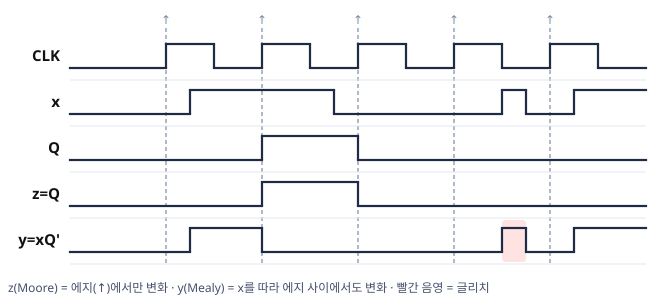
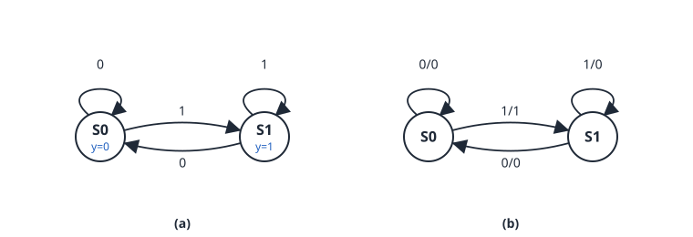
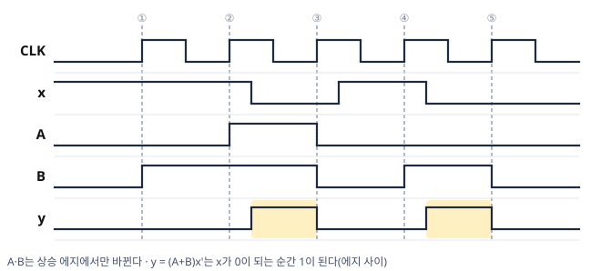
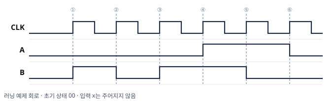
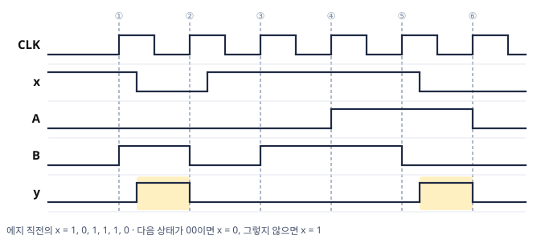

# 디지털공학 5장 보조학습자료 (2/2)
### FSM · Mealy와 Moore 판정 · 시퀀스 추적과 타이밍 차트 · 순차회로 설계 절차 · 설계 예제 · 연습문제 해설

> 이 자료는 교재의 핵심 개념과 풀이 과정을 본문 서술로 정리한 복습용 보조자료입니다.  
> Mano, *Digital Design* 5장과 함께 활용하세요.

---

## 목차

- [5. 유한상태머신 (FSM)](#5-유한상태머신-fsm)
- [6. 순차회로 설계 절차](#6-순차회로-설계-절차)
- [7. 설계 예제](#7-설계-예제)
- [8. 연습문제 해설](#8-연습문제-해설)

---

## 5. 유한상태머신 (FSM)

### 학습목표

- Moore Machine과 Mealy Machine의 구조적 차이를 설명할 수 있다.
- 출력식으로 Mealy와 Moore를 판정하고, 출력이 바뀌는 시점을 설명할 수 있다.
- 글리치(Glitch)가 발생하는 원인과 해결 방법을 이해한다.
- 입력 시퀀스에 대한 상태와 출력의 변화를 표와 타이밍 차트로 추적할 수 있다.


> 🎞️ **Mealy와 Moore** — 두 모델의 차이를 약 58초 동안 재생하고 처음부터 반복합니다.

---

### 5.1 FSM이란?

**유한상태머신(Finite State Machine, FSM)** 은 순차논리 회로의 동작을  
**유한한 수의 상태(State)** 로 모델링하는 추상적 표현 방식입니다.

- 회로의 동작 = 현재 상태에서 입력을 받아 다음 상태로 전이(Transition)
- 이 전이 규칙과 출력 규칙의 집합이 FSM을 정의합니다.

FSM의 구성 요소:

| 요소 | 내용 |
|---|---|
| **상태 집합 $S$** | 가능한 모든 내부 상태 |
| **입력 집합 $I$** | 외부 입력 신호 |
| **출력 집합 $O$** | 외부 출력 신호 |
| **전이 함수** | 현재 상태 + 입력 → 다음 상태 |
| **출력 함수** | 상태(또는 상태+입력) → 출력 |

---

### 5.2 Moore Machine

**Moore Machine**은 **출력이 현재 상태에만 의존**하는 FSM입니다.

$$\text{출력} = G(\text{현재 상태})$$

- 출력이 플립플롭 출력에만 의존하므로 **클럭과 동기화**됩니다.
- 입력 신호가 변해도 출력은 다음 클럭 에지까지 바뀌지 않습니다.
- **안정적이고 설계가 단순**하다는 장점이 있습니다.

**상태천이도 표기:**

```
        x=0
  ┌──────────────┐
  │              ▼
[S0 / y=0] ──x=1──▶ [S1 / y=1]
  ▲                       │
  └────────x=0─────────────┘
```

> 💡 Moore Machine에서 출력 $y$는 **원 안(상태 안)** 에 표기합니다.  
> 입력에 따른 전이 화살표에는 입력만 표기합니다.

---

### 5.3 Mealy Machine

**Mealy Machine**은 **출력이 현재 상태와 현재 입력의 조합**으로 결정되는 FSM입니다.

$$\text{출력} = G(\text{현재 상태},\; \text{현재 입력})$$

- 입력이 변하면 **클럭과 무관하게** 출력도 즉시 변할 수 있습니다.
- 일반적으로 Moore Machine보다 **상태 수가 적어** 회로가 간단해질 수 있습니다.
- 단, 비동기 입력이 사용될 경우 **글리치(Glitch)** 문제가 발생할 수 있습니다.

**상태천이도 표기:**

```
        x=0 / y=0
  ┌──────────────────┐
  │                  ▼
[S0] ──── x=1 / y=1 ────▶ [S1]
  ▲                            │
  └────────x=0 / y=0───────────┘
```

> 💡 Mealy Machine에서 출력 $y$는 **화살표 위(입력/출력)** 에 함께 표기합니다.

---

### 5.4 Moore vs Mealy 비교

| 항목 | Moore Machine | Mealy Machine |
|---|---|---|
| 출력 결정 요소 | 현재 상태만 | 현재 상태 + 현재 입력 |
| 출력 시점 | 클럭 동기 (안정적) | 입력 변화 시 즉시 (비동기 가능) |
| 상태 수 | 상대적으로 많음 | 상대적으로 적음 |
| 글리치 위험 | 낮음 | 높음 (비동기 입력 시) |
| 상태도 출력 위치 | 상태 원 안 | 전이 화살표 위 |

> 📖 **그림은 교재 참고** — Mano 6판 Fig 5.21 (Block diagrams of Mealy and Moore state machines): Mealy 블록도에는 입력이 출력 논리에 직접 연결되는 선이 하나 더 있습니다. 두 모델의 구조적 차이는 이 연결 하나입니다.

- 1/2 자료 4.4절 회로의 출력식은 $y = (A+B)x'$입니다. 출력식에 입력 $x$가 있으므로 **Mealy**입니다.
- 판정 기준은 **정리한 출력식에 입력 변수가 남는가**입니다(5.6절의 예제 5-4).

---

### 5.5 글리치(Glitch)와 해결 방법

**글리치**란 하드웨어에 의해 발생하는 **시스템의 일시적 오류 신호**입니다.

**Mealy Machine에서 글리치가 발생하는 원인:**

- 비동기 입력 신호가 변할 때, 클럭 사이클 중간에 출력이 순간적으로 바뀜
- 이 의도하지 않은 짧은 출력 변화가 글리치

**해결 방법:**

$$\text{클럭의 활성화 에지 직전의 비동기 입력 값을 샘플링하여 사용}$$

즉, 비동기 입력을 그대로 사용하지 않고, 클럭 에지 직전에 **레지스터로 샘플링(동기화)** 해서 사용합니다.

> ⚠️ **자주 하는 실수** — Mealy 회로의 출력을 「클럭 에지에서만 바뀐다」고 가정하고 파형을 그리는 실수입니다.
>
> 에지에서만 바뀌는 것은 **상태**(플립플롭)입니다. Mealy 출력은 입력이 변하는 순간 함께 변합니다. 출력을 안정적으로 사용하려면 클럭 에지 시점의 값을 읽습니다.

**확인 — 같은 입력에서 Moore 출력과 Mealy 출력**



- $z$는 상태 $Q$만 사용하므로 상승 에지에서만 바뀝니다.
- $y$는 입력 $x$를 직접 사용하므로 $x$가 바뀌는 순간 함께 바뀝니다. 빨간 음영의 짧은 펄스는 어느 에지와도 겹치지 않아, 에지 시점의 값을 사용하는 다음 회로에는 전달되지 않습니다.
- 따라서 Mealy 출력은 에지 시점의 값으로 읽습니다.

> 📖 **그림은 교재 참고** — Mano 6판 Fig 5.22 (Simulation output of Mealy_Zero_Detector): 「valid Mealy output」은 클럭 에지 시점의 값이고, 「Mealy glitch」는 에지 사이의 입력 변화가 만든 짧은 펄스입니다.

---

### 5.6 Mealy와 Moore 판정 — 예제

#### 예제 5-1 — 출력식으로 판정

어떤 회로의 출력식이 $y = A'B + x(A \oplus B)$이다. ⓐ Mealy/Moore를 판정하라. ⓑ 출력식을 $y = A'B$로 바꾸면 판정과 출력 변화 시점이 어떻게 달라지는가?

<details>
<summary>풀이 보기</summary>


**ⓐ** 출력식에 입력 $x$가 있으므로 **Mealy**입니다. $x$가 에지 사이에서 변하면 $y$도 즉시 변합니다(글리치 가능).

**ⓑ** $y = A'B$는 상태만의 함수이므로 **Moore**입니다. 상태가 클럭 에지에서만 바뀌므로 $y$도 에지 직후에만 바뀝니다.

**검산**: 판별 기준은 출력식에 입력 변수가 있는가입니다. 식의 길이 · 항 수 · XOR 유무는 판정과 무관합니다(식을 정리한 뒤에 판단합니다 — 예제 5-4).

</details>

#### 예제 5-2 — 상태도로 판정

아래 두 상태도 (a) · (b)가 각각 Moore 모델인지 Mealy 모델인지 판정하고, 근거와 출력이 바뀌는 시점을 쓰라.



<details>
<summary>풀이 보기</summary>


| | 출력 표기 위치 | 판정 | 출력이 바뀌는 시점 |
|---|---|---|---|
| (a) | 원 안(상태마다 $y$ 하나) | **Moore** | 상태가 바뀌는 에지 직후 |
| (b) | 화살표 위(입력/출력) | **Mealy** | 입력이 바뀌는 즉시(에지 사이 포함) |

- (b)의 상태 $S0$에서는 $x = 0$이면 $y = 0$, $x = 1$이면 $y = 1$입니다. 같은 상태에서 입력에 따라 출력이 다르므로 출력은 상태만의 함수가 아닙니다.
- 동작: (a)는 직전 에지의 $x$를 한 클럭 동안 내보냅니다(한 클럭 지연된 $x$). (b)는 상태 $S0$(직전 에지의 $x = 0$)에서 $x$가 1인 동안만 $y = 1$이므로, **$x$가 0에서 1로 바뀐 것을 알리는 회로**입니다.

**검산**: (a)의 상태 $S1$을 향하는 화살표는 모두 $x = 1$이고, 원 안 출력은 $y = 1$입니다. 출력이 상태와 함께 정해집니다.

</details>

#### 예제 5-3 — 상태표 · 상태도 · 판정 (심화)

D 플립플롭 $A$·$B$, 입력 $x$, 출력 $y$인 회로에서 다음을 읽었다: $D_A = B$, $D_B = A'x$, $y = AB'$. ⓐ 상태표(8행) ⓑ 상태도 ⓒ Mealy/Moore 판정을 수행하라.

<details>
<summary>풀이 보기</summary>


**ⓐ** 입력 열 $D_A = B$, $D_B = A'x$를 계산하면, D 특성표에 따라 그 값이 다음 상태가 됩니다.

| 현재 $AB$ | $x$ | $D_A D_B$ = 다음 $AB$ | $y$ |
|:---:|:---:|:---:|:---:|
| 00 | 0 | 00 | 0 |
| 00 | 1 | 01 | 0 |
| 01 | 0 | 10 | 0 |
| 01 | 1 | 11 | 0 |
| 10 | 0 | 00 | 1 |
| 10 | 1 | 00 | 1 |
| 11 | 0 | 10 | 0 |
| 11 | 1 | 10 | 0 |

**ⓑ** $x = 1$이 지속되면 $00 \to 01 \to 11 \to 10 \to 00$을 순환합니다. $10$은 입력과 무관하게 $00$으로, $11$은 $10$으로 이동합니다.

**ⓒ** $y = AB'$는 출력식에 입력 $x$가 없으므로 **Moore**입니다. $y$는 상태 $10$에서만 1이며, 표에서 $x$의 두 행이 같은 이유입니다.

**검산**: 행 $01$, $x = 0$: $D_A = B = 1$, $D_B = A'x = 1 \cdot 0 = 0$ → 다음 $10$

</details>

#### 예제 5-4 — 정리하기 전의 출력식 (심화)

어떤 회로의 출력식을 $y = Ax + Ax'$로 읽었다. 한 학생이 「식에 $x$가 있으므로 Mealy」라고 판정했다. 판정을 검토하라.

<details>
<summary>풀이 보기</summary>


출력식을 정리합니다(분배 법칙 · 보수 법칙).

$$y = Ax + Ax' = A(x + x') = A$$

- 정리한 식에는 $x$가 없으므로 출력은 상태 $A$만의 함수이고 **Moore**입니다. 학생 판정은 틀렸습니다.
- 판정 기준은 「정리한(최소화한) 출력식에 입력 변수가 남는가」입니다.
- 출력 변화 시점도 Moore와 같습니다. $x$가 에지 사이에서 바뀌어도 $Ax + Ax'$의 논리값은 $A$와 같습니다.

**검산**: $A = 1$일 때 $x = 0$이면 $y = 0 + 1 = 1$, $x = 1$이면 $y = 1 + 0 = 1$로 $x$와 무관하게 $y = A$입니다.

</details>

---

### 5.7 시퀀스 추적과 타이밍 차트

입력이 에지마다 차례로 주어지면, 상태표에서 해당 행을 순서대로 찾아 상태와 출력의 시간 전개를 추적합니다. 아래 예제는 1/2 자료 4.4절의 회로($D_A = Ax + Bx$, $D_B = A'x$, $y = (A+B)x'$)를 사용합니다.

#### 예제 5-5 — 상태와 출력 추적

4.4절 회로(초기 상태 $00$)에 입력 $x = 1, 1, 0, 1, 0$이 클럭 에지마다 순서대로 들어올 때, 상태와 출력을 추적하라.

<details>
<summary>풀이 보기</summary>


| 에지 | 현재 $AB$ | $x$ | $y$ | 다음 $AB$ |
|:---:|:---:|:---:|:---:|:---:|
| ① | 00 | 1 | 0 | 01 |
| ② | 01 | 1 | 0 | 11 |
| ③ | 11 | 0 | 1 | 00 |
| ④ | 00 | 1 | 0 | 01 |
| ⑤ | 01 | 0 | 1 | 00 |

출력 시퀀스는 $0, 0, 1, 0, 1$입니다. 1의 연속이 끊기는 순간마다 **$y$가 1**이며, 4.4절에서 상태도로 읽은 의미가 시퀀스로 확인됩니다.

</details>

#### 예제 5-6 — T 플립플롭 카운터 추적

1/2 자료 예제 4-5의 회로($T_A = Bx$, $T_B = x$, 초기 상태 $00$)에 $x = 1, 1, 1, 1$을 가할 때 상태를 추적하라.

<details>
<summary>풀이 보기</summary>


| 에지 | 현재 $AB$ | $T_A = Bx$ | $T_B = x$ | 다음 $AB$ |
|:---:|:---:|:---:|:---:|:---:|
| ① | 00 | 0 | 1 | 01 |
| ② | 01 | 1 | 1 | 10 |
| ③ | 10 | 0 | 1 | 11 |
| ④ | 11 | 1 | 1 | 00 |

상태 시퀀스는 $00 \to 01 \to 10 \to 11 \to 00$, 2진수로 $0, 1, 2, 3, 0$입니다. 「$x$가 1인 동안만 세는 2비트 카운터」라는 해석이 시퀀스로 확인됩니다.

**검산** — ②: $T_A = 1$ → $A$ 토글($0 \to 1$), $T_B = 1$ → $B$ 토글($1 \to 0$) → $10$

</details>

**타이밍 차트 작도 규칙** — 시퀀스 표를 시간 축 위의 파형으로 옮기면 상태 변화(에지 동기)와 Mealy 출력(비동기)의 차이가 그림으로 드러납니다.

1. 상태 신호($A$, $B$)는 상승 에지에서만 바뀝니다. 변화점을 에지 위치에 맞춥니다.
2. 입력 $x$는 에지 직후에 바뀐다고 가정합니다(다음 에지 전에 안정 — 셋업 조건).
3. Mealy 출력 $y$는 상태 · 입력이 바뀌는 즉시 다시 계산합니다. 에지 사이에서도 변합니다.

#### 예제 5-7 — 타이밍 차트 작도 (심화)

예제 5-5의 시퀀스(초기 $00$, $x = 1, 1, 0, 1, 0$)를 CLK · $x$ · $A$ · $B$ · $y$ 파형으로 그려라.

<details>
<summary>풀이 보기</summary>


먼저 에지 사이 구간별 값을 표로 정리합니다(각 열 = 그 에지 직후부터 다음 에지 직전까지).

| 구간 | ① 전 | ① 후 | ② 후 | ③ 후 | ④ 후 | ⑤ 후 |
|:---:|:---:|:---:|:---:|:---:|:---:|:---:|
| $AB$ | 00 | 01 | 11 | 00 | 01 | 00 |
| $x$ (다음 에지용) | 1 | 1 | 0 | 1 | 0 | 0 |
| $y = (A+B)x'$ | 0 | 0 | 1 | 0 | 1 | 0 |



$y$ 펄스는 에지 ② · ③ 사이와 ④ · ⑤ 사이, 즉 에지 직전 구간에 나타납니다. 예제 5-5 표의 「에지 ③에서 $y = 1$」은 그 에지 시점에 읽는 값이며, 파형에서는 $x$가 0으로 바뀐 순간부터 1입니다.

**검산**: $A$ · $B$의 변화점은 모두 상승 에지와 일치합니다(동기). $y$의 변화점 4개 가운데 2개는 에지가 아니라 $x$의 하강과 일치합니다(Mealy).

</details>

#### 예제 5-8 — 상태 파형에서 입력 복원 (심화)

4.4절 회로(초기 상태 $00$)의 상태 $A$ · $B$가 아래 파형과 같이 변했다. 에지 ①\~⑥ 직전의 입력 $x$를 복원하고, $y = 1$이 되는 구간을 쓰라.



<details>
<summary>풀이 보기</summary>


1/2 자료 예제 4-2의 상태표를 근거로 에지마다 다음 상태에서 $x$를 판정합니다.

- $x = 0$이면 다음 상태는 항상 $00$입니다. $x = 1$이면 다음 상태가 $00$이 되지 않습니다($x = 1$이면 $D_A = A + B$와 $D_B = A'$가 동시에 0이 될 수 없음).
- 따라서 다음 상태가 $00$이면 $x = 0$, 그렇지 않으면 $x = 1$입니다.

| 에지 | ① | ② | ③ | ④ | ⑤ | ⑥ |
|:---:|:---:|:---:|:---:|:---:|:---:|:---:|
| 다음 $AB$ | 01 | 00 | 01 | 11 | 10 | 00 |
| 복원한 $x$ | 1 | 0 | 1 | 1 | 1 | 0 |



- $y = 1$은 $x$가 0이고 상태가 $00$이 아닌 구간으로, 에지 ① · ② 사이와 ⑤ · ⑥ 사이입니다. 두 구간 모두 1의 연속이 0으로 끊기는 순간입니다.

**검산**: 에지 ④ — 현재 $01$, $x = 1$ → $D_A = 1 \cdot (0 + 1) = 1$, $D_B = 1 \cdot 1 = 1$ → 다음 $11$로 파형의 ④ 뒤 $A = B = 1$과 같습니다.

</details>

---

### 5.8 복습문제

#### 문제 (1)

다음 중 Moore Machine의 특성에 해당하는 것을 모두 고르라.

1. 출력이 현재 상태와 입력의 조합으로 결정된다.
2. 출력이 클럭과 동기화된다.
3. 상태 수가 Mealy Machine보다 항상 적다.
4. 상태천이도에서 출력이 상태 원 안에 표기된다.

<details>
<summary>정답 보기</summary>


**정답: 2, 4**

- 1번: Mealy Machine의 특성 → 오답
- 2번: Moore는 상태에만 의존하므로 클럭 동기화 → 정답
- 3번: 일반적으로 Moore가 상태 수가 더 많음 → 오답
- 4번: Moore는 출력을 상태 안에 표기 → 정답

</details>

---

#### 문제 (2)

세 회로의 출력식이 각각 다음과 같다. Mealy/Moore를 분류하고, 클럭 에지 사이에서 출력이 변할 수 있는 것을 고르라.

(a) $y = AB$ (b) $y = (A+B)x'$ (c) $y = A \oplus B$

<details>
<summary>정답 및 풀이 보기</summary>


| 회로 | 출력식에 입력 포함? | 분류 |
|:---:|:---:|:---:|
| (a) | 없음 (상태만) | Moore |
| (b) | $x'$ 포함 | Mealy |
| (c) | 없음 (상태만) | Moore |

에지 사이에서 출력이 변할 수 있는 것은 (b)입니다. (a) · (c)는 상태가 에지에서만 바뀌므로 출력도 에지 직후에만 바뀝니다.

</details>

---

#### 문제 (3)

1/2 자료 4.4절 회로(초기 상태 $00$)에 $x = 0, 1, 1, 1, 0$을 가할 때 상태 · 출력 시퀀스를 추적하라. $y = 1$이 나타나는 시점을 회로의 의미로 설명하라.

<details>
<summary>정답 및 풀이 보기</summary>


| 에지 | 현재 $AB$ | $x$ | $y$ | 다음 $AB$ |
|:---:|:---:|:---:|:---:|:---:|
| ① | 00 | 0 | 0 | 00 |
| ② | 00 | 1 | 0 | 01 |
| ③ | 01 | 1 | 0 | 11 |
| ④ | 11 | 1 | 0 | 10 |
| ⑤ | 10 | 0 | 1 | 00 |

출력 시퀀스는 $0, 0, 0, 0, 1$입니다. $y = 1$은 ⑤로, 1이 세 번 이어진 뒤 0으로 바뀌는 시점입니다. 처음의 $x = 0$(①)에서는 상태가 $00$이므로 $y = 0$입니다. 끊길 1의 연속이 없었기 때문입니다.

</details>

---

---

## 6. 순차회로 설계 절차

### 학습목표

- 순차회로 설계의 7단계 절차를 순서대로 나열하고 설명할 수 있다.
- 상태축소와 상태할당의 목적과 방법을 이해한다.

---

### 6.1 설계 절차 7단계

순차회로 설계는 아래 7단계를 순서대로 수행합니다.  
이 절차는 **정형화된 체계**로 소프트웨어 툴로 자동화도 가능합니다.

| 단계 | 내용 |
|---|---|
| **Step 1** | 시스템 사양 분석 → **상태도(상태천이도)** 도출 |
| **Step 2** | 상태 축소 가능 시 **상태축소** 수행 |
| **Step 3** | 각 상태에 **2진 코드(상태 할당)** 부여 |
| **Step 4** | 2진 코드 기반 **상태표** 작성 |
| **Step 5** | 사용할 **플립플롭 종류 선택** (D, JK, T) |
| **Step 6** | 선택된 플립플롭의 특성 방정식을 이용해 **논리식 도출** (K-map 활용) |
| **Step 7** | **논리회로 작성** 및 검증 |

> 💡 해석(4장)이 "회로 → 상태표"였다면,  
> 설계는 "상태도 → 회로"로 **반대 방향**입니다.

---

### 6.2 상태 축소 (State Reduction)

상태 축소는 **동일한 동작을 하는 두 상태를 하나로 병합**하여  
플립플롭 수와 회로 복잡도를 줄이는 과정입니다.

**병합 조건:**  
두 상태 $S_i$와 $S_j$가 다음 조건을 **모두** 만족하면 동일 상태로 간주:

1. 모든 입력에 대해 **출력이 동일**하다.
2. 모든 입력에 대해 **다음 상태가 동일**하거나,  
   다음 상태도 서로 병합 가능한 상태 쌍을 가리킨다.

> 💡 **실전 방법**: 상태표에서 행(row)을 비교하여  
> 출력 열이 완전히 같고, 다음 상태 열도 서로 대응되면 축소합니다.

---

### 6.3 상태 할당 (State Assignment)

상태 할당은 각 추상 상태(a, b, c…)에 **2진 코드를 부여**하는 과정입니다.

- $n$개 상태를 표현하려면 최소 $\lceil \log_2 n \rceil$비트 필요
- 2비트로는 최대 4개 상태 표현 가능
- 3비트로는 최대 8개 상태 표현 가능

**할당 방식에 따라 최종 논리식의 복잡도가 달라집니다.**  
일반적으로 Gray Code 방식 할당이 K-map 간소화에 유리합니다.

| 상태 수 | 필요 플립플롭 수 |
|:---:|:---:|
| 2 | 1 |
| 3~4 | 2 |
| 5~8 | 3 |
| 9~16 | 4 |

---

### 6.4 플립플롭 여기표 (Excitation Table)

각 플립플롭 종류별로, **원하는 상태 전이를 만들기 위해 어떤 입력이 필요한지** 역방향으로 정의한 표입니다.

**D 플립플롭 여기표:**

| $Q(t)$ | $Q(t+1)$ | $D$ |
|:---:|:---:|:---:|
| 0 | 0 | 0 |
| 0 | 1 | 1 |
| 1 | 0 | 0 |
| 1 | 1 | 1 |

> D 플립플롭은 $D = Q(t+1)$이므로, **다음 상태를 그대로 입력에 넣으면 됩니다.**

**JK 플립플롭 여기표:**

| $Q(t)$ | $Q(t+1)$ | $J$ | $K$ |
|:---:|:---:|:---:|:---:|
| 0 | 0 | 0 | × |
| 0 | 1 | 1 | × |
| 1 | 0 | × | 1 |
| 1 | 1 | × | 0 |

> 💡 JK 여기표의 $\times$(Don't Care)를 K-map에서 적극 활용하면 식이 크게 단순해집니다.

**T 플립플롭 여기표:**

| $Q(t)$ | $Q(t+1)$ | $T$ |
|:---:|:---:|:---:|
| 0 | 0 | 0 |
| 0 | 1 | 1 |
| 1 | 0 | 1 |
| 1 | 1 | 0 |

> T 플립플롭은 $T = Q(t) \oplus Q(t+1)$: **상태가 바뀌면 1, 유지되면 0**입니다.

---

---

## 7. 설계 예제

### 학습목표

- D 플립플롭을 사용해 연속 1 검출기를 설계할 수 있다.
- JK 플립플롭으로 동일 기능을 설계할 수 있다.
- T 플립플롭으로 3비트 업카운터를 설계할 수 있다.

---

### 7.1 설계 예제 — D 플립플롭: 연속 1 검출기

> **설계 사양**  
> - 입력: 1비트 스트림 $x$  
> - 출력: $y$ (1비트)  
> - 기능: 입력에 **1이 연속으로 3개 이상 입력**되면 출력 $y = 1$  
> - 플립플롭: D 플립플롭 사용  
> - 상태: 2비트 ($A, B$)

---

**Step 1 — 상태도 도출:**

필요한 상태를 다음과 같이 정의합니다:

| 상태 | 의미 |
|---|---|
| $S_0$ (00) | 연속 1이 0개 (초기 또는 0 입력 직후) |
| $S_1$ (01) | 연속 1이 1개 |
| $S_2$ (10) | 연속 1이 2개 |
| $S_3$ (11) | 연속 1이 3개 이상 (출력 Set) |

```
         x=0/y=0           x=0/y=0          x=0/y=0
[S0] ◀──────────── [S1] ◀─────────── [S2] ─────────▶ [S0]
  │                  ▲                  ▲
  └── x=1/y=0 ──────┘                  │
                     └── x=1/y=0 ──────┘
                                        │ x=1/y=1
                                        ▼
                                      [S3] ──── x=1/y=1 ──▶ [S3]
                                        │
                                        └── x=0/y=0 ──▶ [S0]
```

---

**Step 2 — 상태 축소**: 이 예제에서는 축소 가능한 상태 없음

**Step 3 — 상태 할당**:

| 상태 | $A$ | $B$ |
|:---:|:---:|:---:|
| $S_0$ | 0 | 0 |
| $S_1$ | 0 | 1 |
| $S_2$ | 1 | 0 |
| $S_3$ | 1 | 1 |

---

**Step 4 — 상태표:**

| 현재 $AB$ | $x$ | 다음 $A(t+1)B(t+1)$ | $y$ |
|:---:|:---:|:---:|:---:|
| 00 | 0 | 00 | 0 |
| 00 | 1 | 01 | 0 |
| 01 | 0 | 00 | 0 |
| 01 | 1 | 10 | 0 |
| 10 | 0 | 00 | 0 |
| 10 | 1 | 11 | 0 |
| 11 | 0 | 00 | 0 |
| 11 | 1 | 11 | 1 |

---

**Step 5 — D 플립플롭 선택**

**Step 6 — K-map으로 논리식 도출:**

D 플립플롭은 $D = Q(t+1)$이므로, 상태표의 다음 상태 열에서 직접 읽습니다.

$D_A$ (= $A(t+1)$) K-map:

```
         x=0   x=1
AB=00  [  0  |  0  ]
AB=01  [  0  |  1  ]
AB=10  [  0  |  1  ]
AB=11  [  0  |  1  ]
```

**K-map 읽기:**

- 1이 되는 최소항: $m_3(ABx=011), m_5(ABx=101), m_7(ABx=111)$
- $m_3, m_7$ 묶기 → $Bx$
- $m_5, m_7$ 묶기 → $Ax$

$$\boxed{D_A = Ax + Bx = x(A+B)}$$

$D_B$ (= $B(t+1)$) K-map:

```
         x=0   x=1
AB=00  [  0  |  1  ]
AB=01  [  0  |  0  ]
AB=10  [  0  |  1  ]
AB=11  [  0  |  1  ]
```

**K-map 읽기:**

- 1이 되는 최소항: $m_1(ABx=001), m_5(ABx=101), m_7(ABx=111)$
- $m_5, m_7$ 묶기 → $Ax$
- $m_1, m_5$ 묶기 → $B'x$

$$\boxed{D_B = Ax + B'x = x(A+B')}$$

$y$ K-map:

- 1이 되는 경우: $AB=11$, $x=1$ → 최소항 $m_7$

$$\boxed{y = ABx}$$

---

**Step 7 — 회로 구조 (개념도):**

```
x, A, B → [조합논리: D_A = x(A+B), D_B = x(A+B'), y = ABx]
                    ↓              ↓
                  [D-FF A]     [D-FF B]
                    ↓              ↓
                    A(t+1)        B(t+1)  (다음 클럭에서 A, B로 피드백)
```

---

### 7.2 설계 예제 — JK 플립플롭: 동일 기능

> JK, T 플립플롭 역시 **Step 1~4(상태도, 축소, 할당, 상태표)는 D 플립플롭과 동일**합니다.  
> Step 5~6에서 여기표(Excitation Table)를 사용한다는 점만 다릅니다.

**Step 6 — JK 여기표를 상태표에 적용:**

상태표의 각 행에서 $(Q(t), Q(t+1))$을 보고, JK 여기표에서 $J$, $K$ 값을 읽습니다.

| 현재 $AB$ | $x$ | $A(t+1)B(t+1)$ | $J_A$ | $K_A$ | $J_B$ | $K_B$ |
|:---:|:---:|:---:|:---:|:---:|:---:|:---:|
| 00 | 0 | 00 | 0 | × | 0 | × |
| 00 | 1 | 01 | 0 | × | 1 | × |
| 01 | 0 | 00 | 0 | × | × | 1 |
| 01 | 1 | 10 | 1 | × | × | 1 |
| 10 | 0 | 00 | × | 1 | 0 | × |
| 10 | 1 | 11 | × | 0 | 1 | × |
| 11 | 0 | 00 | × | 1 | × | 1 |
| 11 | 1 | 11 | × | 0 | × | 0 |

**K-map으로 간소화 (Don't Care 적극 활용):**

$$J_A = Bx$$
$$K_A = x' + B'x' = x'$$

$$J_B = A'x + Ax = x$$

$K_B$ K-map ($B=0$인 행은 전부 don't care):

```
         x=0   x=1
AB=00  [  ×  |  ×  ]
AB=01  [  1  |  1  ]
AB=10  [  ×  |  ×  ]
AB=11  [  1  |  0  ]
```

**K-map 읽기:**

- 1이 되는 최소항: $m_2(ABx=010), m_3(ABx=011), m_6(ABx=110)$ / 0인 칸: $m_7(ABx=111)$
- $A'$ (AB=00·01 두 행 전체, don't care 활용) → $m_2, m_3$ 커버
- $x'$ ($x=0$ 열 전체, don't care 활용) → $m_2, m_6$ 커버

$$\boxed{K_B = A' + x'}$$

> 💡 JK 플립플롭은 Don't Care($\times$)가 많아  
> D 플립플롭보다 **더 단순한 논리식**이 나오는 경우가 많습니다.

---

### 7.3 설계 예제 — T 플립플롭: 3비트 업카운터

> **설계 사양**  
> - 입력: 클럭만 (외부 입력 없음)  
> - 출력: 3비트 상태 $Q_2 Q_1 Q_0$  
> - 기능: $0 \rightarrow 1 \rightarrow 2 \rightarrow \cdots \rightarrow 7 \rightarrow 0$ 순환  
> - 플립플롭: T 플립플롭 사용

---

**Step 1 — 상태도:**

```
 →  →  →  →  →  →  →  →[1]
```

**Step 4 — 상태표:**

| 현재 $Q_2 Q_1 Q_0$ | 다음 $Q_2(t+1) Q_1(t+1) Q_0(t+1)$ |
|:---:|:---:|
| 000 | 001 |
| 001 | 010 |
| 010 | 011 |
| 011 | 100 |
| 100 | 101 |
| 101 | 110 |
| 110 | 111 |
| 111 | 000 |

**Step 6 — T 여기표 적용 ($T = Q(t) \oplus Q(t+1)$):**

| 현재 $Q_2 Q_1 Q_0$ | $T_2$ | $T_1$ | $T_0$ |
|:---:|:---:|:---:|:---:|
| 000 | 0 | 0 | 1 |
| 001 | 0 | 1 | 1 |
| 010 | 0 | 0 | 1 |
| 011 | 1 | 1 | 1 |
| 100 | 0 | 0 | 1 |
| 101 | 0 | 1 | 1 |
| 110 | 0 | 0 | 1 |
| 111 | 1 | 1 | 1 |

**K-map으로 간소화:**

$$\boxed{T_0 = 1}$$

$$\boxed{T_1 = Q_0}$$

$$\boxed{T_2 = Q_1 Q_0}$$

**회로 구조:**

```
CLK ──▶ [T-FF Q_0 (T=1)]  → Q_0
    ──▶ [T-FF Q_1 (T=Q_0)] → Q_1
    ──▶ [T-FF Q_2 (T=Q_1·Q_0)] → Q_2
```

> 💡 업카운터는 T 플립플롭으로 설계했을 때 가장 단순합니다.  
> $T_0 = 1$ (항상 토글), $T_1 = Q_0$ (LSB가 1일 때 토글),  
> $T_2 = Q_1 Q_0$ (하위 두 비트가 모두 1일 때 토글)  
> → **이 패턴이 2진 카운터의 본질**입니다.

---

### 7.4 복습문제

#### 문제 (1)

T 플립플롭을 이용한 3비트 업카운터에서, 현재 상태가 $Q_2 Q_1 Q_0 = 101$일 때  
다음 클럭 에지 이후 상태를 계산하라.

<details>
<summary>정답 및 풀이 보기</summary>


$Q_2 Q_1 Q_0 = 101$에서:

$$T_0 = 1 \Rightarrow Q_0(t+1) = 1 \oplus 1 = 0$$
$$T_1 = Q_0 = 1 \Rightarrow Q_1(t+1) = 1 \oplus 0 = 1$$
$$T_2 = Q_1 Q_0 = 0 \cdot 1 = 0 \Rightarrow Q_2(t+1) = 0 \oplus 1 = 1$$

$$\boxed{Q_2 Q_1 Q_0 = 110}$$

(5 → 6으로 올바르게 증가)

</details>

---

#### 문제 (2)

연속 1 검출기 설계에서 $D_A$를 구하는 K-map의 최소항 번호를 나열하고, 간소화된 식을 쓰라.  
(변수 순서: $A, B, x$)

<details>
<summary>정답 보기</summary>


$D_A = 1$인 최소항:
- $(A=0, B=1, x=1) = m_3$
- $(A=1, B=0, x=1) = m_5$
- $(A=1, B=1, x=1) = m_7$

K-map 묶기:
- $m_3, m_7$: $Bx$
- $m_5, m_7$: $Ax$

$$\boxed{D_A = Ax + Bx = x(A+B)}$$

</details>

---

---

## 8. 연습문제 해설

### 8.1 연습문제 5.11 — 상태 축소 검증

> **문제 조건**  
> 입력 시퀀스 $110010100111010$이 회로에 인가, 초기 상태 $AB = 00$  
> (a) 상태 천이 및 출력 시퀀스 결정  
> (b) 상태표 도출 후 상태 축소  
> (c) 축소된 상태표가 동일한지 검증

---

**상태 할당**: $A = 00$, $B = 01$, $C = 10$, $D = 11$

**주어진 완전 상태표:**

| 현재 상태 | 다음 상태 ($X=0$) | 다음 상태 ($X=1$) | 출력 ($X=0$) | 출력 ($X=1$) |
|:---:|:---:|:---:|:---:|:---:|
| A | A | B | 0 | 0 |
| B | A | D | 1 | 0 |
| C | A | C | 1 | 0 |
| D | A | C | 1 | 0 |

---

**(a) 상태 천이 시퀀스:**

입력: $1\ 1\ 0\ 0\ 1\ 0\ 1\ 0\ 0\ 1\ 1\ 1\ 0\ 1\ 0$, 초기 상태: $A(=00)$

| 현재 상태 | 입력 $X$ | 다음 상태 | 출력 $y$ |
|:---:|:---:|:---:|:---:|
| A(00) | 1 | B | 0 |
| B(01) | 1 | D | 0 |
| D(11) | 0 | A | 1 |
| A(00) | 0 | A | 0 |
| A(00) | 1 | B | 0 |
| B(01) | 0 | A | 1 |
| A(00) | 1 | B | 0 |
| B(01) | 0 | A | 1 |
| A(00) | 0 | A | 0 |
| A(00) | 1 | B | 0 |
| B(01) | 1 | D | 0 |
| D(11) | 1 | C | 0 |
| C(10) | 0 | A | 1 |
| A(00) | 1 | B | 0 |
| B(01) | 0 | A | 1 |

**출력 시퀀스**: $0\ 0\ 1\ 0\ 0\ 1\ 0\ 1\ 0\ 0\ 0\ 0\ 1\ 0\ 1$

---

**(b) 상태 축소:**

B, C, D행을 비교합니다.

| 현재 | 출력(X=0) | 출력(X=1) | 다음(X=0) | 다음(X=1) |
|:---:|:---:|:---:|:---:|:---:|
| B | 1 | 0 | A | D |
| C | 1 | 0 | A | C |
| D | 1 | 0 | A | C |

- **C와 D 비교**: 출력 동일(1, 0), 다음 상태 X=0에서 모두 A(동일), X=1에서 C와 C(동일) → **C = D 병합 가능**

병합 결과 ($D = C$):

| 현재 | 다음(X=0) | 다음(X=1) | 출력(X=0) | 출력(X=1) |
|:---:|:---:|:---:|:---:|:---:|
| A | A | B | 0 | 0 |
| B | A | D→**C** | 1 | 0 |
| C | A | C | 1 | 0 |

- **B와 C 비교 (D=C 치환 후)**: B의 다음(X=1) = C, C의 다음(X=1) = C → 동일, 출력 동일, 다음(X=0) 모두 A → **B = C 병합 가능**

최종 축소 상태표:

| 현재 | 다음(X=0) | 다음(X=1) | 출력(X=0) | 출력(X=1) |
|:---:|:---:|:---:|:---:|:---:|
| **A** | A | B | 0 | 0 |
| **B** | A | B | 1 | 0 |

$$\boxed{D = C = B \quad \Rightarrow \quad \text{4개 상태 → 2개 상태로 축소}}$$

---

**(c) 검증 — 축소된 상태표로 동일 시퀀스 추적:**

입력: $1\ 1\ 0\ 0\ 1\ 0\ 1\ 0\ 0\ 1\ 1\ 1\ 0\ 1\ 0$, 초기 상태: $A$

| 현재 상태 | 입력 | 다음 상태 | 출력 |
|:---:|:---:|:---:|:---:|
| A | 1 | B | 0 |
| B | 1 | B | 0 |
| B | 0 | A | 1 |
| A | 0 | A | 0 |
| A | 1 | B | 0 |
| B | 0 | A | 1 |
| A | 1 | B | 0 |
| B | 0 | A | 1 |
| A | 0 | A | 0 |
| A | 1 | B | 0 |
| B | 1 | B | 0 |
| B | 1 | B | 0 |
| B | 0 | A | 1 |
| A | 1 | B | 0 |
| B | 0 | A | 1 |

**출력 시퀀스**: $0\ 0\ 1\ 0\ 0\ 1\ 0\ 1\ 0\ 0\ 0\ 0\ 1\ 0\ 1$

> ✅ 원래 시퀀스($0\ 0\ 1\ 0\ 0\ 1\ 0\ 1\ 0\ 0\ 0\ 0\ 1\ 0\ 1$)와 **완전히 동일**합니다.  
> 상태 축소가 올바르게 수행되었음이 검증됩니다.

---

### 8.2 연습문제 5.16 — 순환 카운터 설계

> **문제 조건**  
> 2개의 D 플립플롭 A, B와 입력 x를 가진 순차회로 설계  
> - $x=0$: 현재 상태 유지  
> - $x=1$: $00 \rightarrow 01 \rightarrow 11 \rightarrow 10 \rightarrow 00$ 순환

---

**Step 1 — 상태도:**

```
x=0: 자기 자신으로 루프
x=1: 00 → 01 → 11 → 10 → 00
```

**Step 4 — 상태표:**

| 현재 $AB$ | $x$ | 다음 $A(t+1)B(t+1)$ |
|:---:|:---:|:---:|
| 00 | 0 | 00 |
| 00 | 1 | 01 |
| 01 | 0 | 01 |
| 01 | 1 | 11 |
| 10 | 0 | 10 |
| 10 | 1 | 00 |
| 11 | 0 | 11 |
| 11 | 1 | 10 |

**Step 6 — K-map으로 $D_A$, $D_B$ 도출:**

$D_A$ K-map:

```
            x=0   x=1
AB=00  [  0  |  0  ]
AB=01  [  0  |  1  ]
AB=11  [  1  |  1  ]
AB=10  [  1  |  0  ]
```

**1이 되는 칸** (변수 순서 $A, B, x$): $m_3(011), m_4(100), m_6(110), m_7(111)$

**K-map 묶기** (두 그룹으로 모두 커버):
- $m_4, m_6$ → $A=1$, $x=0$ → $Ax'$
- $m_3, m_7$ → $B=1$, $x=1$ → $Bx$

$$D_A = Ax' + Bx$$

**검증**:
- $(AB=00, x=1)$: $0 \cdot 0 + 0 \cdot 1 = 0$ ✓
- $(AB=01, x=1)$: $0 \cdot 0 + 1 \cdot 1 = 1$ ✓
- $(AB=11, x=0)$: $1 \cdot 1 + 1 \cdot 0 = 1$ ✓
- $(AB=10, x=1)$: $1 \cdot 0 + 0 \cdot 1 = 0$ ✓

$$\boxed{D_A = Ax' + Bx}$$

$D_B$ K-map:

**$B(t+1) = 1$인 칸** (상태표에서 확인): $m_1(001), m_2(010), m_3(011), m_6(110)$
- $(AB=00, x=1) = m_1$
- $(AB=01, x=0) = m_2$
- $(AB=01, x=1) = m_3$
- $(AB=11, x=0) = m_6$

**K-map 묶기** (두 그룹으로 모두 커버):
- $m_1, m_3$ → $A=0$, $x=1$ → $A'x$
- $m_2, m_6$ → $B=1$, $x=0$ → $Bx'$

$$D_B = A'x + Bx'$$

**검증**:
- $(AB=00, x=1)$: $A'x=1,\ Bx'=0 \Rightarrow D_B=1$ → 다음 $B=1$ ✓
- $(AB=01, x=0)$: $A'x=0,\ Bx'=1 \Rightarrow D_B=1$ → 다음 $B=1$ ✓
- $(AB=11, x=1)$: $A'x=0,\ Bx'=0 \Rightarrow D_B=0$ → 다음 $B=0$ ✓
- $(AB=10, x=1)$: $A'x=0,\ Bx'=0 \Rightarrow D_B=0$ → 다음 $B=0$ ✓

$$\boxed{D_A = Ax' + Bx, \quad D_B = A'x + Bx'}$$

---

### 8.3 권장 연습문제

> 📌 **권장 연습**: 연습문제 **5.6, 5.7, 5.12, 5.17**

| 문제 | 예상 유형 |
|---|---|
| 5.6 | 클럭형 순차회로 해석 |
| 5.7 | 상태표 및 상태천이도 작성 |
| 5.12 | 상태 축소 |
| 5.17 | 순차회로 설계 (플립플롭 선택 포함) |

---

> 📌 **5장 전체 학습 완료 체크리스트**
>
> - [ ] 순차논리와 조합논리의 구조적 차이를 설명할 수 있다
> - [ ] Active High/Low SR-Latch의 동작과 금지 상태를 이해한다
> - [ ] D-Latch의 한계(레벨 응답 불안정)를 설명할 수 있다
> - [ ] 에지 응답 방식의 필요성과 Setup/Hold Time을 이해한다
> - [ ] D, JK, T 플립플롭의 특성 방정식과 여기표를 작성할 수 있다
> - [ ] 주어진 회로에서 상태방정식을 도출하고 상태표를 작성할 수 있다
> - [ ] Moore와 Mealy Machine의 차이와 글리치 발생 원인을 설명할 수 있다
> - [ ] 순차회로 설계 7단계를 순서대로 수행할 수 있다
> - [ ] D 플립플롭으로 연속 1 검출기를 설계할 수 있다
> - [ ] T 플립플롭으로 3비트 업카운터를 설계하고 논리식을 도출할 수 있다
> - [ ] 상태 축소 조건을 적용하여 등가 상태를 병합할 수 있다
> - [ ] 축소 전후 상태표의 동작이 동일한지 시퀀스로 검증할 수 있다
