# 디지털공학 6장 보조학습자료 (1/2)
### 레지스터 개요 · 병렬 로드 레지스터 · 시프트 레지스터 · 범용 시프트 레지스터 · 직렬 전송 · 직렬 가산

> 이 자료는 교재의 핵심 개념과 풀이 과정을 본문 서술로 정리한 복습용 보조자료입니다.  
> Mano, *Digital Design* 6장과 함께 활용하세요.

---

## 목차

- [1. 레지스터 개요](#1-레지스터-개요)
- [2. 병렬 로드 레지스터](#2-병렬-로드-레지스터)
- [3. 시프트 레지스터](#3-시프트-레지스터)
- [4. 직렬 전송](#4-직렬-전송)

---

## 1. 레지스터 개요

### 학습목표

- 레지스터와 카운터의 정의와 상호 관계를 설명할 수 있다.
- 레지스터 내부의 데이터 이동 방식을 이해한다.
- 레지스터의 역할과 실제 활용을 설명할 수 있다.

---

### 1.1 레지스터란?

**레지스터(Register)** 는 **여러 개의 플립플롭**을 기본 소자로 하여 구성된 디지털 저장 회로입니다.  
플립플롭 하나당 **1-bit 데이터를 저장**하며, 기능에 따라 추가적인 조합 게이트가 붙습니다.

$$n\text{비트 레지스터} = n\text{개의 플립플롭}$$

**레지스터의 위치**: 5장에서 배운 **플립플롭(단일 저장 소자)** 을 여러 개 묶어  
실용적인 **멀티비트 저장 블록**으로 확장한 것이 레지스터입니다.

> 💡 **비유**: 플립플롭이 한 칸짜리 사물함이라면,  
> 레지스터는 여러 칸이 연결된 사물함 열(列)입니다.

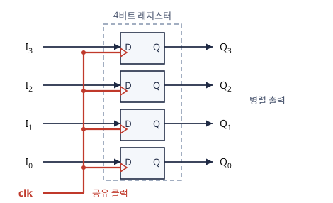

---

### 1.2 카운터와의 관계

**카운터(Counter)** 는 레지스터의 특수한 형태입니다.  
미리 정의된 상태들이 **정해진 순서에 따라 상태 전이**를 일으키는 구조이기 때문입니다.

| 구분 | 레지스터 | 카운터 |
|---|---|---|
| 상위 개념 | 플립플롭 그룹 | 레지스터의 특수 형태 |
| 데이터 변화 | 외부 입력에 의해 변화 | 미리 정의된 순서로 자동 순환 |
| 대표 용도 | 데이터 임시 저장, 이동 | 클럭 계수, 분주, 타이머 |

> 💡 카운터는 **레지스터에 포함되는 개념**이지만,  
> 실제 설계에서는 구조와 용도가 달라 별도로 구분해서 다룹니다.

---

### 1.3 레지스터 내 데이터 이동

레지스터의 핵심 기능 중 하나는 **저장된 데이터를 내부적으로 이동시키는 것**입니다.  
이동 방향과 방식에 따라 **시프트 레지스터**의 종류가 결정됩니다.

데이터 이동의 기본 방향:

- **왼쪽 시프트(Left Shift)**: MSB 방향으로 이동
- **오른쪽 시프트(Right Shift)**: LSB 방향으로 이동
- **병렬 이동**: 모든 비트가 동시에 교체

---

### 1.4 레지스터의 역할

조합회로의 출력은 입력이 바뀌면 함께 바뀌므로 값을 보관하지 못합니다. 디지털 시스템은 연산의 입력과 결과를 다음 단계까지 보관해야 하며, 이 보관을 레지스터가 담당합니다.

| 역할 | 내용 | 다루는 절 |
|---|---|:---:|
| **값 보관** | 갱신 전까지 $n$비트 값 유지 | §2 |
| **갱신 시점 통일** | 클럭 에지에서 $n$비트를 함께 저장 | §2 |
| **데이터 전달** | 레지스터 사이의 값 이동(병렬 · 직렬) | §2 · §4 |
| **병렬 ↔ 직렬 변환** | 시프트 레지스터로 비트를 차례로 입출력 | §3 · §4 |
| **제어와 상태 보관** | 장치 설정값과 동작 상태 저장 | §1.5 |

**왜 에지에서 함께 저장하는가** — 조합회로의 출력은 입력이 바뀐 뒤 안정될 때까지 시간이 걸립니다. 레지스터는 클럭 에지에서만 값을 저장하므로 변화 중인 값이 다음 단계로 전달되지 않습니다. 이 시간과 최대 클럭 주파수의 관계는 6장 2/2의 §6에서 다룹니다.

---

### 1.5 실제 활용

| 위치 | 레지스터 | 저장하는 값 |
|---|---|---|
| CPU | 프로그램 카운터(PC) | 다음에 실행할 명령의 주소 |
| CPU | 명령 레지스터(IR) | 실행 중인 명령 |
| CPU | 범용 레지스터 | 연산의 입력과 결과 |
| MCU | 입출력 포트 레지스터(ATmega128의 DDRx · PORTx) | 핀의 입출력 방향과 출력 값 |
| 통신 | UART 시프트 레지스터 · 데이터 레지스터(ATmega128의 UDR) | 송수신 중인 비트와 완성된 바이트 |
| 주변 IC | 74HC595(8비트 시프트 레지스터 + 저장 레지스터) | LED 등의 출력 8비트(MCU 핀 3개로 제어) |

> MCU(Micro Controller Unit) = 마이크로컨트롤러  
> UART(Universal Asynchronous Receiver/Transmitter) = 범용 비동기 송수신기(§4.5)

**명령 하나의 실행 — 덧셈 $R_1 \leftarrow R_1 + R_2$**

1. $R_1$과 $R_2$의 값을 ALU(산술 · 논리 연산 장치)로 전달합니다.
2. ALU의 결과를 클럭 에지에서 $R_1$에 저장합니다.
3. PC를 다음 명령의 주소로 갱신합니다.

- CPU의 명령 실행은 레지스터 사이의 전송과 연산의 연속입니다. 이 과정을 기술하는 표기가 8장의 RTL(Register Transfer Level)입니다.
- PC는 값을 저장하면서 순서대로 증가하므로 레지스터이면서 카운터입니다(6장 2/2).

---

### 1.6 디지털 시스템에서의 위치

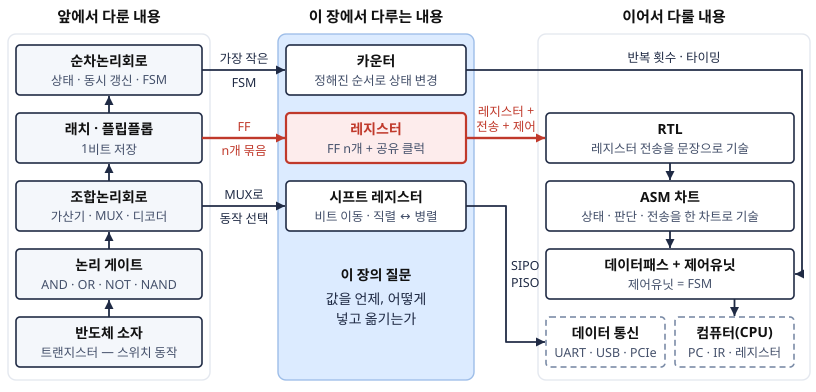

- **왼쪽**: 소자 → 게이트 → 조합회로 → 플립플롭 → 순차회로에서 1비트 저장과 상태를 다룹니다.
- **가운데**: 플립플롭을 $n$개 묶어 $n$비트 값을 한 단위로 저장합니다.
- **오른쪽**: 레지스터를 부품으로 사용해 시스템을 기술하고 구현합니다.
- 점선 상자는 다른 과목에서 이어지는 내용입니다(데이터 통신은 §4.5에서 개요만 다룹니다).

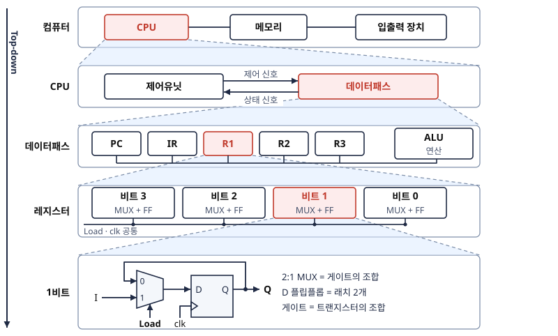

위의 흐름 그림은 부품을 조합해 시스템을 구성하는 순서(Bottom-up)이고, 이 그림은 시스템을 부품으로 분해하는 순서(Top-down)입니다.

> 💡 **핵심**: 레지스터는 **데이터패스의 기본 단위**입니다. 8장부터 시스템을 「레지스터 + 전송 + 제어」로 분해하며, 이 장의 질문은 「레지스터에 값을 언제, 어떻게 넣고 옮기는가」입니다.  
> 언제 = §2 병렬 로드의 Load  
> 어떻게 옮기는가 = §3 시프트 레지스터 · §4 직렬 전송

---

### 1.7 복습문제

#### 문제 (1)

"레지스터는 플립플롭의 집합이고, 카운터는 레지스터의 특수 형태이다."  
이 문장이 참인지 거짓인지 판단하고, 이유를 설명하라.

<details>
<summary>정답 보기</summary>


**참(True)**

- 레지스터는 여러 플립플롭으로 구성되며, 플립플롭 1개당 1-bit 저장
- 카운터는 미리 정의된 순서대로 상태 전이가 발생하는 레지스터의 특수 형태
- 따라서 카운터 ⊂ 레지스터 ⊂ 플립플롭 그룹의 계층 관계가 성립함

</details>

---

---

## 2. 병렬 로드 레지스터

### 학습목표

- 병렬 로드 레지스터의 동작 원리와 동기화 방식을 설명할 수 있다.
- 클럭 펄스 게이팅 방식이 권장되지 않는 이유를 이해한다.
- 로드 제어신호를 이용한 입력 데이터 제어 방식을 설명할 수 있다.

---

### 2.1 병렬 로드 레지스터란?

**병렬 로드 레지스터**는 **모든 비트를 동시에 로드(Load)** 할 수 있는 레지스터입니다.

특성:

- 동일한 **클럭 소스를 공유**하여 모든 플립플롭이 동기화
- 단일 클럭 펄스에 의해 **모든 비트가 동시에 Load/Update**
- 직렬 로드 방식 대비 **속도가 빠름**

---

### 2.2 데이터 변경 제어 방법

클럭 펄스가 인가되면 레지스터의 모든 플립플롭이 갱신됩니다.  
하지만 **원하지 않는 시점에 데이터가 변경되는 것을 방지**하려면 별도의 제어가 필요합니다.

두 가지 제어 방법이 있습니다:

| 방법 | 설명 | 권장 여부 |
|---|---|---|
| **1) 클럭 펄스 입력 제어** | 로드할 때만 클럭을 게이트(gate)로 선택적으로 인가 | ⚠️ **비권장** |
| **2) 입력 데이터 제어** | 클럭은 항상 인가하되, 입력 데이터 자체를 MUX로 제어 | ✅ **권장** |

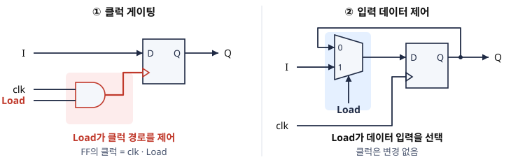

---

### 2.3 클럭 게이팅이 비권장인 이유

클럭 펄스에 게이트(AND, OR 등 조합 게이트)를 두면  
**게이트 지연(Gate Delay)** 이 발생하고, 이로 인해:

- 서로 다른 플립플롭으로 전달되는 클럭의 도착 시간이 미세하게 달라짐 → **클럭 스큐(Clock Skew)**
- 클럭 스큐는 동기화 오류의 직접적인 원인

$$\text{클럭 스큐} \Rightarrow \text{플립플롭 간 동기화 실패} \Rightarrow \text{데이터 오류}$$

**왜 문제인가** — 5장 이후의 모든 설계는 「한 에지에서 모든 플립플롭이 에지 직전 값을 동시에 받는다」를 전제로 합니다. 도착 시각이 어긋나면 먼저 갱신된 플립플롭의 새 값을 늦게 갱신되는 플립플롭이 받을 수 있습니다.

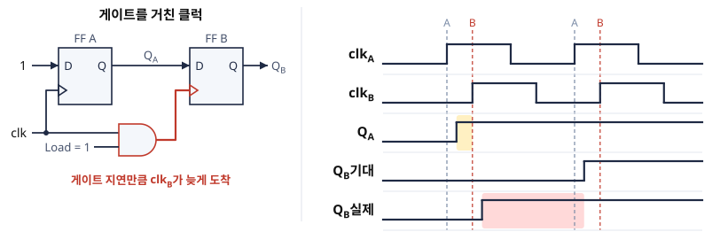

- **노란 구간**: $Q_A$가 1로 바뀐 뒤 $\text{clk}_B$의 에지가 도착하기 전까지의 시간
- **기대**: 두 플립플롭이 동시에 갱신되면 첫 에지에서 $Q_B$는 $Q_A$의 직전 값 0을 받습니다. 둘째 에지에서 1이 됩니다.
- **실제**: $\text{clk}_B$의 에지가 $Q_A$가 바뀐 뒤에 도착하므로 $Q_B$는 새 값 1을 받습니다. 빨간 구간만큼 $Q_B$가 일찍 바뀝니다.

> ⚠️ 결론: **모든 순차회로에서 클럭에 직접 게이트를 두는 것은 권장하지 않습니다.**  
> 대신, 입력 데이터 경로에 MUX를 배치해 클럭은 항상 그대로 전달합니다.

> ⚠️ **자주 하는 실수**: Logisim이나 과제 설계에서 Load 기능을 `AND(clk, Load)`로 구현하는 것입니다.  
> 시뮬레이터에서는 우연히 동작할 수 있지만 실제 하드웨어에서는 스큐로 인한 간헐적 오류의 원인이 됩니다. 클럭은 변경하지 않는 배선으로 취급하고, 제어는 데이터 입력에서 수행합니다.

> 💡 **Tip**: 실제 칩에서는 전력 절감을 위해 일부 회로의 클럭을 멈추기도 합니다. 이때는 일반 AND 게이트가 아니라 짧은 펄스가 생기지 않도록 설계된 전용 클럭 게이팅 셀을 사용합니다.

---

### 2.4 로드 제어신호를 가지는 병렬 레지스터

**Load** 제어신호를 이용해 입력 데이터를 제어하는 구조입니다.

```
Load = 0: Q ──▶[MUX]──▶ D  (현재 Q 값을 피드백 → 상태 유지)
Load = 1: I  ──▶[MUX]──▶ D  (외부 입력 I를 선택 → 데이터 로드)
```

**동작 요약:**

| Load 신호 | D 입력 | 다음 클럭 후 $Q(t+1)$ |
|:---:|:---:|:---:|
| 0 | $Q(t)$ (피드백) | $Q(t)$ — **유지** |
| 1 | $I$ (외부 입력) | $I$ — **로드** |

> 💡 클럭은 항상 정상적으로 인가되지만,  
> MUX가 입력 데이터를 "유지값"과 "새 데이터" 중 하나로 선택하는 방식으로 제어합니다.

> 📖 **그림은 교재 참고** — Mano 6판 Fig 6.2 (Four-bit register with parallel load): 각 플립플롭 앞의 AND-OR 쌍이 2:1 MUX입니다. Load가 인버터를 거쳐 두 AND를 반대로 제어합니다.

#### 예제 2-1 — Load 시퀀스 추적

4비트 병렬 로드 레지스터의 초기 값이 $Q = 0110$이다. 3개 클럭에 걸쳐 $(Load, I)$가 $(0, 1111) \to (1, 1010) \to (0, 0000)$일 때 $Q$를 추적하라.

<details>
<summary>풀이 보기</summary>


| 클럭 | Load | $I$ | 동작 | $Q$ |
|:---:|:---:|:---:|---|:---:|
| 1 | 0 | 1111 | 유지 ($I$ 무시) | 0110 |
| 2 | 1 | 1010 | 로드 | **1010** |
| 3 | 0 | 0000 | 유지 ($I$ 무시) | 1010 |

**검산**: 클럭 1과 3에서 $I$에 어떤 값이 있어도 $Q$는 변하지 않습니다. MUX가 피드백 경로를 선택하고 있기 때문입니다. 클럭은 세 번 모두 정상 인가되었습니다. 클럭을 차단한 것이 아니라 데이터를 선택한 것입니다.

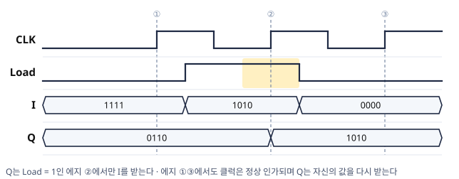

- Load는 에지와 에지 사이에 바뀌어도 결과에 영향이 없습니다. 플립플롭이 받는 값은 에지 순간의 $D$(MUX 출력)뿐입니다.
- 다만 에지 전후의 셋업 · 홀드 시간에는 $D$가 안정되어 있어야 합니다.

</details>

#### 예제 2-2 — Load-MUX의 입력 식

Load-MUX 구조에서 각 플립플롭의 $D$ 입력 식을 유도하고, $(Load, I_i, Q_i) = (0, 1, 0)$일 때 다음 상태를 확인하라.

<details>
<summary>풀이 보기</summary>


**Step 1** — 2:1 MUX(4장)의 식을 적용합니다. 선택선 = $Load$, 입력 0 = $Q_i$(피드백), 입력 1 = $I_i$(외부)입니다.

$$D_i = Load' \cdot Q_i + Load \cdot I_i$$

**Step 2** — $(0, 1, 0)$을 대입합니다. $D_i = 1 \cdot 0 + 0 \cdot 1 = 0$이므로 $Q_i(t+1) = 0$입니다. $I_i = 1$이 무시되고 값이 유지됩니다.

**검산**: $Load = 1$이면 $D_i = I_i$(로드)입니다. §2.4 동작 표의 두 행이 식 하나로 통합됩니다.

</details>

#### 예제 2-3 — 클럭 게이팅의 문제점 찾기 (심화)

한 학생이 Load 기능을 클럭 게이팅으로 구현했다(플립플롭의 클럭 = $\text{clk} \cdot \text{Load}$). 아래 파형에서 Load가 9에서 1이 되고 13에서 0이 될 때, 게이트 클럭의 문제점 두 가지를 찾아라.

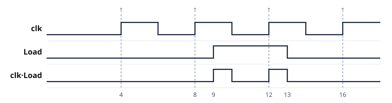

<details>
<summary>풀이 보기</summary>


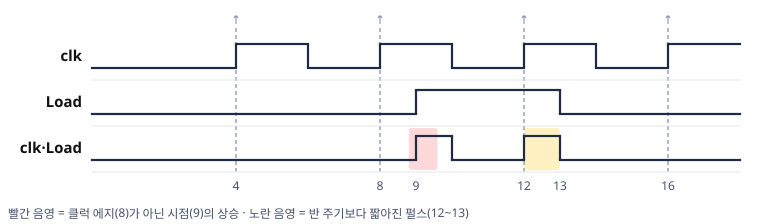

| 위치 | 게이트 클럭의 동작 | 문제 |
|---|---|---|
| 9 | Load가 1이 되는 순간 상승 | 클럭 에지(8)가 아닌 시점의 상승 — 의도하지 않은 순간에 값을 저장 |
| 12\~13 | 상승 뒤 Load가 0이 되어 일찍 하강 | 반 주기보다 짧은 펄스 — 최소 펄스 폭을 보장하지 못함 |

- **최소 펄스 폭**: 플립플롭이 안정적으로 동작하는 데 필요한 클럭 펄스의 최소 길이이며, 데이터시트의 규격 항목입니다.
- 문제의 원인은 Load가 클럭과 무관한 시점에 바뀌는 신호라는 점입니다. 이러한 신호가 클럭 경로에 섞이면 에지의 시점을 클럭이 아니라 Load가 정하게 됩니다.
- 여기에 게이트 지연까지 더해지면 게이트를 거친 플립플롭과 거치지 않은 플립플롭의 도착 시각이 달라집니다(§2.3 클럭 스큐).

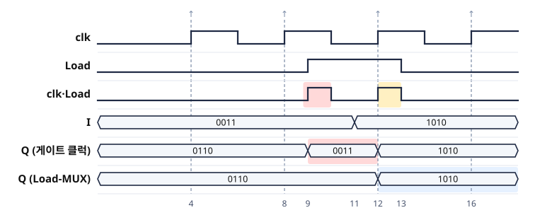

- **게이트 클럭**: 9의 상승에서 $Q$가 0011로 바뀝니다. 클럭 에지가 아닌 시점에 값이 저장된 결과입니다.
- **Load-MUX**: 에지 8에서는 Load = 0이므로 유지합니다. 에지 12에서만 $Q$가 1010으로 바뀝니다.
- Load-MUX 구조에서는 Load가 언제 바뀌어도 플립플롭은 클럭 에지 순간의 $D$만 받습니다.

</details>

#### 예제 2-4 — 파형에서 Load 복원 (심화)

병렬 로드 레지스터의 $I$와 $Q$가 클럭마다 아래와 같았다. 에지 ①~⑤의 Load 값을 복원하라.

| 에지 | 에지 직전 $I$ | 에지 직전 $Q$ | 에지 직후 $Q$ |
|:---:|:---:|:---:|:---:|
| ① | 1111 | 0110 | 0110 |
| ② | 1010 | 0110 | 1010 |
| ③ | 0101 | 1010 | 1010 |
| ④ | 0011 | 1010 | 0011 |
| ⑤ | 0011 | 0011 | 0011 |

<details>
<summary>풀이 보기</summary>


**판정 규칙** — 예제 2-2의 식에서, 에지 직후 $Q$가 $I$와 같고 직전 $Q$와 다르면 Load = 1이고, 직전 $Q$와 같고 $I$와 다르면 Load = 0입니다.

| 에지 | Load | 근거 |
|:---:|:---:|---|
| ① | 0 | 직후 $Q$ = 직전 $Q$ ≠ $I$ |
| ② | 1 | 직후 $Q$ = $I$ ≠ 직전 $Q$ |
| ③ | 0 | 직후 $Q$ = 직전 $Q$ ≠ $I$ |
| ④ | 1 | 직후 $Q$ = $I$ ≠ 직전 $Q$ |
| ⑤ | **판정 불가** | $I$ = 직전 $Q$ — Load가 0이어도 1이어도 결과가 같음 |

에지 ⑤는 두 경우의 결과가 같아 파형만으로는 Load를 알 수 없습니다. 이러한 칸은 카르노맵의 don't care처럼 「어느 값이어도 결과가 같은」 칸입니다.

</details>

---

### 2.5 복습문제

#### 문제 (1)

Load 제어신호를 가진 4-bit 병렬 레지스터에서,  
현재 저장값이 $Q = 1010$이고 입력 $I = 0111$이다.  
다음 클럭 이후 상태를 아래 두 경우에 대해 구하고, 이 제어를 클럭 게이팅으로 구현하지 않는 이유를 한 줄로 쓰라.

(a) Load = 0  
(b) Load = 1

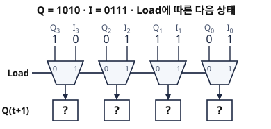

<details>
<summary>정답 보기</summary>


**(a) Load = 0**  
MUX가 피드백 경로($Q$)를 선택 → $D = Q = 1010$  
다음 상태: $Q(t+1) = 1010$ (유지)

**(b) Load = 1**  
MUX가 외부 입력($I$)을 선택 → $D = I = 0111$  
다음 상태: $Q(t+1) = 0111$ (로드 완료)

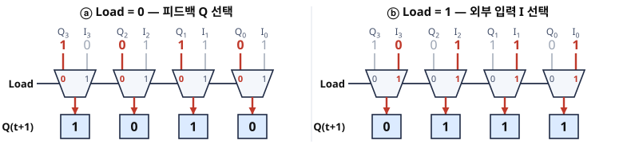

**이유**: 클럭 경로의 게이트는 게이트 지연과 클럭 스큐를 일으켜 플립플롭의 동시 갱신이 성립하지 않습니다. 따라서 제어는 클럭이 아니라 데이터 입력(MUX)에서 수행합니다.

「유지」도 능동적 동작(자체 값을 다시 로드)입니다. 이 관점은 8장 RTL에서 「아무 일도 하지 않는 클럭」을 이해하는 핵심 관점이 됩니다.

</details>

---

---

## 3. 시프트 레지스터

### 학습목표

- 시프트 레지스터의 정의와 동작 원리를 설명할 수 있다.
- MUX를 이용한 시프트 제어 방식을 이해한다.
- 직렬입력-직렬출력, 직렬입력-병렬출력, 병렬입력-직렬출력, 병렬입력-병렬출력의 차이를 설명할 수 있다.
- 범용 시프트 레지스터의 4모드(유지 · 우측 · 좌측 · 로드) 동작을 추적할 수 있다.

---

### 3.1 시프트 레지스터란?

**시프트 레지스터(Shift Register)** 는 각 플립플롭에 저장된 데이터를  
**정해진 방향으로 한 비트씩 이동(Shift)** 할 수 있는 레지스터입니다.

```
[FF3] ──▶ [FF2] ──▶ [FF1] ──▶ [FF0]
  ↑                                ↓
직렬 입력 (Serial In)          직렬 출력 (Serial Out)
```

클럭이 한 번 인가될 때마다 데이터가 한 칸씩 이동합니다.

> 💡 **비유**: 컨베이어 벨트 위의 상자들이 클럭마다 한 칸씩 이동하는 것과 같습니다.

**왜 한 칸씩인가** — 모든 플립플롭이 같은 에지에 **에지 직전의 값**을 받기 때문입니다. $Q_2$는 $Q_3$의 새 값이 아니라 에지 직전 값을 받으므로, 한 에지에 한 칸만 이동합니다.

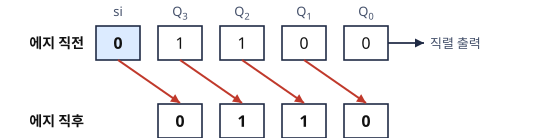

직전 $Q_0$의 값은 직렬 출력으로 전달되고, 비어 있던 $Q_3$에는 $si$가 저장됩니다.

> 📖 **그림은 교재 참고** — Mano 6판 Fig 6.3 (Four-bit shift register): D 플립플롭 사슬로 구현한 시프트 레지스터입니다. 플립플롭 사이의 연결은 배선만으로 구성됩니다.

---

### 3.2 시프트 제어 (MUX 방식)

단순 시프트 레지스터는 클럭마다 항상 시프트됩니다.  
**데이터를 유지하거나 새 데이터를 로드**하려면 제어 신호가 필요합니다.

클럭에 게이팅하는 방식은 앞서 설명한 이유로 비권장이므로,  
**MUX를 각 플립플롭 입력단에 배치**하여 제어합니다.

```
Data_gate = 0 : D ─▶[MUX]──▶ [FF]  → 외부 데이터 입력(시프트)
Data_gate = 1 : Q ─▶[MUX]──▶ [FF]  → 피드백 Q 선택(상태 유지)
```

| Data_gate | 동작 |
|:---:|:---:|
| 0 | 앞 플립플롭의 $Q$ 또는 직렬 입력 데이터 선택 → **시프트 진행** |
| 1 | 현재 플립플롭의 $Q$ 피드백 → **현재 상태 유지** |

---

### 3.3 시프트 레지스터의 종류

입력과 출력 방식의 조합에 따라 4가지로 분류됩니다:

| 종류 | 입력 | 출력 | 특징 |
|---|---|---|---|
| **SISO** (직렬 입력 – 직렬 출력) | 1-bit 순차 입력 | 1-bit 순차 출력 | 가장 기본적인 형태, 지연(Delay) 회로로 활용 |
| **SIPO** (직렬 입력 – 병렬 출력) | 1-bit 순차 입력 | n-bit 동시 출력 | 직렬 데이터 → 병렬 변환 (예: UART 수신 측) |
| **PISO** (병렬 입력 – 직렬 출력) | n-bit 동시 입력 | 1-bit 순차 출력 | 병렬 데이터 → 직렬 변환 (예: UART 송신 측) |
| **PIPO** (병렬 입력 – 병렬 출력) | n-bit 동시 입력 | n-bit 동시 출력 | 일반 레지스터와 유사, 고속 병렬 처리 |

> 💡 핵심 원리: SIPO는 **클럭을 n번 인가해야** n비트 데이터가 출력단에 모두 나타납니다.  
> 반대로 PISO는 클럭을 n번 인가하면 병렬로 로드된 n비트 데이터가 순차적으로 출력됩니다.

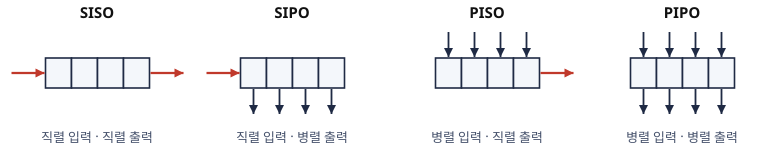

---

### 3.4 입력에서 출력까지의 시간 지연

시프트 레지스터에서 직렬 입력 데이터가 최종 출력단에 도달하기까지는  
**저장 비트 수만큼 클럭이 필요**합니다.

$$\text{지연 클럭 수} = \text{레지스터 비트 수} = n$$

예를 들어 8-bit 시프트 레지스터에서는,  
직렬 입력 첫 비트가 반대쪽 끝 출력까지 도달하려면 **8클럭**이 필요합니다.

이 특성을 활용하면 시프트 레지스터를 **지연 회로(Delay Circuit)** 로 사용할 수 있습니다.

---

### 3.5 범용 시프트 레지스터

유지 · 시프트 · 로드를 하나의 부품으로 합치려면 각 플립플롭 앞에 **4:1 MUX**(4장)를 두고 선택 신호 $s_1 s_0$로 모드를 선택합니다.

| $s_1 s_0$ | 동작 |
|:---:|---|
| 00 | 유지 (피드백) |
| 01 | **우측 시프트** ($si \to Q_3 \to \cdots \to Q_0$) |
| 10 | **좌측 시프트** (좌측 직렬 입력 $\to Q_0 \to \cdots \to Q_3$) |
| 11 | **병렬 로드** |

각 플립플롭의 4:1 MUX 입력은 자신의 $Q$ · 왼쪽 플립플롭의 $Q$ · 오른쪽 플립플롭의 $Q$ · 병렬 입력 $I$입니다.

> 📖 **그림은 교재 참고** — Mano 6판 Fig 6.7 (Four-bit universal shift register): 플립플롭마다 4:1 MUX가 있고 $s_1 s_0$로 모드를 선택합니다.

> 💡 **핵심**: 범용 시프트 레지스터는 **데이터패스 레지스터의 대표 형태**입니다. 8장의 마이크로연산(레지스터 값에 대한 기본 동작) 가운데 전송과 시프트를 이 부품의 모드 선택으로 구현할 수 있습니다. 산술 · 논리 연산은 ALU가 담당합니다. $s_1 s_0$를 공급하는 회로가 8장의 제어유닛입니다.

#### 예제 3-1 — 우측 시프트의 산술 의미

범용 시프트 레지스터(초기 $0101$)에 2클럭 동안 모드 $s_1 s_0 = 01$(우측 시프트, $si = 0$)을 연속 적용할 때 상태를 추적하라.

<details>
<summary>풀이 보기</summary>


| 클럭 | 모드 | 상태 |
|:---:|:---:|:---:|
| 초기 | — | 0101 |
| 1 | 01 ($si = 0$) | 0010 |
| 2 | 01 ($si = 0$) | 0001 |

**검산**: $0101_{(2)} = 5 \to 0010 = 2 \to 0001 = 1$입니다. 우측 시프트 1회는 **2로 나누기**(내림)에 해당합니다. 이 규칙이 음수에서 어떻게 되는지는 예제 3-3에서 다룹니다.

</details>

#### 예제 3-2 — 시프트 레지스터의 타이밍 차트

4비트 시프트 레지스터(우측 시프트, $si \to Q_3$, 초기 $0000$)에 에지별 $si = 1, 1, 0, 1$을 입력한다. 각 클럭 후 $Q_3 Q_2 Q_1 Q_0$을 채우고, 직렬 출력($Q_0$)에 첫 1이 나타나는 클럭을 답하라.

<details>
<summary>풀이 보기</summary>


| 클럭 | $si$ | $Q_3 Q_2 Q_1 Q_0$ |
|:---:|:---:|:---:|
| 1 | 1 | 1000 |
| 2 | 1 | 1100 |
| 3 | 0 | 0110 |
| 4 | 1 | 1011 |

$Q_0$에 첫 1이 나타나는 시점은 **4클럭 후**입니다. 첫 입력이 네 칸을 통과하므로 $n$비트 = $n$클럭 지연(§3.4)이 확인됩니다.

**검산**: 입력 순서 $1, 1, 0, 1$이 4클럭 후 $Q_0 Q_1 Q_2 Q_3 = 1, 1, 0, 1$로 보존됩니다.

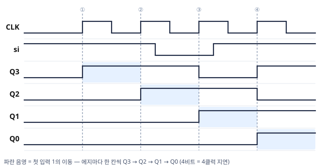

각 플립플롭의 파형은 바로 위 플립플롭의 파형을 한 클럭 늦춘 모양입니다($Q_2$ = 한 클럭 전의 $Q_3$).

</details>

**Logisim으로 확인하기** — 예제 3-2의 회로를 구성해 표와 대조합니다.

1. **배치**: D 플립플롭 4개를 $Q_3 \to Q_2 \to Q_1 \to Q_0$ 순서로 놓고, 앞 플립플롭의 $Q$를 다음 플립플롭의 $D$에 연결합니다. $Q_3$의 $D$에는 입력 핀 $si$를, 네 플립플롭의 클럭에는 입력 핀 $CLK$ 하나를 연결하고, 각 $Q$에 출력 핀을 연결합니다.
2. **초기 상태 확인**: 네 출력이 $0000$인지 확인합니다.
3. **에지 ① · ②**: $si = 1$로 두고 $CLK$를 0 → 1 → 0으로 두 번 바꿉니다. $1000 \to 1100$이 되는지 확인합니다.
4. **에지 ③ · ④**: $si = 0$으로 한 번, $si = 1$로 한 번 에지를 인가합니다. $0110 \to 1011$이 되는지 확인합니다.
5. **대조**: 에지마다 기록한 값이 표와 일치하는지 확인합니다. $si$를 0으로 두고 에지를 더 인가해 값이 오른쪽 끝으로 출력되는 것을 관찰합니다.

#### 예제 3-3 — 2의 보수의 우측 시프트 (심화)

4비트 2의 보수 $1100$($-4$)을 범용 시프트 레지스터로 우측 시프트(모드 01)해 2로 나누려 한다. (a) $si = 0$일 때 (b) $si = Q_3$(부호 비트)일 때 결과와 그 10진 값을 구하라.

<details>
<summary>풀이 보기</summary>


| 경우 | 시프트 결과 | 10진 값 (2의 보수) | 판정 |
|---|:---:|:---:|:---:|
| (a) $si = 0$ | $0110$ | $+6$ | ✗ 부호가 바뀜 |
| (b) $si = Q_3 = 1$ | $1110$ | $-2$ | ✓ $-4 \div 2$ |

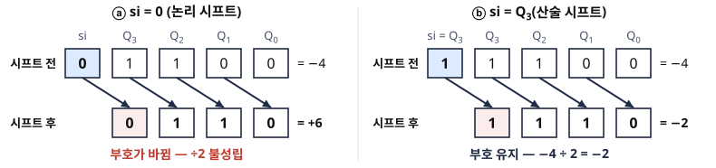

- (a)에서는 비어 있는 $Q_3$ 자리에 0이 입력되어 부호 비트가 0이 됩니다. 「우측 시프트 = 2로 나누기」는 부호 없는 수(예제 3-1)에서만 그대로 성립합니다.
- (b)처럼 부호 비트를 다시 입력하는 시프트를 **산술 시프트**, 0을 입력하는 시프트를 **논리 시프트**라고 합니다. 범용 시프트 레지스터에서는 $si$에 무엇을 연결하는가로 둘을 구분합니다.

</details>

#### 예제 3-4 — 범용 시프트 레지스터의 입력 식 (심화)

4비트 범용 시프트 레지스터에서 가운데 플립플롭 $Q_2$의 입력 $D_2$를 $s_1$ · $s_0$의 식으로 쓰라. 우측 시프트에서 $Q_2$는 $Q_3$의 값을, 좌측 시프트에서는 $Q_1$의 값을 받으며, 병렬 입력은 $I_2$이다.

<details>
<summary>풀이 보기</summary>


**Step 1** — 모드별로 $Q_2$가 받을 값을 정합니다.

| $s_1 s_0$ | 동작 | $D_2$ |
|:---:|---|:---:|
| 00 | 유지 | $Q_2$ |
| 01 | 우측 시프트 | $Q_3$ |
| 10 | 좌측 시프트 | $Q_1$ |
| 11 | 병렬 로드 | $I_2$ |

**Step 2** — 4:1 MUX의 식(4장)을 적용합니다. 선택선 조합마다 곱항이 하나입니다.

$$D_2 = s_1's_0'\,Q_2 + s_1's_0\,Q_3 + s_1s_0'\,Q_1 + s_1s_0\,I_2$$

**검산**: $s_1 s_0 = 01$이면 둘째 항만 남아 $D_2 = Q_3$이므로 우측 시프트입니다.

예제 2-2의 Load-MUX($D_i = Load'Q_i + Load\,I_i$)는 이 식에서 시프트 두 항을 뺀 경우입니다.

</details>

---

### 3.6 복습문제

#### 문제 (1)

4-bit SIPO 시프트 레지스터의 초기 상태가 $0000$이다.  
직렬 입력으로 $1, 0, 1, 1$이 4클럭에 걸쳐 인가될 때,  
각 클럭 이후의 레지스터 상태를 나타내라.

<details>
<summary>정답 및 풀이 보기</summary>


오른쪽으로 시프트(새 입력은 MSB 위치에 들어온다고 가정):

| 클럭 | 직렬 입력 | 레지스터 상태 ($Q_3 Q_2 Q_1 Q_0$) |
|:---:|:---:|:---:|
| 초기 | — | 0000 |
| 1 | 1 | 1000 |
| 2 | 0 | 0100 |
| 3 | 1 | 1010 |
| 4 | 1 | 1101 |

4클럭 후 병렬 출력: $Q_3 Q_2 Q_1 Q_0 = 1101$

**검산**: 첫 입력 1은 4클럭 동안 네 칸을 이동해 $Q_0$에, 마지막 입력 1은 $Q_3$에 저장됩니다. 입력 순서 $1, 0, 1, 1$이 $Q_0$, $Q_1$, $Q_2$, $Q_3$ 위치에 보존됩니다.

</details>

#### 문제 (2)

범용 시프트 레지스터의 초기 상태가 $1001$이다. 클럭 3번에 걸쳐 모드가 순서대로 (a) $s_1 s_0 = 11$ (병렬 입력 $I = 0110$) (b) $01$ (우측 시프트, $si = 1$) (c) $00$일 때, 각 클럭 후 상태를 구하라.

<details>
<summary>정답 및 풀이 보기</summary>


| 클럭 | 모드 | 동작 | 상태 |
|:---:|:---:|---|:---:|
| 초기 | — | — | 1001 |
| 1 | 11 | 병렬 로드 $I = 0110$ | **0110** |
| 2 | 01 | 우측 시프트 ($si = 1$ → $Q_3$) | **1011** |
| 3 | 00 | 유지 | 1011 |

**검산** (클럭 2): $0110$에서 $si = 1$이 $Q_3$에 저장되고 나머지가 한 칸씩 오른쪽으로 이동해 $1011$이 됩니다.

부품 하나가 클럭마다 다른 동작을 수행합니다. 동작을 정하는 $s_1 s_0$를 클럭마다 공급하는 회로가 제어유닛입니다(8장).

</details>

#### 문제 (3)

4비트 시프트 레지스터의 각 플립플롭 앞에 2:1 MUX를 두고 제어 신호 $Ctrl$로 동작을 선택한다. $Ctrl = 0$이면 유지, $Ctrl = 1$이면 우측 시프트($si \to Q_3$)이다. (a) $Q_1$의 입력 $D_1$을 식으로 구하고 (b) 초기 $1010$, $si = 1$에서 $Ctrl = 1, 0, 1$을 차례로 인가했을 때 각 클럭 후 상태를 구하라.

<details>
<summary>정답 및 풀이 보기</summary>


**(a)** 우측 시프트에서 $Q_1$은 $Q_2$의 값을 받으므로, 예제 2-2와 같은 2:1 MUX 식입니다.

$$D_1 = Ctrl'\,Q_1 + Ctrl\,Q_2$$

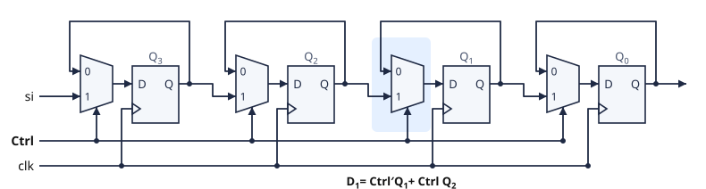

**(b)**

| 클럭 | $Ctrl$ | 동작 | 상태 |
|:---:|:---:|---|:---:|
| 초기 | — | — | 1010 |
| 1 | 1 | 우측 시프트($si = 1$) | 1101 |
| 2 | 0 | 유지 | 1101 |
| 3 | 1 | 우측 시프트($si = 1$) | 1110 |

**검산** (클럭 1): $1010$의 각 비트가 오른쪽으로 한 칸 이동하고, 비어 있는 $Q_3$에 $si = 1$이 저장되어 $1101$이 됩니다.

범용 시프트 레지스터(§3.5)에서 좌측 시프트와 병렬 로드를 뺀 형태입니다. 선택할 동작이 둘이면 2:1 MUX, 넷이면 4:1 MUX입니다.

</details>

---

---

## 4. 직렬 전송

### 학습목표

- 레지스터 간 직렬 전송의 동작 원리를 설명할 수 있다.
- 직렬 가산의 구조(전가산기 1개 + 캐리 플립플롭)를 개요 수준으로 설명할 수 있다.
- UART를 포함하여 직렬 전송이 활용되는 현대 디지털 시스템의 사례를 이해한다.

---

### 4.1 직렬 전송이란?

**직렬 전송(Serial Transfer)** 은 송신 측 레지스터에서 수신 측 레지스터로  
**한 번에 1-bit씩 순차적으로 전송하고 조작하는 방식**입니다.

병렬 전송과의 비교:

| 구분 | 직렬 전송 | 병렬 전송 |
|---|---|---|
| 한 번에 전송 비트 수 | 1-bit | n-bit |
| 필요한 신호선 수 | 적음 (1~2개) | 많음 (n개) |
| 전송 속도 (같은 클럭 기준) | 상대적으로 느림 | 빠름 |
| 신호 간 타이밍 오차(Skew) | 거의 없음 | 관리 필요 |
| 실용적 장점 | 배선 단순, 고속 차동 신호 적용 용이 | 짧은 거리, 내부 버스에 적합 |

> 💡 **현대 인터페이스의 역설**: 직렬 전송은 "느리다"는 이미지가 있지만,  
> 실제로는 배선 복잡도와 신호 스큐 문제를 줄이기 위해 **고속 시스템일수록 직렬 방식**을 채택합니다.

- **병렬의 한계**: 비트 수가 늘수록 모든 선의 도착 시각을 맞추기 어려워집니다. §2.3의 스큐와 같은 문제입니다.
- **직렬의 해법**: 한 쌍의 선(**차동 쌍** — 두 선의 전압 차로 1비트를 전달)으로 비트를 차례로 전송하므로 선 사이의 도착 시간 차이 문제가 크게 줄어듭니다.
- **속도 확장**: **Lane**(송신 · 수신 차동 쌍 한 벌)을 늘립니다. Lane 사이의 어긋남은 수신 측에서 보정합니다.

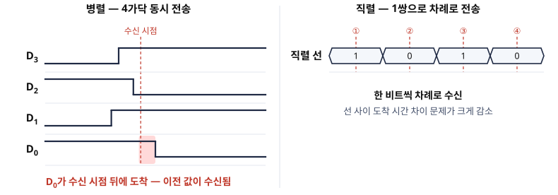

---

### 4.2 4-bit 레지스터 간 직렬 전송 예제

#### 예제 4-1 — 직렬 전송 추적

송신 레지스터 A: 초기값 $1011$  
수신 레지스터 B: 초기값 $0010$

**전송 방식:**  
A 레지스터의 LSB($Q_0$)가 클럭마다 B 레지스터의 입력으로 직렬 전송됩니다.  
A는 우측 시프트, B는 우측 시프트로 수신합니다.

| 클럭 | A 상태 | B 상태 | A→B 전송 비트 |
|:---:|:---:|:---:|:---:|
| 초기 | 1011 | 0010 | — |
| 1 | 0101 | 1001 | 1 |
| 2 | 0010 | 1100 | 1 |
| 3 | 0001 | 0110 | 0 |
| 4 | 0000 | 1011 | 1 |

4클럭 후 A 레지스터의 원래 값 $1011$이 B 레지스터에 완전히 복사됩니다.

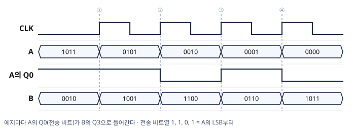

- 전송 비트열은 $1, 1, 0, 1$이며 A의 LSB부터 차례로 출력됩니다. B에서는 먼저 입력된 비트가 오른쪽으로 이동해 4클럭 뒤 $Q_0$에 도착하므로 순서가 보존됩니다.
- 4클럭 뒤에 멈추려면 제어 신호로 시프트와 유지를 선택합니다(§3.6 문제 (3)의 $Ctrl$). 클럭 횟수를 세는 부품이 카운터(6장 2/2)입니다.

> 📖 **그림은 교재 참고** — Mano 6판 Fig 6.4 (Serial transfer from register A to register B): 교재 그림은 클럭을 AND로 제어합니다. 설계에서는 §2와 같이 클럭을 그대로 두고 MUX로 유지와 시프트를 선택합니다.

> 💡 **Tip**: 위 방식은 전송 후 A가 비워집니다($0000$). A의 출력을 **자신의 입력으로도 되돌리면(재순환)** 전송 후에도 A가 원래 값으로 복원됩니다. 예제 4-3에서 추적합니다.

---

### 4.3 직렬 가산 — 가산기 하나로 n비트 덧셈 (개요)

4장의 리플 캐리 가산기는 전가산기 $n$개를 사용합니다. 직렬 방식은 **전가산기 1개**로 같은 연산을 수행합니다.

- 시프트 레지스터 A · B가 클럭마다 한 비트씩(LSB부터) 전가산기에 공급합니다.
- 합 비트는 A로 되돌려 시프트 입력합니다. 결과는 A에 저장됩니다.
- **캐리는 플립플롭 하나에 저장**해 다음 비트 계산에 전달합니다.

> 📖 **그림은 교재 참고** — Mano 6판 Fig 6.5 (Serial adder): 전가산기 1개와 캐리 저장 플립플롭으로 구성됩니다. 이 그림도 캐리 플립플롭의 클럭을 AND로 제어합니다.

$n$배 느린 대신 전가산기 수는 $1/n$입니다(캐리 플립플롭 1개 추가). **시간과 하드웨어의 절충**입니다. 병렬 구현(가산기를 비트 수만큼 배치)과 직렬 구현(가산기 하나를 비트 수만큼 반복 사용)은 같은 덧셈의 두 구현입니다.

#### 예제 4-2 — 직렬 가산 추적

직렬 가산기에서 $A = 0101$(5), $B = 0011$(3), 캐리 플립플롭 초기값 $C = 0$이다. 둘 다 우측 시프트하고, 합 비트는 A의 $Q_3$으로, B에는 0이 입력된다. 4클럭을 추적해 결과를 확인하라.

<details>
<summary>풀이 보기</summary>


전가산기는 매 클럭 $S = A_0 \oplus B_0 \oplus C$, $C^+ = A_0B_0 + C(A_0 \oplus B_0)$를 계산합니다(4장).

| 클럭 | 에지 직전 A | 에지 직전 B | $A_0$ | $B_0$ | $C$ | $S$ | $C^+$ |
|:---:|:---:|:---:|:---:|:---:|:---:|:---:|:---:|
| 1 | 0101 | 0011 | 1 | 1 | 0 | 0 | 1 |
| 2 | 0010 | 0001 | 0 | 1 | 1 | 0 | 1 |
| 3 | 0001 | 0000 | 1 | 0 | 1 | 0 | 1 |
| 4 | 0000 | 0000 | 0 | 0 | 1 | **1** | 0 |

4클럭 뒤 $A = 1000$(8)이므로 $5 + 3 = 8$입니다.

- 합 비트 $0, 0, 0, 1$이 LSB부터 차례로 A의 $Q_3$에 입력되어 오른쪽으로 이동하므로, 마지막 합 비트가 MSB가 됩니다.
- 캐리 플립플롭은 앞 자리의 올림수를 다음 클럭까지 기억합니다. 리플 캐리 가산기의 캐리 배선을 시간 방향으로 바꾼 것입니다.

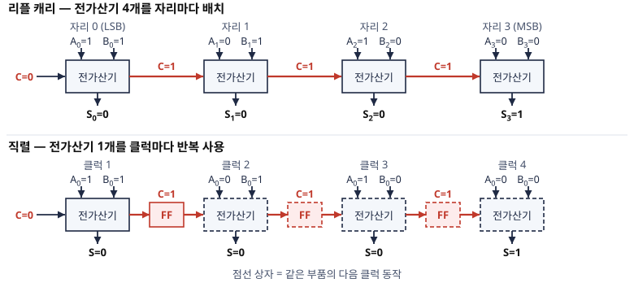

</details>

---

### 4.4 재순환과 직렬 출력의 위치

#### 예제 4-3 — 재순환 직렬 전송 (심화)

예제 4-1과 같은 연결(A의 $Q_0$ → B의 $Q_3$, 둘 다 우측 시프트, $A = 1011$, $B = 0010$)에서, 이번에는 A의 $Q_0$을 **A의 $Q_3$에도 되돌린다**(재순환). 4클럭 후 A와 B를 구하라.

<details>
<summary>풀이 보기</summary>


A는 회전(rotate)하고, B는 예제 4-1과 동일하게 수신합니다.

| 클럭 | A | B | 전송 비트 |
|:---:|:---:|:---:|:---:|
| 초기 | 1011 | 0010 | — |
| 1 | 1101 | 1001 | 1 |
| 2 | 1110 | 1100 | 1 |
| 3 | 0111 | 0110 | 0 |
| 4 | **1011** | **1011** | 1 |

**검산**: 전송 비트열($1, 1, 0, 1$)이 예제 4-1과 같으므로 B의 결과도 같습니다. A는 4클럭 만에 원래 값으로 복원되었습니다. 읽으면 지워지는 전송과 읽어도 남는 전송의 차이는 배선 한 가닥입니다.

</details>

#### 예제 4-4 — 직렬 출력 연결 오류 (심화)

한 학생이 예제 4-1의 회로를 구성하면서 B의 직렬 입력에 A의 $Q_0$ 대신 $Q_3$을 연결했다. 4클럭 뒤 B를 구하고, 이 연결이 틀린 이유를 설명하라.

<details>
<summary>풀이 보기</summary>


| 클럭 | 에지 직전 A | 전송 비트(A의 $Q_3$) | 에지 직후 B |
|:---:|:---:|:---:|:---:|
| 1 | 1011 | 1 | 1001 |
| 2 | 0101 | 0 | 0100 |
| 3 | 0010 | 0 | 0010 |
| 4 | 0001 | 0 | **0001** |

- 4클럭 뒤 $B = 0001$이므로 A의 원래 값 $1011$이 복사되지 않습니다.
- 우측 시프트에서 $Q_3$은 **입력을 받는 첫 플립플롭**입니다. 첫 클럭 뒤부터는 A에 유입되는 0이 차례로 저장되므로, $Q_3$을 읽으면 원래 MSB 한 비트와 유입된 0만 전송됩니다.
- 직렬 출력은 시프트 방향의 **마지막 플립플롭**($Q_0$)에서 가져와야 합니다.

</details>

---

### 4.5 직렬 전송의 실제 활용 분야

직렬 전송 원리는 현대 디지털 시스템에서 **매우 광범위하게 응용**됩니다.  
아래 기술들은 모두 직렬 전송의 직접적인 응용 사례입니다.

---

#### UART (Universal Asynchronous Receiver/Transmitter)

**UART**는 가장 기초적인 직렬 통신 인터페이스입니다.  
레지스터 간 직렬 전송 개념을 하드웨어 통신 프로토콜로 구현한 것입니다.

**UART의 데이터 프레임 구조:**

```
|Start|D0|D1|D2|D3|D4|D5|D6|D7|Parity|Stop|
   1     ←── 8 data bits ──▶         1    1
```

- **Start Bit**: 전송 시작 신호
- **Data Bits**: 실제 데이터 (보통 8-bit)
- **Parity Bit**: 오류 검출 (선택적)
- **Stop Bit**: 전송 종료 신호

**활용 분야:**
- 마이크로컨트롤러 (Arduino, STM32, ESP32 등)와 PC 간 통신
- 센서 모듈, GPS 수신기, 블루투스 모듈 연결
- 임베디드 시스템 디버깅 포트 (Debug UART)
- 개발 보드의 시리얼 모니터

> 💡 UART는 클럭 신호 없이 **미리 약속된 Baud Rate(비트 전송 속도)** 로 통신하므로  
> 비동기(Asynchronous) 방식입니다.  
> 대표적인 Baud Rate: 9600, 115200 bps

UART 내부에는 §3.3의 시프트 레지스터가 있습니다. 송신부는 바이트를 비트로 분해하는 **PISO**이고, 수신부는 비트 스트림을 바이트로 조립하는 **SIPO**입니다. 다른 직렬 통신의 양 끝에도 같은 부품이 있습니다.

---

#### USB (Universal Serial Bus)

**USB**는 이름 그대로 **직렬(Serial) 버스**입니다.  
PC와 키보드, 마우스, 저장장치, 스마트폰 등을 연결하는 가장 보편적인 인터페이스입니다.

**USB의 직렬 전송 구조:**

```
호스트(PC) ──[D+/D-]──▶ 디바이스
            차동 직렬 신호쌍
```

- 데이터를 패킷 단위로 묶어 **비트 스트림으로 직렬 전송**
- 기본 USB는 호스트가 통신 방향을 제어하는 반이중(Half-duplex) 구조
- USB 3.x(SuperSpeed)부터는 추가 고속 차동선이 도입되어 **전이중(Full-duplex)** 통신 지원
**USB 세대별 최고 속도:**

| 세대 | 규격명 | 최대 속도 |
|---|---|---|
| USB 1.1 | Full Speed | 12 Mbps |
| USB 2.0 | Hi-Speed | 480 Mbps |
| USB 3.2 Gen 1 | SuperSpeed | 5 Gbps |
| USB 3.2 Gen 2 | SuperSpeed+ | 10 Gbps |
| USB4 Gen 3 | — | 40 Gbps |
| USB4 Version 2.0 | — | 80 Gbps |

---

#### USB-to-Serial 어댑터

**USB-to-Serial 어댑터**는 USB 인터페이스를 가진 PC에서  
RS-232, RS-485, TTL UART 등 기존 직렬 통신 장치를 연결할 때 사용하는 변환 장치입니다.

**실무 활용 예:**
- 구형 산업용 장비 (RS-232 포트 사용 장비)와 현대 PC 연결
- 아두이노, 라즈베리파이 개발 보드와 PC 간 시리얼 통신
- 임베디드 장치 펌웨어 업로드

---

#### PCI Express (PCIe)

**PCIe**는 PC 내부에서 CPU와 GPU, SSD, 네트워크 카드 등을 연결하는  
**현대 고속 직렬 인터페이스의 대표 사례**입니다.

**PCIe의 구조적 특징:**

```
CPU ──[Lane 0: TX+/TX-  RX+/RX-]──▶ GPU
     ──[Lane 1: TX+/TX-  RX+/RX-]──▶
     ──[Lane 2: TX+/TX-  RX+/RX-]──▶
     ──[Lane N: TX+/TX-  RX+/RX-]──▶
```

- 각 Lane은 **송신용 차동 신호쌍** + **수신용 차동 신호쌍**으로 구성
- 여러 Lane을 묶어($\times 1$, $\times 4$, $\times 8$, $\times 16$) 대역폭 확장 가능
- **Point-to-point 직렬 링크**이므로 선 사이의 스큐 문제가 크게 줄어듦(Lane 사이의 어긋남은 수신 측에서 보정)

**PCIe 세대별 최대 속도 (Lane당):**

| 세대 | Lane당 대역폭 | ×16 슬롯 기준 총 대역폭 |
|---|---|---|
| PCIe 3.0 | 8 GT/s (약 1 GB/s) | ~16 GB/s |
| PCIe 4.0 | 16 GT/s (약 2 GB/s) | ~32 GB/s |
| PCIe 5.0 | 32 GT/s (약 4 GB/s) | ~64 GB/s |
| PCIe 6.0 | 64 GT/s (약 8 GB/s) | ~128 GB/s |

> 💡 **핵심 시사점**: PCIe는 병렬 버스(구형 PCI)에서 직렬 링크로 전환된 대표 사례입니다.  
> 병렬 방식은 비트 수를 늘릴수록 신호 스큐 관리가 어려워지지만,  
> 직렬 방식은 Lane만 늘리면 되므로 **확장성이 뛰어납니다**.

---

### 4.6 직렬 전송 기술 비교 요약

| 기술 | 용도 | 전송 방식 | 대표 속도 |
|---|---|---|---|
| **UART** | 마이크로컨트롤러, 임베디드 통신 | 비동기 직렬 | ~115,200 bps |
| **USB 2.0** | 범용 외부 장치 연결 | 비동기 직렬 패킷 | 480 Mbps |
| **USB 3.2 Gen 2** | 고속 외부 저장장치 연결 | 전이중 직렬 | 10 Gbps |
| **PCIe 5.0 ×16** | GPU, NVMe SSD 내부 연결 | 고속 직렬 Lane | 64 GB/s |

> 💡 **정리하면**:
> - 저속·단순 연결: **UART**
> - 범용 외부 연결: **USB**
> - 고속 내부 연결: **PCIe**
>
> 직렬 전송은 "느린 방식"이 아니라,  
> **현대 고속 인터페이스의 표준 방식**으로 이해해야 합니다.

---

### 4.7 복습문제

#### 문제 (1)

USB가 "직렬(Serial)" 버스라 불리는 이유를 두 가지 관점(구조적 특성, 전송 방식)에서 설명하라.

<details>
<summary>정답 보기</summary>


1. **구조적 특성**: USB는 데이터를 전송하는 실제 신호선이 D+/D- 차동 신호쌍으로  
   최소화되어 있으며, 병렬 버스처럼 여러 비트를 동시에 보내는 구조가 아님
2. **전송 방식**: 데이터가 패킷 단위로 묶인 후, **비트 스트림(bit stream)** 형태로  
   한 비트씩 순차 전송됨

→ 두 이유 모두 "직렬(Serial)" 방식의 정의와 일치함

</details>

---

#### 문제 (2)

PCIe 4.0 ×4 슬롯의 총 대역폭을 계산하라.  
(PCIe 4.0: Lane당 약 2 GB/s 기준)

<details>
<summary>정답 및 풀이 보기</summary>


$$\text{총 대역폭} = \text{Lane당 대역폭} \times \text{Lane 수}$$

$$= 2\,\text{GB/s} \times 4 = \boxed{8\,\text{GB/s}}$$

</details>

#### 문제 (3)

$A = 1101$, $B = 0000$(둘 다 4비트, 예제 4-1과 같은 연결)일 때 4클럭 후의 A와 B를 구하라.

<details>
<summary>정답 및 풀이 보기</summary>


| 클럭 | A | B | 전송 비트 |
|:---:|:---:|:---:|:---:|
| 1 | 0110 | 1000 | 1 |
| 2 | 0011 | 0100 | 0 |
| 3 | 0001 | 1010 | 1 |
| 4 | 0000 | **1101** | 1 |

$B = 1101$은 A의 원래 값과 같습니다. LSB부터 전송되어 순서가 보존되며, 첫 비트는 4클럭 동안 B를 통과해 $Q_0$에 저장됩니다.

</details>

#### 문제 (4) — 종합

RTL 표기(8장) `P: B ← A`는 「제어 신호 $P = 1$인 클럭 에지에 A의 값을 B로 병렬 전송하라」는 뜻이다. 이 문장을 이 장의 부품으로 **하드웨어 배선**하라(글로 작성: 무엇을 어디에 연결하는가).

<details>
<summary>정답 및 풀이 보기</summary>


1. B를 **병렬 로드 레지스터**(§2)로 구성합니다.
2. A의 병렬 출력 4비트를 B의 병렬 입력 $I$에 배선합니다.
3. 제어 신호 $P$를 B의 **Load 입력**에 연결합니다. 클럭은 양쪽 모두 그대로 둡니다.

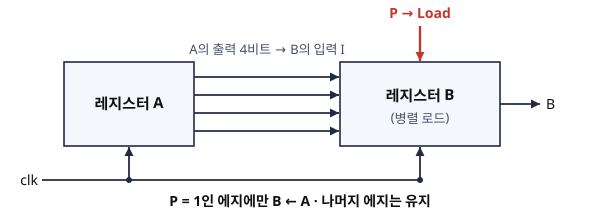

$P = 1$인 에지에만 $B \leftarrow A$이고, 나머지 에지에는 B가 유지됩니다.

**검산**: $P = 0$이면 MUX가 피드백을 선택하므로 값이 유지됩니다.

RTL 문장 `P: B ← A`는 이 배선의 줄임 표기입니다. 8장의 RTL 설계는 이러한 문장을 작성하는 일이고, 제어유닛은 $P$ 같은 신호를 적절한 클럭에 생성하는 FSM입니다.

</details>

#### 문제 (5)

UART 수신기가 8비트 데이터를 받아 병렬 바이트로 만들 때 (a) 어떤 유형의 시프트 레지스터가 필요하며 (b) 데이터 비트 수신에 최소 몇 번의 비트 클럭이 필요한가?

<details>
<summary>정답 보기</summary>


**(a)** **SIPO**(직렬 입력 – 병렬 출력)입니다. 한 비트씩 입력받아 8비트가 채워지면 병렬로 출력합니다.

**(b)** **8클럭**입니다($n$비트 = $n$클럭, §3.4).

반대편 송신기는 PISO입니다. 직렬 통신 링크 하나에 이 두 부품이 서로 대응합니다.

</details>

---

> 📌 **2차 보조자료 예고**  
> 다음 자료(2/2)에서는 아래 내용을 다룹니다.
> - 5. 비동기식 카운터 (리플 카운터 구조 및 동작)
> - 6. 전파지연과 최대 클럭 주파수 (4-bit 예제 계산)
> - 7. 동기식 카운터 (동작 원리, JK 입력 상태표, 논리식 도출)
