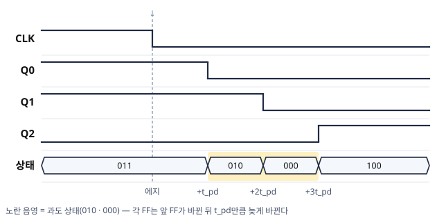
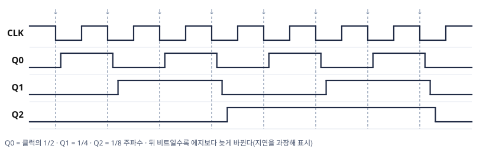
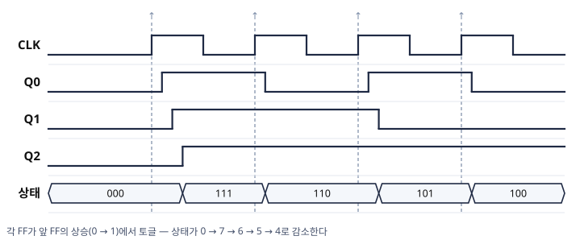
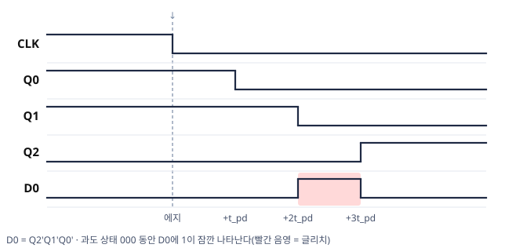
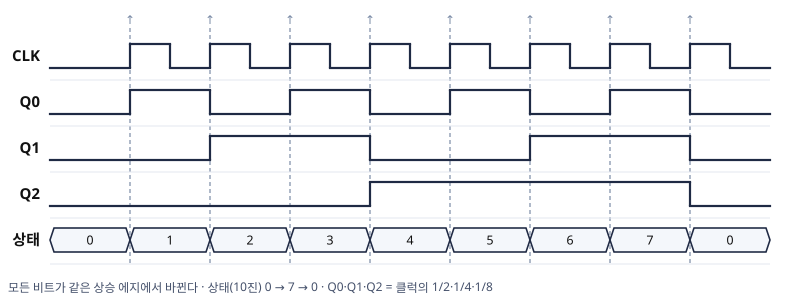
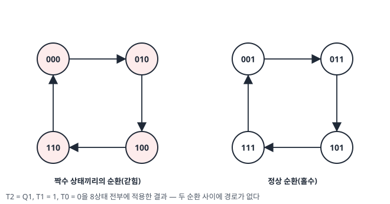
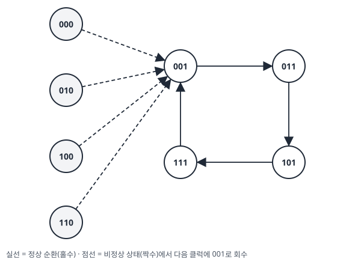

# 디지털공학 6장 보조학습자료 (2/2)
### 비동기식 카운터(리플 카운터), 전파지연과 최대 클럭 주파수, 동기식 카운터, 카운터 설계, 기타 카운터

> 이 자료는 교재의 핵심 개념과 풀이 과정을 본문 서술로 정리한 복습용 보조자료입니다.  
> Mano, *Digital Design* 6장과 함께 활용하세요.

---

## 목차

- [5. 비동기식 카운터 (리플 카운터)](#5-비동기식-카운터-리플-카운터)
- [6. 전파지연과 최대 클럭 주파수](#6-전파지연과-최대-클럭-주파수)
- [7. 동기식 카운터](#7-동기식-카운터)
- [8. 기타 카운터](#8-기타-카운터)

---

## 5. 비동기식 카운터 (리플 카운터)

### 학습목표

- 비동기식 카운터의 구조와 "리플(Ripple)"이라는 이름의 유래를 설명할 수 있다.
- 3비트 리플 카운터의 동작을 타이밍도로 추적할 수 있다.
- T 플립플롭과 D 플립플롭으로 비동기 카운터를 구성하는 방법을 이해한다.
- 리플 카운터의 과도 상태가 출력을 사용하는 회로에 미치는 영향을 설명할 수 있다.

---

### 5.1 비동기식 카운터란?

**비동기식 카운터(Asynchronous Counter)** 는 **첫 번째 플립플롭에만 클럭 펄스를 입력**하고,  
나머지 플립플롭은 **앞단 플립플롭의 출력을 자신의 클럭 펄스로 사용**하는 카운터입니다.

```
CLK ──▶[FF0]──Q0──▶[FF1]──Q1──▶[FF2]──Q2
        클럭 입력    클럭 입력    클럭 입력
       (외부 CLK)   (Q0 사용)   (Q1 사용)
```

- 클럭이 모든 플립플롭에 **동시에 들어가지 않습니다.**
- 앞단의 출력 변화가 뒷단의 클럭을 차례로 흔들기 때문에,  
  상태 변화가 **물결치듯(Ripple) 순차적으로 전파**됩니다.
- 이 때문에 비동기식 카운터를 **리플 카운터(Ripple Counter)** 라고도 부릅니다.

> 💡 **핵심**: "비동기"란 모든 플립플롭이 같은 클럭에 맞춰 동시에 바뀌지 않는다는 뜻입니다.  
> 한 단계씩 신호가 전달되어야 다음 단계가 동작합니다.

> 💡 **카운터 = 입력 없는 FSM**: 카운터는 입력 없이 클럭만으로 정해진 순환을 반복하는 순차회로입니다. 다음 상태가 현재 상태만으로 정해지므로, 상태표에서 입력 열을 지운 형태가 됩니다. 5장의 상태표와 상태도로 그대로 읽을 수 있습니다.

> 📖 **그림은 교재 참고** — Mano 6판 Fig 6.8 (Four-bit binary ripple counter): 클럭이 $A_0$에만 연결되고, $A_0$의 출력이 $A_1$의 클럭이 됩니다. D 플립플롭으로 만든 구성은 $Q'$를 $D$에 되돌려 토글을 만듭니다(5.3).

---

### 5.2 3비트 리플 카운터 동작

각 플립플롭은 **JK 플립플롭의 $J = K = 1$(토글) 설정**으로 사용합니다.  
$J = K = 1$이면 클럭 에지마다 출력이 **반전(Toggle)** 됩니다. (5장 JK 플립플롭 참고)

- **FF0**: 외부 CLK로 동작 → 클럭마다 $Q_0$ 토글 (LSB)
- **FF1**: $Q_0$를 클럭으로 사용 → $Q_0$가 $1 \rightarrow 0$으로 바뀔 때 $Q_1$ 토글
- **FF2**: $Q_1$을 클럭으로 사용 → $Q_1$이 $1 \rightarrow 0$으로 바뀔 때 $Q_2$ 토글 (MSB)

> ⚠️ 그림의 클럭 입력에 **버블(○)** 이 있으면 **하강 에지(Negative Edge)** 에서 동작합니다.  
> 즉, 앞단 출력이 $1 \rightarrow 0$으로 떨어질 때 다음 단이 토글합니다.

**타이밍도 (하강 에지 트리거 기준):**

```
        1   2   3   4   5   6   7   8
CLK   ┐_┌─┐_┌─┐_┌─┐_┌─┐_┌─┐_┌─┐_┌─┐_┌
Q0    0  1  0  1  0  1  0  1  0     ← 클럭마다 토글 (LSB)
Q1    0  0  1  1  0  0  1  1  0     ← Q0:1→0 일 때 토글
Q2    0  0  0  0  1  1  1  1  0     ← Q1:1→0 일 때 토글 (MSB)
      └─────────────────────────┘
       000→001→010→011→100→101→110→111→000 (recycle)
```

3비트이므로 $0 \sim 7$($000 \sim 111$)을 세고, 8번째 클럭에서 **다시 0으로 순환(recycle)** 합니다.

$$\text{3비트 카운터의 계수 범위} = 0 \sim 2^3 - 1 = 0 \sim 7$$

**왜 하강 에지인가** — 2진수에서 윗자리는 아랫자리가 $1 \rightarrow 0$으로 넘어갈 때(자리올림) 바뀝니다. 아랫비트의 $1 \rightarrow 0$은 그 비트 출력의 하강 에지이므로, 하강 에지 플립플롭에 $Q$를 그대로 연결하면 증가 계수가 됩니다. 상승 에지 플립플롭을 같은 방식으로 연결하면 계수 방향이 바뀝니다(예제 5-3).

#### 예제 5-1 — 리플 카운터의 과도 상태 추적

3비트 리플 카운터(하강 에지 토글)의 상태가 $011$이다. 다음 클럭에서 일어나는 일을 순서대로 추적하라. 각 플립플롭의 전파지연은 $t_{pd}$로 같다.

<details>
<summary>풀이 보기</summary>


1. 클럭 에지 → $Q_0$: $1 \rightarrow 0$ (토글). 에지에서 $t_{pd}$ 뒤
2. $Q_0$의 하강이 $Q_1$의 클럭 에지가 됨 → $Q_1$: $1 \rightarrow 0$. 에지에서 $2t_{pd}$ 뒤
3. $Q_1$의 하강이 $Q_2$의 클럭 에지가 됨 → $Q_2$: $0 \rightarrow 1$. 에지에서 $3t_{pd}$ 뒤

$$011 \rightarrow 010 \rightarrow 000 \rightarrow 100 \quad (3 \rightarrow 4)$$

**검산**: 최종값 $100 = 4$입니다. 그러나 도착까지 세 단이 차례로 바뀌었고, 그 사이 $010$과 $000$이라는 **과도 상태**가 순간적으로 존재했습니다.



- $Q_2$가 바뀌기까지 필요한 시간은 $3t_{pd}$입니다. 비트 수만큼 지연이 쌓입니다(§6의 속도 상한).

</details>

> ⚠️ **자주 하는 실수**: 리플 카운터의 모든 비트가 "동시에" 바뀐다고 그리는 것입니다.  
> 각 비트는 앞 비트가 바뀐 뒤에야 움직입니다. 이 때문에 이름이 리플(ripple, 물결)이고, 분류가 비동기입니다. 5장 상태표의 전제인 "모든 플립플롭의 동시 갱신"이 리플 카운터에서는 성립하지 않습니다.

#### 예제 5-2 — 8개 에지의 계수와 분주

3비트 리플 카운터(Fig 6.8과 같은 하강 에지 구성, 초기 $000$)에 클럭 하강 에지 8개가 인가된다. 각 에지 뒤의 $Q_2 Q_1 Q_0$을 표로 채우고, $Q_0$, $Q_1$, $Q_2$의 주파수가 각각 클럭의 몇 분의 1인지 답하라.

<details>
<summary>풀이 보기</summary>


| 에지 | 연쇄 전이 | $Q_2 Q_1 Q_0$ | 10진 |
|:---:|---|:---:|:---:|
| 1 | $Q_0$ | 001 | 1 |
| 2 | $Q_0 \rightarrow Q_1$ | 010 | 2 |
| 3 | $Q_0$ | 011 | 3 |
| 4 | $Q_0 \rightarrow Q_1 \rightarrow Q_2$ | 100 | 4 |
| 5 | $Q_0$ | 101 | 5 |
| 6 | $Q_0 \rightarrow Q_1$ | 110 | 6 |
| 7 | $Q_0$ | 111 | 7 |
| 8 | $Q_0 \rightarrow Q_1 \rightarrow Q_2$ | 000 | 0 |

- 토글 횟수는 $Q_0$ 8회, $Q_1$ 4회, $Q_2$ 2회입니다. 주기가 클럭의 2배, 4배, 8배이므로 주파수는 $1/2$, $1/4$, $1/8$입니다(분주).
- **검산**: 에지 8개 뒤 처음 상태인 $000$으로 돌아옵니다. 3비트 리플 카운터는 8개 상태를 순환합니다(mod-8).



- $Q_1$은 $Q_0$의 하강에서만, $Q_2$는 $Q_1$의 하강에서만 바뀝니다. 연쇄가 가장 긴 전이는 에지 4와 8의 3단입니다.

</details>

#### 예제 5-3 — 상승 에지로 만든 리플 카운터 (심화)

한 학생이 3비트 리플 카운터를 **상승 에지** T 플립플롭($T = 1$)으로 만들면서 Fig 6.8과 같이 앞 플립플롭의 $Q$를 다음 플립플롭의 클럭에 연결했다(초기 $000$). 학생은 "에지 종류만 바뀌었으므로 $0 \rightarrow 1 \rightarrow 2 \cdots$로 센다"고 예상했다. 클럭 상승 에지 4개 뒤까지 추적해 이 예상을 판정하라.

<details>
<summary>풀이 보기</summary>


| 에지 | $Q_0$ | $Q_1$ (클럭 = $Q_0$의 상승) | $Q_2$ (클럭 = $Q_1$의 상승) | 상태 | 10진 |
|:---:|:---:|:---:|:---:|:---:|:---:|
| 1 | $0 \rightarrow 1$ | 토글 $0 \rightarrow 1$ | 토글 $0 \rightarrow 1$ | 111 | 7 |
| 2 | $1 \rightarrow 0$ | 유지 1 | 유지 1 | 110 | 6 |
| 3 | $0 \rightarrow 1$ | 토글 $1 \rightarrow 0$ | 유지 1 | 101 | 5 |
| 4 | $1 \rightarrow 0$ | 유지 0 | 유지 1 | 100 | 4 |

- 상태가 $0 \rightarrow 7 \rightarrow 6 \rightarrow 5 \rightarrow 4$로 **감소**합니다. 학생의 예상은 틀렸고, 이 회로는 다운 카운터입니다.
- **왜**: 감소 계수에서 윗자리는 아랫자리가 $0 \rightarrow 1$로 바뀔 때(빌림) 바뀝니다. 상승 에지 플립플롭에 $Q$를 연결하면 그 순간에 반응합니다.



| 플립플롭의 에지 | 다음 플립플롭 클럭에 연결 | 계수 방향 |
|:---:|:---:|:---:|
| 하강 | $Q$ | 증가 (Fig 6.8) |
| 하강 | $Q'$ | 감소 |
| 상승 | $Q$ | 감소 (이 예제) |
| 상승 | $Q'$ | 증가 |

- $Q'$의 상승은 $Q$의 하강과 같으므로, 연결을 $Q'$로 바꾸면 에지 종류를 바꾼 것과 같은 효과가 납니다.

</details>

#### 예제 5-4 — 디코더 출력의 글리치 (심화)

3비트 리플 카운터(하강 에지, 플립플롭 지연 $t_{pd}$ 동일)의 출력에 3-to-8 디코더(4장)를 연결해 상태 0을 검출하는 신호 $D_0 = Q_2' Q_1' Q_0'$을 만들었다. 카운터가 $011 \rightarrow 100$으로 전이할 때 $D_0$의 파형을 구하고, 이 신호를 다른 회로의 리셋 입력에 사용하면 어떤 문제가 생기는지 설명하라. (디코더 게이트의 지연은 무시)

<details>
<summary>풀이 보기</summary>


**Step 1** — 과도 상태(예제 5-1)는 $011 \rightarrow 010 \rightarrow 000 \rightarrow 100$입니다. 상태 $000$은 에지 뒤 $2t_{pd}$부터 $3t_{pd}$까지 존재합니다.

**Step 2** — 디코더는 입력이 나타내는 상태를 그대로 해석하므로, 그 구간 동안 $D_0 = 1$입니다. 폭 $t_{pd}$의 짧은 펄스(**글리치**)가 생깁니다.

**Step 3** — 정상 계수 순서에서 상태 0은 이 전이에 없습니다. 리셋 입력은 짧은 펄스에도 반응하므로 의도하지 않은 시점에 리셋이 일어납니다.



- 대책 ① **동기 카운터**(§7): 과도 상태를 거치는 연쇄 전이가 없습니다.
- 대책 ② **디코더 출력을 다음 클럭 에지에서 레지스터로 받아 사용**: 동기 카운터도 플립플롭마다 지연이 조금씩 달라 짧은 펄스가 생길 수 있으므로, 출력으로 다른 회로를 제어할 때는 이 방식이 표준입니다.

</details>

---

### 5.3 T 플립플롭 / D 플립플롭으로 구현

비동기 카운터는 토글 동작만 있으면 되므로, JK 외에 **T 또는 D 플립플롭**으로도 구성합니다.

| 구현 | 연결 방법 | 토글 원리 |
|---|---|---|
| **T 플립플롭** | $T = 1$ (Logic 1 고정) | $T=1$이면 클럭마다 토글 |
| **D 플립플롭** | $D = \overline{Q}$ (출력 보수를 입력에 연결) | $D=Q'$이면 클럭마다 반전 |

두 방식 모두 **첫 단만 외부 클럭(Count)** 을 받고, 각 단의 출력을 다음 단의 클럭으로 연결합니다.

**4비트 비동기 2진 카운터 계수 표 (일부):**

| $A_3$ | $A_2$ | $A_1$ | $A_0$ |
|:---:|:---:|:---:|:---:|
| 0 | 0 | 0 | 0 |
| 0 | 0 | 0 | 1 |
| 0 | 0 | 1 | 0 |
| 0 | 0 | 1 | 1 |
| 0 | 1 | 0 | 0 |
| $\vdots$ | | | |
| 0 | 1 | 1 | 1 |
| 1 | 0 | 0 | 0 |

> 💡 4비트 카운터는 $0 \sim 15$를 세고 16번째에 0으로 돌아갑니다.  
> 비트를 하나 늘릴 때마다 계수 범위가 2배가 됩니다.

---

### 5.4 복습문제 (정답 포함)

#### 문제 (1)

3비트 리플 카운터가 현재 $Q_2 Q_1 Q_0 = 011$이다.  
다음 클럭 에지 이후의 상태는 무엇인가?

<details>
<summary>정답 및 풀이 보기</summary>


2진 카운터는 1씩 증가하므로 $011_{(2)} = 3 \rightarrow 4 = 100_{(2)}$

$$\boxed{Q_2 Q_1 Q_0 = 100}$$

(토글 관점: $Q_0$: 1→0, 이 하강이 $Q_1$ 토글 1→0, 이 하강이 다시 $Q_2$ 토글 0→1 → $100$)

</details>

---

#### 문제 (2)

비동기식 카운터가 "리플 카운터"라고 불리는 이유를 한 문장으로 설명하라.

<details>
<summary>정답 보기</summary>


첫 번째 플립플롭만 외부 클럭을 받고 나머지는 앞단 출력을 클럭으로 사용하므로,  
상태 변화가 한 단계씩 순차적으로(물결치듯) 전파되기 때문입니다.

</details>

---

#### 문제 (3)

3비트 리플 카운터(하강 에지)의 상태가 $111$일 때, 다음 클럭에서 거쳐 가는 중간 상태들과 최종 상태를 순서대로 쓰라.

<details>
<summary>정답 및 풀이 보기</summary>


$Q_0$ 토글 → $110$ → $Q_0$의 하강이 $Q_1$을 토글 → $100$ → $Q_1$의 하강이 $Q_2$를 토글 → $000$

$$111 \rightarrow 110 \rightarrow 100 \rightarrow \boxed{000} \quad (7 \rightarrow 0)$$

모든 단이 연쇄로 바뀌는 최악의 전이입니다. 이 전이가 §6의 속도 한계를 결정합니다.

</details>

---

---

## 6. 전파지연과 최대 클럭 주파수

### 학습목표

- 비동기 카운터에서 전파지연이 누적되는 이유를 설명할 수 있다.
- 정상 동작을 위한 최대 클럭 주파수 조건을 계산할 수 있다.
- 셋업 시간을 포함해 동기 회로의 최대 클럭 주파수를 산정할 수 있다.

---

### 6.1 비동기 카운터의 전파지연

비동기 카운터는 신호가 한 단씩 전달되므로, 각 플립플롭의 **전파지연(Propagation Delay)** 이 **누적**됩니다.

- 전파지연으로 인해 플립플롭들이 **동시에 동작하지 않습니다.** (이것이 "비동기")
- 클럭 주파수를 **너무 높이면** 앞단의 변화가 뒷단까지 전달되기 전에 다음 클럭이 들어와 **오동작**합니다.

```
CLK   ┐_┌─────┐_┌─────
Q0      →│tpd│      ← CLK에서 Q0까지 지연
Q1          →│tpd│  ← Q0에서 Q1까지 지연
Q2              →│tpd│ ← Q1에서 Q2까지 지연
        └ 지연이 단마다 더해짐(누적) ┘
```

> ⚠️ **핵심 조건**: 카운터가 정상 동작하려면  
> **최대 누적 지연시간 < 클럭 주기** 여야 합니다.

**왜 정착을 기다려야 하는가** — 카운터 값을 다른 회로가 사용하려면(디코딩, 비교, 레지스터 저장) 모든 비트가 정착한 뒤여야 합니다. 정착 전에 다음 에지가 오면 과도 상태의 값을 읽게 됩니다(예제 5-4).

---

### 6.2 최대 클럭 주파수 조건

$n$비트 비동기 카운터에서 최악의 경우는 **모든 비트가 연쇄적으로 바뀌는 순간**입니다.  
(예: $0111 \rightarrow 1000$ 또는 $1111 \rightarrow 0000$ — 캐리가 끝까지 전파)

이때 신호가 마지막 플립플롭까지 도달하는 시간은 **플립플롭 $n$개의 지연 합**입니다.

$$T_{\text{clk}} > n \times t_{pd}$$

$$\boxed{f_{\max} = \frac{1}{n \times t_{pd}}}$$

여기서 $t_{pd}$는 플립플롭 1개의 전파지연입니다.

---

### 6.3 예제 풀이: 최대 클럭 주파수 계산

> **문제**: 4비트 비동기 2진 카운터에서 각 플립플롭은 하강 에지(Negative-Edge) 트리거로 동작하고,  
> 전파지연이 **10ns**일 때 카운터가 정상 동작하기 위한 **최대 클럭 주파수**는?

**Step 1** — 최악의 누적 지연 (4비트 → 플립플롭 4개):

$$T = 4 \times 10\,\text{ns} = 40\,\text{ns}$$

**Step 2** — 최대 클럭 주파수:

$$f_{\max} = \frac{1}{T} = \frac{1}{40\,\text{ns}} = \frac{1}{40 \times 10^{-9}\,\text{s}} = 25\,\text{MHz}$$

$$\boxed{f_{\max} = 25\,\text{MHz}}$$

**검산**: 비트를 8개로 늘리면 $8 \times 10 = 80\,\text{ns}$이므로 $12.5\,\text{MHz}$입니다. 비트 수가 분모에 있어, 비트가 2배이면 $f_{\max}$는 $1/2$이 됩니다.

> 💡 비트 수가 늘어날수록 누적 지연이 커져 **최대 동작 주파수가 낮아집니다.**  
> 이것이 비동기 카운터의 가장 큰 단점이며, 다음에 배울 **동기식 카운터**가 이를 해결합니다.

#### 예제 6-1 — 정해진 클럭에서 가능한 비트 수 (심화)

전파지연이 $t_{pd} = 12\,\text{ns}$인 플립플롭으로 리플 카운터를 만든다. 클럭 $25\,\text{MHz}$에서 카운터 값을 매 클럭 읽어 사용하려면 최대 몇 비트까지 가능한가? 또한 12비트 카운터가 필요하다면 플립플롭의 전파지연은 몇 ns 미만이어야 하는가?

<details>
<summary>풀이 보기</summary>


**Step 1** — 클럭 주기: $T_{\text{clk}} = \dfrac{1}{25 \times 10^{6}} = 40\,\text{ns}$

**Step 2** — 비트 수: $n \times 12 < 40$ → $n < 3.33$ → 최대 $\boxed{3\text{비트}}$

**Step 3** — 12비트의 조건: $12 \times t_{pd} < 40$ → $\boxed{t_{pd} < 3.33\,\text{ns}}$

- **검산**: 3비트는 $36\,\text{ns} < 40$으로 가능하고, 4비트는 $48\,\text{ns} > 40$으로 불가능합니다.
- 비트 수에 비례해 플립플롭에 요구되는 속도가 높아집니다. 리플 구조의 한계입니다.

</details>

---

### 6.4 동기 카운터의 한 클럭 소요

동기 카운터(§7)는 모든 플립플롭이 같은 클럭을 받으므로, 한 클럭에 필요한 시간은 누적이 아니라 다음과 같습니다.

$$T_{\text{clk}} > t_{pd} + t_{comb} \quad (\text{플립플롭 1단 지연} + \text{조합논리 지연})$$

- **왜**: 에지에서 플립플롭 출력이 바뀌고($t_{pd}$), 그 값이 다음 상태 조합논리를 거쳐($t_{comb}$) 다음 에지 전에 플립플롭 입력에 도착해야 합니다. 플립플롭은 모두 같은 에지에서 바뀌므로 이 경로가 비트마다 이어지지 않습니다.
- **셋업 시간**: 플립플롭 입력은 에지 직전 $t_{su}$ 동안 안정되어야 합니다(5장). $t_{su}$가 주어지면 $T_{\text{clk}} > t_{pd} + t_{comb} + t_{su}$로 계산합니다. 이 자료의 문제는 $t_{su}$가 주어지지 않으면 0으로 간주합니다(예제 6-3).

| | 리플 (비동기) | 동기 |
|---|---|---|
| 한 클럭의 소요 | $n \times t_{pd}$ (누적) | $t_{pd} + t_{comb}$ (비트 수와 무관) |
| 중간 과도 상태 | 있음 | 없음 |
| 회로 | 가장 단순 | 조합논리(다음 상태 논리) 필요 |

> 💡 **핵심**: 리플 카운터가 회로는 더 단순한데도 고속 시스템에서 사용되지 않는 이유는 누적 지연이 속도 상한을 낮추기 때문입니다.  
> 또한 $t_{pd} + t_{comb}$ 식은 카운터만의 것이 아니라 **모든 동기 순차회로**(8장의 제어유닛 포함)의 최대 클럭 주파수를 결정합니다.

#### 예제 6-2 — 리플과 동기의 최대 주파수 비교

전파지연이 12 ns인 플립플롭으로 카운터를 만든다.

- ⓐ 8비트 리플 카운터의 $f_{\max}$를 구하라.
- ⓑ 같은 플립플롭과 조합논리 지연 8 ns로 동기 카운터를 만들면 $f_{\max}$는?
- ⓒ 리플 카운터가 회로는 더 단순한데도 고속 시스템에서 사용되지 않는 이유를 한 문장으로 쓰라.

<details>
<summary>풀이 보기</summary>


ⓐ 리플(§6.2): $T = 8 \times 12 = 96\,\text{ns}$ → $f_{\max} = 1/96\,\text{ns} \approx \boxed{10.4\,\text{MHz}}$

ⓑ 동기(§6.4): $T = 12 + 8 = 20\,\text{ns}$ → $f_{\max} = 1/20\,\text{ns} = \boxed{50\,\text{MHz}}$

ⓒ 리플 카운터는 전파지연이 단마다 누적되어($n \times t_{pd}$) 비트 수가 늘수록 최대 동작 주파수가 낮아지기 때문이다.

**검산**: ⓑ는 비트 수와 무관합니다. 조합논리가 같다면 8비트든 16비트든 20 ns입니다.

</details>

#### 예제 6-3 — 셋업 시간을 빠뜨린 계산 (심화)

한 학생이 예제 6-2 ⓑ의 동기 카운터를 계산 결과대로 $50\,\text{MHz}$로 동작시켰더니, 가끔 잘못된 값이 저장되었다. 플립플롭 데이터시트의 셋업 시간은 $t_{su} = 3\,\text{ns}$이다. 학생의 계산에서 빠진 것을 찾고, 올바른 $f_{\max}$를 구하라.

<details>
<summary>풀이 보기</summary>


**Step 1** — 학생의 계산은 $T = 12 + 8 = 20\,\text{ns}$입니다. 다음 상태 값은 에지 뒤 $20\,\text{ns}$에 플립플롭 입력에 도착합니다. $50\,\text{MHz}$의 다음 에지도 $20\,\text{ns}$ 뒤이므로, 에지 직전 $3\,\text{ns}$의 안정 구간(셋업 시간)이 없습니다.

**Step 2** — 셋업 시간을 포함한 식(§6.4): $T > 12 + 8 + 3 = 23\,\text{ns}$ → $f_{\max} = 1/23\,\text{ns} \approx \boxed{43.5\,\text{MHz}}$

- **검산**: $43.5\,\text{MHz}$의 주기 $23\,\text{ns}$에서는 입력이 도착한 $20\,\text{ns}$ 뒤 $3\,\text{ns}$의 안정 구간이 남습니다.
- 셋업 위반의 결과는 매번 같지 않아 "가끔" 나타나는 오류가 됩니다. 원인을 찾기 어려운 이유입니다.

</details>

---

### 6.5 복습문제 (정답 포함)

#### 문제 (1)

각 플립플롭의 전파지연이 8ns인 **6비트** 비동기 카운터의 최대 클럭 주파수를 구하라.

<details>
<summary>정답 및 풀이 보기</summary>


$$T = 6 \times 8\,\text{ns} = 48\,\text{ns}$$

$$f_{\max} = \frac{1}{48\,\text{ns}} \approx 20.8\,\text{MHz}$$

$$\boxed{f_{\max} \approx 20.8\,\text{MHz}}$$

</details>

---

#### 문제 (2)

같은 전파지연을 가진 플립플롭으로 카운터의 비트 수를 늘리면  
최대 클럭 주파수는 어떻게 변하는가? 이유와 함께 설명하라.

<details>
<summary>정답 보기</summary>


**낮아진다.**  
비동기 카운터는 지연이 단마다 누적되므로, 비트 수 $n$이 커지면  
최악의 누적 지연 $n \times t_{pd}$가 커지고, $f_{\max} = 1/(n \times t_{pd})$는 작아지기 때문입니다.

</details>

---

#### 문제 (3)

문제 (1)과 같은 플립플롭(전파지연 8 ns)으로 동기 카운터를 만들고 다음 상태 조합논리 지연이 6 ns라면 최대 클럭 주파수는? 문제 (1)의 결과와 비교하라.

<details>
<summary>정답 및 풀이 보기</summary>


$$T = 8 + 6 = 14\,\text{ns} \quad \Rightarrow \quad f_{\max} = \frac{1}{14\,\text{ns}} \approx \boxed{71.4\,\text{MHz}}$$

문제 (1)의 리플 카운터($20.8\,\text{MHz}$)보다 3배 이상 빠릅니다. 비트를 늘려도 조합논리의 지연이 늘지 않는 한 유지됩니다. 동기 설계가 표준인 이유입니다.

</details>

---

---

## 7. 동기식 카운터

### 학습목표

- 동기식 카운터와 비동기식 카운터의 구조적 차이를 설명할 수 있다.
- 상태표와 플립플롭 여기표, K-map을 이용해 동기 카운터의 입력 논리식을 도출할 수 있다.
- $n$비트 동기 이진 카운터의 $T$ 입력 규칙을 유도하고, AND 사슬 구조가 최대 클럭 주파수에 미치는 영향을 설명할 수 있다.
- 임의 순환 시퀀스의 동기 카운터를 여기표로 설계하고, 미사용 상태의 두 가지 처리 방식을 구분할 수 있다.

---

### 7.1 동기식 vs 비동기식

**동기식 카운터(Synchronous Counter)** 는 비동기식과 동일하게 지정된 상태들을 순환하지만,  
**모든 플립플롭이 동일한 클럭에 의해 동시에 트리거**되어 동작합니다.

| 항목 | 비동기식(리플) | 동기식 |
|---|---|---|
| 클럭 연결 | 첫 단만 외부 클럭, 이후 앞단 출력 사용 | **모든 단이 같은 클럭** |
| 동작 시점 | 순차적(지연 누적) | **동시** |
| 속도 | 느림 (지연 누적) | 빠름 |
| 회로 복잡도 | 단순 | 상대적으로 복잡 (입력 논리 필요) |

> 💡 모든 플립플롭이 동시에 트리거되므로 지연이 누적되지 않아  
> 동기식 카운터가 **고속 동작에 유리**합니다.

---

### 7.2 2비트 동기 카운터 설계

**목표**: $00 \rightarrow 01 \rightarrow 10 \rightarrow 11 \rightarrow 00$ 을 순환하는 2비트 카운터 ($Q_B$=MSB, $Q_A$=LSB)

**Step 1 — 상태도:**

```
   ┌──▶ 00 ──┐
   │         ▼
  11         01
   ▲         │
   └── 10 ◀──┘
   (00→01→10→11→00 순환)
```

**Step 2 — 상태표 + JK 여기표:**

JK 여기표 규칙 — $0\rightarrow0: J{=}0,K{=}\times$ / $0\rightarrow1: J{=}1,K{=}\times$ / $1\rightarrow0: J{=}\times,K{=}1$ / $1\rightarrow1: J{=}\times,K{=}0$

| 현재 $Q_B Q_A$ | 다음 $Q_B Q_A$ | $J_B$ | $K_B$ | $J_A$ | $K_A$ |
|:---:|:---:|:---:|:---:|:---:|:---:|
| 0 0 | 0 1 | 0 | × | 1 | × |
| 0 1 | 1 0 | 1 | × | × | 1 |
| 1 0 | 1 1 | × | 0 | 1 | × |
| 1 1 | 0 0 | × | 1 | × | 1 |

**Step 3 — K-map으로 입력 논리식 도출:**

각 입력을 $Q_B, Q_A$에 대한 K-map으로 묶으면 (× = Don't Care 활용):

$$J_B = Q_A \qquad K_B = Q_A$$
$$J_A = 1 \qquad K_A = 1$$

- $J_A = K_A = 1$ → FF-A는 **클럭마다 토글** (LSB)
- $J_B = K_B = Q_A$ → FF-B는 **$Q_A = 1$일 때만 토글**

> 💡 이 패턴($J_A=K_A=1$, $J_B=K_B=Q_A$)은 2진 카운터의 전형적인 구조입니다.  
> "하위 비트가 1일 때 상위 비트가 토글"하는 2진 증가 규칙과 정확히 일치합니다.

---

### 7.3 회로 구성과 타이밍

**회로 구성:**

```
        ┌─────────┐        ┌─────────┐
   1 ──▶│JA     Q │──QA──┬─│JB     Q │──── QB
        │  FF-A   │      │ │  FF-B   │
   1 ──▶│KA     Q̄│      └─│KB     Q̄│
        └────▲────┘        └────▲────┘
   CP ───────┴──────────────────┘   (동일 클럭 동시 인가)
```

- FF-A: $J_A = K_A = 1$ → 매 클럭 토글, $Q_A$ = LSB
- FF-B: $J_B = K_B = Q_A$ → $Q_A=1$일 때 토글, $Q_B$ = MSB

**타이밍도:**

```
       t1  t2  t3  t4
CP   ┐_┌─┐_┌─┐_┌─┐_┌
QA   0  1  0  1  0     ← 매 클럭 토글
QB   0  0  1  1  0     ← QA=1 직후 클럭에서 토글
     └────────────┘
      00→01→10→11→00 (0→1→2→3→0)
```

> 💡 두 플립플롭이 **같은 클럭에 동시에** 반응하므로,  
> $Q_B$는 "이전 클럭의 $Q_A$ 값"에 따라 토글됩니다. (리플처럼 기다리지 않음)

---

### 7.4 n비트 동기 이진 카운터 — T 입력의 규칙

2진수 증가의 규칙을 관찰하면, 어떤 비트는 자기보다 아래 비트가 모두 1일 때 토글합니다. 예를 들어 $0111 \rightarrow 1000$에서는 아래 세 비트가 모두 1이므로 넷째 비트에 자리올림이 발생합니다. T 플립플롭으로 그대로 옮기면 다음과 같습니다.

$$T_0 = 1, \quad T_1 = Q_0, \quad T_2 = Q_1 Q_0, \quad T_3 = Q_2 Q_1 Q_0, \; \cdots$$

- **왜 T 플립플롭인가**: 카운터에서 각 비트가 할 일은 「바뀐다」와 「유지한다」 둘뿐입니다. T 플립플롭의 $T$가 그 선택에 해당하므로(5장 특성표), 다음 상태를 계산하지 않고 토글 조건만 기술하면 됩니다.
- **확인**: 리플 카운터는 아랫비트의 출력 변화를 클럭으로 기다렸고, 동기 카운터는 같은 조건을 AND로 미리 계산해 두고 모든 플립플롭이 같은 에지를 기다립니다. 7.2의 2비트 결과($J_A = K_A = 1$, $J_B = K_B = Q_A$)도 같은 규칙입니다.

> 📖 **그림은 교재 참고** — Mano 6판 Fig 6.12 (Four-bit synchronous binary counter): 모든 플립플롭이 같은 클럭을 받고, AND 사슬이 「아래 비트가 모두 1인가」를 판정합니다.

#### 예제 7-1 — 4비트 동기 카운터의 다음 상태

4비트 동기 이진 카운터의 현재 상태가 $Q_3 Q_2 Q_1 Q_0 = 1011$이다. 각 $T$ 입력을 계산하고 다음 상태를 구하라.

<details>
<summary>풀이 보기</summary>


**Step 1** — $T$ 입력 계산: $T_0 = 1$, $T_1 = Q_0 = 1$, $T_2 = Q_1 Q_0 = 1 \cdot 1 = 1$, $T_3 = Q_2 Q_1 Q_0 = 0 \cdot 1 \cdot 1 = 0$

**Step 2** — 토글 적용(모두 같은 에지에 동시): $Q_0$은 $1 \rightarrow 0$, $Q_1$은 $1 \rightarrow 0$, $Q_2$는 $0 \rightarrow 1$, $Q_3$은 유지(1)

$$\boxed{1011 \rightarrow 1100} \quad (11 \rightarrow 12)$$

**검산**: 아래 세 비트($011$)가 모두 1이 아니므로 $Q_3$는 유지됩니다. 자리올림이 $Q_2$에서 멈춘 것과 정확히 대응합니다.

</details>

#### 예제 7-2 — 3비트 동기 카운터의 타이밍

3비트 동기 이진 카운터($T_0 = 1$, $T_1 = Q_0$, $T_2 = Q_1 Q_0$, 초기 $000$)에 클럭 상승 에지 8개가 인가된다. 에지마다 $T$ 입력과 다음 상태를 표로 채우고, 예제 5-2의 리플 카운터와 파형을 비교하라.

<details>
<summary>풀이 보기</summary>


| 에지 | 에지 직전 $Q_2 Q_1 Q_0$ | $T_2\,T_1\,T_0$ | 에지 직후 $Q_2 Q_1 Q_0$ | 10진 |
|:---:|:---:|:---:|:---:|:---:|
| 1 | 000 | 0 0 1 | 001 | 1 |
| 2 | 001 | 0 1 1 | 010 | 2 |
| 3 | 010 | 0 0 1 | 011 | 3 |
| 4 | 011 | 1 1 1 | 100 | 4 |
| 5 | 100 | 0 0 1 | 101 | 5 |
| 6 | 101 | 0 1 1 | 110 | 6 |
| 7 | 110 | 0 0 1 | 111 | 7 |
| 8 | 111 | 1 1 1 | 000 | 0 |

- $T$는 에지 **직전** 상태로 계산합니다. 에지에서 세 플립플롭이 그 값을 동시에 받습니다.
- **검산**: 에지 4와 8에서 $T_2 T_1 T_0 = 111$이므로 세 비트가 한 에지에서 함께 토글합니다.



- 분주 구조($Q_0$ = $1/2$, $Q_1$ = $1/4$, $Q_2$ = $1/8$)는 리플 카운터(예제 5-2)와 같고, **과도 상태가 없다**는 점이 다릅니다.

</details>


**Logisim으로 확인하기** — 예제 7-2의 회로를 구성해 표와 대조합니다.

1. **배치**: Memory 라이브러리의 T 플립플롭 3개($Q_0$, $Q_1$, $Q_2$), 2입력 AND 1개, 입력 핀 1개($CLK$), 출력 핀 3개를 놓습니다. $T_0$에는 상수 1을, $T_1$에는 $Q_0$을, $T_2$에는 AND($Q_1$, $Q_0$)를 연결하고, 세 플립플롭의 클럭에는 $CLK$ 하나를 연결합니다. $CLK$는 입력 핀으로 두어 한 단계씩 수동으로 바꿉니다.
2. **초기 상태 확인**: 세 출력이 $000$인지 확인합니다.
3. **에지 ①\~④**: $CLK$를 0 → 1 → 0으로 네 번 바꾸며 $001 \rightarrow 010 \rightarrow 011 \rightarrow 100$이 되는지 확인합니다. 에지 ④에서 세 출력이 함께 바뀌는 것을 확인합니다.
4. **에지 ⑤\~⑧**: 네 번 더 바꾸어 $111$ 다음에 $000$으로 돌아오는지 확인합니다.
5. **분주 관찰**: 8번의 에지 동안 $Q_0$, $Q_1$, $Q_2$가 바뀐 횟수(8, 4, 2)를 세어 위 표와 대조합니다.

#### 예제 7-3 — AND 사슬의 지연 (심화)

Fig 6.12처럼 AND 게이트를 사슬로 이어 $T_1 = Q_0$, $T_i = Q_{i-1} \cdot T_{i-1}$ ($i \ge 2$)로 만든 동기 카운터가 있다. 플립플롭 전파지연은 $t_{pd} = 10\,\text{ns}$, 2입력 AND 지연은 $t_{AND} = 2\,\text{ns}$이다.

- ⓐ 4비트일 때 $f_{\max}$를 구하라.
- ⓑ 16비트일 때 $f_{\max}$를 구하라.
- ⓒ 한 학생은 "동기 카운터의 $f_{\max}$는 비트 수와 무관하다(§6.4)"며 두 경우의 답을 같게 썼다. 이 판단을 평가하라.

<details>
<summary>풀이 보기</summary>


**Step 1** — 가장 긴 경로: $Q_0$이 바뀐 뒤 $T_2, T_3, \dots$로 AND를 하나씩 거칩니다. $n$비트에서 $T_{n-1}$까지의 AND 수는 $n - 2$이므로 $t_{comb} = (n-2) \times t_{AND}$입니다.

**Step 2** — ⓐ 4비트: $t_{comb} = 2 \times 2 = 4\,\text{ns}$ → $T = 10 + 4 = 14\,\text{ns}$ → $f_{\max} \approx \boxed{71.4\,\text{MHz}}$

**Step 3** — ⓑ 16비트: $t_{comb} = 14 \times 2 = 28\,\text{ns}$ → $T = 10 + 28 = 38\,\text{ns}$ → $f_{\max} \approx \boxed{26.3\,\text{MHz}}$

ⓒ 학생의 판단은 **틀렸습니다**. §6.4의 「비트 수와 무관」은 $t_{comb}$가 비트 수와 함께 증가하지 않는다는 조건이 붙은 말입니다. AND 사슬은 비트마다 게이트가 하나씩 늘어나므로 $t_{comb}$가 비트 수에 비례합니다.

| 구조 | 16비트의 $t_{comb}$ | $f_{\max}$ |
|---|:---:|:---:|
| 리플 카운터 | 해당 없음($16 \times 10 = 160\,\text{ns}$) | $6.25\,\text{MHz}$ |
| 동기, AND 사슬 | $28\,\text{ns}$ | $26.3\,\text{MHz}$ |
| 동기, $T_i$마다 다입력 AND 1개 | $2\,\text{ns}$ (게이트 1단) | $83.3\,\text{MHz}$ |

- 사슬 구조도 리플보다 빠르지만, 비트 수와 무관하게 만들려면 $T_i = Q_{i-1} \cdots Q_0$을 게이트 1단으로 구현해야 합니다. 입력 수가 많은 게이트는 실제로 지연이 커지므로 실무에서는 두 방식을 절충합니다(4장 리플 캐리 가산기의 캐리 지연과 같은 구조).

</details>

#### 예제 7-4 — 다운 카운터의 T 입력 (심화)

3비트 동기 카운터의 상태가 에지마다 $000 \rightarrow 111 \rightarrow 110 \rightarrow 101 \rightarrow 100 \rightarrow 011 \rightarrow 010 \rightarrow 001 \rightarrow 000$으로 바뀐다(예제 5-3의 다운 카운트를 동기 회로로 구현). 이 동작을 만드는 $T_0$, $T_1$, $T_2$의 식을 구하라.

<details>
<summary>풀이 보기</summary>


**Step 1** — 전이마다 바뀌는 비트를 표시합니다($T = Q \oplus Q^+$).

| 현재 | 다음 | $T_2$ | $T_1$ | $T_0$ |
|:---:|:---:|:---:|:---:|:---:|
| 000 | 111 | 1 | 1 | 1 |
| 111 | 110 | 0 | 0 | 1 |
| 110 | 101 | 0 | 1 | 1 |
| 101 | 100 | 0 | 0 | 1 |
| 100 | 011 | 1 | 1 | 1 |
| 011 | 010 | 0 | 0 | 1 |
| 010 | 001 | 0 | 1 | 1 |
| 001 | 000 | 0 | 0 | 1 |

**Step 2** — 1인 행의 공통점을 읽습니다.

- $T_0$: 모든 행에서 1 → $\boxed{T_0 = 1}$
- $T_1$: $Q_0 = 0$인 행에서만 1 → $\boxed{T_1 = Q_0'}$
- $T_2$: $Q_1 Q_0 = 00$인 행에서만 1 → $\boxed{T_2 = Q_1' Q_0'}$

**검산**: $110$에서 $T_2 = 0$, $T_1 = Q_0' = 1$, $T_0 = 1$이므로 다음 상태는 $101$입니다.

- 증가 계수의 「아래 비트가 모두 1」이 감소 계수에서는 「아래 비트가 모두 0」(빌림)으로 바뀝니다. 두 식 가운데 하나를 제어 입력으로 선택하면 업다운 카운터(§8.3)가 됩니다.

</details>

---

### 7.5 임의 순환 카운터 설계 — FSM 설계 절차의 적용

임의의 세기 순서(mod-N, 특정 시퀀스)는 5장의 순차회로 설계 절차를 그대로 사용합니다. 입력이 없으므로 상태표가 절반으로 줄어들 뿐입니다.

$$\text{상태도(순환)} \rightarrow \text{상태표} \rightarrow \text{여기표} \rightarrow \text{K-map} \rightarrow \text{회로}$$

- **왜 여기표인가**: 카운터 설계에서 주어지는 것은 「현재 → 다음」 전이이고, 구할 것은 플립플롭 입력입니다. 여기표가 그 방향(전이 → 입력)의 표입니다(7.2의 JK 여기표).
- **확인**: 예제 7-4에서 $T = Q \oplus Q^+$로 바뀌는 비트를 표시한 것이 T 여기표의 적용이었습니다.

#### 예제 7-5 — 짝수만 세는 카운터

짝수만 세는 카운터 $000 \rightarrow 010 \rightarrow 100 \rightarrow 110 \rightarrow 000$을 T 플립플롭으로 설계하라. (홀수 상태는 don't care)

<details>
<summary>풀이 보기</summary>


**Step 1** — 여기표($T = Q \oplus Q^+$)로 각 전이를 번역합니다.

| 현재 $Q_2 Q_1 Q_0$ | 다음 | $T_2$ | $T_1$ | $T_0$ |
|:---:|:---:|:---:|:---:|:---:|
| 000 | 010 | 0 | 1 | 0 |
| 010 | 100 | 1 | 1 | 0 |
| 100 | 110 | 0 | 1 | 0 |
| 110 | 000 | 1 | 1 | 0 |

**Step 2** — 홀수 4개 상태($001$, $011$, $101$, $111$)는 X입니다. $T_1$은 정상 상태 전부에서 1이므로 X를 1로 두어 $T_1 = 1$이고, $T_0$은 전부 0이므로 X를 0으로 두어 $T_0 = 0$입니다.

**Step 3** — $T_2$의 K-map(행 = $Q_2$, 열 = $Q_1 Q_0$, 열 순서 00, 01, 11, 10)

| $T_2$ | 00 | 01 | 11 | 10 |
|:---:|:---:|:---:|:---:|:---:|
| $Q_2 = 0$ | 0 | X | X | 1 |
| $Q_2 = 1$ | 0 | X | X | 1 |

- 1인 $m_2$, $m_6$과 X인 $m_3$, $m_7$을 함께 묶으면 $Q_1 = 1$인 두 열 전체이므로 $T_2 = Q_1$입니다.

$$T_2 = Q_1, \qquad T_1 = 1, \qquad T_0 = 0$$

**검산**: $110$에서 $T_2 = Q_1 = 1$(토글 $1 \rightarrow 0$), $T_1 = 1$(토글), $T_0 = 0$이므로 다음 상태는 $000$입니다.

- $T_0 = 0$(LSB는 0으로 고정)이고 $Q_1$이 LSB처럼 매번 토글합니다. "짝수만 세기 = 한 자리 위에서 세기"라는 구조가 식에 드러납니다.

</details>

#### 예제 7-6 — 한 비트씩 바뀌는 2비트 순환

$00 \rightarrow 01 \rightarrow 11 \rightarrow 10 \rightarrow 00$을 순환하는 2비트 카운터를 T 플립플롭으로 설계하라.

<details>
<summary>풀이 보기</summary>


**Step 1** — 여기표 $T = Q \oplus Q^+$로 전이를 번역합니다($Q_1 Q_0$).

| 현재 | 다음 | $T_1$ | $T_0$ |
|:---:|:---:|:---:|:---:|
| 00 | 01 | 0 | 1 |
| 01 | 11 | 1 | 0 |
| 11 | 10 | 0 | 1 |
| 10 | 00 | 1 | 0 |

**Step 2** — $T_1$의 K-map(행 = $Q_1$, 열 = $Q_0$)

| $T_1$ | $Q_0 = 0$ | $Q_0 = 1$ |
|:---:|:---:|:---:|
| $Q_1 = 0$ | 0 | 1 |
| $Q_1 = 1$ | 1 | 0 |

- 대각선 배치(체커보드)는 XOR(3장, 4장)이므로 $T_1 = Q_1 \oplus Q_0$입니다. $T_0$은 $T_1$의 반대 칸(00, 11)이 1이므로 $T_0 = (Q_1 \oplus Q_0)'$입니다.

$$\boxed{T_1 = Q_1 \oplus Q_0, \qquad T_0 = (Q_1 \oplus Q_0)'}$$

**검산**: $11$에서 $T_1 = 0$(유지), $T_0 = 1$(토글)이므로 다음 상태는 $10$입니다.

- 매 클럭 정확히 한 비트만 토글합니다. Gray 순환의 정의가 식($T_1$과 $T_0$이 서로 보수)에 나타납니다.

</details>

---

### 7.6 미사용 상태의 처리 — 방치와 회수

예제 7-5에서 홀수 상태를 X로 두었습니다. 그러나 전원 투입 직후나 잡음으로 회로가 홀수 상태에 놓이면 어떻게 될까요? X로 설계된 회로가 미사용 상태에서 어디로 가는지는 설계 과정에서 정하지 않았습니다. 확인하기 전에는 정상 순환으로 돌아온다는 보장이 없습니다.

- **왜**: X는 K-map 묶음을 크게 만들기 위해 0이나 1로 골라 사용한 값입니다. 묶음이 정해지면 미사용 상태의 다음 상태도 정해지지만, 그 값은 순환을 고려해 정한 것이 아닙니다.
- **확인**: 예제 7-7에서 X로 설계한 카운터를 미사용 상태부터 추적합니다.

| 정책 | 방법 | 비용 | 용도 |
|---|---|---|---|
| **방치 (don't care)** | 미사용 상태를 X로 두어 최소 회로를 얻음 | 최소 | 갇혀도 무방한 회로 |
| **회수 (명시 전이)** | 미사용 상태에서 정상 상태로 가는 전이를 명시해 설계 | 논리 증가 | 신뢰성이 필요한 회로(제어기는 필수) |

> 📖 **그림은 교재 참고** — Mano 6판 Fig 6.16 (Counter with unused states): 미사용 상태에서도 정상 순환으로 회수되는 경로가 있는지 확인하는 것이 설계 검증의 일부입니다.

> ⚠️ **자주 하는 실수**: "don't care로 두었으니 알아서 돌아오겠지"라고 가정하는 것입니다.  
> X는 "어떤 값이 되어도 좋다"는 뜻이고, 그 "어떤 값"에는 미사용 상태끼리의 순환(갇힘)도 포함됩니다. 신뢰성이 필요한 설계라면 미사용 상태의 다음 상태를 확인하거나 명시적으로 지정합니다. "비정상 상태는 ○○로 전이"라는 조건이 붙으면 don't care가 아니라 명시 설계입니다.

#### 예제 7-7 — don't care 설계의 갇힘 (심화)

한 학생이 홀수만 세는 카운터 $001 \rightarrow 011 \rightarrow 101 \rightarrow 111 \rightarrow 001$을 T 플립플롭으로 설계하면서 짝수 상태를 don't care로 두어 $T_2 = Q_1$, $T_1 = 1$, $T_0 = 0$을 얻었다. 시뮬레이션에서 전원 투입 직후 상태가 $000$이었고, 카운터는 홀수를 한 번도 출력하지 않았다. 원인을 찾아라.

<details>
<summary>풀이 보기</summary>


**Step 1** — 정상 순환을 확인합니다. $001 \rightarrow 011 \rightarrow 101 \rightarrow 111 \rightarrow 001$이 식대로 동작하므로 설계 자체에는 오류가 없습니다.

**Step 2** — $000$부터 추적합니다.

| 현재 | $T_2 = Q_1$ | $T_1$ | $T_0$ | 다음 |
|:---:|:---:|:---:|:---:|:---:|
| 000 | 0 | 1 | 0 | 010 |
| 010 | 1 | 1 | 0 | 100 |
| 100 | 0 | 1 | 0 | 110 |
| 110 | 1 | 1 | 0 | 000 |

- 짝수 상태끼리 순환하고 정상 순환으로 가는 경로가 없습니다(**갇힘**).

**Step 3** — 원인: $T_0 = 0$이므로 $Q_0$은 시작할 때의 값을 계속 유지합니다. 이 식은 예제 7-5와 같습니다. 같은 회로가 $Q_0 = 0$에서 시작하면 짝수를, $Q_0 = 1$에서 시작하면 홀수를 셉니다. X를 고를 때 두 순환 사이의 경로를 고려하지 않았습니다.



</details>

#### 예제 7-8 — 미사용 상태의 회수 설계 (심화)

예제 7-7의 홀수 카운터를 다시 설계하되, **비정상 상태(짝수)에 놓이면 다음 클럭에 $001$로 전이**하도록 명시 설계하라. ($T_2$는 K-map으로 구한다)

<details>
<summary>풀이 보기</summary>


**Step 1** — 전이 8행 전부를 여기표로 번역합니다(짝수 4개 → $001$).

| 현재 | 다음 | $T_2$ | $T_1$ | $T_0$ |
|:---:|:---:|:---:|:---:|:---:|
| 001 | 011 | 0 | 1 | 0 |
| 011 | 101 | 1 | 1 | 0 |
| 101 | 111 | 0 | 1 | 0 |
| 111 | 001 | 1 | 1 | 0 |
| 000 | 001 | 0 | 0 | 1 |
| 010 | 001 | 0 | 1 | 1 |
| 100 | 001 | 1 | 0 | 1 |
| 110 | 001 | 1 | 1 | 1 |

**Step 2** — $T_0$과 $T_1$은 1인 상태를 읽습니다.

- $T_0$: 짝수 상태에서만 1 → $\boxed{T_0 = Q_0'}$
- $T_1$: 1인 상태 = 홀수 전부와 $010$, $110$ → $\boxed{T_1 = Q_0 + Q_1}$

**Step 3** — $T_2$의 K-map(행 = $Q_2$, 열 = $Q_1 Q_0$, 열 순서 00, 01, 11, 10, X 없음)

| $T_2$ | 00 | 01 | 11 | 10 |
|:---:|:---:|:---:|:---:|:---:|
| $Q_2 = 0$ | 0 | 0 | 1 | 0 |
| $Q_2 = 1$ | 1 | 0 | 1 | 1 |

- $\{m_3, m_7\} \rightarrow Q_1 Q_0$, $\{m_4, m_6\} \rightarrow Q_2 Q_0'$ → $\boxed{T_2 = Q_1 Q_0 + Q_2 Q_0'}$

**검산**: 비정상 상태 $100$에서 $T_2 = 0 + 1 = 1$(토글 $1 \rightarrow 0$), $T_1 = 0$(유지), $T_0 = 1$(토글 $0 \rightarrow 1$)이므로 다음 상태는 $001$입니다. 정상 순환으로 복귀합니다.



- don't care 설계(예제 7-7)보다 식이 복잡해졌습니다. 신뢰성에는 비용이 따릅니다. 이 절충을 명시하고 선택하는 것이 설계자의 일입니다.

</details>

---

### 7.7 복습문제 (정답 포함)

#### 문제 (1)

2비트 동기 카운터에서 $J_A, K_A, J_B, K_B$의 입력 논리식을 쓰라.

<details>
<summary>정답 보기</summary>


$$J_A = K_A = 1, \qquad J_B = K_B = Q_A$$

FF-A는 매 클럭 토글(LSB), FF-B는 $Q_A=1$일 때만 토글(MSB)합니다.

</details>

---

#### 문제 (2)

동기식 카운터가 비동기식 카운터보다 **고속 동작에 유리한 이유**를 설명하라.

<details>
<summary>정답 보기</summary>


비동기식은 신호가 한 단씩 전달되어 전파지연이 누적되지만,  
동기식은 **모든 플립플롭이 같은 클럭에 동시에 트리거**되므로 지연이 누적되지 않습니다.  
따라서 최대 동작 주파수가 비트 수에 따라 급격히 낮아지지 않아 고속 동작에 유리합니다.

</details>

---

#### 문제 (3)

동기 이진 카운터에서 $T_4$(다섯째 비트)의 식을 구하고, 현재 상태 $01111$에서 다음 상태를 구하라.

<details>
<summary>정답 및 풀이 보기</summary>


$$T_4 = Q_3 Q_2 Q_1 Q_0$$

$01111$에서는 아래 네 비트가 모두 1이므로 $T_4 = 1$이고, $T_3 = T_2 = T_1 = T_0 = 1$입니다(각자 아래 비트가 모두 1). 모든 비트가 토글합니다.

$$\boxed{01111 \rightarrow 10000} \quad (15 \rightarrow 16)$$

리플이라면 5단 연쇄가 필요했을 전이가, 동기에서는 한 에지에서 동시에 일어납니다.

</details>

---

#### 문제 (4)

여기표만으로 답하라. 카운터의 어떤 비트가 다음 전이를 해야 할 때, 필요한 $T$와 $(J, K)$를 각각 쓰라.

- ⓐ $0 \rightarrow 1$
- ⓑ $1 \rightarrow 1$

<details>
<summary>정답 보기</summary>


| 전이 | $T$ | $(J, K)$ |
|:---:|:---:|:---:|
| ⓐ $0 \rightarrow 1$ | 1 | $(1, \times)$ |
| ⓑ $1 \rightarrow 1$ | 0 | $(\times, 0)$ |

7.2의 JK 여기표와 같습니다. 카운터 설계가 "FSM 설계의 특수한 경우"라는 뜻입니다.

</details>

---

#### 문제 (5)

mod-5 카운터 $000 \rightarrow 001 \rightarrow 010 \rightarrow 011 \rightarrow 100 \rightarrow 000$을 T 플립플롭으로 설계하면서 미사용 상태($101$, $110$, $111$)를 don't care로 두었더니 $T_2 = Q_2 + Q_1 Q_0$, $T_1 = Q_0$, $T_0 = Q_2'$를 얻었다. 미사용 상태 세 개의 다음 상태를 구하고, 정상 순환으로 복귀하는지 판정하라.

<details>
<summary>정답 및 풀이 보기</summary>


| 현재 | $T_2 = Q_2 + Q_1 Q_0$ | $T_1 = Q_0$ | $T_0 = Q_2'$ | 다음 | 판정 |
|:---:|:---:|:---:|:---:|:---:|:---:|
| 101 | 1 | 1 | 0 | 011 | 정상 |
| 110 | 1 | 0 | 0 | 010 | 정상 |
| 111 | 1 | 1 | 0 | 001 | 정상 |

세 상태 모두 한 클럭 안에 정상 순환으로 복귀합니다(**검산**: 정상 상태 $100$에서 $T_2 = 1$, $T_1 = 0$, $T_0 = 0$이므로 다음 상태는 $000$).

이 설계에서는 X를 고른 결과가 복귀 경로를 만들었습니다. 그러나 예제 7-7처럼 갇힘이 생길 수도 있으므로, don't care로 설계했으면 미사용 상태의 다음 상태를 반드시 확인합니다.

</details>

---

---

## 8. 기타 카운터

### 학습목표

- 링 카운터와 존슨 카운터의 구조와 상태 수 차이를 설명할 수 있다.
- 병렬 로드·업다운·BCD 카운터의 기능을 이해한다.
- 링 카운터의 미사용 상태와 초기화가 필요한 이유를 설명할 수 있다.

---

### 8.1 링 카운터(Ring Counter)

**링 카운터**는 시프트 레지스터의 **마지막 출력을 다시 첫 단 입력으로 되먹임(순환 시프트)** 한 카운터입니다. 보통 **하나의 1**만 넣고 순환시킵니다.

```
1000 → 0100 → 0010 → 0001 → 1000 → …
```

- $n$개 플립플롭 → **$n$개 상태** (4비트면 4상태)
- 항상 하나의 출력만 1이므로 **별도 디코더 없이** 출력 자체를 타이밍 신호로 사용
- 단점: $n$개 상태만 쓰므로 플립플롭 효율이 낮음
- **왜 시프트 레지스터로 만드는가**: 링과 존슨 카운터는 다음 상태 조합논리 없이 배선만으로 구성됩니다(6장 1/2의 시프트 레지스터). 대신 플립플롭 수에 비해 사용하는 상태가 적습니다.
- **미사용 상태와 초기화**: 4비트 링 카운터는 상태 4개만 사용하므로 미사용 상태가 12개입니다. $0000$은 시프트해도 $0000$이 유지되고, $1100$은 1 두 개가 함께 순환합니다($1100 \rightarrow 0110 \rightarrow 0011 \rightarrow 1001$). §7.6의 갇힘이므로, 링 카운터는 초기화로 1 하나를 설정한 뒤 시작합니다.

> 💡 **Tip**: 링 카운터의 상태 $1000 \rightarrow 0100 \rightarrow 0010 \rightarrow 0001$은 원핫 할당(5장 상태 할당)에서 하나의 1이 이동하는 모습입니다.  
> 매 클럭 다음 단계로 넘어가는 타이밍 신호는 8장 제어유닛이 하는 일의 원형이기도 합니다.

---

### 8.2 존슨 카운터(Johnson Counter)

**존슨 카운터(트위스티드 링)** 는 마지막 플립플롭의 **보수 출력 $\overline{Q}$ 를 첫 단에 되먹임** 합니다.

```
0000 → 1000 → 1100 → 1110 → 1111 → 0111 → 0011 → 0001 → 0000 → …
```

- $n$개 플립플롭 → **$2n$개 상태** (4비트면 8상태)
- 링 카운터보다 **2배 효율** (같은 FF 수로 2배 상태)
- 상태 디코딩에 2-입력 AND 게이트면 충분

| 카운터 | $n$비트 상태 수 | 출력 디코딩 |
|---|:---:|---|
| 링 카운터 | $n$ | 불필요 |
| 존슨 카운터 | $2n$ | 2-입력 AND |
| 2진 카운터 | $2^n$ | 전체 디코더 필요 |

> 📖 **그림은 교재 참고** — Mano 6판 Fig 6.18 (Construction of a Johnson counter): 마지막 출력의 보수를 첫 입력으로 되돌린 시프트 레지스터입니다.


---

### 8.3 기능이 추가된 카운터

| 종류 | 기능 |
|---|---|
| **병렬 로드 카운터** | Load 신호로 임의의 초기값을 한 번에 적재 후 계수 시작 |
| **업/다운 카운터** | 제어 입력으로 증가(Up)/감소(Down) 방향 선택 |
| **BCD 카운터** | $0 \sim 9$만 세고 10에서 0으로 복귀 (10진 카운터) |

> 💡 이들은 모두 **동기 카운터 + 약간의 조합논리(MUX·디코딩)** 로 구현됩니다.  
> 실무의 타이머·분주기·주소 카운터가 이런 형태입니다.

- **용도**: mod-N과 BCD 카운터는 10진 표시와 분주에, 업다운 카운터는 위치와 수량의 추적(예: 엘리베이터 층수)에 사용합니다. 링 카운터는 타이밍 신호 생성에, 존슨 카운터는 적은 플립플롭으로 긴 시퀀스를 만들 때 사용합니다.
- **설계**: mod-N 카운터는 §7.5의 여기표 절차로, 업다운 카운터는 예제 7-4의 감소 조건으로 설계합니다. 새로운 설계 방법은 필요하지 않습니다.

---

### 8.4 복습문제 (정답 포함)

#### 문제 (1)

4비트 링 카운터와 4비트 존슨 카운터의 상태 수를 각각 쓰라.

<details>
<summary>정답 보기</summary>


- 링 카운터: **4개 상태** ($n$)
- 존슨 카운터: **8개 상태** ($2n$)

</details>

---

#### 문제 (2)

링 카운터가 2진 카운터와 달리 **출력 디코더가 필요 없는** 이유를 설명하라.

<details>
<summary>정답 보기</summary>


링 카운터는 항상 **단 하나의 플립플롭만 1**이고 그 1이 한 자리씩 이동합니다.  
각 플립플롭 출력이 곧 특정 시점을 가리키는 신호이므로, 별도의 디코딩 게이트 없이 출력 자체를 타이밍 신호로 쓸 수 있습니다.

</details>

---

#### 문제 (3)

4비트 존슨 카운터의 시퀀스를 $0000$부터 나열하고, 인접한 두 상태가 몇 비트씩 다른지 확인하라.

<details>
<summary>정답 및 풀이 보기</summary>


마지막 비트의 보수가 앞으로 입력됩니다.

$$0000 \rightarrow 1000 \rightarrow 1100 \rightarrow 1110 \rightarrow 1111 \rightarrow 0111 \rightarrow 0011 \rightarrow 0001 \rightarrow 0000$$

1이 차오르고 다시 빠지는 패턴이며, 같은 플립플롭 4개로 링 카운터의 두 배인 8개 상태를 순환합니다. **검산**: 인접한 두 상태는 항상 1비트만 다릅니다(Gray 성질).

</details>

---

> 📌 **6장 전체 학습 완료 체크리스트**
>
> **1차 자료 (레지스터)**
> - [ ] 레지스터와 카운터의 관계를 설명할 수 있다
> - [ ] 병렬 로드 레지스터에서 클럭 게이팅이 비권장인 이유를 안다
> - [ ] 시프트 레지스터 4종(SISO/SIPO/PISO/PIPO)을 구분한다
> - [ ] 레지스터 간 직렬 전송 동작과 UART 활용을 이해한다
>
> **2차 자료 (카운터)**
> - [ ] 비동기식(리플) 카운터의 구조와 동작을 타이밍도로 설명할 수 있다
> - [ ] 3비트 리플 카운터의 계수 순서를 추적할 수 있다
> - [ ] T/D 플립플롭으로 비동기 카운터를 구성하는 방법을 안다
> - [ ] 비동기 카운터의 전파지연 누적을 이해한다
> - [ ] 최대 클럭 주파수 $f_{\max} = 1/(n \times t_{pd})$를 계산할 수 있다
> - [ ] 동기식 카운터가 비동기식과 다른 점(동시 트리거)을 설명할 수 있다
> - [ ] 2비트 동기 카운터의 상태표·여기표·K-map으로 입력식을 도출할 수 있다
> - [ ] 링 카운터와 존슨 카운터의 상태 수($n$ vs $2n$)를 구분한다
> - [ ] 병렬 로드·업다운·BCD 카운터의 기능을 설명할 수 있다
> - [ ] 리플 카운터의 과도 상태와 디코더 출력의 글리치를 설명할 수 있다
> - [ ] 동기 회로의 최대 클럭 주파수를 셋업 시간까지 포함해 계산할 수 있다
> - [ ] T 플립플롭으로 $n$비트 동기 이진 카운터와 임의 순환 카운터를 설계할 수 있다
> - [ ] 미사용 상태의 처리(방치와 회수)를 구분하고 갇힘 여부를 확인할 수 있다
