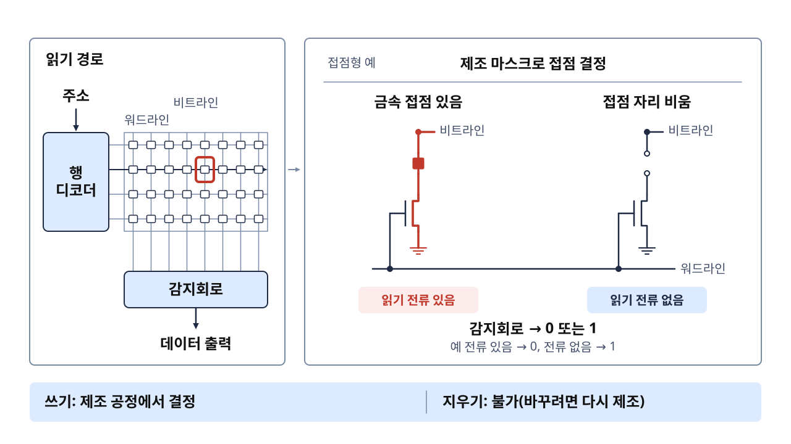
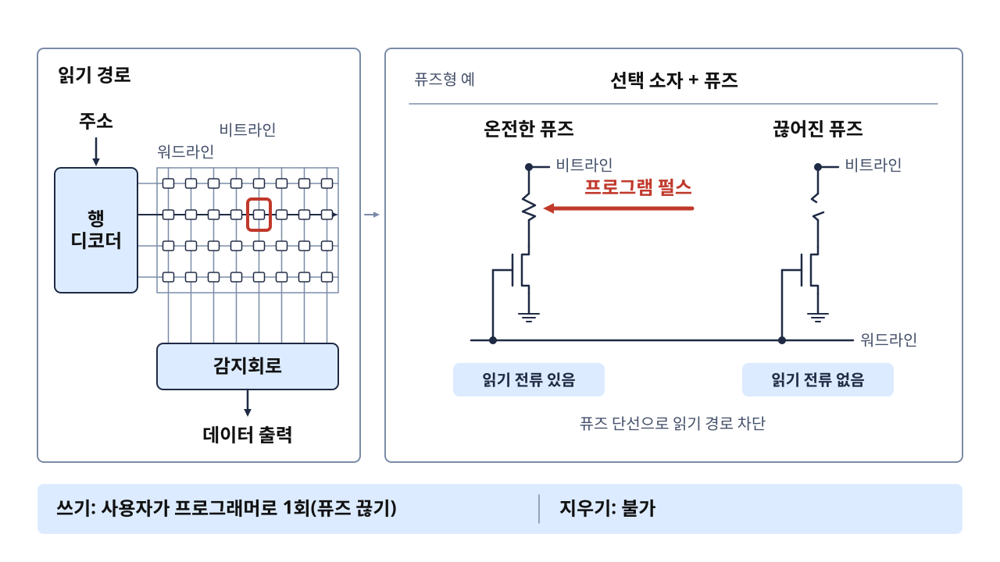
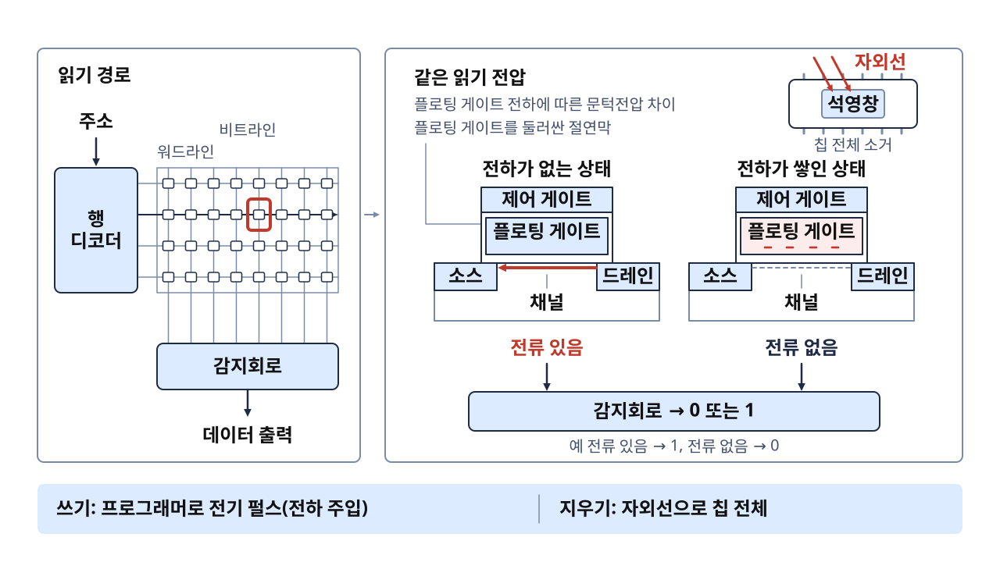
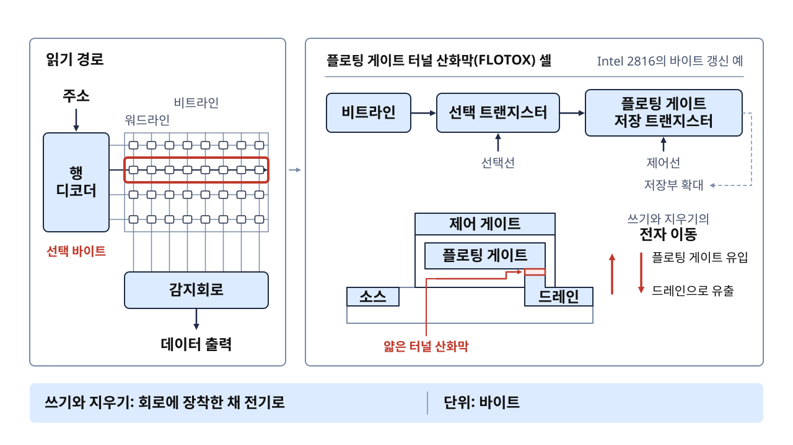
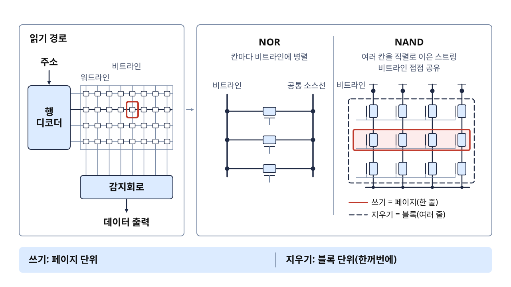
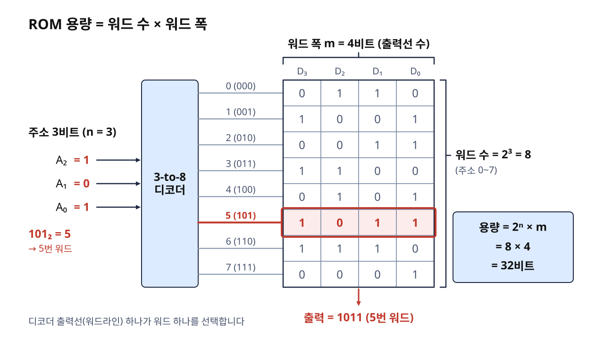
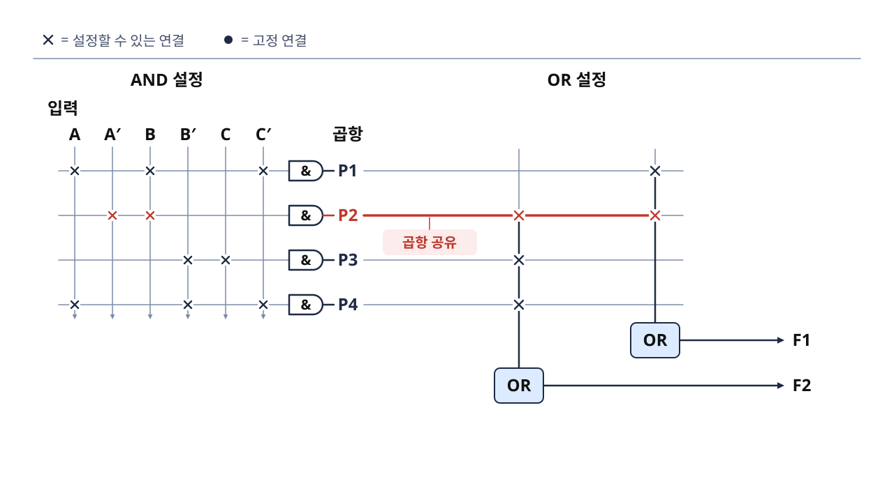
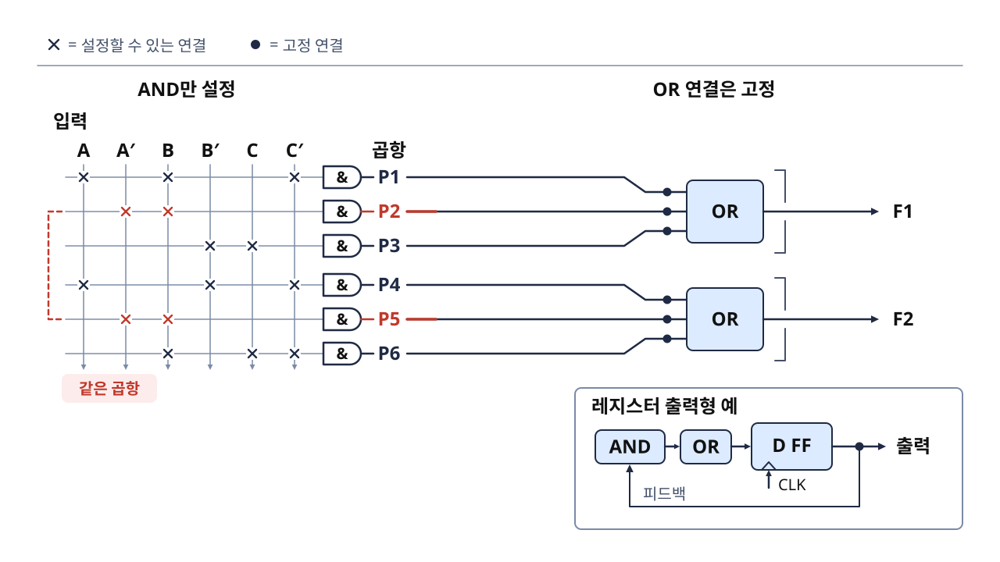
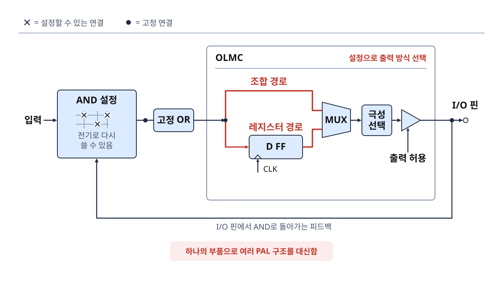
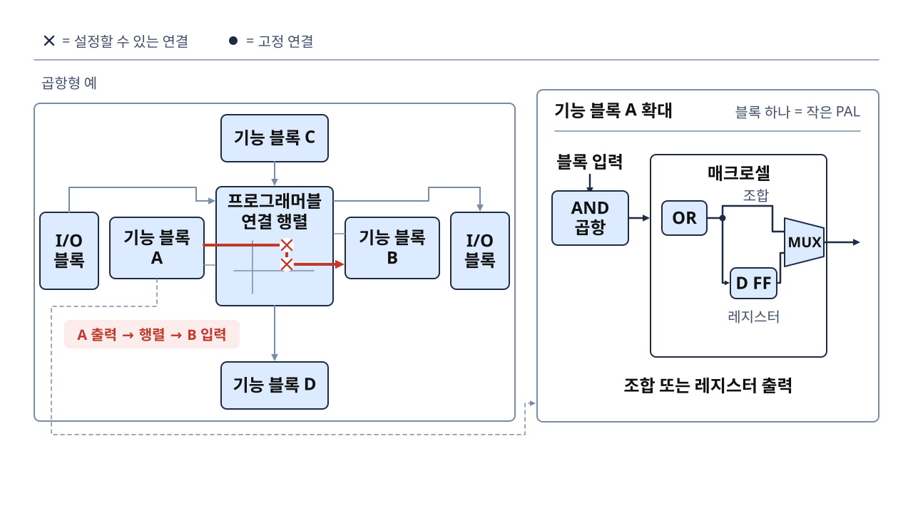

# 디지털공학 7장 보조학습자료
### 메모리 및 프로그래머블 논리

> 이 자료는 교재의 핵심 개념과 풀이 과정을 본문 서술로 정리한 복습용 보조자료입니다.  
> Mano, *Digital Design* 7장과 함께 활용하세요.

---

## 목차

- [1. 메모리 구조와 동작](#1-메모리-구조와-동작)
- [2. 메모리 분류](#2-메모리-분류)
- [3. SRAM과 DRAM](#3-sram과-dram)
- [4. 메모리 디코딩과 주소 다중화](#4-메모리-디코딩과-주소-다중화)
- [5. 오류 검출·정정 (해밍 코드)](#5-오류-검출정정-해밍-코드)
- [6. ROM 설계](#6-rom-설계)
- [7. 프로그래머블 논리 소자 (PLD)](#7-프로그래머블-논리-소자-pld)
- [8. PLA와 PAL](#8-pla와-pal)
- [9. 순차 프로그래머블 논리 소자](#9-순차-프로그래머블-논리-소자)
- [10. CPLD와 FPGA](#10-cpld와-fpga)

---

## 1. 메모리 구조와 동작

### 학습목표

- 메모리의 기본 구성 요소인 셀, 워드, MAR, MBR의 역할을 설명할 수 있다.
- 메모리 읽기/쓰기 동작 순서를 단계별로 나열할 수 있다.

---

### 1.1 메모리 구조

**메모리**는 **데이터를 저장하는 셀(Cell)** 과  
**외부와 정보를 주고받는 주변회로**로 구성된 저장 장치입니다.

$$\text{메모리} = \text{저장 셀 배열} + \text{주변 제어 회로}$$

**핵심 구성 요소:**

| 요소 | 역할 |
|---|---|
| **메모리 셀** | 실제 데이터(비트)를 저장하는 최소 단위 |
| **MAR** (Memory Address Register) | 접근하고자 하는 메모리 위치의 **주소**를 저장 |
| **MBR** (Memory Buffer Register) | 읽기/쓰기 동작에서 데이터를 임시 보관하는 **버퍼** |

---

### 1.2 워드(Word)

**워드(Word)** 는 메모리가 **한 번에 읽기/쓰기 처리하는 비트 수**입니다.

- 대부분의 컴퓨터 메모리는 **8비트(1 Byte)의 배수**를 워드 단위로 사용합니다.
- 메모리 용량 표기:

$$\text{메모리 용량} = \text{워드 수} \times \text{워드 크기(비트)}$$

**예시:** $4 \times 4$ 메모리 → 워드 4개, 각 워드 4비트  
$1\text{K} \times 8$ 메모리 → 1024개의 워드, 각 워드 8비트

---

### 1.3 메모리 읽기 동작 (Read)

```
Step 1. 접근하려는 메모리 주소를 MAR로 전송
Step 2. 읽기(Read) 제어신호 인가
Step 3. 해당 주소의 데이터가 MBR로 전송됨
Step 4. MBR에 저장된 데이터를 사용
```

---

### 1.4 메모리 쓰기 동작 (Write)

```
Step 1. 쓰려는 메모리 주소를 MAR로 전송
Step 2. 저장할 데이터를 MBR로 전송
Step 3. 쓰기(Write) 제어신호 인가
Step 4. MBR의 데이터가 MAR이 가리키는 주소에 저장됨
```

> 💡 **핵심 차이**:  
> 읽기는 "주소 → 제어신호 → 데이터 사용" 순서  
> 쓰기는 "주소 → 데이터 준비 → 제어신호" 순서  
> 쓰기에서는 **데이터가 먼저 MBR에 있어야** 쓰기 신호를 보낼 수 있습니다.

---

### 1.5 복습문제

#### 문제 (1)

메모리 읽기 동작과 쓰기 동작의 단계를 순서대로 나열하고,  
두 동작의 결정적 차이를 한 문장으로 설명하라.

<details>
<summary>정답 보기</summary>


**읽기**: 주소→MAR / 읽기 제어신호 / MBR에서 데이터 사용  
**쓰기**: 주소→MAR / 데이터→MBR / 쓰기 제어신호

**차이**: 읽기는 메모리에서 MBR로 데이터가 **나오고**,  
쓰기는 MBR에서 메모리로 데이터가 **들어간다**.

</details>

---

---

## 2. 메모리 분류

### 학습목표

- 메모리의 접근 방법, 기능, 저장 방식, 데이터 유지성에 따른 분류를 설명할 수 있다.
- RAM과 ROM, SRAM과 DRAM, 휘발성과 비휘발성의 차이를 구분할 수 있다.

---

### 2.1 접근 방법에 의한 분류

| 종류 | 정의 | 예 |
|---|---|---|
| **RAM** (Random Access Memory) | 어느 위치에 접근하든 **접근 시간이 동일** | SRAM, DRAM |
| **SAM** (Sequential Access Memory) | 순서대로 접근하므로 **위치에 따라 접근 시간이 다름** | 자기 테이프 |

> ⚠️ **주의**: "RAM = 읽기/쓰기 가능"이라는 오해가 많습니다.  
> RAM은 사실 **접근 방식**에 대한 분류어입니다.  
> 읽기/쓰기 가능 여부는 아래 기능 분류에서 다룹니다.

---

### 2.2 기능에 의한 분류

| 종류 | 정의 | 특징 |
|---|---|---|
| **RWM** (Read and Write Memory) | **읽기/쓰기 모두** 가능 | 일반적으로 RAM이 여기 해당 |
| **ROM** (Read Only Memory) | **읽기만** 가능 (특정 조건에서만 쓰기) | 전원 꺼져도 데이터 유지 |

**ROM의 세부 종류:**

| 종류 | 쓰기 방법 | 특징 |
|---|---|---|
| **Mask ROM** | 제조 공정에서만 가능 | 대량 생산에 적합, 사용자 수정 불가 |
| **Fuse-Link PROM** | 퓨즈 끊기 방식, **1회만** 가능 | OTP (One Time Programmable) |
| **PROM** | 사용자가 **1회** 기록 | Mask ROM보다 유연 |
| **EPROM** | 자외선(UV)으로 소거 후 재기록 | 창문(Window)이 있는 IC 패키지 |
| **EEPROM** | **전기적**으로 소거 후 재기록 | Flash Memory의 기반 기술 |

> 💡 발전 방향: **Mask ROM → PROM → EPROM → EEPROM → Flash**  
> 점점 더 편리하고 빠르게 재기록 가능한 방향으로 발전합니다.

세대별 칸 구조, 등장 배경, 활용처는 §6.2 「ROM의 변화」에서 다룹니다.

---

### 2.3 저장 방식에 의한 분류

| 종류 | 저장 방식 | 특징 |
|---|---|---|
| **SRAM** | 플립플롭 기반 | 빠름, 전원 유지 시 데이터 보존, 고가 |
| **DRAM** | 커패시터 전하 충전 방식 | 저전력, 고집적, 주기적 Refresh 필요 |

---

### 2.4 데이터 유지성에 의한 분류

| 종류 | 정의 | 대표 예 |
|---|---|---|
| **휘발성(Volatile)** | 전원 차단 시 데이터 소멸 | SRAM, DRAM |
| **비휘발성(Non-Volatile)** | 전원 차단 후에도 데이터 유지 | Flash Memory, ROM, 자기 디스크 |

---

### 2.5 전체 분류 요약

```
메모리
├── 접근방법: RAM (랜덤) / SAM (순차)
├── 기능:    RWM (읽기/쓰기) / ROM (읽기 전용)
│             └── ROM 세부: Mask/PROM/EPROM/EEPROM
├── 저장방식: SRAM (FF) / DRAM (커패시터)
└── 유지성:  휘발성 (RAM) / 비휘발성 (ROM, Flash)
```

---

### 2.6 복습문제

#### 문제 (1)

다음 설명에 해당하는 메모리 종류를 쓰라.

(a) 전기적 신호로 내용을 지우고 다시 기록할 수 있는 ROM  
(b) 자외선으로 내용을 지우고 재기록이 가능한 ROM  
(c) 플립플롭으로 구성되어 전원이 공급되는 동안 데이터가 유지되는 RAM  
(d) 커패시터의 전하로 데이터를 저장하고 주기적 재충전이 필요한 RAM

<details>
<summary>정답 보기</summary>


(a) **EEPROM** (Electrically Erasable PROM)  
(b) **EPROM** (Erasable PROM)  
(c) **SRAM** (Static RAM)  
(d) **DRAM** (Dynamic RAM)

</details>

---

---

## 3. SRAM과 DRAM

### 학습목표

- SRAM 메모리 셀의 구조와 입출력 신호를 설명할 수 있다.
- DRAM 메모리 셀의 저장 원리와 Refresh의 필요성을 이해한다.
- SRAM과 DRAM의 장단점을 비교하여 적절한 사용 상황을 판단할 수 있다.

---

### 3.1 SRAM 메모리 셀 구조

SRAM의 기본 저장 단위는 **BC(Binary Cell)** 으로,  
5장에서 배운 **플립플롭** 구조를 기반으로 1-bit를 저장합니다.

**BC 구성 신호:**

| 신호 | 역할 |
|---|---|
| **입력 비트** | 저장할 데이터 (0 또는 1) |
| **Read/Write** | 읽기(1) 또는 쓰기(0) 모드 선택 |
| **Select** | 해당 셀을 활성화할지 여부 |
| **출력 비트** | 읽기 모드 시 저장된 데이터 출력 |

**동작 원리:**

```
Select = 0 → 셀 비활성화, 입출력 차단
Select = 1, R/W = 0 → 쓰기: 입력 비트 → 셀에 저장
Select = 1, R/W = 1 → 읽기: 저장 데이터 → 출력 비트
```

BC를 기본 단위로 시스템 워드에 맞게 그룹화하면 실제 메모리 블록이 완성됩니다.

---

### 3.2 DRAM 메모리 셀 구조

DRAM은 **커패시터(Capacitor)에 전하를 충전하는 방식**으로 1-bit를 저장합니다.

- 커패시터에 전하 충전 → $1$
- 커패시터에 전하 없음 → $0$

**Refresh(재충전)의 필요성:**

$$\text{커패시터} \xrightarrow{\text{시간 경과}} \text{전하 방전} \xrightarrow{} \text{데이터 손실}$$

- 커패시터에 저장된 전하는 시간이 지남에 따라 자연적으로 방전됩니다.
- 따라서 **주기적인 재충전(Refresh)** 이 반드시 필요하며,
- 이를 위한 **추가 Refresh 회로**가 필요합니다.

---

### 3.3 SRAM vs DRAM 비교

| 항목 | SRAM | DRAM |
|---|---|---|
| 저장 방식 | 플립플롭 | 커패시터 전하 |
| Refresh 필요 여부 | 불필요 | **필요** (주기적 재충전) |
| 동작 속도 | **빠름** | 느림 |
| 전력 소비 | 많음 | **적음** |
| 단위 면적당 집적도 | 낮음 | **높음** |
| 가격 | 비쌈 | **저렴** |
| 주요 사용처 | CPU 캐시 메모리 | 메인 메모리 (PC의 RAM) |

> 💡 CPU 내부 캐시는 속도가 최우선이라 SRAM 사용,  
> 대용량이 필요한 메인 메모리는 집적도와 가격을 위해 DRAM 사용.  
> 이것이 "L1/L2 캐시는 작고 빠르고 비싸며, DDR 메모리는 크고 저렴하다"는 이유입니다.

---

### 3.4 복습문제

#### 문제 (1)

SRAM과 DRAM 중 다음 상황에 더 적합한 것을 고르고 이유를 설명하라.

(a) CPU 내부에서 매 클럭마다 접근하는 고속 캐시  
(b) 스마트폰의 대용량 메인 메모리 (수 GB 규모)

<details>
<summary>정답 보기</summary>


**(a) SRAM**  
이유: CPU 캐시는 최고 속도가 요구되며 용량이 작아도 됨.  
SRAM은 플립플롭 기반으로 빠르고 Refresh가 불필요함.

**(b) DRAM**  
이유: 스마트폰 메인 메모리는 수 GB 대용량이 필요하며 전력 소비에 민감함.  
DRAM은 집적도가 높고 전력 소비가 적어 대용량 구현에 적합함.

</details>

---

---

## 4. 메모리 디코딩과 주소 다중화

### 학습목표

- 메모리 Enable 신호와 R/W 신호의 역할을 설명할 수 있다.
- 1차원 디코딩과 2차원 디코딩의 차이와 2차원의 장점을 이해한다.
- Address Multiplexing(CAS/RAS)의 목적을 이해한다.

---

### 4.1 메모리 디코딩 기본 구조

메모리에서 특정 워드를 선택하기 위해 **디코더(Decoder)** 를 사용합니다.

**제어 신호 동작:**

| 신호 | 값 | 동작 |
|:---:|:---:|:---:|
| **Memory Enable** | 0 | 디코더 출력 = 0, 메모리 선택 안 됨 |
| **Memory Enable** | 1 | 주소 입력에 의해 워드 선택됨 |
| **R/W** | 0 | **쓰기 모드**: 입력 데이터 → 선택된 워드에 저장 |
| **R/W** | 1 | **읽기 모드**: 선택된 워드 → 출력 데이터로 출력 |

---

### 4.2 4×4 RAM 구조

- **4 워드 × 4 비트** 구성
- 2-bit 주소 입력 → $2^2 = 4$개 워드 선택
- 2-to-4 디코더로 4개 워드 중 하나를 선택

---

### 4.3 1차원 디코딩 vs 2차원 디코딩

대용량 메모리에서 1차원 디코딩은 **비효율적**입니다.

**예: 1K 워드 메모리 ($2^{10} = 1024$ 워드)**

| 방식 | 디코더 구성 | 필요한 AND 게이트 수 |
|---|---|---|
| **1차원** | 10 × 1024 디코더 | **1,024개** |
| **2차원** | 5 × 32 디코더 × 2개 | **64개** |

$$\text{절약된 게이트 수} = 1024 - 64 = 960\text{개}$$

**2차원 디코딩 원리:**

- 메모리 셀 배열을 **가능한 정사각형에 가깝게** 배열합니다.
- 주소를 **행(Row) 주소**와 **열(Column) 주소**로 분리하여 각각 디코딩합니다.
- 두 디코더의 출력이 교차하는 지점의 셀을 선택합니다.

```
주소 [9:5] → 행 디코더 → 32개 행 중 1행 선택
주소 [4:0] → 열 디코더 → 32개 열 중 1열 선택
→ 선택된 행과 열이 교차하는 1개 워드 접근
```

> 💡 2차원 디코딩은 게이트 수를 줄일 뿐 아니라,  
> 메모리 셀 배열이 정사각형에 가까울수록 배선 길이도 균등해져 **동작 안정성도 향상**됩니다.

---

### 4.4 Address Multiplexing (주소 다중화)

**목적**: IC 패키지의 **물리적 핀 수를 줄이기** 위한 기법입니다.

- 행 주소와 열 주소를 **같은 핀**을 통해 시분할로 전달합니다.
- **RAS (Row Address Strobe)**: 행 주소 전송 타이밍 신호
- **CAS (Column Address Strobe)**: 열 주소 전송 타이밍 신호

```
핀 [A0~A7]으로 먼저 행 주소 전달 → RAS 신호
핀 [A0~A7]으로 다시 열 주소 전달 → CAS 신호
→ 8개 핀으로 16비트 주소(A0~A15) 전달 가능
```

> 💡 Address Multiplexing 덕분에  
> 메모리 칩의 핀 수를 절반으로 줄일 수 있어  
> IC 패키지 비용과 기판 면적이 절약됩니다.

---

---

## 5. 오류 검출·정정 (해밍 코드)

### 학습목표

- 패리티(검출)와 해밍 코드(정정)의 차이를 설명할 수 있다.
- 해밍 코드의 패리티 비트 수와 배치 규칙을 이해한다.
- 신드롬(Syndrome)으로 오류 위치를 찾아 정정하는 과정을 수행할 수 있다.

---

### 5.1 패리티의 한계와 해밍 코드

1장에서 배운 **패리티 비트**는 1비트 오류의 **발생 여부만** 알 수 있을 뿐, **어느 비트가 틀렸는지는 알 수 없습니다.** 따라서 정정이 불가능합니다.

**해밍 코드(Hamming Code)** 는 패리티 비트를 **여러 개** 사용해, 1비트 오류의 **위치까지 찾아 정정**할 수 있는 코드입니다. (메모리·통신의 오류 정정에 사용)

| 방식 | 기능 |
|---|---|
| 단일 패리티 | 1비트 오류 **검출만** |
| 해밍 코드 | 1비트 오류 **검출 + 정정** |

---

### 5.2 패리티 비트 수 결정

데이터 비트 $k$개에 대해, 패리티 비트 $p$개는 다음 조건을 만족해야 합니다.

$$2^p \geq k + p + 1$$

- 예) $k = 4$ → $2^p \geq 5 + p$ → $p = 3$ (총 7비트, **(7, 4) 해밍 코드**)

---

### 5.3 패리티 비트 배치 규칙

- 패리티 비트는 **2의 거듭제곱 위치**(1, 2, 4, 8, …)에 둡니다.
- 데이터 비트는 나머지 위치(3, 5, 6, 7, …)에 채웁니다.
- 각 패리티 비트는 **자기 위치 번호의 비트가 1인 모든 자리**를 검사합니다. (짝수 패리티 기준)

**(7, 4) 코드 위치 배치:**

| 위치 | 1 | 2 | 3 | 4 | 5 | 6 | 7 |
|:---:|:---:|:---:|:---:|:---:|:---:|:---:|:---:|
| 역할 | $P_1$ | $P_2$ | $D_1$ | $P_4$ | $D_2$ | $D_3$ | $D_4$ |

| 패리티 | 검사 위치 |
|:---:|---|
| $P_1$ | 1, 3, 5, 7 |
| $P_2$ | 2, 3, 6, 7 |
| $P_4$ | 4, 5, 6, 7 |

---

### 5.4 예제 풀이: 해밍 코드 생성

> **문제**: 데이터 $D_1 D_2 D_3 D_4 = 1011$의 (7, 4) 해밍 코드를 구하라. (짝수 패리티)

데이터 배치: 위치3 = 1, 위치5 = 0, 위치6 = 1, 위치7 = 1

$$P_1 = D_1 \oplus D_2 \oplus D_4 = 1 \oplus 0 \oplus 1 = 0 \quad (\text{위치 } 3,5,7)$$
$$P_2 = D_1 \oplus D_3 \oplus D_4 = 1 \oplus 1 \oplus 1 = 1 \quad (\text{위치 } 3,6,7)$$
$$P_4 = D_2 \oplus D_3 \oplus D_4 = 0 \oplus 1 \oplus 1 = 0 \quad (\text{위치 } 5,6,7)$$

| 위치 | 1 | 2 | 3 | 4 | 5 | 6 | 7 |
|:---:|:---:|:---:|:---:|:---:|:---:|:---:|:---:|
| 값 | 0 | 1 | 1 | 0 | 0 | 1 | 1 |

$$\boxed{\text{해밍 코드} = 0110011}$$

---

### 5.5 예제 풀이: 오류 검출·정정 (신드롬)

> **문제**: 위 코드 $0110011$을 수신했는데 **위치 5**가 뒤집혀 $0110\mathbf{1}11$로 도착했다. 오류를 찾아 정정하라.

각 패리티 검사를 다시 계산합니다 (오류 없으면 짝수 패리티이므로 0).

$$C_1 = \text{위치}(1,3,5,7) = 0 \oplus 1 \oplus 1 \oplus 1 = 1$$
$$C_2 = \text{위치}(2,3,6,7) = 1 \oplus 1 \oplus 1 \oplus 1 = 0$$
$$C_4 = \text{위치}(4,5,6,7) = 0 \oplus 1 \oplus 1 \oplus 1 = 1$$

**신드롬(Syndrome)** $= C_4 C_2 C_1 = 101_{(2)} = 5$

$$\boxed{\text{오류 위치} = 5 \rightarrow \text{위치 5 비트를 반전하여 정정}}$$

> 💡 신드롬이 $0$이면 오류 없음, $0$이 아니면 그 **2진값이 곧 틀린 비트의 위치**입니다.  
> 이렇게 해밍 코드는 1비트 오류를 **스스로 찾아 고칠 수 있습니다.**

---

### 5.6 복습문제 (정답 포함)

#### 문제 (1)

데이터 비트가 $k = 8$일 때 필요한 최소 패리티 비트 수 $p$를 구하라.

<details>
<summary>정답 및 풀이 보기</summary>


$2^p \geq k + p + 1 = 9 + p$

- $p = 3$: $8 \geq 12$ ✗
- $p = 4$: $16 \geq 13$ ✓

$$\boxed{p = 4 \text{ (데이터 8 + 패리티 4 = 총 12비트)}}$$

</details>

---

#### 문제 (2)

해밍 코드 수신 후 신드롬이 $C_4 C_2 C_1 = 000$이었다. 무엇을 의미하는가?

<details>
<summary>정답 보기</summary>


신드롬이 $0$이므로 **오류 없음**을 의미합니다.  
신드롬이 $0$이 아니면 그 2진값이 틀린 비트의 위치를 가리키며, 해당 비트를 반전해 정정합니다.

</details>

---

---

## 6. ROM 설계

### 학습목표

- ROM이 AND 게이트(디코더)와 OR 게이트의 조합으로 SOP 논리식을 구현함을 이해한다.
- ROM 설계 예제(예제 7.1)를 단계별로 수행할 수 있다.
- ROM의 용량을 워드와 주소로 계산하고, 진리표를 주소-내용 표로 옮길 수 있다.
- ROM 기술의 세대별 변화(마스크 ROM에서 플래시까지)를 저장 칸의 구조로 설명할 수 있다.

**ROM의 쓰기와 읽기** — 레벨 값(0\~3, 2비트)을 받아 LED를 아래부터 그 개수만큼 켜는 레벨 표시기를 4 × 3 ROM으로 만드는 경우입니다(예: 소리 크기 표시, 배터리 잔량 표시). 다음을 확인합니다.

- 쓰기(프로그래밍) = 격자의 연결점을 정하는 일
- 읽기 = 주소 → 디코더 선 하나 → 그 선에 연결된 출력만 1 → LED
- 동작 중에는 읽기만 하는 ROM과 동작 중에도 읽고 쓰는 RAM의 차이


---

### 6.1 ROM의 논리적 구조

ROM은 단순한 저장 장치가 아니라,  
**조합논리 함수를 하드웨어적으로 구현하는 회로**로도 볼 수 있습니다.

$$\text{ROM} = \underbrace{\text{AND 게이트 배열}}_{\text{디코더 (최소항 생성)}} + \underbrace{\text{OR 게이트 배열}}_{\text{SOP 합산}}$$

- **AND 게이트 (디코더)**: $n$개의 입력 주소로 $2^n$개의 최소항(minterm) 생성
- **OR 게이트**: 원하는 최소항들을 선택해 합산 → SOP 출력

즉, ROM에 저장된 내용이 곧 **진리표 전체**이며,  
어떤 조합논리 함수도 ROM으로 구현할 수 있습니다.

> 📖 **그림은 교재 참고** — Mano 6판 Fig 7.10 (Internal logic of a 32 × 8 ROM): 5-to-32 디코더와 8개 OR의 교차점 어레이입니다. 교차점의 연결 여부가 곧 진리표입니다.

- **왜 디코더인가**: 디코더는 주소 $n$비트가 가리키는 출력선 하나만 1로 만듭니다(4장 — 민텀 생성기). 그 선이 어느 OR에 연결되어 있는지가 그 주소의 출력값을 정합니다.
- **확인**: 주소가 바뀌면 다른 민텀 선 하나가 1이 되고, 그 선에 연결된 OR의 출력만 1이 됩니다. 진리표의 한 행을 읽는 것과 같습니다.
- 4장에서 「디코더 + OR = 임의 함수」를 배웠습니다. ROM은 그 구조를 제품화한 것입니다. OR 어레이의 연결을 끊고 잇는 것(프로그래밍)만으로 어떤 진리표든 구현합니다.

---

### 6.2 ROM의 변화 — 교차점 한 칸을 정하는 방법

§6.1의 교차점 연결은 논리 모델입니다. 실제 칩에서 교차점 하나는 저장 소자 한 칸(셀)이고, 그 칸의 상태를 정하는 방법이 세대마다 바뀌었습니다.

| 종류 | 칸의 상태를 정하는 것 | 쓰는 사람과 시점 | 지우기 |
|---|---|---|---|
| 마스크 ROM | 제조 마스크의 금속 접점 | 제조사, 제조 공정 | 불가 |
| PROM | 퓨즈 | 사용자, 프로그래머로 1회 | 불가 |
| EPROM | 플로팅 게이트(floating gate)의 전하 | 사용자, 프로그래머 | 자외선, 칩 전체 |
| EEPROM | 플로팅 게이트의 전하 | 회로에 장착한 채 전기로 | 전기, 바이트 단위 |
| 플래시 | 플로팅 게이트의 전하 | 회로에 장착한 채 전기로 | 전기, 블록 단위 |

- 장치마다 칸 그림, 이렇게 사용된 이유, 활용처 순서로 살펴봅니다.
- 전류가 흐르는 칸을 0으로 읽는지 1로 읽는지는 제품마다 다릅니다. 그림의 0과 1은 예입니다.

#### ① 마스크 ROM — 1965년 Sylvania가 Honeywell용 256비트 ROM을 만듦



- **구조**: 칸마다 금속 접점이 있거나 없습니다. 워드라인이 선택되면 접점이 있는 칸에서만 비트라인으로 전류가 흐르고, 감지회로가 전류 유무를 0 또는 1로 읽습니다.
- **사용된 이유**: 칸이 작아 대량 생산하면 비트당 비용이 낮습니다. 대신 내용을 바꾸려면 마스크를 새로 만들어 다시 제조해야 합니다.
- **활용처**: 마이크로프로그램, 조회 표, 문자 표시 패턴. 첫 대량 수요는 탁상 계산기였고, 뒤에는 게임 카트리지가 이를 넘어섰습니다.
- **출처**: Computer History Museum(CHM), 「Semiconductor Read-Only-Memory Chips Appear」(1965)

#### ② PROM(Programmable ROM) — 1950년대 말 미사일용 컴퓨터의 상수 저장에서 시작(Wen Tsing Chow)



- **구조**: 칸마다 선택 소자와 퓨즈가 직렬로 있습니다. 프로그래머가 큰 전류 펄스로 퓨즈를 끊으면 그 칸에는 전류가 흐르지 않습니다.
- **사용된 이유**: 마스크 ROM은 주문마다 마스크를 만들어야 해 비용과 시간이 들었습니다. PROM은 같은 빈 칩에 사용자가 직접 내용을 씁니다. 끊은 퓨즈는 되돌릴 수 없으므로 한 번만 쓸 수 있습니다.
- **활용처**: 마스크 ROM과 같은 용도(프로그램 코드, 조회 표)를 개발 단계나 적은 수량의 제품에서 사용
- **출처**: CHM(1965 항목의 PROM 설명), IEEE Technology Navigator 「PROM」

#### ③ EPROM(Erasable PROM) — 1971년 Intel 1702(2048비트, Dov Frohman 설계)



- **구조**: 절연막에 둘러싸여 어느 전극에도 연결되지 않은 플로팅 게이트에 전하를 가둡니다. 전하가 쌓이면 트랜지스터가 켜지는 데 필요한 전압(문턱전압)이 높아져, 같은 읽기 전압에서 전류가 흐르지 않습니다.
- **사용된 이유**: PROM은 한 번 잘못 쓰면 칩을 폐기해야 했습니다. EPROM은 패키지의 석영창으로 자외선을 비추어 칩 전체를 지운 뒤 다시 쓸 수 있어, 프로그램을 고쳐 가며 시험할 수 있습니다.
- **활용처**: 마이크로프로세서 시스템의 프로그램 개발(쓰기와 지우기를 되풀이하는 설계 도구)
- **출처**: CHM, 「Reusable Programmable ROM Introduces Iterative Design Flexibility」(1971)

#### ④ EEPROM(Electrically Erasable PROM) — 1978년 Intel 2816(16K비트, George Perlegos)



- **구조**: 칸마다 선택 트랜지스터와 플로팅 게이트 저장 트랜지스터가 있습니다. 얇은 터널 산화막으로 전자를 주입하고 빼내므로 자외선이 필요 없습니다.
- **사용된 이유**: EPROM은 지우려면 칩을 빼서 자외선을 비추어야 했고 칩 전체가 지워졌습니다. EEPROM은 회로에 장착한 채 필요한 바이트만 전기로 고칩니다.
- **활용처**: 장비의 보정값, 설정값처럼 가끔 바뀌고 전원이 꺼져도 남아야 하는 작은 데이터
- **출처**: CHM, 「Pioneers of Semiconductor Non-Volatile Memory」

#### ⑤ 플래시 메모리 — 1984년 Toshiba 발표(마스오카 후지오), 1987년 NAND 발표, 1991년 NAND 상용화(4 Mbit)



- **구조**: EEPROM과 같은 플로팅 게이트 칸입니다. 칸마다 따로 지우지 않고 여러 칸을 한꺼번에 지웁니다(「플래시」라는 이름의 유래). NOR는 칸마다 비트라인에 병렬로, NAND는 여러 칸을 직렬로 이어 접점을 공유합니다.
- **사용된 이유**: 한꺼번에 지우는 대신 칸을 작게 만들어 같은 면적에 더 많은 비트를 담습니다. NAND는 직렬 연결로 접점 수를 줄여 비트당 비용을 더 낮췄습니다.
- **활용처**: NOR = 임베디드 시스템의 부트 코드, NAND = SSD, SD 카드
- **출처**: KIOXIA(구 Toshiba 메모리) 「Technology Development History」, CHM

#### ROM의 변화 정리

| 변화 | 해결한 불편 |
|---|---|
| 마스크 ROM → PROM | 주문마다 마스크를 만드는 비용과 시간 |
| PROM → EPROM | 한 번 잘못 쓰면 칩을 폐기 |
| EPROM → EEPROM | 칩을 빼서 자외선으로 칩 전체를 지움 |
| EEPROM → 플래시 | 칸마다 지우는 구조여서 칸이 큼 → 한꺼번에 지워 집적도를 높임 |

- **공통점**: 어느 세대든 §6.1의 「디코더 + 교차점」 구조는 같고, 교차점 한 칸의 상태를 정하는 방법만 바뀌었습니다.
- **연결**: §8의 PLA와 그 뒤의 PAL, GAL도 같은 저장 기술(퓨즈, 플로팅 게이트)로 연결을 정합니다.

---

### 6.3 용량 계산 — 워드와 주소

- **워드(word)**: 주소 하나에 저장된 비트 단위이며, 읽을 때 함께 출력됩니다. 워드 폭 $m$ = 출력선(OR) 수 = 진리표 한 행의 출력 비트 수
- **주소(address)**: 워드를 가리키는 번호입니다. 주소 $n$비트는 $0$부터 $2^n - 1$까지 $2^n$개의 번호를 만들고, 번호마다 워드가 하나씩 있습니다(진리표의 입력 조합 하나 = 주소 하나).
- **워드라인**: §6.1 디코더의 출력선 하나입니다. 주소가 정한 워드라인 하나만 1이 되어 그 워드를 선택합니다.
- **용량** = 워드 수 × 워드 폭 = $2^n \times m$비트(8비트 = 1바이트)
- 예: 교재 Fig 7.10의 32 × 8 ROM = 주소 5비트($2^5 = 32$ 워드) × 워드 8비트 = 256비트



> 💡 **Tip**: $2^n \times m$에서 왼쪽($2^n$)은 **행 수(진리표의 행)**, 오른쪽($m$)은 **열 수(출력 함수 개수)** 입니다. ROM 한 개는 $m$개 함수의 진리표 전체입니다.

#### 예제 6-1 — 워드 수와 용량

주소 11비트, 워드 8비트인 ROM의 ⓐ 워드 수 ⓑ 총 비트 용량을 구하라.

<details>
<summary>풀이 보기</summary>


ⓐ $2^{11} = 2048$ 워드 (2K) / ⓑ $2048 \times 8 = 16{,}384$ 비트 $= 2$ KB

**검산**: 주소 $n$비트 → $2^n$ 워드, 총 용량 $= 2^n \times m$비트 — 메모리류 계산의 공통 공식입니다. 주소 비트가 하나 늘면 워드 수는 2배입니다.

</details>

#### 예제 6-2 — 곱셈표 ROM

8비트 수 두 개를 곱해 16비트 결과를 내는 회로를 ROM 하나로 구현한다. ⓐ 주소 비트 수와 워드 크기 ⓑ ROM 크기($2^n \times m$)와 총 용량(바이트)을 구하라.

<details>
<summary>풀이 보기</summary>


ⓐ 주소 = 입력 전부 = $8 + 8 = 16$비트, 워드 = 출력 = 16비트

ⓑ $2^{16} \times 16 = 65{,}536 \times 16 = 1{,}048{,}576$비트 $= 131{,}072$바이트 $= \boxed{128\ \text{KB}}$

- **검산**: 4비트 × 4비트 곱셈이면 $2^8 \times 8 = 2{,}048$비트 $= 256$바이트입니다. 입력이 8비트 늘었을 때 용량은 512배입니다.
- 입력 비트가 늘면 ROM의 크기는 지수적으로 증가합니다. 순차 곱셈기(8장 2/2)는 가산기 하나로 여러 클럭에 나누어 곱합니다. 시간과 하드웨어의 절충입니다(6장 1/2 직렬 가산과 같은 원리).

</details>

---

### 6.4 진리표를 ROM 내용으로

ROM 구현은 회로 설계가 아니라 **진리표를 주소-내용 표로 옮기는 일**입니다. 입력 조합 = 주소, 그 행의 출력 = 그 주소의 내용입니다.

#### 예제 6-3 — 전가산기를 ROM으로

전가산기(입력 $x, y, z$, 출력 $S, C$)를 ROM 하나로 구현하려 한다. ⓐ 필요한 ROM의 크기($2^n \times m$)를 구하고 ⓑ 주소 $011$과 $111$ 번지에 기록될 내용($C\,S$ 순)을 구하라.

<details>
<summary>풀이 보기</summary>


ⓐ 입력 3비트 = 주소, 출력 2비트 = 워드 → $\boxed{2^3 \times 2 = 8 \times 2\ \text{ROM}}$ (총 16비트)

ⓑ 주소 = 입력 조합, 내용 = 진리표의 출력:

- $011$: $0{+}1{+}1 = 10_{(2)}$ → $C{=}1, S{=}0$ → 내용 $\boxed{10}$
- $111$: $1{+}1{+}1 = 11_{(2)}$ → $C{=}1, S{=}1$ → 내용 $\boxed{11}$

**검산**: 4장 전가산기 진리표와 대조 ✓ — 회로 설계 없이 **진리표를 주소-내용으로 옮기는 것만으로** 완료됩니다. ROM은 민텀을 모두 만들어 두므로(§6.1) K-map도 게이트도 필요하지 않으며, 그 대가는 $2^n$의 크기입니다.

</details>

#### 예제 6-4 — 2비트 곱셈 ROM

2비트 수 $A = A_1A_0$, $B = B_1B_0$의 곱 $P$(4비트)를 ROM으로 구현한다. ⓐ ROM 크기를 구하고 ⓑ 주소를 $A_1A_0B_1B_0$ 순서로 둘 때 주소 $1110$, $1111$, $0111$의 내용을 구하라.

<details>
<summary>풀이 보기</summary>


ⓐ 주소 4비트, 워드 4비트 → $\boxed{2^4 \times 4 = 16 \times 4\ \text{ROM}}$

ⓑ 주소를 $A$와 $B$로 나누어 읽고 곱을 2진수로 나타냅니다.

| 주소 $A_1A_0B_1B_0$ | $A \times B$ | 내용 $P_3P_2P_1P_0$ |
|:---:|:---:|:---:|
| 11 10 | $3 \times 2 = 6$ | 0110 |
| 11 11 | $3 \times 3 = 9$ | 1001 |
| 01 11 | $1 \times 3 = 3$ | 0011 |

- **검산**: 최대 곱 $3 \times 3 = 9 < 16$ → 4비트로 충분합니다 ✓ — 예제 6-2의 축소판입니다.
- 주소 4비트의 앞 두 비트가 $A$, 뒤 두 비트가 $B$입니다.

</details>

---

### 6.5 ROM 설계 예제 7.1

> **설계 사양**  
> - 입력: 3비트 ($I_2 I_1 I_0$)  
> - 출력: 입력값의 **제곱(square)** 을 나타내는 6비트 출력  
> - ROM 크기: $2^3 \times 6 = 8 \times 6$ ROM

**Step 1 — 입출력 진리표 작성:**

| $I_2 I_1 I_0$ | 10진수 | 제곱값 | $O_5$ | $O_4$ | $O_3$ | $O_2$ | $O_1$ | $O_0$ |
|:---:|:---:|:---:|:---:|:---:|:---:|:---:|:---:|:---:|
| 000 | 0 | 0 | 0 | 0 | 0 | 0 | 0 | 0 |
| 001 | 1 | 1 | 0 | 0 | 0 | 0 | 0 | 1 |
| 010 | 2 | 4 | 0 | 0 | 0 | 1 | 0 | 0 |
| 011 | 3 | 9 | 0 | 0 | 1 | 0 | 0 | 1 |
| 100 | 4 | 16 | 0 | 1 | 0 | 0 | 0 | 0 |
| 101 | 5 | 25 | 0 | 1 | 1 | 0 | 0 | 1 |
| 110 | 6 | 36 | 1 | 0 | 0 | 1 | 0 | 0 |
| 111 | 7 | 49 | 1 | 1 | 0 | 0 | 0 | 1 |

**Step 2 — ROM 프로그래밍 해석:**

각 행(주소)이 ROM의 한 워드에 해당하며,  
출력 비트가 1인 위치에 연결(프로그래밍)이 이루어집니다.

예: 주소 $101_2 = 5_{10}$ → 출력 $011001_2 = 25_{10}$ → 올바름 ✓

**Step 3 — 각 출력 비트의 SOP 표현:**

$$O_5 = m_6 + m_7 \quad (\text{최소항 } I_2 I_1 I_0' + I_2 I_1 I_0)$$
$$O_4 = m_4 + m_5 + m_7$$
$$O_3 = m_3 + m_5$$
$$O_2 = m_2 + m_6$$
$$O_1 = 0 \quad (\text{항상 0})$$
$$O_0 = m_1 + m_3 + m_5 + m_7$$

> 💡 ROM은 **진리표를 그대로 하드웨어화** 한 것입니다.  
> K-map 간소화 없이 모든 입력 조합에 대한 출력을 직접 저장하므로,  
> 복잡한 논리식도 ROM 크기만 충분하면 **단일 사이클로 구현**할 수 있습니다.

**Step 4 — ROM에 저장할 필요가 없는 비트 빼기:**

- 모든 행에서 $O_1 = 0$이고 $O_0 = I_0$입니다. 두 비트는 ROM 밖에서 배선으로 얻습니다($O_1$ = 접지, $O_0$ = $I_0$ 직결).
- ROM에는 $O_5 \cdots O_2$만 저장합니다 → $8 \times 6$ 대신 $\boxed{8 \times 4\ \text{ROM}}$
- **왜**: 홀수의 제곱은 홀수이고 짝수의 제곱은 짝수이므로 $O_0 = I_0$입니다. 제곱수를 4로 나눈 나머지는 0 또는 1이므로 $O_1 = 0$입니다.

#### 예제 6-5 — BCD 변환 ROM의 용량 (심화)

4비트 2진수(0\~15)를 BCD 두 자리(십의 자리 4비트, 일의 자리 4비트)로 바꾸는 ROM을 설계하던 학생이 「입력 4비트, 출력 8비트이므로 ROM 용량은 $4 \times 8 = 32$비트」라고 계산했다. 오류를 찾아 올바른 용량을 구하고, 출력 8비트 가운데 ROM에 저장할 필요가 없는 비트가 있는지 확인하라.

<details>
<summary>풀이 보기</summary>


**Step 1** — 오류: 4는 주소 비트 수이지 워드 수가 아닙니다. 워드 수 $= 2^4 = 16$ → $16 \times 8 = \boxed{128\text{비트}}$

**Step 2** — 십의 자리는 0 또는 1뿐입니다(최댓값 15). 십의 자리 4비트 중 상위 3비트는 항상 0이므로, 저장할 비트는 십의 자리 1비트와 일의 자리 4비트입니다 → $16 \times 5 = 80$비트

**Step 3** — 일의 자리 = $A$ 또는 $A - 10$이고 10은 짝수이므로, 일의 자리 최하위 비트 $= A_0$입니다. 예제 7.1의 Step 4와 같은 관찰입니다 → $\boxed{16 \times 4\ \text{ROM}}$ (64비트)

- **검산**: $A = 13$ → BCD $0001\ 0011$: 십의 자리 최하위 비트 1, 일의 자리 3의 최하위 비트 1 $= A_0$ ✓
- 워드 수는 예제 6-1의 공식($2^n$)으로 구합니다.

</details>

---

### 6.6 복습문제

#### 문제 (1)

2비트 입력 $A, B$를 받아 아래 출력을 내는 ROM의 크기와 진리표를 작성하라.

- $F_1 = A \oplus B$  
- $F_2 = AB$  
- $F_3 = A + B$

<details>
<summary>정답 보기</summary>


ROM 크기: $2^2 \times 3 = 4 \times 3$

| $AB$ | $F_1$ | $F_2$ | $F_3$ |
|:---:|:---:|:---:|:---:|
| 00 | 0 | 0 | 0 |
| 01 | 1 | 0 | 1 |
| 10 | 1 | 0 | 1 |
| 11 | 0 | 1 | 1 |

이 진리표를 4개 워드에 그대로 저장하면 ROM 설계 완성.

</details>

---

#### 문제 (2)

어떤 메모리 유닛이 주소 12비트, 데이터 16비트를 가진다. ⓐ 접근 가능한 최대 워드 수 ⓑ 1워드의 크기(바이트) ⓒ 최대 용량(바이트)을 구하라.

<details>
<summary>정답 및 풀이 보기</summary>


ⓐ $2^{12} = 4096$ 워드 / ⓑ $16 \div 8 = 2$ 바이트 / ⓒ $4096 \times 2 = 8192$ 바이트 $= 8$ KB

**검산**: 비트로 계산해도 $4096 \times 16 = 65{,}536$비트 $\div 8 = 8192$바이트 ✓ — 답이 비트인지 바이트인지 반드시 확인합니다.

</details>

---

---

## 7. 프로그래머블 논리 소자 (PLD)

### 학습목표

- PLD의 정의와 퓨즈링크 방식의 프로그래밍 원리를 이해한다.
- PROM, PLA, PAL, GAL의 AND/OR 배열 프로그래밍 가능 여부를 비교하여 설명할 수 있다.

---

### 7.1 PLD란?

**PLD(Programmable Logic Device)** 는  
주로 **AND 게이트와 OR 게이트의 배열 구조**를 가지는 IC입니다.

**프로그래밍 원리:**

- 각 게이트 입력에 **퓨즈링크(Fuse-Link)** 가 연결되어 있습니다.
- 사용자가 원하는 위치의 퓨즈링크를 **전자적으로 끊어(Open)** 회로를 구성합니다.
- 결과적으로 **SOP(Sum of Products)** 형식의 조합논리 함수를 구현합니다.

```
[AND 게이트 배열] ──▶ [OR 게이트 배열] ──▶ 출력
  (곱의 항 생성)         (합산)
```

---

### 7.2 PLD 종류별 AND/OR 배열 비교

| 종류 | AND 배열 | OR 배열 | 특징 |
|---|---|---|---|
| **PROM** | 고정 (Full Decoder) | 프로그래밍 가능 | 모든 최소항 생성 → 주소 메모리로 주로 사용, 논리 구현은 비효율 |
| **PLA** | 프로그래밍 가능 | 프로그래밍 가능 | **가장 유연**, 동작 속도와 집적도는 낮음 |
| **PAL** | 프로그래밍 가능 | 고정 | 현재 가장 많이 사용, PLA보다 빠름 |
| **GAL** | 프로그래밍 가능 | 고정 | PAL + **재프로그래밍 가능** + 출력논리도 프로그래밍 가능 |

> 💡 **약어**:
> - PROM: **P**rogrammable **ROM** — AND 배열(디코더) 고정, OR 배열만 설정
> - PLA: **P**rogrammable **L**ogic **A**rray — 두 배열 모두 설정
> - PAL: **P**rogrammable **A**rray **L**ogic — AND 배열만 설정
> - GAL: **G**eneric **A**rray **L**ogic — PAL 구조에 출력 매크로셀을 더하고, 전기로 지우고 다시 씀

> 📖 **그림은 교재 참고** — Mano 6판 Fig 7.13 (Basic configuration of three PLDs): 어느 어레이를 설정할 수 있는가로 세 소자를 구분합니다. PROM은 OR만, PLA는 둘 다, PAL은 AND만 설정합니다.

**PROM, PLA, PAL 비교**

| 구분 | PROM | PLA | PAL |
|---|---|---|---|
| AND 배열 | 고정(디코더, 민텀 $2^n$개 모두) | 프로그래머블(필요한 곱항만) | 프로그래머블(필요한 곱항만) |
| OR 배열 | 프로그래머블 | 프로그래머블 | 고정(출력마다 곱항 수 정해짐) |
| 곱항 공유 | 해당 없음 | 가능 | 불가(출력마다 따로 만듦) |
| 알맞은 경우 | 입력이 적고 진리표 대부분이 필요할 때 | 입력이 많고 곱항이 적으며, 출력끼리 공유가 많을 때 | 출력마다 곱항 몇 개로 충분할 때 |
| 약점 | 입력이 늘면 크기가 $2^n$으로 커짐 | 두 배열을 모두 설정해 느리고 가격이 높음 | 출력마다 곱항 수 제한 |
| 등장 | 1950년대 말 발명 | 1975년 사용자 프로그래밍 제품 | 1978년 MMI |
| 등장 배경 | 마스크 ROM의 주문 제작 비용과 시간 | ROM의 민텀 낭비(입력이 많을 때) | PLA의 느린 속도와 높은 가격 |

- 등장 순서 = PROM → PLA → PAL. 각 소자는 앞 소자의 불편을 줄이는 방향으로 등장했습니다(상세 = §6.2 「ROM의 변화」 ②, §7.3 ①과 ②).

---

### 7.3 PLD 발전 계보

구조가 넓어지는 흐름:

$$\text{PAL/PLA (구형, OTP)} \rightarrow \text{GAL (SPLD, 재기록 가능)} \rightarrow \text{CPLD (복잡도↑, 비휘발성)} \rightarrow \text{FPGA (고집적, 고성능, 주력)}$$

> ⚠️ 이 순서는 설정할 수 있는 범위가 넓어지는 순서이며 출시 순서와 다릅니다. FPGA(1985년 Xilinx XC2064)가 CPLD의 초기 계열(1988년 Altera MAX 5000)보다 먼저 나왔습니다.

> 💡 현재 산업 현장에서는 FPGA가 **주력 프로그래머블 논리 소자**입니다.  
> CPLD는 전원 인가 즉시 동작이 필요한 보조 회로에, FPGA는 고성능 설계에 사용됩니다.

**프로그래머블 논리의 변화 — 무엇을 설정할 수 있는가**

ROM, PLA, PAL은 어느 배열을 설정하는가로 나뉩니다(Fig 7.13). 그 뒤의 소자는 출력 회로와 블록 사이의 배선까지 설정할 수 있게 넓어졌습니다.

| 소자 | 설정하는 것 | 고정된 것 | 설정을 담는 곳 |
|---|---|---|---|
| PLA | AND 배열, OR 배열 | 없음 | 퓨즈(초기 제품) |
| PAL | AND 배열 | OR 연결 | 퓨즈(초기 제품) |
| GAL | AND 배열, 출력 매크로셀 | OR 연결 | 전기로 지우는 플로팅 게이트 |
| CPLD | 블록 안의 곱항, 블록 사이 연결 | 블록 구조 | EPROM, 플래시 등(제품마다 다름) |
| FPGA | LUT 내용, 배선 스위치 | 블록 배열 | 메모리 셀(전원을 켤 때 불러옴) 등 |

- **약어**: PLD = Programmable Logic Device, CPLD = Complex PLD, FPGA = Field-Programmable Gate Array, LUT = Look-Up Table

#### ① PLA — 1975년 Intersil IM5200, Signetics 82S100(사용자가 프로그래밍하는 PLA)



- **구조**: AND 배열과 OR 배열을 모두 설정합니다. 필요한 곱항만 만들고, 같은 곱항(P2)을 여러 출력이 공유합니다(§8.1, 예제 8-1).
- **사용된 이유**: ROM처럼 민텀을 모두 만들지 않으므로, 입력이 많고 함수가 간단할 때 칩이 작아집니다. 두 배열을 모두 설정하는 만큼 뒤에 나온 PAL보다 느리고 비쌌습니다.
- **활용처**: 명령어 해독, 주소 해독 같은 제어 논리. 마이크로프로세서 6502는 칩 안에 명령 코드와 실행 단계를 받아 제어 신호를 만드는 PLA형 해독 배열을 두었습니다(제조 때 정해진 배열이며 사용자가 프로그래밍하는 부품은 아님).
- **출처**: CHM, 「PAL User-Programmable Logic Devices Introduced」(1975년 FPLA 설명), Michael Steil, 「How MOS 6502 Illegal Opcodes really work」(pagetable.com)

#### ② PAL — 1978년 Monolithic Memories(MMI), John Birkner와 H. T. Chua



- **구조**: AND 배열만 설정하고 OR 연결은 고정입니다. 출력마다 사용할 수 있는 곱항 수가 정해져 있어, 두 출력에 같은 곱항이 필요하면 각각 따로 만듭니다(P2와 P5).
- **사용된 이유**: PLA의 유연성을 일부 줄이는 대신 더 빠르고 저렴해졌습니다. 논리식을 퓨즈 연결표로 변환하는 설계 도구(PALASM)도 함께 제공되었습니다.
- **레지스터 출력형**: 출력에 D 플립플롭과 피드백을 둔 제품(예: PAL16R8)으로 상태 기계도 구현합니다.
- **활용처**: 마이크로프로세서 주변의 주소 해독, 칩 선택 신호, 주변 장치 인터페이스 제어
- **출처**: CHM 1978 항목, MMI 「PAL Handbook」 3판

#### ③ GAL — 1985년 Lattice, 처음으로 전기로 지울 수 있게 된 PLD



- **구조**: PAL과 같은 AND 설정과 고정 OR에 출력 매크로셀(OLMC, Output Logic Macrocell)을 더했습니다. 설정으로 조합 출력과 레지스터 출력, 극성을 고르고, 출력을 AND 배열로 되돌릴 수 있습니다.
- **사용된 이유**: 퓨즈형 PAL은 한 번 쓰면 고칠 수 없었고 출력 형태마다 다른 부품이 필요했습니다. GAL은 전기로 지우고 다시 쓸 수 있고(GAL16V8 = 100회 보장), 한 부품이 여러 PAL 구조를 대신합니다.
- **활용처**: PAL 부품의 대체, 소규모 상태 기계와 제어 논리
- **출처**: Lattice, 「The Life of an Extraordinary Lattice Employee」(2018), GAL16V8 데이터시트, 1988 Lattice GAL Data Book

#### ④ CPLD — 1980년대 말 Altera MAX 계열(MAX 5000, EPROM 기반) 등



- **구조**: PAL과 비슷한 기능 블록 여러 개를 프로그래머블 연결 행렬로 잇고, 바깥에 I/O 블록을 둡니다. 블록 A의 출력이 연결 행렬을 거쳐 블록 B의 입력이 됩니다.
- **사용된 이유**: PAL, GAL 하나로는 입력과 출력이 모자란 제어 논리를 칩 하나에 담습니다. 큰 배열 하나를 확장하는 대신 작은 블록 여러 개를 연결 행렬로 잇습니다.
- **활용처**: 보드의 전원 공급 순서 제어, 리셋 제어, 상태 감시 같은 보드 관리 논리
- **출처**: Altera, MAX 5000 데이터시트, Intel(Altera), 「MAX V CPLD」 제품 개요

#### ⑤ FPGA로 이어짐 — 1985년 Xilinx XC2064(처음 판매된 FPGA, 논리 블록 64개)

- 곱항(AND와 OR) 대신 작은 진리표를 담는 LUT를 논리 블록으로 사용하고, 블록 사이 배선을 칩 곳곳의 메모리 셀로 설정합니다.
- 설계를 고칠 때 칩을 새로 만들지 않고 설정만 다시 불러옵니다.
- **활용처**: 새 칩을 제조하기 전의 시제품 검증, 통신과 신호 처리
- 내부 구조와 CPU와의 차이 = §10.2의 모션 세 편
- **출처**: IEEE Spectrum, 「FPGA chip IEEE milestone」

---

---

## 8. PLA와 PAL

### 학습목표

- PLA의 구조적 특성과 XOR 출력단의 역할을 이해한다.
- PAL의 구조와 PLA와의 차이를 설명할 수 있다.
- PLA 구현 예제(예제 7.2)를 수행할 수 있다.

---

### 8.1 PLA 구조와 특성

**PLA(Programmable Logic Array)** 는  
AND 배열과 OR 배열 모두를 프로그래밍할 수 있어 가장 유연합니다.

**출력단의 XOR 게이트:**

- PLA는 출력단에 **XOR 게이트**를 추가하여 **보수(Complement) 처리**가 가능합니다.
- XOR 입력에 $0$을 연결하면 → 출력 = 정상
- XOR 입력에 $1$을 연결하면 → 출력 = 보수(Invert)

$$F \oplus 0 = F \qquad F \oplus 1 = F'$$

**중요 제약:**

IC 패키지 내 AND 게이트의 수가 제한되어 있으므로,  
**곱의 항(Product Term) 수를 최소화**하는 것이 PLA 설계의 핵심입니다.  
따라서 K-map을 이용한 논리식 간소화가 중요합니다.

**ROM의 낭비, PLA의 절약**

ROM은 민텀 $2^n$개를 **모두** 만들어 놓고 고릅니다. 함수가 간단하면 대부분이 낭비입니다. PLA는 AND 어레이도 프로그래머블로 만들어 **필요한 곱항만** 생성합니다. 3장의 K-map 최소화가 다시 사용되는 지점입니다. 곱항 수를 줄일수록 작은 PLA로 충분합니다.

> 📖 **그림은 교재 참고** — Mano 6판 Fig 7.14 (PLA with three inputs, four product terms, and two outputs): 곱항을 두 출력이 **공유**할 수 있다는 점이 요점입니다. 예제 8-3이 이 그림의 PLA를 읽는 문제입니다.

- **왜 곱항 수가 크기를 정하는가**: 같은 입력, 출력 수라면 PLA의 크기는 AND 게이트 수, 즉 곱항 수로 정해집니다. 두 출력이 같은 곱항을 사용하면 그 곱항의 AND 게이트 하나로 충분합니다.
- **출력단의 XOR**: 4장 가산-감산기의 XOR(제어 가능한 인버터)와 같은 역할입니다. $F$보다 $F'$의 곱항이 적으면 $F'$를 만들고 XOR로 반전합니다(§8.3).

---

### 8.2 곱항 공유와 프로그래밍 표

#### 예제 8-1 — 공유 곱항 세기

$F_1 = AB' + AC$, $F_2 = AC + BC$를 PLA로 구현할 때 필요한 곱항 수를 구하라.

<details>
<summary>풀이 보기</summary>


곱항 집합 = $\{AB',\ AC,\ BC\}$ — $AC$가 **공유**되므로 **3개**면 충분합니다(따로 세면 4개).

**검산**: PLA 프로그래밍 = 곱항 목록 + 각 출력이 어느 곱항을 OR하는지 — $F_1$: {1, 2}, $F_2$: {2, 3} ✓

- 두 식의 곱항을 집합으로 써서 겹치는 원소를 찾습니다.

</details>

#### 예제 8-2 — PLA 프로그래밍 표 작성

예제 8-1의 $F_1 = AB' + AC$, $F_2 = AC + BC$를 PLA 프로그래밍 표로 작성하라. 입력 열에는 1(변수), 0(보수), −(연결 없음)을, 출력 열에는 1(연결), −(연결 없음)을 기입한다.

<details>
<summary>풀이 보기</summary>


| 곱항 | 번호 | $A$ | $B$ | $C$ | $F_1$ | $F_2$ |
|:---:|:---:|:---:|:---:|:---:|:---:|:---:|
| $AB'$ | 1 | 1 | 0 | − | 1 | − |
| $AC$ | 2 | 1 | − | 1 | 1 | 1 |
| $BC$ | 3 | − | 1 | 1 | − | 1 |
| 출력 극성 | | | | | 참(T) | 참(T) |

- 표의 행 하나 = AND 게이트 하나(곱항), 입력 열 = AND 어레이의 교차점, 출력 열 = OR 어레이의 교차점, 출력 극성 = 출력 XOR의 연결(참 = 0, 보수 = 1)입니다.
- 곱항에 나타나지 않는 변수는 연결하지 않습니다(−).
- **검산**: $F_2$ 열의 1 = 행 2와 3 → $AC + BC$ ✓

</details>

#### 예제 8-3 — 프로그래밍된 PLA 읽기 (심화)

교재 Fig 7.14의 PLA에서 교차점(×)과 출력 XOR의 연결을 읽어 $F_1$, $F_2$의 식을 구하라.

<details>
<summary>풀이 보기</summary>


**Step 1** — AND 어레이: 각 행에서 교차점이 있는 입력선을 곱합니다 → 1 = $AB'$, 2 = $AC$, 3 = $BC$, 4 = $A'BC'$

**Step 2** — OR 어레이: 오른쪽 OR = 행 1, 2, 4 → $AB' + AC + A'BC'$ / 왼쪽 OR = 행 2, 3 → $AC + BC$

**Step 3** — 출력 XOR: $F_1$의 XOR는 0에 연결(그대로), $F_2$의 XOR는 1에 연결(반전)

$$F_1 = AB' + AC + A'BC', \qquad F_2 = (AC + BC)'$$

- **검산**: 곱항 $AC$가 두 OR에 모두 연결되어 있습니다. 공유된 곱항입니다 ✓ 프로그래밍 표로 옮기면 $F_2$의 출력 극성은 보수(C)입니다.
- XOR의 한 입력이 1이면 출력은 다른 입력의 반전입니다.

</details>

---

### 8.3 예제 7.2 — 곱항 4개로 구현하기 (심화)

Fig 7.14와 같은 크기의 PLA(3입력, 곱항 4개, 2출력, 출력 XOR 있음)로 $F_1(A,B,C) = \Sigma(3,5,6,7)$, $F_2(A,B,C) = \Sigma(0,2,4,7)$을 구현하려 한다(Mano 6판 예제 7.2). 두 함수를 각각 최소화하면 곱항이 몇 개 필요한가? 곱항 4개로 구현하는 방법을 찾아라.

<details>
<summary>풀이 보기</summary>


**Step 1** — 참 함수 최소화(3장): $F_1 = AB + AC + BC$, $F_2 = A'C' + B'C' + ABC$ → 공통 곱항이 없어 **6개**입니다. 곱항 4개를 넘습니다.

**Step 2** — 보수 최소화: $F_1' = \Sigma(0,1,2,4) = A'B' + A'C' + B'C'$, $F_2' = \Sigma(1,3,5,6) = A'C + B'C + ABC'$

**Step 3** — 네 조합의 곱항 수를 비교합니다.

| 조합 | 곱항 | 수 |
|---|---|:---:|
| $F_1$, $F_2$ | $AB,\ AC,\ BC,\ A'C',\ B'C',\ ABC$ | 6 |
| $F_1'$, $F_2$ | $A'B'$, **$A'C'$**, **$B'C'$**, $ABC$ (굵게 = 공유) | **4** |
| $F_1$, $F_2'$ | $AB,\ AC,\ BC,\ A'C,\ B'C,\ ABC'$ | 6 |
| $F_1'$, $F_2'$ | $A'B',\ A'C',\ B'C',\ A'C,\ B'C,\ ABC'$ | 6 |

→ $F_1'$를 만들고 $F_1$의 출력 XOR를 1에 연결(반전), $F_2$는 그대로 → **곱항 4개**로 구현됩니다.

| 곱항 | 번호 | $A$ | $B$ | $C$ | $F_1$ | $F_2$ |
|:---:|:---:|:---:|:---:|:---:|:---:|:---:|
| $A'B'$ | 1 | 0 | 0 | − | 1 | − |
| $A'C'$ | 2 | 0 | − | 0 | 1 | 1 |
| $B'C'$ | 3 | − | 0 | 0 | 1 | 1 |
| $ABC$ | 4 | 1 | 1 | 1 | − | 1 |
| 출력 극성 | | | | | 보수(C) | 참(T) |

- **검산**: $m_3$($011$)에서 $F_1' = 0 + 0 + 0 = 0$ → 반전 후 $F_1 = 1$ ✓ ($m_3 \in F_1$)
- PLA 설계는 K-map 최소화로 끝나지 않고 **출력 극성 선택**까지 포함합니다. 3장 최소화와 4장 XOR의 결합입니다.
- 각 함수의 0인 민텀으로 보수를 만든 뒤 곱항을 다시 비교합니다.

</details>

---

### 8.4 PAL 구조와 특성

**PAL(Programmable Array Logic)** 은  
**AND 배열만 프로그래밍 가능**하고 OR 배열은 고정된 PLD입니다.

**PLA와의 비교:**

| 항목 | PLA | PAL |
|---|---|---|
| AND 배열 | 프로그래밍 가능 | 프로그래밍 가능 |
| OR 배열 | 프로그래밍 가능 | **고정** |
| 유연성 | 더 높음 | 낮음 |
| 동작 속도 | 상대적으로 느림 | 상대적으로 빠름 |
| 현재 사용 빈도 | 낮음 | 높음 (PAL이 더 많이 사용됨) |

> 💡 PAL은 OR 배열이 고정되어 있어 구조가 단순하고,  
> AND 배열만 프로그래밍하면 되므로 **설계가 빠르고 동작이 안정적**입니다.  
> 이것이 PAL이 PLA보다 실제 제품에서 더 많이 사용되는 이유입니다.

---

### 8.5 복습문제

#### 문제 (1)

다음 중 AND/OR 배열이 모두 프로그래밍 가능한 PLD 종류를 고르라.

(a) PROM  (b) PLA  (c) PAL  (d) GAL

<details>
<summary>정답 보기</summary>


**(b) PLA**

- PROM: AND 고정, OR 가변
- PLA: AND 가변, OR 가변 → 둘 다 프로그래밍 가능
- PAL: AND 가변, OR 고정
- GAL: AND 가변, OR 고정 (PAL 구조 기반, 재기록만 추가)

</details>

---

#### 문제 (2)

PLA 설계에서 K-map을 이용한 논리식 간소화가 중요한 이유를 설명하라.

<details>
<summary>정답 보기</summary>


PLA IC 패키지 내에는 AND 게이트 수가 제한되어 있습니다.  
각 AND 게이트가 하나의 곱의 항(Product Term)을 담당하므로,  
곱의 항 수가 많으면 AND 게이트가 부족해 구현이 불가능합니다.  
따라서 K-map으로 곱의 항 수를 최소화해야  
제한된 AND 게이트 수 내에서 설계를 완성할 수 있습니다.

</details>

---

#### 문제 (3)

4입력 함수 3개를 구현한다. 최소화 결과 서로 다른 곱항이 총 6개였다. ⓐ ROM으로 구현할 때의 크기($2^n \times m$)와 ⓑ PLA로 구현할 때 필요한 곱항 수를 구하고, 어느 구현이 경제적인지 판단하라.

<details>
<summary>정답 및 풀이 보기</summary>


ⓐ ROM: $2^4 \times 3 = 16 \times 3$ (민텀 16개 모두 생성) / ⓑ PLA: **곱항 6개** × 출력 3

곱항 6 ≪ 민텀 16이므로 **PLA가 경제적**입니다. 일반 기준은 다음과 같습니다. 진리표가 조밀하고 불규칙하면(코드 변환 등) ROM, 최소화가 잘 되는 함수면 PLA가 알맞습니다. 이 판단 자체가 구현 대안을 비교해 선택하는 설계자의 관점입니다.

</details>

---

---

## 9. 순차 프로그래머블 논리 소자

### 학습목표

- 조합 PLD와 순차 PLD의 차이를 설명할 수 있다.
- GAL-SPLD의 매크로 셀 구조를 이해한다.

---

### 9.1 순차 PLD의 필요성

PROM, PLA와 기본형 PAL은 게이트만으로 구성된 **조합논리** 소자입니다.  
플립플롭이 없으므로 **상태를 저장해야 하는 순차논리는 구현할 수 없습니다.**

출력에 D 플립플롭과 피드백을 둔 **레지스터 출력형 PAL**(예: PAL16R8)이 나오면서 PLD로 상태 기계도 구현하게 되었습니다(§7.3 ②).

$$\text{조합 PLD} = \text{게이트만} \quad \Rightarrow \quad \text{상태 저장 불가}$$

이 한계를 극복하기 위해 **게이트와 플립플롭을 모두 포함**하는  
**순차 프로그래머블 논리 소자(Sequential PLD)** 가 등장했습니다.

> 💡 내부 구조가 복잡하여 강의에서는 **종류별 특성 중심**으로 다룹니다.

---

### 9.2 GAL — SPLD (Simple PLD)

**GAL(Generic Array Logic)** 은 PAL 구조에 출력 매크로셀을 더하고, 전기로 지우고 다시 쓸 수 있게 만든 순차 PLD입니다(1985년 Lattice, §7.3 ③).

$$\text{GAL} = \text{PAL (프로그래밍 가능 AND + 고정 OR)} + \text{출력 매크로셀(D 플립플롭 포함)}$$

**매크로 셀(Macro Cell):**

- PAL의 AND-OR 구조 + D 플립플롭을 **하나의 단위 블록**으로 묶은 것입니다.
- 이 매크로 셀 여러 개를 패키지 안에 집어넣어 GAL IC를 구성합니다.

**GAL의 특징:**

| 항목 | 내용 |
|---|---|
| 기반 구조 | PAL + D 플립플롭 |
| 재기록 가능 여부 | **가능** (PAL과의 가장 큰 차이) |
| 출력 논리 | 프로그래밍 가능 |
| 분류 | SPLD (Simple PLD) |

---

---

## 10. CPLD와 FPGA

### 학습목표

- CPLD의 모듈 기반 구조와 스위칭 매트릭스의 역할을 설명할 수 있다.
- FPGA의 구성 요소와 GAL/CPLD 대비 차별화된 특성을 이해한다.
- PLD 계열의 발전 흐름을 설명할 수 있다.

---

### 10.1 CPLD (Complex Programmable Logic Device)

**CPLD**는 여러 개의 PLD 모듈을 **프로그래밍 가능한 스위칭 매트릭스**로 연결한 소자입니다.

**구조:**

```
┌─────────────────────────────────────────────┐
│  CPLD                                        │
│                                              │
│  [PLD 모듈] ──┐                              │
│  [PLD 모듈] ──┼──▶ [스위칭 매트릭스] ──▶ 출력 │
│  [PLD 모듈] ──┘       (프로그래밍 가능)       │
│                                              │
│  각 PLD 모듈은 매크로 셀로 구성됨             │
└─────────────────────────────────────────────┘
```

**특징:**

| 항목 | 내용 |
|---|---|
| 구조 | 다수 PLD 모듈 + 프로그래밍 가능 스위칭 매트릭스 |
| 비휘발성 | **비휘발성** (전원 인가 즉시 동작) |
| 복잡도 | GAL보다 높음 |
| 주요 용도 | 전원 제어, 부트 시퀀스, 인터페이스 로직 |

---

### 10.2 FPGA (Field Programmable Gate Array)

**FPGA**는 현재 프로그래머블 논리 소자의 **주력 제품**입니다.  
사용자가 직접 프로그래밍할 수 있는 **VLSI(Very Large Scale Integration)** 회로입니다.

**구성 요소:**

| 요소 | 역할 |
|---|---|
| **LUT** (Look-Up Table) | 임의의 조합논리 함수 구현 |
| **멀티플렉서** | 신호 선택 및 라우팅 |
| **게이트** | 기본 논리 연산 |
| **플립플롭** | 순차논리, 상태 저장 |
| **내부 RAM** | 데이터 저장, 복잡한 논리 구현 |

**CPLD와의 비교:**

| 항목 | CPLD | FPGA |
|---|---|---|
| 비휘발성 | 비휘발성 (즉시 동작) | 대부분 **휘발성** (전원 시 설정 로드 필요) |
| 집적도 | 중간 | **매우 높음** |
| 성능 | 중간 | **고성능** |
| 유연성 | 중간 | **매우 높음** |
| 주요 용도 | 인터페이스, 전원 제어 | AI 가속기, 신호처리, 프로토타이핑 |

> 💡 **FPGA의 핵심 개념 — LUT**:  
> LUT는 작은 ROM과 유사합니다.  
> $n$입력 LUT는 $2^n$비트 메모리로, 입력 조합을 주소로 사용해  
> 미리 저장된 출력값을 내놓습니다.  
> 이를 통해 **어떤 조합논리 함수도 구현** 가능합니다.

**네 가지 칩의 내부** — 겉모습이 비슷한 네 가지 칩(ROM, RAM(Random Access Memory), CPU(Central Processing Unit), FPGA)의 내부를 기능 블록으로 나누어 봅니다. 다음을 확인합니다.

- ROM = 디코더와 연결점 격자, 연결점에 진리표가 고정됨
- RAM = 주소로 칸을 선택하고 동작 중에 읽고 씀
- CPU = 제어 영역(명령어 해독기, 제어기)과 데이터 영역(레지스터 파일, ALU(Arithmetic Logic Unit))으로 된 고정 회로가 명령어를 하나씩 실행
- FPGA = 논리 블록(LUT, 플립플롭)과 연결 스위치를 설정 메모리의 내용으로 채워 회로를 만듦


**LUT의 구조와 동작** — 입력 3개(A, B, C) 가운데 둘 이상이 1이면 1을 내는 다수결 함수를 FPGA의 3입력 LUT 하나로 만드는 경우입니다. 다음을 확인합니다.

- LUT의 구조 = 진리표를 담는 설정 메모리 8칸과, 입력을 선택선으로 사용하는 2:1 MUX 3단
- 설정할 때 진리표의 출력 열이 칸에 채워짐
- 입력 조합이 칸 하나를 골라 그 값을 출력함 → §6 ROM과 같은 원리
- 큰 회로 = 작은 LUT 여러 개를 배선으로 이음(실제 FPGA의 LUT는 입력이 더 많음, 예: 6입력 = 64칸)


**출처**: AMD, UG574 「UltraScale Architecture CLB」 LUT Primitives(6입력 LUT의 기능 = 64비트 설정값)

**같은 일을 CPU와 FPGA로** — 센서 값 6, 9, 5, 12의 평균(8)을 CPU와 FPGA로 각각 처리하는 경우입니다(8장 1/2 §1.1의 평균 회로와 같은 계산). 다음을 확인합니다.

- CPU = 회로는 그대로 두고 ROM에 저장된 명령어(값 읽기, 더하기, 오른쪽 시프트, 결과 쓰기)를 차례로 실행
- FPGA = 설정으로 데이터 처리 회로(가산기, 합계 레지스터, 개수 카운터, 제어유닛)를 직접 만듦
- 네 가지 칩이 바꾸는 것(내용, 명령어, 회로)과 바꾸는 시점


---

### 10.3 PLD 전체 발전 계보 정리

$$\boxed{\text{ROM/PAL/PLA (OTP)} \rightarrow \text{GAL (SPLD, 재기록)} \rightarrow \text{CPLD (복잡도↑, 비휘발성)} \rightarrow \text{FPGA (고집적, 고성능, 주력)}}$$

> ⚠️ 아래 표의 「세대」는 설정할 수 있는 범위가 넓어지는 순서입니다. 출시 순서와 다릅니다(FPGA = 1985년, CPLD의 초기 계열 MAX 5000 = 1988년 — §7.3).

| 세대 | 대표 소자 | 핵심 특징 |
|---|---|---|
| 1세대 | PROM, PAL, PLA | 단순 조합논리, OTP |
| 2세대 | GAL (SPLD) | 재기록 가능, 순차논리 추가 |
| 3세대 | CPLD | 다중 PLD 모듈, 비휘발성, 고복잡도 |
| 4세대 | FPGA | LUT 기반, 고집적, 고성능, AI/신호처리 |

---

### 10.4 복습문제

#### 문제 (1)

FPGA와 CPLD의 결정적 차이를 **비휘발성, 집적도, 용도** 세 가지 관점에서 비교하라.

<details>
<summary>정답 보기</summary>


| 관점 | CPLD | FPGA |
|---|---|---|
| **비휘발성** | 비휘발성 → 전원 인가 즉시 동작 | 대부분 휘발성 → 부팅 시 설정 로드 필요 |
| **집적도** | 중간 수준 | 수백만~수십억 게이트, 매우 높음 |
| **용도** | 인터페이스 로직, 전원 시퀀서 | AI 추론, 고속 신호처리, 프로토타이핑 |

</details>

---

#### 문제 (2)

FPGA에서 LUT가 ROM과 유사한 이유를 설명하라.

<details>
<summary>정답 보기</summary>


$n$입력 LUT는 $2^n$비트의 메모리로 구성됩니다.  
$n$개의 입력이 메모리 주소로 사용되고,  
해당 주소에 미리 저장된 출력값이 나오는 구조입니다.  

ROM도 입력(주소)에 대응하는 데이터를 출력하는 구조이므로,  
LUT와 ROM은 **입력을 주소로, 저장값을 출력으로 사용한다**는 점에서 동일한 원리입니다.  
따라서 LUT로 어떤 조합논리 함수도 구현할 수 있습니다.

</details>

---

> 📌 **7장 전체 학습 완료 체크리스트**
>
> - [ ] 메모리의 워드, MAR, MBR의 역할을 설명할 수 있다
> - [ ] 메모리 읽기/쓰기 동작을 단계별로 나열할 수 있다
> - [ ] RAM/SAM, RWM/ROM, 휘발성/비휘발성 분류 기준을 설명할 수 있다
> - [ ] ROM의 세부 종류(Mask, PROM, EPROM, EEPROM)를 구분할 수 있다
> - [ ] SRAM과 DRAM의 저장 방식과 장단점을 비교할 수 있다
> - [ ] 패리티와 해밍 코드의 차이를 설명하고, 신드롬으로 1비트 오류를 정정할 수 있다
> - [ ] 2차원 디코딩이 1차원보다 효율적인 이유를 게이트 수로 설명할 수 있다
> - [ ] Address Multiplexing(CAS/RAS)의 목적을 이해한다
> - [ ] ROM이 SOP 조합논리 함수를 구현하는 원리를 설명할 수 있다
> - [ ] ROM 설계 예제(3비트 입력 → 제곱 출력)를 수행할 수 있다
> - [ ] ROM의 용량을 워드와 주소로 계산하고, 진리표를 주소-내용 표로 옮길 수 있다
> - [ ] ROM 기술의 세대별 변화(마스크 ROM → 플래시)를 저장 칸의 구조로 설명할 수 있다
> - [ ] PLA 프로그래밍 표를 작성하고, 출력 극성을 선택해 곱항 수를 줄일 수 있다
> - [ ] PROM, PLA, PAL, GAL의 AND/OR 배열 가변 여부를 비교할 수 있다
> - [ ] PLA의 XOR 출력단의 역할과 곱의 항 최소화의 중요성을 설명할 수 있다
> - [ ] GAL-SPLD의 매크로 셀 구조(PAL + D FF)를 설명할 수 있다
> - [ ] CPLD의 스위칭 매트릭스 구조를 이해한다
> - [ ] FPGA의 LUT 동작 원리를 ROM과 비교하여 설명할 수 있다
> - [ ] PLD 발전 계보(PAL → GAL → CPLD → FPGA)를 순서대로 설명할 수 있다
