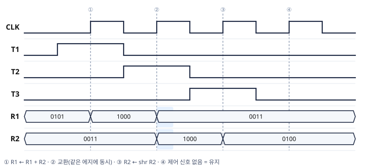
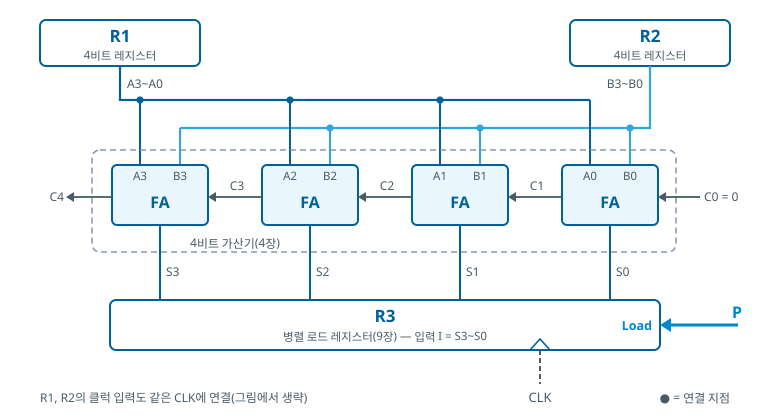
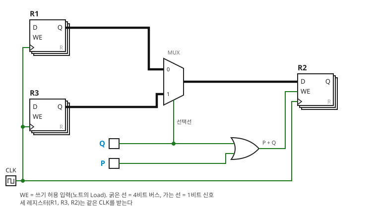
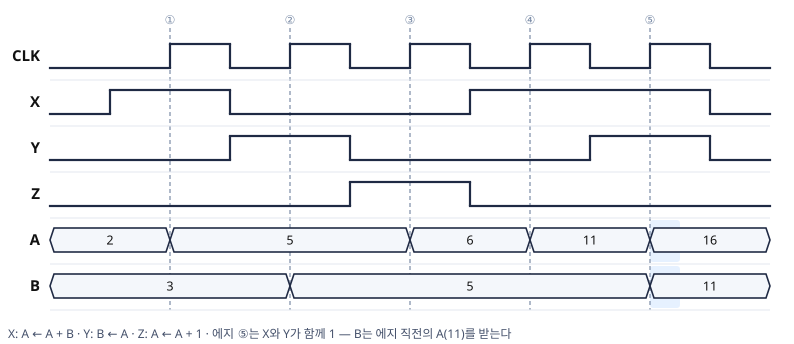
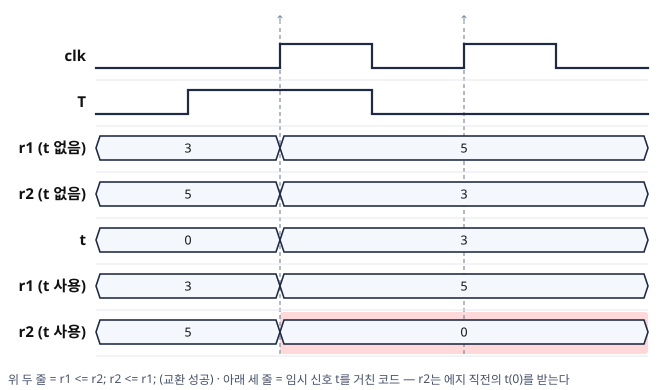

# 디지털공학 8장 보조학습자료 (1/2)
### RTL 개요 · FSM · ASM Chart · ASMD Chart

> 이 자료는 교재의 핵심 개념과 풀이 과정을 본문 서술로 정리한 복습용 보조자료입니다.  
> Mano, *Digital Design* 8장과 함께 활용하세요.

---

## 목차

- [1. 레지스터 전송 레벨(RTL) 설계 개요](#1-레지스터-전송-레벨rtl-설계-개요)
- [2. 상태 머신(FSM)과 제어기 구조](#2-상태-머신fsm과-제어기-구조)
- [3. FSM 설계 절차](#3-fsm-설계-절차)
- [4. Moore Machine vs Mealy Machine](#4-moore-machine-vs-mealy-machine)
- [5. ASM Chart](#5-asm-chart)
- [6. ASMD Chart](#6-asmd-chart)

---

## 1. 레지스터 전송 레벨(RTL) 설계 개요

### 학습목표

- RTL 설계가 필요한 이유를 대형 디지털 시스템의 특성과 연결하여 설명할 수 있다.
- Datapath Unit과 Control Unit의 역할과 차이를 구분할 수 있다.
- Top-Down 설계 계층에서 RTL 수준의 위치를 설명할 수 있다.
- 레지스터 전송 문장(전송, 조건부 전송, 동시 전송)을 읽고 작성할 수 있다.
- 마이크로연산 4계열을 담당 부품과 연결하고, RTL 문장과 하드웨어 배선을 서로 바꾸어 나타낼 수 있다.
- RTL 문장과 VHDL 구문을 서로 바꾸어 나타낼 수 있다.

---

### 1.1 RTL 설계의 배경

5장과 6장에서 배운 순차회로는 **상태표(State Table)** 와  
**상태 천이도(State Diagram)** 를 이용하여 동작을 표현했습니다.

그러나 실제 디지털 시스템의 경우, 이 방법에는 한계가 있습니다.

$$\text{시스템 복잡도} \uparrow \quad \Rightarrow \quad \text{상태 수} \uparrow\uparrow \quad \Rightarrow \quad \text{상태표/상태 천이도로 표현 불가}$$

**해결 방법:**  
시스템을 **기능별 모듈**로 나누고,  
모듈 간 **데이터 경로(Data Path)** 와 **제어 신호(Control Signal)** 로 표현합니다.

```
외부 입력 ──▶ [Control Unit] ──제어신호──▶ [Datapath Unit] ──▶ 출력
                   ↑                              │
                   └──────── 상태 피드백 ──────────┘
```

- **예**: 32비트 레지스터 하나의 상태 수만 해도 $2^{32}$개입니다. 4비트 카운터도 상태표로 나타내면 16행이지만, 레지스터 전송 표기(§1.6)로는 $R \leftarrow R + 1$ 한 줄입니다.
- **왜**: 상태표는 상태마다 행을 하나씩 두므로 표의 크기가 상태 수에 비례합니다. 플립플롭이 $n$개이면 상태는 $2^n$개까지 늘어납니다.

> 📖 **그림은 교재 참고** — Mano 6판 Fig 8.2 (Control and datapath interaction): 제어유닛이 데이터패스에 제어 신호를 보내고, 데이터패스가 상태를 제어유닛에 알립니다.
>
> 이 그림이 8장 전체의 지도입니다. §1 = 전송의 언어(RTL), §5\~6 = 제어 흐름의 설계도(ASM 차트), 8장 2/2 = 제어유닛의 구현입니다.

**데이터 처리 회로의 동작** — 센서 값 4개를 한 클럭에 하나씩 받아 평균을 구해 출력하는 회로입니다. 다음 세 가지를 확인합니다.

- 값을 담는 곳(데이터패스)과 순서를 정하는 곳(제어유닛)
- 클럭마다 레지스터가 받는 값을 정하는 제어 신호
- 다음 단계를 바꾸는 상태 신호(DONE)


---

### 1.2 모듈 구성 소자

각 모듈은 아래 기본 디지털 소자들로 구성됩니다:

| 소자 | 역할 |
|---|---|
| **레지스터** | 데이터 임시 저장 |
| **디코더** | 제어신호 해석 및 분배 |
| **멀티플렉서(MUX)** | 데이터 경로 선택 |
| **산술소자(ALU 등)** | 연산 처리 |
| **제어 논리** | 연산 순서 및 흐름 제어 |

---

### 1.3 RTL 설계의 정의

**레지스터 전송 레벨(Register Transfer Level, RTL) 설계** 란:

> 레지스터에 저장된 2진 정보의 **처리(Processing)** 및  
> **흐름(Transfer)** 단계에서의 설계를 의미합니다.

즉, RTL은 다음 두 가지를 핵심적으로 다룹니다:
- **언제**: 어떤 조건(제어신호)이 만족될 때
- **무엇을**: 어떤 레지스터에서 어떤 레지스터로, 어떤 연산을 거쳐 데이터가 이동하는가

---

### 1.4 Top-Down 설계 계층에서의 RTL 위치

디지털 시스템 설계는 **추상적 수준에서 구체적 수준으로** 내려가며 진행됩니다.

| 수준 | 계층 | 예시 |
|:---:|---|---|
| ↑ 추상적 | **System Level** | Computer, Disk Device, Bus Interface |
| | **Chip Level** | Microprocessor, RAM, ROM, UART |
| → **RTL Level** | **Register Level** | Register, ALU, Counter, Mux |
| | **Gate Level** | NAND, NOR, Flip-Flop |
| | **Circuit Level** | Transistor, Resistor, Capacitor |
| ↓ 구체적 | **Layout Level** | Poly, Metal, Contact Layer |

> 💡 RTL은 **Register Level**에 해당합니다.  
> 하드웨어 설계 언어(HDL, 예: Verilog/VHDL)로 작성하는 코드가 바로 RTL 코드이며,  
> 이를 합성(Synthesis)하면 Gate Level 회로가 자동으로 생성됩니다.

---

### 1.5 실제 칩 안의 제어와 데이터

§1.1의 그림(제어유닛 + 데이터패스)은 교재 속 개념도에 그치지 않고 실제 칩 안에 그대로 있습니다. 작은 장치와 큰 장치를 하나씩 같은 기준으로 살펴봅니다.

| 예 | 무엇인가 |
|---|---|
| 마이크로컨트롤러의 타이머 | ATmega328P(아두이노 우노의 칩) 안의 Timer/Counter0 — 클럭 수를 누적하다가 설정값에 닿으면 알림 |
| 공개 프로세서 코어 | Ibex — lowRISC가 설계를 공개한 32비트 RISC-V 프로세서(2단 파이프라인) |

- **데이터 영역** = 값을 담고 계산하는 곳(레지스터, 카운터, 비교기, ALU)
- **제어 영역** = 언제 무엇을 할지 정하는 곳(모드 설정, 제어 논리, 디코더, 상태 기계)
- **상태 신호** = 데이터 영역이 계산 결과를 제어 영역에 알리는 선(§1.1 모션의 DONE)

#### 타이머의 제어와 데이터

**상황** — ATmega328P의 타이머(Timer/Counter0)가 비교 일치 모드로 같은 간격을 만드는 경우입니다. 장면 1은 전체 구조와 두 영역, 장면 2는 데이터 영역의 값 경로, 장면 3은 상태 신호 MATCH가 제어 영역으로 돌아오는 흐름입니다.


**전체 구조**

- **하는 일**: 클럭 수를 누적하다가 카운트가 설정값과 같아지면 알립니다(예: 일정 시간마다 신호 만들기).
- **비교 일치 모드**: 카운터 TCNT0가 비교값 OCR0A와 같아지면 카운터를 0으로 지웁니다. 따라서 같은 간격이 되풀이됩니다.
- **출처**: Microchip, ATmega328P 데이터시트 §18.7.2 「Clear Timer on Compare Match (CTC) Mode」

**데이터 영역**

- 카운터 TCNT0는 6장 2/2의 카운터, 비교값 OCR0A는 6장 1/2의 레지스터, 비교기는 4장의 크기 비교기입니다.
- 비교기는 TCNT0와 OCR0A를 계속 비교합니다.
- 이 영역의 동작을 레지스터 전송 표기(§1.6)로 나타내면 $INC:\ TCNT0 \leftarrow TCNT0 + 1$, $\ CLR:\ TCNT0 \leftarrow 0$입니다.

**제어 영역과 상태 신호**

- **제어 논리**: CPU가 기록한 모드 설정에 따라 클럭마다 INC나 CLR을 냅니다.
- **상태 신호 MATCH**: 비교기의 일치 결과가 제어 논리로 돌아오면 CLR이 출력되고, 카운터가 0부터 다시 증가합니다.
- 같은 일치로 다음 타이머 클럭에 플래그 OCF0A가 1이 되고, 허용되어 있으면 CPU에 인터럽트를 요청합니다.
- §1.1 모션의 DONE과 같은 역할입니다. 데이터 영역의 결과가 제어 영역의 다음 행동을 바꿉니다.

#### 프로세서의 제어와 데이터

**상황** — 공개 프로세서 코어 Ibex(2단 파이프라인) 안에서 명령어가 처리되는 경우입니다. 장면 1은 프로그램 코드가 기계어로 바뀌어 명령어 메모리에 저장되는 과정, 장면 2는 블록이 처리 순서대로 나타나는 전체 구조와 두 영역, 장면 3은 데이터 영역의 값 경로, 장면 4는 제어 신호와 상태 신호(분기 비교 결과)의 흐름입니다.


**전체 구조**

- Ibex는 두 단으로 나뉩니다. 1단은 명령어 가져오기(프리페치 버퍼), 2단은 해독과 실행(디코더, 컨트롤러, 레지스터 파일, ALU, 곱셈, 나눗셈기, 메모리 접근부)입니다.
- 레지스터 읽기와 쓰기는 2단에서 해독, 실행과 같은 클럭 안에 일어납니다.
- **출처**: Ibex 문서 「Pipeline Details」, 「Instruction Decode and Execute」

**데이터 영역**

- 레지스터 파일은 값을 보관하고, ALU는 산술과 논리 연산을 합니다. 곱셈, 나눗셈기와 메모리 접근부(LSU)는 데이터 메모리와 값을 주고받습니다.
- 명령어 `add x3, x1, x2`를 레지스터 전송 표기로 나타내면 $x3 \leftarrow x1 + x2$입니다. §1.7의 마이크로연산과 같은 형식입니다.

**제어 영역과 상태 신호**

- **디코더**: 명령어를 읽어 다른 블록에 제어 신호를 냅니다.
- **컨트롤러**: 프로세서 전체 실행을 이끄는 상태 기계입니다(리셋 뒤 시작, 분기 때 다음 주소, 예외와 인터럽트 처리).
- **상태 신호**: ALU의 분기 비교 결과가 컨트롤러로 돌아오면, 컨트롤러가 다음 명령어의 주소(PC)를 정합니다.
- §5\~6의 ASM 차트와 8장 2/2의 제어유닛이 이와 같은 제어 영역을 설계하는 방법입니다.

#### 정리

| 장치 | 데이터 영역 | 제어 영역 | 상태 신호 |
|---|---|---|---|
| 평균 회로(§1.1의 모션) | 합계 레지스터, 가산기, 개수 카운터 | 제어유닛 | DONE |
| 타이머 | 카운터 TCNT0, 비교값 OCR0A, 비교기 | 클럭 선택, 제어 논리 | MATCH |
| 프로세서(Ibex) | 레지스터 파일, ALU, 메모리 접근부 | 디코더, 컨트롤러 | 분기 비교 결과 |

- 8장에서 설계하는 「데이터패스 + 제어유닛」은 실제 칩의 구조와 같습니다.

---

### 1.6 레지스터 전송 표기법 — 세 가지 문법

| 표기 | 의미 |
|---|---|
| $R2 \leftarrow R1$ | $R1$의 내용을 $R2$로 전송 (다음 클럭 에지에) |
| $P:\ R2 \leftarrow R1$ | **조건부** — 제어 신호 $P{=}1$인 에지에만 전송 |
| $P:\ R2 \leftarrow R1,\ R4 \leftarrow R3$ | 콤마 = **같은 에지에 동시에** |

- **왜 에지에 동시인가**: 레지스터는 같은 클럭을 받는 플립플롭의 묶음입니다(6장 1/2). 모든 플립플롭이 같은 에지에서 에지 직전의 값을 받으므로(5장 순차회로), 레지스터 전송 문장도 같은 에지에서 함께 반영됩니다.
- **확인**: 콤마로 이은 두 전송이 한 에지에서 함께 일어나는 모습은 예제 1-2의 에지 ②에서 확인합니다.

> ⚠️ **자주 하는 실수**: $\leftarrow$를 프로그래밍의 대입문처럼 「즉시, 순서대로」 읽는 것입니다.
>
> 레지스터 전송은 모두 **클럭 에지에, 동시에** 일어납니다. $R2 \leftarrow R1,\ R1 \leftarrow R2$는 순차 실행이 아니라 **교환(swap)** 입니다. 에지 직전의 값들이 서로에게 실립니다.

---

### 1.7 마이크로연산 — 부품과의 대응

한 클럭에 일어나는 기본 연산을 **마이크로연산**이라 부릅니다. 모두 앞 장에서 배운 부품이 담당합니다.

| 계열 | 예 | 담당 부품 |
|---|---|---|
| 전송 | $R2 \leftarrow R1$ | 병렬 로드 레지스터(6장 1/2) |
| 산술 | $R3 \leftarrow R1 + R2$, $R1 \leftarrow R1 + 1$ | 가산기(4장), 카운터(6장 2/2) |
| 논리 | $R1 \leftarrow R1 \oplus R2$ | 게이트 열(2장) |
| 시프트 | $R1 \leftarrow \text{shr } R1$ | 시프트 레지스터(6장 1/2) |

- **왜 네 계열인가**: 레지스터가 에지에서 받는 값은 다른 레지스터의 값(전송), 두 값의 계산 결과(산술, 논리), 현재 값의 비트 재배치(시프트) 가운데 하나입니다.
- **확인**: 표의 담당 부품은 모두 2\~6장에서 다룬 부품입니다. 레지스터 전송 표기는 새 부품이 아니라 기존 부품을 **언제 사용할지**를 기술하는 표기입니다.

---

### 1.8 RTL 문장 읽기

#### 예제 1-1 — 초기화와 증가

다음 RTL 기술이 하는 일을 설명하라.

$$T_0:\ R1 \leftarrow 0 \qquad T_1:\ R1 \leftarrow R1 + 1$$

<details>
<summary>풀이 보기</summary>


$T_0$이 1인 에지에 $R1$을 0으로 초기화하고, 이후 $T_1$이 1인 에지마다 1씩 증가합니다. **초기화 가능한 카운터**(6장 2/2)의 RTL 표현입니다. $T_0$, $T_1$ 같은 제어 신호를 알맞은 순간에 1로 만드는 회로가 제어유닛(8장 2/2)입니다.

**검산**: $T_0{=}1$ 한 번 → $R1{=}0$, 이후 $T_1$이 1인 에지 3번 → $R1 = 3$ ✓

- 문장의 순서가 아니라 조건이 1인 에지가 동작 시점을 정합니다.

</details>

#### 예제 1-2 — 동시 전송의 추적

4비트 레지스터의 초기값이 $R1 = 0101$, $R2 = 0011$이다. 에지 ①\~④에서 1인 제어 신호가 차례로 $T_1$, $T_2$, $T_3$, (없음)일 때 각 에지 뒤의 $R1$, $R2$를 구하라.

$$T_1:\ R1 \leftarrow R1 + R2 \qquad T_2:\ R1 \leftarrow R2,\ R2 \leftarrow R1 \qquad T_3:\ R2 \leftarrow \text{shr } R2$$

<details>
<summary>풀이 보기</summary>


| 에지 | 1인 신호 | 수행 | $R1$ | $R2$ |
|:---:|:---:|---|:---:|:---:|
| (초기) | — | — | 0101 | 0011 |
| ① | $T_1$ | $R1 \leftarrow R1 + R2$ ($5 + 3$) | 1000 | 0011 |
| ② | $T_2$ | 교환 | 0011 | 1000 |
| ③ | $T_3$ | $R2 \leftarrow \text{shr } R2$ | 0011 | 0100 |
| ④ | 없음 | 유지 | 0011 | 0100 |

- 에지 ②에서 $R1$은 에지 직전의 $R2$(0011)를, $R2$는 에지 직전의 $R1$(1000)을 받습니다. 교환입니다.
- **검산**: $0100 = 4 = 8 \div 2$ — 우측 시프트는 2로 나누기입니다(6장 1/2 시프트 레지스터) ✓



- 제어 신호가 0인 에지 ④에서는 두 레지스터가 모두 유지됩니다.

</details>

---

### 1.9 RTL 문장의 하드웨어 실체

#### 예제 1-3 — 조건부 덧셈의 배선

$P:\ R3 \leftarrow R1 + R2$를 부품으로 배선하라.

<details>
<summary>풀이 보기</summary>


1. 가산기(4장)의 두 입력에 $R1$, $R2$의 출력을 배선합니다.
2. 가산기 출력을 $R3$(병렬 로드 레지스터, 6장 1/2)의 입력 $I$에 배선합니다.
3. $P$를 $R3$의 **Load**에 연결합니다. 클럭은 그대로 둡니다.



**검산**: $P{=}0$이면 가산기는 계속 계산하지만 $R3$이 받지 않습니다(유지). 제어는 언제나 수신 레지스터의 Load에서 합니다 ✓

- 클럭을 막지 않고 수신 레지스터가 값을 받을지만 정합니다(6장 1/2 §2.4의 Load 구조).

</details>

> 💡 **Tip**: RTL 문장 하나는 「부품 몇 개 + 배선 + 제어 신호 한 가닥」의 **속기**입니다. 문장을 보면 하드웨어를, 하드웨어를 보면 문장을 떠올리는 것이 이 절의 목표입니다(예제 1-4와 1-5에서 두 방향으로 확인).

#### 예제 1-4 — 출처가 둘인 전송

다음 RTL 기술의 하드웨어를 블록도 수준으로 배선하라. 단, $P$와 $Q$는 동시에 1이 되지 않는다.

$$P:\ R2 \leftarrow R1 \qquad Q:\ R2 \leftarrow R3$$

<details>
<summary>풀이 보기</summary>


**Step 1** — 목적지가 같은 $R2$이고 출처가 **두 곳**($R1$, $R3$)이므로 경로 선택이 필요합니다(4장 MUX).

**Step 2** — $R2$ 입력 앞에 **2:1 MUX**를 둡니다. 입력 0 = $R1$, 입력 1 = $R3$, 선택선 = $Q$

**Step 3** — $R2$의 **Load** $= P + Q$ (둘 중 하나가 1이면 받습니다)

**검산**: $P{=}1$ → MUX가 $R1$ 선택($Q{=}0$), Load 1 → $R2 \leftarrow R1$ ✓ / $Q{=}1$ → MUX가 $R3$ 선택, Load 1 ✓ / 둘 다 0 → Load 0, 유지 ✓

- 목적지가 같은 전송이 여러 개면 MUX가 생깁니다. 데이터패스에 MUX가 많은 이유입니다.

</details>

**Logisim으로 확인하기** — 예제 1-4의 회로를 구성해 세 경우를 확인합니다.

1. **배치**: Memory 라이브러리의 레지스터 1개($R2$, 데이터 폭 4비트), Plexers 라이브러리의 멀티플렉서 1개(2입력, 데이터 폭 4비트), OR 게이트 1개, 4비트 입력 핀 2개($R1$, $R3$ 자리 — 값을 직접 정함), 1비트 입력 핀 3개($P$, $Q$, $CLK$), 4비트 출력 핀 1개를 놓습니다.
2. **연결**: MUX 입력 0에 $R1$ 핀, 입력 1에 $R3$ 핀, 선택선에 $Q$를 연결하고, MUX 출력을 레지스터의 데이터 입력에 연결합니다. $P + Q$(OR 게이트 출력)를 레지스터의 Enable 입력에, $CLK$를 클럭 입력에 연결합니다.
3. **$P = 1$**: $R1 = 1011$, $R3 = 0110$으로 두고 $P = 1$, $Q = 0$에서 $CLK$를 0 → 1 → 0으로 바꿉니다. 출력이 $1011$이 되는지 확인합니다.
4. **$Q = 1$**: $P = 0$, $Q = 1$로 바꾸고 에지를 줍니다. 출력이 $0110$이 되는지 확인합니다.
5. **유지**: $P = Q = 0$으로 두고 $R1$, $R3$ 값을 바꾼 뒤 에지를 줍니다. 출력이 변하지 않으면 정상입니다(Enable = 0이면 유지).



#### 예제 1-5 — 배선에서 RTL 문장으로

다음 배선을 RTL 문장 하나로 쓰라: 「가산기의 입력 A에 $R1$, 입력 B에 $R2$의 출력이 연결되고, 가산기 출력이 $R1$의 병렬 입력으로 들어간다. 제어 신호 $ADD$가 $R1$의 Load에 연결되어 있다.」

<details>
<summary>풀이 보기</summary>


$$ADD:\ R1 \leftarrow R1 + R2$$

**검산**: 목적지 = Load를 받는 레지스터($R1$), 출처 = 그 입력에 연결된 것(가산기 출력 = $R1{+}R2$), 조건 = Load에 연결된 신호($ADD$) ✓ — 누적기(accumulator)의 RTL 문장이며, 8장 2/2에서 다시 다룹니다.

- 배선에서 RTL 문장을 읽을 때는 Load 입력부터 거꾸로 읽습니다. Load의 신호 = 조건, Load를 가진 레지스터 = 목적지, 그 레지스터의 데이터 입력 = 출처입니다.

</details>

#### 예제 1-6 — 두 조건이 함께 1일 때 (심화)

예제 1-4의 회로에서 설계 조건과 달리 $P$와 $Q$가 같은 에지에 함께 1이 되었다($R1 = 1011$, $R3 = 0110$). 한 학생은 $R2$에 $R1$과 $R3$이 함께 실리므로 두 값의 OR인 $1111$이 저장된다고 답했다. 실제로 저장되는 값을 구하고, RTL 기술에서 이 상황을 다루는 방법을 쓰라.

<details>
<summary>풀이 보기</summary>


**Step 1** — Load $= P + Q = 1$ → $R2$는 이 에지에서 값을 받습니다.

**Step 2** — MUX 선택선 $= Q = 1$ → 입력 1($R3$)만 통과 → $R2 \leftarrow \boxed{0110}$. MUX는 입력 하나만 고르므로 두 값이 섞이지 않습니다. 학생의 답은 틀렸습니다.

**Step 3** — 이 회로는 결과적으로 $Q$를 우선합니다. 그러나 RTL 기술 $P: R2 \leftarrow R1$, $Q: R2 \leftarrow R3$만으로는 둘이 함께 1일 때의 동작이 정해지지 않습니다. 방법은 둘입니다.

- 제어유닛이 두 신호가 함께 1이 되지 않도록 보장합니다(8장 2/2).
- 우선순위를 RTL에 명시합니다: $PQ':\ R2 \leftarrow R1$, $\ Q:\ R2 \leftarrow R3$

같은 상황의 HDL 기술은 예제 1-11에서 다룹니다.

</details>

#### 예제 1-7 — 결과에서 제어 신호 찾기 (심화)

8비트 레지스터 $A$, $B$와 제어 신호 세 개 $X:\ A \leftarrow A + B$, $\ Y:\ B \leftarrow A$, $\ Z:\ A \leftarrow A + 1$이 있다. 에지 ①\~⑤ 뒤 $(A, B)$가 $(2, 3) \to (5, 3) \to (5, 5) \to (6, 5) \to (11, 5) \to (16, 11)$로 바뀌었다(10진). 각 에지에서 1이었던 제어 신호를 모두 찾아라.

<details>
<summary>풀이 보기</summary>


| 에지 | 변화 | 판정 | 1인 신호 |
|:---:|---|---|:---:|
| ① | $A$: 2 → 5 | $2 + 3 = 5$ ✓, $2 + 1 = 3$ ✗ | $X$ |
| ② | $B$: 3 → 5 | 에지 직전 $A = 5$ | $Y$ |
| ③ | $A$: 5 → 6 | $5 + 5 = 10$ ✗, $5 + 1 = 6$ ✓ | $Z$ ($Y$는 판정 불가) |
| ④ | $A$: 6 → 11 | $6 + 5 = 11$ ✓ | $X$ |
| ⑤ | $A$: 11 → 16, $B$: 5 → 11 | $A = 11 + 5$, $B$ = 에지 직전 $A$(11) | $X$, $Y$ |

- **검산**: 값이 바뀌지 않은 레지스터는 그 에지에 자신을 목적지로 하는 신호가 없습니다(에지 ②의 $A$, 에지 ①과 ④의 $B$) ✓
- 에지 ③은 예외입니다. 에지 직전 $A = B = 5$이므로 $Y$가 1이어도 $B$는 5로 같습니다. 값이 유지되었다는 것만으로는 쓰기가 없었다고 판정할 수 없습니다(§5 ASM 차트의 추적에서도 같습니다).
- 에지 ⑤에서 $B$가 받은 값은 새 $A$(16)가 아니라 에지 직전의 $A$(11)입니다. 두 전송이 같은 에지에 동시에 일어났습니다.



- 결과(레지스터 값)에서 원인(제어 신호)을 찾는 이 과정이 §5의 ASM 차트를 수기로 추적해 검증하는 방법의 기초입니다.

</details>

---

### 1.10 HDL과 RTL — 코드와 RTL 문장의 대응

[HDL 보조학습자료](교재_회로로_배우는_HDL.md)의 3\~6장 절에서 읽은 코드의 실체를 정리합니다.

| 코드 예 | 그 실체 | HDL 보조학습자료 |
|---|---|---|
| `F <= (not x and z) or (x and y)` | 조합논리의 **식 그대로** | 3장, 4장 절 |
| `if rising_edge(clk) then Q <= D` | **에지**의 문법 | 5장 절 |
| `case state is ...` | **FSM** — 상태도가 코드로 | 5장 절 |
| `r <= si & r(3 downto 1)` | 시프트 = **배선** | 6장 절 |
| `cnt <= cnt + 1` | 카운트 = **산술** | 6장 절 |

순차회로의 문장들은 모두 「레지스터가 무엇을 받는가」를 기술합니다. 그것이 **RTL(Register Transfer Level) 기술**입니다. HDL 코드를 RTL 코드라 부르는 이유입니다.

- **확인**: 카운터의 `cnt <= cnt + 1`은 RTL로 $CNT \leftarrow CNT + 1$이고, 시프트 레지스터의 `r <= si & r(3 downto 1)`은 빈자리에 $si$가 들어가는 $R \leftarrow \text{shr } R$입니다.

#### 두 언어, 같은 문장

| RTL 표기 | VHDL |
|---|---|
| $R2 \leftarrow R1$ | `r2 <= r1;` |
| $P:\ R2 \leftarrow R1$ | `if P = '1' then r2 <= r1; end if;` |
| $R1 \leftarrow R1 + 1$ | `r1 <= r1 + 1;` |
| 동시 전송(콤마) | 같은 process 안의 문장들 — **모두 에지에 동시 반영** |

- **왜 1:1인가**: process 안의 `<=`는 에지에서 갱신되는 신호(레지스터)에 값을 내보내고(HDL 보조학습자료 5-5), `if`의 조건은 수신 레지스터의 Load에 연결되는 제어 신호입니다. RTL의 「조건: 목적지 ← 출처」가 코드의 「if 조건 then 목적지 <= 출처」입니다.

> 💡 **핵심**: 설계 계층에서 RTL은 게이트보다 **한 층 위**의 언어입니다(§1.4). RTL로 기술하면 **합성(synthesis) 도구가 §3.1 FSM 설계 7단계의 Step 3\~7에 해당하는 일을 자동으로 처리**해 목표 소자의 회로를 만들어 냅니다. 여기서는 그 언어가 **무엇의 속기인지**(부품, 배선, 제어)를 이해합니다.

| 수기로 하는 단계 | 합성 도구에서 하는 일 |
|---|---|
| 상태 할당(§3.1 Step 3) | 상태 코드(이진, Gray, 원핫 등)를 도구가 정함, 설계자가 옵션으로 지정 가능 |
| 플립플롭 종류 선택(§3.1 Step 5) | 레지스터를 D 플립플롭으로 구현 |
| 상태표, 방정식 도출, K-map 간소화(3장, §3.1 Step 4와 6) | K-map 대신 논리 최적화 알고리즘이 식을 간소화 |
| 회로 작성(§3.1 Step 7), FPGA | LUT와 플립플롭으로 변환 |
| 회로 작성(§3.1 Step 7), 주문형 반도체(ASIC, Application-Specific Integrated Circuit) | 게이트와 플립플롭으로 변환 |

#### 예제 1-8 — VHDL을 RTL로

다음 VHDL 구문을 RTL 표기로 옮겨라. $A$와 $B$는 `unsigned` 4비트 신호이다(HDL 보조학습자료 6-5).

```vhdl
if rising_edge(clk) then
  if LD = '1' then
    A <= B;
  elsif INC = '1' then
    A <= A + 1;
  end if;
end if;
```

<details>
<summary>풀이 보기</summary>


**Step 1** — 바깥 `if` = 클럭 에지 → 안쪽 문장은 모두 에지에서의 전송입니다.

**Step 2** — `if LD` → $LD:\ A \leftarrow B$

**Step 3** — `elsif INC` = $LD$가 0이고 $INC$가 1일 때 → $LD' \cdot INC:\ A \leftarrow A + 1$

$$LD:\ A \leftarrow B \qquad LD'\,INC:\ A \leftarrow A + 1$$

**검산**: $LD = INC = 1$이면 첫 조건만 실행 → $A \leftarrow B$(적재 우선) ✓

- `elsif`는 우선순위를 만듭니다. RTL로 옮길 때 뒤 조건에 앞 조건의 부정을 곱합니다(예제 1-6의 우선순위 명시와 같은 형태).

</details>

#### 예제 1-9 — RTL을 VHDL로

다음 RTL 기술을 VHDL의 process 하나로 쓰라. $CLR$과 $ADD$는 동시에 1이 되지 않으며, $R1$과 $R2$는 `unsigned` 4비트 신호 `r1`, `r2`이다.

$$CLR:\ R1 \leftarrow 0 \qquad ADD:\ R1 \leftarrow R1 + R2$$

<details>
<summary>풀이 보기</summary>


```vhdl
process(clk)
begin
  if rising_edge(clk) then
    if CLR = '1' then
      r1 <= "0000";          -- CLR: R1 <- 0
    elsif ADD = '1' then
      r1 <= r1 + r2;         -- ADD: R1 <- R1 + R2
    end if;                  -- 둘 다 0이면 유지
  end if;
end process;
```

- 조건이 서로 배타이므로 `elsif` 대신 독립된 `if` 두 개로 써도 동작이 같습니다. 함께 1이 될 수 있으면 우선순위가 달라지므로 구분해야 합니다(예제 1-11).
- **검산**: 코드를 다시 RTL로 옮기면(예제 1-8의 방법) $CLR:\ R1 \leftarrow 0$, $CLR' \cdot ADD:\ R1 \leftarrow R1 + R2$입니다. $ADD$만 1일 때 원래 기술과 같습니다 ✓

</details>

#### 예제 1-10 — 교환과 임시 신호 (심화)

RTL $T:\ R1 \leftarrow R2,\ R2 \leftarrow R1$(교환)을 코드로 옮기던 학생이 「`r1 <= r2; r2 <= r1;`은 첫 줄에서 `r1`이 바뀌어 교환에 실패한다」고 판단해 임시 신호 `t`를 추가했다. 초기값 $r1 = 3$, $r2 = 5$, $t = 0$에서 $T = 1$인 에지 하나 뒤의 값을 구하고, 학생의 판단과 수정을 평가하라.

```vhdl
if rising_edge(clk) then
  if T = '1' then
    t  <= r1;
    r1 <= r2;
    r2 <= t;
  end if;
end if;
```

<details>
<summary>풀이 보기</summary>


**Step 1** — process 안의 신호는 에지 직전 값으로 계산되고, process가 끝난 뒤 함께 갱신됩니다(HDL 보조학습자료 5-5). 세 줄의 오른쪽은 모두 에지 직전 값입니다: $r1 = 3$, $r2 = 5$, $t = 0$

**Step 2** — 결과: $t = 3$, $r1 = 5$, $r2 = \boxed{0}$ → 교환에 실패합니다($r2$가 에지 직전의 $t$를 받음).

**Step 3** — 학생의 판단(「첫 줄에서 `r1`이 바뀐다」)이 틀렸습니다. 신호 대입은 줄 순서대로 즉시 반영되지 않으므로 `r1 <= r2; r2 <= r1;`만으로 교환됩니다. RTL의 콤마와 같은 동작입니다. 임시 신호는 순차 프로그래밍의 방식이며, 여기서는 한 클럭 늦은 값을 사용하게 만들어 오류를 냅니다.



- **검산**: 원래 코드 → $r1 = 5$, $r2 = 3$ ✓ (교환). 복습문제 (2)의 순차 프로그래밍과 반대 결과입니다.

</details>

#### 예제 1-11 — 같은 신호에 두 번 대입 (심화)

다음 코드에서 $P$와 $Q$가 같은 에지에 함께 1이면 `r2`는 무엇을 받는가? 한 학생은 「두 `if`가 모두 참이므로 두 전송이 함께 일어난다(또는 충돌한다)」고 답했다. 판정하고, 이 코드와 같은 동작의 RTL을 쓰라.

```vhdl
if rising_edge(clk) then
  if P = '1' then r2 <= r1; end if;
  if Q = '1' then r2 <= r3; end if;
end if;
```

<details>
<summary>풀이 보기</summary>


**Step 1** — process 안에서 같은 신호에 여러 번 대입하면 **마지막으로 실행된 대입**이 그 에지의 값이 됩니다 → $r2 \leftarrow r3$

**Step 2** — 학생의 답은 틀렸습니다. 두 전송이 함께 일어나거나 충돌하지 않고, 뒤에 쓴 $Q$의 대입이 우선합니다. 예제 1-6의 MUX 회로(선택선 = $Q$)와 같은 동작입니다.

**Step 3** — 같은 동작의 RTL: $PQ':\ R2 \leftarrow R1$, $\ Q:\ R2 \leftarrow R3$

- **검산**: $P = 1$, $Q = 0$ → 둘째 `if` 미실행 → $r2 \leftarrow r1$ ✓
- 코드에서 문장의 순서가 의미를 갖는 경우입니다. 우선순위를 의도했다면 `if Q … elsif P …`로 명시하는 것이 읽기 쉽습니다.

</details>

**HDL에서 칩까지** — 조건부 전송 $P:\ R2 \leftarrow R1$을 기술한 HDL 코드 하나가 FPGA 시제품을 거쳐 반도체 칩이 되기까지의 과정입니다. 다음을 확인합니다.

- 코드 한 줄이 하드웨어 한 부분이 되는 대응: 포트 = 칩의 핀, `rising_edge` = D 플립플롭, `if P` = Load-MUX의 선택선
- HDL 작성과 시뮬레이션 단계(HDL 보조학습자료에서 다루는 단계)
- 합성 뒤의 두 갈래: FPGA = LUT와 플립플롭, 비트스트림으로 시제품 검증 / 반도체 = 표준 셀, 레이아웃, 마스크, 제조
- FPGA는 설정을 바꾸면 회로가 바뀌고, 반도체는 고치려면 다시 제조해야 합니다.


**출처**: AMD UG892(Vivado 설계 흐름), OpenROAD Flow Scripts(RTL에서 GDSII까지), Cadence 「What is ASIC Prototyping?」

---

### 1.11 복습문제

#### 문제 (1)

"대형 디지털 시스템을 상태표와 상태 천이도만으로 표현하기 어려운 이유"를 한 문장으로 설명하라.

<details>
<summary>정답 보기</summary>


시스템이 복잡해질수록 상태 수가 기하급수적으로 늘어나  
상태표와 상태 천이도로 모든 경우를 나열하고 표현하는 것이 실질적으로 불가능해지기 때문입니다.

</details>

---

#### 문제 (2)

$S:\ R1 \leftarrow R2,\ R2 \leftarrow R1$이 수행하는 일을 적고, 순차 프로그래밍의 `R1=R2; R2=R1;`과 결과가 어떻게 다른지 설명하라.

<details>
<summary>정답 및 풀이 보기</summary>


RTL에서는 에지 직전의 $R2$ 값이 $R1$로, 에지 직전의 $R1$ 값이 $R2$로 갑니다. **동시 교환(swap)** 입니다.

순차 프로그래밍에서는 `R1=R2`를 실행하는 순간 $R1$의 원래 값이 사라집니다. 이어서 `R2=R1`은 같은 값을 되돌리므로 **둘 다 $R2$의 원래 값**이 됩니다(교환 실패).

하드웨어는 모든 레지스터가 에지 직전 값을 읽고 에지에 동시에 씁니다. 순차회로의 다음 상태를 현재 상태로만 계산하는 원리(5장)와 같습니다.

</details>

---

#### 문제 (3)

「제어 신호 $C{=}1$일 때 $R2$를 오른쪽으로 한 칸 시프트한다」를 RTL 문장으로 쓰라.

<details>
<summary>정답 및 풀이 보기</summary>


$$C:\ R2 \leftarrow \text{shr } R2$$

하드웨어 실체는 범용 시프트 레지스터(6장 1/2)의 모드 선택($s_1 s_0 = 01$)에 $C$를 배선한 것입니다.

</details>

---

#### 문제 (4)

다음 VHDL 구문을 RTL 표기로 옮기고, 이 하드웨어의 이름(예제 1-5 참조)을 쓰라.

```vhdl
if EN = '1' then
  ACC <= ACC + X;
end if;
```

<details>
<summary>정답 및 풀이 보기</summary>


$$EN:\ ACC \leftarrow ACC + X$$

$EN$이 1인 에지마다 $X$를 누적하는 **누적기(accumulator)** 입니다. RTL 문장과 VHDL 구문이 같은 문장의 두 표기임을 확인합니다.

</details>

---

---

## 2. 상태 머신(FSM)과 제어기 구조

### 학습목표

- FSM(Finite State Machine)의 정의와 디지털 시스템에서의 역할을 설명할 수 있다.
- Datapath Unit과 Control Unit의 기능적 차이를 설명할 수 있다.
- FSM이 Control Unit의 역할을 담당하는 이유를 이해한다.

---

### 2.1 상태 머신(SM)이란?

**상태 머신(State Machine, SM)** 은 **시스템을 추상화하여 표현하는 수학적 모델링 방법**입니다.

대다수의 시스템은 상태 수가 유한하므로,  
SM은 일반적으로 **유한 상태 머신(FSM, Finite State Machine)** 을 가리킵니다.

**FSM의 핵심 동작:**

$$\text{현재 상태} + \text{외부 입력} \xrightarrow{\text{천이 조건}} \text{다음 상태}$$

**FSM의 적용 사례:**

- 하드웨어: 엘리베이터, 교통신호등, 자판기, 비밀번호 패턴
- 소프트웨어: 프로토콜 파서, 게임 AI, 컴파일러 렉서

---

### 2.2 디지털 시스템의 두 유닛

디지털 시스템은 크게 두 유닛으로 구분됩니다:

| 유닛 | 역할 | 구성 소자 예 |
|---|---|---|
| **Datapath Unit** | 시스템 요구에 따라 **레지스터 데이터를 조작** | 레지스터, ALU, Shift Register, Counter |
| **Control Unit** | 데이터의 처리 및 흐름을 위한 **명령 생성** | FSM (순차회로) |

**FSM의 역할:**

$$\text{FSM} = \text{Datapath Unit의 연산 순서를 제어하는 신호를 생성하는 순차회로}$$

즉, FSM(Control Unit)은 "**무엇을 언제 할지**" 결정하고,  
Datapath Unit은 그 명령을 받아 "**실제 데이터를 처리**"합니다.

---

### 2.3 천이 발생 조건의 유형

FSM에서 상태 천이를 발생시키는 입력의 처리 방식에 따라 두 가지로 구분됩니다:

| 유형 | 설명 | 특징 |
|---|---|---|
| **Event** | 특정 사건(신호 에지)이 발생할 때 천이 | 클럭 에지 등 순간적 신호 |
| **Condition** | 특정 조건(레벨)이 유지될 때 천이 | 신호가 일정 값을 유지하는 동안 |

---

### 2.4 복습문제

#### 문제 (1)

Datapath Unit과 Control Unit의 역할을 각각 한 문장으로 설명하고,  
FSM이 어느 유닛에 해당하는지 이유와 함께 설명하라.

<details>
<summary>정답 보기</summary>


- **Datapath Unit**: 시스템 요구에 따라 레지스터에 저장된 데이터를 직접 조작하는 유닛
- **Control Unit**: 데이터 처리와 흐름 제어를 위한 명령 신호를 생성하는 유닛

**FSM이 Control Unit에 해당하는 이유**:  
FSM은 외부 입력과 현재 상태를 기반으로 다음 상태를 결정하고,  
각 상태에서 Datapath Unit에 내릴 연산 명령 신호를 출력하는 순차회로이기 때문입니다.

</details>

---

---

## 3. FSM 설계 절차

### 학습목표

- FSM 설계의 7단계 절차를 순서대로 나열할 수 있다.
- 각 단계에서 수행하는 작업을 설명할 수 있다.

---

### 3.1 FSM 설계 7단계

슬라이드에서 제시된 FSM 설계 표준 절차입니다:

```
Step 1. 시스템 사양 및 기능 분석을 통해 상태도 도출
          ↓
Step 2. 상태 축소 가능 시 축소 (등가 상태 제거)
          ↓
Step 3. 상태에 대한 2진 코드 할당 (State Encoding)
          ↓
Step 4. 2진 코드 상태표 작성
          ↓
Step 5. 플립플롭 종류 선택 (D, T, JK 등)
          ↓
Step 6. 선택한 플립플롭에 따른 논리식 도출 (K-map 활용)
          ↓
Step 7. 논리회로 작성 (상태머신 완성)
```

---

### 3.2 각 단계 설명

**Step 1 — 상태도 도출**  
문제의 요구사항을 분석하여 필요한 상태들과 상태 간 전이 조건을 파악합니다.  
Moore/Mealy 유형 중 어느 것으로 설계할지도 이 단계에서 결정합니다.

**Step 2 — 상태 축소**  
서로 동일한 동작을 하는 등가 상태(Equivalent State)가 있으면 합쳐서  
최소한의 상태 수로 설계합니다. 회로 복잡도를 낮출 수 있습니다.

**Step 3 — 2진 코드 할당**  
각 상태에 플립플롭의 값 조합($00, 01, 10, 11$ 등)을 할당합니다.  
할당 방식에 따라 회로 복잡도가 달라질 수 있습니다.

**Step 4 — 상태표 작성**  
현재 상태, 입력, 다음 상태, 출력을 2진 코드로 나타낸 표를 완성합니다.

**Step 5 — 플립플롭 선택**  
설계 목적에 따라 D, T, JK 플립플롭 중 하나를 선택합니다.

**Step 6 — 논리식 도출**  
선택한 플립플롭의 **여기표(Excitation Table)** 와 **K-map** 을 이용하여  
각 플립플롭의 입력 논리식을 도출합니다.

**Step 7 — 논리회로 작성**  
도출된 논리식을 기반으로 게이트와 플립플롭으로 최종 회로를 완성합니다.

> 💡 이 7단계는 5장에서 배운 순차회로 설계 절차와 **동일한 프레임**을 따릅니다.  
> RTL 설계에서는 이 절차에 **Datapath 연산을 결합**하는 것이 핵심 확장점입니다.

---

### 3.3 복습문제

#### 문제 (1)

FSM 설계 7단계를 순서대로 나열하라. (핵심 키워드 중심으로)

<details>
<summary>정답 보기</summary>


1. 상태도 도출
2. 상태 축소
3. 2진 코드 할당
4. 2진 코드 상태표 작성
5. 플립플롭 종류 선택
6. 플립플롭 입력 논리식 도출 (K-map)
7. 논리회로 작성

</details>

---

---

## 4. Moore Machine vs Mealy Machine

### 학습목표

- Moore Machine과 Mealy Machine의 출력 결정 방식 차이를 설명할 수 있다.
- Mealy Machine에서 글리치(Glitch)가 발생하는 원인과 해결 방법을 이해한다.

---

### 4.1 Moore Machine

**Moore Machine** 은 **출력이 현재 상태만으로 결정**되는 FSM 모델입니다.

$$\text{출력} = f(\text{현재 상태})$$

- 출력은 플립플롭의 출력($Q$)에만 의존합니다.
- 클럭과 **동기화**됩니다.
- 상태 전이가 완료되어야 출력이 변하므로 **안정적**입니다.

```
[현재 상태] ──▶ [출력 논리] ──▶ 출력
     ↑
   클럭 동기
```

---

### 4.2 Mealy Machine

**Mealy Machine** 은 **출력이 현재 상태 + 입력신호의 조합으로 결정**되는 FSM 모델입니다.

$$\text{출력} = f(\text{현재 상태},\ \text{입력})$$

- 입력이 변하면 클럭과 무관하게 즉시 출력이 바뀔 수 있습니다.
- 비동기 입력신호를 사용할 경우 **글리치(Glitch)** 가 발생할 수 있습니다.

**글리치(Glitch)란?**

> 하드웨어에 의한 시스템의 **일시적 오류 신호**입니다.  
> 입력신호의 천이와 클럭 사이클 사이의 시간 지연이 원인입니다.

---

### 4.3 글리치 해결 방법

**방법**: 클럭의 활성화 에지(Active Edge) 직전의 비동기 입력값을 **샘플링(Sampling)** 하여 사용합니다.

```
비동기 입력 ──▶ [D-FF 동기화] ──▶ 동기화된 입력 ──▶ Mealy Machine
                    ↑
                  클럭
```

> 💡 이 기법을 **입력 동기화(Input Synchronization)** 라고 하며,  
> 현업에서 Mealy Machine 설계 시 표준적으로 적용됩니다.

---

### 4.4 Moore vs Mealy 비교

| 항목 | Moore Machine | Mealy Machine |
|---|---|---|
| 출력 결정 | 현재 상태만으로 결정 | 현재 상태 + 입력으로 결정 |
| 클럭 동기화 | 완전 동기 | 입력에 따라 비동기 가능성 있음 |
| 글리치 위험 | 없음 | 있음 (비동기 입력 시) |
| 필요한 상태 수 | 상대적으로 많음 | 상대적으로 적음 |
| 안정성 | 높음 | 설계에 따라 다름 |
| 출력 응답 속도 | 클럭 에지 이후 | 입력 변화 즉시 가능 |

> 💡 **어떤 것을 선택할까?**  
> - 안정성과 동기화가 중요하면 → **Moore Machine**  
> - 상태 수를 줄이고 응답 속도를 높이려면 → **Mealy Machine** (단, 동기화 처리 필수)

---

### 4.5 복습문제

#### 문제 (1)

Moore Machine과 Mealy Machine에서 출력 함수를 논리식으로 나타내라.  
그리고 두 모델 중 설계 안전성이 높은 것과 그 이유를 설명하라.

<details>
<summary>정답 보기</summary>


**Moore**: $Z = f(Q)$ — 출력은 현재 상태 $Q$에만 의존  
**Mealy**: $Z = f(Q, X)$ — 출력은 현재 상태 $Q$와 입력 $X$에 의존

**안전성이 높은 것**: Moore Machine  
**이유**: 출력이 클럭과 동기화되어 있으므로, 비동기 입력에 의한 글리치 발생 가능성이 없습니다.  
Mealy Machine은 비동기 입력신호가 사용되면 클럭 사이클과의 시간 지연으로 일시적 오류 신호(글리치)가 발생할 수 있습니다.

</details>

---

---

## 5. ASM Chart

### 학습목표

- ASM Chart의 정의와 기존 상태 천이도에 비한 장점을 설명할 수 있다.
- State Box, Decision Box, Condition Box의 역할과 표기 방식을 설명할 수 있다.
- ASM Block의 개념을 이해할 수 있다.
- 예제 8.10의 ASM Chart를 설명할 수 있다.

---

### 5.1 ASM Chart란?

**ASM Chart(Algorithm State Machine Chart)** 는  
**순차적인 연산 서술에 적합한 특수한 형태의 플로우차트(Flow Chart)** 입니다.

**도입 목적:**  
기존 상태 천이도는 상태만 표현할 수 있었지만,  
ASM Chart는 **제어 순서와 데이터패스 연산을 함께, 더 정확하게 표현**할 수 있습니다.

$$\text{기존 상태 천이도} \xrightarrow{\text{개선}} \text{ASM Chart (제어 + 데이터패스 연산 통합 표현)}$$

---

### 5.2 ASM Chart의 세 가지 기본 요소

#### 1) State Box (상태 박스)

```
┌──────────────────┐
│  상태 이름        │  ← 상태 이름 (예: S0, S1 …)
│  이진 코드        │  ← 할당된 2진 코드 (예: 00, 01 …)
│                  │
│  출력 신호        │  ← 해당 상태에서의 Moore형 출력 신호
│  레지스터 연산    │  ← 해당 상태에서 수행되는 레지스터 연산
└──────────────────┘
```

- 상태 이름, 할당된 이진 코드를 명시합니다.
- **Moore형 출력 신호**와 **레지스터 연산**을 박스 안에 기술합니다.
- 상태가 활성화될 때 박스 내 출력 신호와 연산이 처리됩니다.

---

#### 2) Decision Box (분기 박스)

```
        ┌───────────┐
        │  조건식    │
        └─────┬─────┘
       0(No)  │  1(Yes)
       ↙          ↘
  (False 경로)    (True 경로)
```

- **외부 입력 또는 상태 입력**에 의한 분기를 표현합니다.
- 출력은 **True/False (1/0)** 두 갈래 이상으로 분기됩니다.
- 분기 경로의 수에는 제한이 없습니다.

---

#### 3) Condition Box (조건 박스)

```
┌──────────────────┐
│  출력 신호        │  ← Mealy형 출력 신호
│  레지스터 연산    │  ← 조건에 따른 레지스터 연산
└──────────────────┘
```

- **반드시 Decision Box에서 분기된 경로 위에만 배치**할 수 있습니다.
- **Mealy형 출력 신호**와 **조건부 레지스터 연산**을 기술합니다.

> ⚠️ Condition Box는 독립적으로 존재할 수 없습니다.  
> 반드시 Decision Box 아래의 분기 경로에 연결되어야 합니다.

---

### 5.3 ASM Chart 세 요소 비교

| 요소 | 형태 | 기술 내용 | 출력 유형 |
|---|---|---|---|
| **State Box** | 직사각형 | 상태 이름, 이진코드, 출력, 레지스터 연산 | **Moore형** |
| **Decision Box** | 마름모 | 입력/조건에 의한 분기 | 없음 (분기만) |
| **Condition Box** | 둥근 직사각형 | 조건부 출력 신호, 레지스터 연산 | **Mealy형** |

---

### 5.4 ASM Block

**ASM Block** 은 **State Box 1개와 이에 연결된 Decision Box, Condition Box들로 이루어진 모듈 단위**입니다.

```
┌────────────────────────────────────────┐
│  ASM Block                              │
│                                        │
│  [State Box] ──▶ [Decision Box]        │
│                      ├──0──▶ [다음 블록] │
│                      └──1──▶ [Condition Box] ──▶ [다음 블록] │
└────────────────────────────────────────┘
```

- **하나의 ASM Block = 하나의 클럭 주기**에 해당합니다.
- Decision Box에 의해 분기되는 경로의 수는 **제한이 없습니다**.
- 여러 ASM Block이 연결되어 전체 ASM Chart를 구성합니다.

> 💡 **핵심**: ASM Block 경계가 클럭 경계입니다.  
> Block 안의 모든 연산은 **같은 클럭 사이클 내에서 처리**됩니다.

---

### 5.5 예제 8.10 — 동기식 상태 머신 ASM Chart 작성

> **설계 사양**  
> - 입력 $x\_in$을 모니터링
> - $x\_in = 1$이 **연속 3번** 입력되면 출력 $y\_out = 1$
> - $y\_out = 1$이 된 후 $x\_in = 0$이 입력될 때까지 $y\_out = 1$ 유지
> - **동기식** 상태 머신으로 설계

---

**Step 1 — 필요한 상태 분석:**

| 상태 이름 | 의미 |
|---|---|
| **S0** | 초기 상태, $x\_in = 1$ 개수 = 0 |
| **S1** | $x\_in = 1$ 연속 1회 확인 |
| **S2** | $x\_in = 1$ 연속 2회 확인 |
| **S3** | $x\_in = 1$ 연속 3회 → $y\_out = 1$ 출력 유지 |

---

**Step 2 — 상태 천이 조건 분석:**

| 현재 상태 | 조건 | 다음 상태 | 출력 $y\_out$ |
|:---:|:---:|:---:|:---:|
| S0 | $x\_in = 0$ | S0 | 0 |
| S0 | $x\_in = 1$ | S1 | 0 |
| S1 | $x\_in = 0$ | S0 | 0 |
| S1 | $x\_in = 1$ | S2 | 0 |
| S2 | $x\_in = 0$ | S0 | 0 |
| S2 | $x\_in = 1$ | S3 | 0 |
| S3 | $x\_in = 0$ | S0 | 1 |
| S3 | $x\_in = 1$ | S3 | 1 |

---

**Step 3 — ASM Chart 구조:**

```
[S0 / 00]
 y_out = 0
    │
    ▼
◇ x_in = 1? ◇
  0↙        ↘1
[S0]      [S1 / 01]
           y_out = 0
              │
              ▼
        ◇ x_in = 1? ◇
          0↙        ↘1
        [S0]      [S2 / 10]
                   y_out = 0
                      │
                      ▼
                ◇ x_in = 1? ◇
                  0↙        ↘1
                [S0]      [S3 / 11]
                           y_out = 1
                              │
                              ▼
                        ◇ x_in = 0? ◇
                          0↙        ↘1
                        [S0]      [S3] (유지)
```

---

**Step 4 — 설계 검증:**

| 입력 시퀀스 | 상태 변화 | $y\_out$ |
|:---:|:---:|:---:|
| 1, 1, 1 | S0→S1→S2→S3 | 0, 0, 0, **1** |
| 1, 0, 1, 1, 1 | S0→S1→S0→S1→S2→S3 | 0, 0, 0, 0, 0, **1** |
| S3에서 $x\_in=1$ | S3→S3 | 1 (유지) |
| S3에서 $x\_in=0$ | S3→S0 | 0 |

---

### 5.6 복습문제

#### 문제 (1)

ASM Chart의 세 가지 기본 요소를 나열하고,  
각 요소가 Moore형 출력과 Mealy형 출력 중 어디에 해당하는지 표로 정리하라.

<details>
<summary>정답 보기</summary>


| 요소 | 출력 유형 | 이유 |
|---|---|---|
| State Box | Moore형 | 현재 상태만으로 출력 결정 |
| Decision Box | 없음 | 분기 경로 결정만 수행 |
| Condition Box | Mealy형 | Decision Box의 조건(입력 포함)에 따라 출력 결정 |

</details>

---

#### 문제 (2)

ASM Block이 "하나의 클럭 사이클"에 해당한다고 볼 수 있는 이유를 설명하라.

<details>
<summary>정답 보기</summary>


ASM Block은 State Box 1개를 중심으로 연결된 Decision Box와 Condition Box로 구성됩니다.  
한 State Box가 활성화된 동안, Block 내의 모든 분기(Decision)와 조건 출력(Condition)은  
**동일한 클럭 사이클 안에서 결정되고 처리**됩니다.  
다음 클럭 에지가 인가되면 다음 State Box(다음 ASM Block)로 천이됩니다.

</details>

---

---

## 6. ASMD Chart

### 학습목표

- ASMD Chart의 정의와 ASM Chart와의 차이를 설명할 수 있다.
- ASMD 설계 절차 3단계를 순서대로 수행할 수 있다.

---

### 6.1 ASMD Chart란?

**ASMD Chart(Algorithm State Machine and Datapath Chart)** 는  
ASM Chart를 확장하여 **레지스터 연산을 상태가 아닌 상태 천이 관점에서 기술**한 방식입니다.

**ASM vs ASMD 핵심 차이:**

| 항목 | ASM Chart | ASMD Chart |
|---|---|---|
| 레지스터 연산 기술 위치 | State Box 내부 | 상태 천이 경로에 주석/신호로 표기 |
| 제어 신호 표현 | 암묵적 | **명시적 제어 신호(레지스터 연산 실행신호)** 로 표기 |
| 레지스터 연산 타이밍 구분 | 어려움 | **용이함** |
| 제어신호와 레지스터 연산 구분 | 어려움 | **명확함** |

> 💡 **ASMD의 핵심 장점**:  
> Controller가 보내는 제어 신호와 Datapath에서 처리되는 레지스터 연산 간의  
> **타이밍과 연결 관계가 명확**해집니다.  
> 이것이 실제 RTL 설계에서 ASMD Chart가 사용되는 이유입니다.

---

### 6.2 ASMD 설계 절차

슬라이드에서 제시된 3단계 절차입니다:

```
Step 1. Controller의 State Box, Decision Box 및
        상태 천이를 발생시키는 입력신호만 나타내는
        ASM Chart 작성
          ↓
Step 2. Datapath Unit의 레지스터 연산
        (상태 천이에 의한 레지스터 연산)을
        ASM Chart에 주석으로 표기하여 ASMD로 변환
          ↓
Step 3. Controller에서 생성된 신호로
        Datapath에 표시된 연산이 처리되도록
        ASMD Chart 수정
```

**각 단계의 의미:**

- **Step 1**: Control Unit 관점에서 먼저 상태 흐름만 잡습니다.
- **Step 2**: 각 상태 천이 시 Datapath에서 어떤 레지스터 연산이 수행되는지 추가합니다.
- **Step 3**: Control Unit이 생성하는 **제어 신호 이름을 명시**하여 설계를 완성합니다.

---

### 6.3 ASMD Chart 기호 체계

ASMD Chart에서는 레지스터 연산을 아래와 같이 표기합니다:

| 표기 | 의미 |
|---|---|
| $R \leftarrow 0$ | 레지스터 $R$을 클리어 |
| $R \leftarrow R + 1$ | 레지스터 $R$을 1 증가 (카운터 기능) |
| $R \leftarrow A$ | 레지스터 $A$의 값을 $R$에 로드 |
| $R \leftarrow \text{shr}(R)$ | 레지스터 $R$을 오른쪽 시프트 |

제어 신호는 보통 다음과 같이 표기합니다:

```
Load_regs   : 레지스터 로드 명령 신호
Add_regs    : 덧셈 연산 명령 신호
Shift_regs  : 시프트 명령 신호
Decr_P      : 카운터 감소 명령 신호
```

---

### 6.4 ASMD 설계에서의 Controller — Datapath 연결 구조

```
외부 입력 (Start, Reset_bar, …)
         │
         ▼
┌─────────────────────┐
│    Controller       │  ← FSM 기반 순차회로
│  (Next-State Logic) │
│  (State Register)   │  ─── 제어 신호 생성 ──▶
│  (State Decoder)    │
└─────────────────────┘
         │                       │
         └─ 상태 피드백 ◀────┐   ▼
                            │ ┌──────────────────┐
                            │ │   Datapath Unit  │
                            │ │  레지스터, ALU,   │
                            └─│  Counter, …      │
                              └──────────────────┘
                                       │
                                       ▼
                                     출력
```

Controller(FSM)가 생성한 제어 신호가 Datapath로 전달되고,  
Datapath의 상태(레지스터 값 등)가 Controller의 입력으로 피드백됩니다.

---

### 6.5 복습문제

#### 문제 (1)

ASMD Chart가 ASM Chart보다 RTL 설계에 더 적합한 이유를  
"제어 신호"와 "레지스터 연산"의 관계 관점에서 설명하라.

<details>
<summary>정답 보기</summary>


ASM Chart는 레지스터 연산을 State Box 안에 기술하여  
어느 클럭 사이클에 어떤 제어 신호에 의해 연산이 처리되는지 구분이 어렵습니다.

ASMD Chart는 레지스터 연산을 **상태 천이 경로에 제어 신호와 함께 명시**하여,  
Controller가 생성하는 신호와 Datapath가 처리하는 레지스터 연산 간의  
**타이밍과 인과관계가 명확하게 드러납니다**.  

이로 인해 Controller와 Datapath를 분리 설계하고 이후 연결하는  
RTL 설계 방식에 더 적합합니다.

</details>

---

> 📌 **8장 1차 보조자료 학습 완료 체크리스트**
>
> - [ ] RTL 설계가 필요한 이유를 상태표의 한계와 연결하여 설명할 수 있다
> - [ ] Datapath Unit과 Control Unit의 역할과 차이를 구분할 수 있다
> - [ ] FSM의 정의와 적용 사례를 이해한다
> - [ ] FSM 설계 7단계를 순서대로 나열할 수 있다
> - [ ] Moore Machine과 Mealy Machine의 출력 결정 방식 차이를 설명할 수 있다
> - [ ] Mealy Machine에서 글리치 발생 원인과 해결 방법을 이해한다
> - [ ] ASM Chart의 세 가지 요소(State, Decision, Condition Box)를 구분할 수 있다
> - [ ] ASM Block이 하나의 클럭 사이클에 해당함을 이해한다
> - [ ] 예제 8.10의 상태 천이표와 ASM 구조를 설명할 수 있다
> - [ ] ASMD Chart가 ASM Chart와 다른 점(제어신호 명시)을 설명할 수 있다
> - [ ] ASMD 설계 3단계 절차를 순서대로 나열할 수 있다

> 📌 **8장 2차 보조자료 예고**
>
> - ASMD 설계 예제 (JK FF + 4-bit 카운터 기반)
> - ASIC 및 Top-Down 설계 방법론
> - 순차 2진 곱셈기 설계 전 과정
> - 제어기 구현 (Next-State Logic, State Decoder, Mux 기반 상태천이 로직)
> - Register의 Set bit Count 예제
